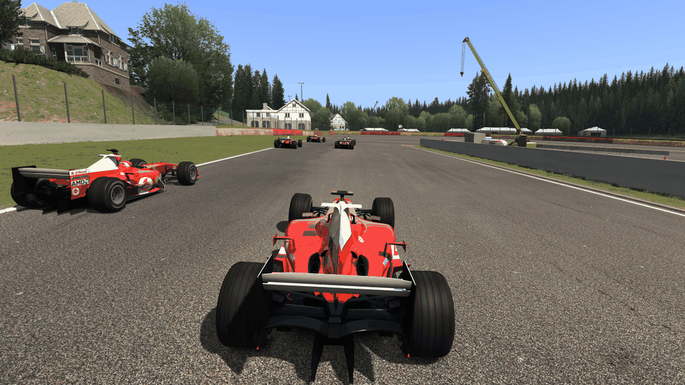
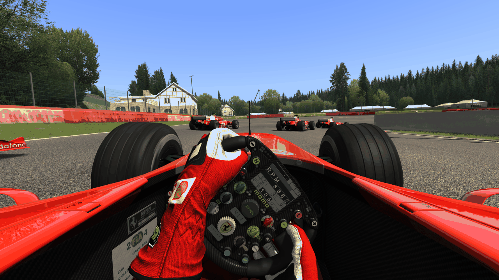

# AI drivers (Task 27)

## Resume here

State: **done**, v0.27.0. Every proof of section 5 is identical; nothing is half-wired. What is left is listed under "Not done".
(Task 28b, v0.28.1, fixed one case these proofs did not have: an AI driver behind a car that sleeps reads its speed as exactly 0, because the sleeping rule stops the body inside the car's own step. The engine now runs the first part of every car's step in the cars' order before the parallel part. See `docs/port/pit_stops.md`.)

- The port: `crates/rustyac-physics/src/ai/` (`driver.rs` = `AIDriver`, `awareness.rs` =
  `stepCarsAwareness2`, `engineer.rs` = the `RaceEngineer` parts, `car_ext.rs` = the `Car`
  parts, `drag.rs` = `AIDriverDrag`, `oracle.rs` = the column table of the comparison),
  `track/ai_line.rs` (the rest of `AISpline`, `AISplineRecorder`, old line versions, side
  CSVs), `msvc_sort.rs`, the engine's AI step (`engine/mod.rs`: `step_cars`, `set_session`,
  `deliver_forced_positions`), the recording (`engine/record.rs`: `AiMeta`, AI columns).
- The game: `crates/rustyac-game/src/sim.rs` (`Driver::ai`, `GameSim::start_ai`,
  `hand_over`), `input_file.rs` (`OpponentDrive::Ai`, `AiSetup`, `event::AI_ON`), `cli.rs`,
  `conditions.rs` (race.ini's cars), `desktop.rs` (Ctrl+C).
- The oracle: `tools/car_oracle/src/game/multi.rs` (`Drive::Ai`, `Drive::Drag`, the `ai_*`
  scenarios), `car_oracle multi --ai-line`.
- Every proof again: `sh re/scratch/task27/final.sh` (about 12 minutes; delete
  `re/scratch/task27/final/` first, a finished label is skipped), then
  `python re/scratch/task27/fill_report.py "<state>"` rebuilds this file from
  `re/scratch/task27/report_template.md` and the logs. One recording against the port as it
  is now, without the game: `sh re/scratch/task27/t.sh oracle/t27f/<label>/<scenario>.mcrec
  0,1,8`. What the drivers of a recording did: `python re/scratch/task27/events.py <mcrec>`.
- Briefs read from the machine code (git-ignored): `re/scratch/task27/spec_spline.md`,
  `spec_harness.md`; listings in `re/scratch/task27/asm/`.

## 1. Summary in plain English

Assetto Corsa's computer drivers now drive in rustyAC, and they are the game's own: the
code of `AIDriver` and everything it leans on was translated from `acs.exe` one function
at a time, and then the game's own AI was run inside the test harness beside the port.
Both start from the same grid with the same random seed and are never corrected; after
every one of the 333 physics steps a second, every number of every car is compared (the
pedals and the wheel the driver chose, every body, the tyres, the engine, and 77 of the
driver's own inner values). In all of the runs below they are identical, bit for bit:
single cars for whole laps, races of 2, 6 and 12 cars with overtakes, cars side by side
and cars hitting each other, a practice session with three pit stops, a drag race, slow
and aggressive drivers, a track whose line is in the old file version, and a car that is
handed to the AI in the middle of a drive.

What that means for playing:

- A Content Manager session with AI opponents just works: `rustyac.exe` reads the game's
  `race.ini`, spawns the opponents (Task 24b) and gives each of them AC's AI driver with
  the level and the aggression of the file. They race you and each other.
- `--opponent <car>:ai`, `--ai-cars <n>`, `--ai-level`, `--ai-aggression` do the same
  without Content Manager.
- Ctrl+C hands your own car to an AI driver, as in AC ("Activate AI"); `--ai-drive` (or
  `INPUT_METHOD=AI` in controls.ini) lets it drive from the start.
- The drivers have their random side like AC's (mistakes, a varying pace, a reaction time
  at the start). In rustyAC a session is still repeatable: the same seed gives the same
  race with any number of processor threads, and a recorded drive replays exactly.

Two things are different from AC on purpose and one by necessity:

- AC with its physics thread pool (its default on a PC with 4 or more cores) is not
  repeatable at all with AI cars: each driver draws random numbers from whichever thread
  happens to step its car, and reads other cars that other threads are changing. rustyAC
  behaves like AC **without** the pool, which is the only setting in which AC can be
  compared, and does so with any number of threads.
- rustyAC never writes into the game's folder. AC rewrites an old AI line as version 7 and
  saves recomputed track limits; rustyAC works both out in memory every time it loads the
  track.
- There is no race direction yet (no end of the race, no results, no drag-race lights):
  the drivers race for as long as the session runs. See "Not done".

## 2. What is ported

All addresses are `acs.exe` 1.16.4. "1:1" means translated from the machine code and the
decompiler's output, in the game's operation order, and checked against the game.

| Part | Game | Port | Notes |
|---|---|---|---|
| The driver | `AIDriver::AIDriver` 0x140298c60, `acquireControls` 0x14029baa0 | `ai/driver.rs` `AiDriver::new`, `acquire` | every `rand()` of the constructor in its order; `ai.ini`, `ai_tyres.ini`, `tyres.ini`, `setup.ini`, the AI setup file |
| Per step | `stepPushVariations` 0x1402a1f20, `stepSetup` 0x1402a2020, `stepHumanizer` 0x1402a19e0, `stepSplineSelection` 0x1402a2240, `stepPitLaneMode` 0x1402a1d00, `stepSinOffset` 0x1402a2170, `stepSuperhuman` 0x1402a2a60 | same names in `driver.rs` | the body forces (`useMagicForces`), `Tyre::absOverride`, the stability control's gain |
| Every 5th step | `getDistanceToNextCorner` 0x14029d250, `updateCurrentSplinePos` 0x1402a3200, `stepSteer` 0x1402a2630 with `getSteerAtDistance` 0x14029de70, `stepGears` 0x1402a1710, `stepGasBrake` 0x1402a08e0 with `getLABraking` 0x14029d650, `stepGasBrakeStart` 0x1402a1580, `updateTyres` 0x1402a32f0, `findTyreForQualify` 0x14029c9f0, `stepTurbo` 0x1402a30c0, `stepDRS` 0x1402a0850, `stepKers` 0x1402a1bb0, `stepP2P` 0x1402a1c20, the retire / teleport branch | same names | `Tyre::aiMult` (1.2, or 1.001 on the throttle); `getLateralPush` 0x14029dd10, `getOutsideOffset` 0x14029ddd0, `getCornerRadiusHint` 0x14029d0b0, `getClosestFollowingCarTTI` 0x14029cf70 |
| Other cars | `stepCarsAwareness2` 0x14029f8d0, `getEngagedDesiredOffset` 0x14029d3e0, `calcMinForwardSides` 0x14029c4f0, `getDistanceToApex` 0x14029d130, `Car::getEngagement` 0x140270660, the opponents' `std::sort` 0x1402980a0 | `ai/awareness.rs`, `AiStepInput::engagement`, `msvc_sort.rs` | sorted by time to impact with the compiler's own (unstable) sort |
| Session and strategy | `onNewSession` 0x14029f140, `selectTimeStartTime` 0x14029f7a0, `generatePitStopStrategy` 0x14029cb70, `generatePitlaneWait` 0x14029cd20, the lap handler 0x14029b1e0, `initTyreStrategies` 0x14029e600, `initSetup` 0x14029e250, `getVKMForMult` 0x14029e190 | `driver.rs`; `ControlsProvider::on_new_session`, `on_forced_position`, `on_lap_completed` | the collision handler of the game is empty |
| The drag driver | `AIDriverDrag::AIDriverDrag` 0x1402ab740, `acquireControls` 0x1402ac1f0, `stepSteer` 0x1402ac790, `stepGasBrake` 0x1402ac430, `stepGasBrakeStart` 0x1402ac520, `stepGears` 0x1402ac5d0, `getSteerAtDistance` 0x1402ac350, `setStartTime` 0x1402ac3d0, the line it lays (lambda 0x1402abf80) | `ai/drag.rs` | `InterpolatingSpline::calculateLinear` 0x1401f0580 for its straight line |
| The engineer | `RaceEngineer::evalLateralGrip` 0x14027a510, `evalLateralGFromLoads` 0x14027a260, `evalTyreLoad` 0x14027a9e0, `evalAvailableBrake` 0x140279f50, `getOptimalBrake` 0x14027c320, `getMaxBrakingForce` 0x14027c1f0, `getTorqueToGripRatio` 0x14027ca60, `projectCarForwardForceAtGas` 0x14027cc20, `getAccelerationProfile` 0x14027b550, `projectWingsLift` 0x14027cdc0, `projectWingsDrag` 0x14027ccf0, `getWeightDistribution` 0x14027cb90, `getDrivingTyresSlip` 0x14027bc20, `getLeftDrivenTyre` / `getRightDrivenTyre`, `findTyreCompound` 0x14027b3a0, `getCompoundDY` 0x14027bbf0, `evaluateFuelPerLapFromTrackSpline` 0x14027ac60, `getMaxSpeedFromGear` 0x14027c240 | `ai/engineer.rs`, `ai/car_ext.rs` | the fuel estimate is `Car::expectedFuelPerLap`; the game's number is in every recording and the port's must equal it |
| The car's side | `Car::setFuelForLaps` 0x140275b60, `getFuelPerLap` 0x140270bd0, `getPitstopTime` 0x140271e60, `initPitstopTimings` 0x140274020, `resetSplineLocator` 0x140275960, `getCGHeight` 0x1402703b0, `evOnForcedPositionCompleted`, `FuelLapEvaluator` inside the car, `Engine::getTorqueAtRPM` 0x140285d10, `getSafeTurboLevel`, `AeroMap::getCurrentLiftKG` / `DragKG`, `Autoclutch::setDownshiftProfile` 0x14029f840, `Kers::getDischargeTimeS` | `ai/car_ext.rs`, `car/chassis.rs`, `car/engine.rs`, `car/aero.rs`, `car/shift_assists.rs`, `car/kers.rs` | |
| The line | `AISpline::load` 0x1402a8390 (`calculateRadius` 0x1402a6420, `initStraights` 0x1402a8130), `calculateNormals` 0x1402a5e10, `getCornerRadiusAt` 0x1402a6bb0, `getDistToCornerFwd` / `Rev` 0x1402a6df0 / 0x1402a70f0, both `getPointWithOffset` 0x1402a7560 / 0x1402a7900, `getSidesAtPos` 0x1402a7a20, `getSlimPayloadAt` 0x1402a7af0, `payloadAtSplineIndex` 0x1402a95b0, `isInStraight` 0x1402a82f0, `initPitlane` 0x1402a7f70 | `track/ai_line.rs` | everything the file stores about radius, grade and corner distances is thrown away by the game at load and worked out again; normals, camber and grip come from three ray casts per point |
| Old line versions | `AISpline::loadVersion6` 0x1402a85b0 and what `AISplineRecorder::save` 0x140296ae0 does before it writes version 7: `calculateRadius(5)`, `buildSides` 0x1402a5630, `cleanSpline` 0x1402a6a20, `closeSmooth` 0x1402a6b80 (`bezierEndopoint` 0x1401ef720, `calculateNthBezier` 0x1401f0700, `adjustPayloadEndpoint` 0x1402a5330), a new grid | `ai_line.rs` (`AiSplineRecorder::load`), `spline.rs` `init_ai_spline` | versions 0 to 6; in memory only. Task 18 refused these lines; they load now |
| Hints, pit lane, side files | `AISplineRecorder::load` 0x1402952c0, `loadPitLaneSpline` 0x140296200 (the attach point), `loadHints` 0x140295670, the four hint queries, `recomputeSidesFromCsv` 0x140296870 with `loadSideSpline` 0x140296480, `Spline::loadFromCSV` 0x1401ee3c0, `linearProjection` 0x1401f3040 | `ai_line.rs` | `HINT_n`, `BRAKEHINT_n`, `MAXSPEED_n`, `DANGER_n` |
| Installing a driver | the `RaceManager` closure 0x140133e00 (`basePush`, `aggression`), `CarAvatar::initControls` 0x1400d6f30 (`INPUT_METHOD=AI`), the `Sim` closure 0x140195b40 ("Activate AI") | `conditions.rs` `race_cars`, `sim.rs` `start_ai`, `hand_over` | |

The locator (`SplineLocator`) was ported in Task 12 and matched the game already; its
`resetToClosestPoint` 0x1402ab530 is new.

## 3. How a driver sees the other cars, and threads

In the game a driver is asked from inside its car's `Car::step`. Without the thread pool
the cars are stepped one after the other, so the driver of car 5 sees cars 0 to 4 already
stepped and cars 6 and up not yet. Reading all of `stepCarsAwareness2`, `stepPitLaneMode`,
`getClosestFollowingCarTTI` and `Car::getEngagement` shows what a driver reads of another
car: the body's place, rotation and velocity, the cached speed and power class, the
spline locator's data, and whether a tyre stands on a pit-lane surface. Of these a car's
own step changes exactly one: the pit-lane flag (a tyre's surface is found by the tyre's
ray cast). Everything else only changes in the one rigid-body step all cars share.

So `PhysicsEngine::step_cars` does this when a car has an AI driver:

1. `Car::stepPreCacheValues` for every car (as the game: all of them before any step).
2. In creation order, on the calling thread: for an AI car, the start of `Car::step` up to
   `Car::pollControls` and then the driver (`acquireControls`), with a view of every other
   car as it is now. Then the car's pit-lane flag **as its step will leave it** is worked
   out from the four rays its tyres are about to cast (the hubs do not move before the
   rigid-body step); the drivers of the cars after it are shown that value. The rays are
   kept, so the tyres' steps do not cast them twice.
3. The rest of every car's step, on the workers when there are any, as before Task 27.

Nothing in 1 and 2 depends on the number of workers and 3 never did, so the result cannot
depend on it. That it is also the game's result is what the proofs show; in addition the
engine counts every step in which a car's flag after its step was not the one the drivers
were shown (`pit_lane_mispredictions`), and every replay of every proof asserts that the
count stays 0. A black-flagged car is the one exception: the game puts it into its pit box
in the middle of its own step, so while a car is black-flagged all cars are stepped one
after the other, exactly as the game does it without its pool.

A session without an AI driver takes none of these paths.

## 4. Randomness

The game's only random source for the AI is the C runtime's `rand()`, whose state is per
thread. The drivers draw:

| Where | Draws | What for |
|---|---|---|
| `AISinOffsetData`, then `AIDriver::AIDriver` | 2 + 20 + 3, and 1 more when the car has an `ai.ini` | the weave's phase and speed, the "genome" (the pace per twentieth of the lap, 0.98 to 1.02), the tyre wear at which it pits, the first pace variation, when it starts revving on the grid, its down-shift point |
| `stepPushVariations`, every 30 to 600 s | 2 | a new pace target (level +- 4 %) and how long it lasts |
| `stepHumanizer` (not the player's car) | 4 at first, then as timers run out | when the next braking and traction mistakes come and how bad |
| `stepGasBrakeStart`, between 1 and 0.5 s before the green light | 1 every fifth step | the reaction time, 50 to 400 ms |
| `selectTimeStartTime` -> `generatePitlaneWait` | 2 (practice, qualifying) or 1 (a race stop, in `Car::getPitstopTime`) | how long it waits in its box, how many laps it does |
| `onNewSession` | 1 per wing it may set; 1 in `generatePitStopStrategy` for a two-stint race | wing angles, the first stint's length |
| `updateTyres` -> `RaceEngineer::findTyreCompound` | 1 in practice | the compound |
| `AIDriverDrag::setStartTime` | 1 | how late it starts |

**Requirement 1 (the oracle setting).** With the pool off every one of these comes from
the physics thread's one stream, in step order: the cars' drivers in creation order within
a step. The port has one stream too (`PhysicsEngine::ai_rand`, MSVCR120's generator) and
asks its drivers in the same order, so the n-th draw of a run is the same draw in both.
The oracle seeds the game's `rand()` before it makes the drivers (`srand(ai_seed)`) and the
port starts its stream from the same number; nothing else of the physics thread draws
during a step (if anything did, the streams would part and every proof would fail at the
next draw).

**Requirement 2 (any number of threads).** The drivers are asked on the calling thread in
creation order whatever the number of workers (section 3), so the stream is consumed in
the same order always. Every proof replays the port with 0, 1 and 8 workers and compares
the three runs row by row; `rustyac.exe --replay <file> --headless --state-hash
--physics-threads <n>` prints the same hash for every n.

**Where rustyAC has to differ from AC:** only from AC with a pool, which draws from as
many streams as it has threads in an order the scheduler decides.

**Seeds in recordings.** A drive's input file (`.ryin`) stores in its header everything
the drivers are made from: the session's seed (`seed`), the AI key (`ai=<player is AI>,
<laps>,<session seconds>,<start delay ms>,<AI seed>,<hand-over step>`), and every AI
opponent with its level and aggression (`opponent=<car>:ai=<basePush>,<aggression>`). The
drivers' stream starts from `seed + 27000 + AI seed + the number of new sessions so far`.
A hand-over of the player's car is a step event (`ai on`) like a gear-box toggle, so a
replay makes the driver at the same step from the same state of the stream. A live drive
takes the AI seed from the clock (as the game seeds `rand()` from the time); pictures and
unattended runs use 0 unless `--ai-seed` says otherwise. The oracle's recordings (`.mcrec`)
store `ai_seed` and each driver's level, aggression and the game's fuel estimate.

## 5. Results

Every row: the game's own `AIDriver` (or `AIDriverDrag`) in the game's own
`PhysicsEngine`, pool off, free-running from step 0, against the port free-running from
step 0, compared after every step. "Values" is the number of 32-bit values compared.
"0 / 1 / 8" is the verdict of the port's run with that many workers against the game's;
the three port runs are also compared with each other.

| Run | Cars, track | Steps | Values | Steps with contacts | 0 / 1 / 8 workers | The three port runs |
|---|---|---|---|---|---|---|
| one car, a whole lap | F2004, Spa | 42,000 | 8,988,000 | 2,518 | IDENTICAL / IDENTICAL / IDENTICAL | the same |
| one car, a whole lap (strut suspension) | BMW M3 E30, Magione | 34,000 | 8,160,000 | 0 | IDENTICAL / IDENTICAL / IDENTICAL | the same |
| one car (4WD) | Audi R8 V10 Plus, Imola | 40,000 | 8,560,000 | 0 | IDENTICAL / IDENTICAL / IDENTICAL | the same |
| one car (rigid axle, Task 17) | Ferrari 250 GTO, Mugello | 45,000 | 9,045,000 | 0 | IDENTICAL / IDENTICAL / IDENTICAL | the same |
| race from the grid, 2 cars | F2004, Spa | 20,000 | 8,460,000 | 1,548 | IDENTICAL / IDENTICAL / IDENTICAL | the same |
| race from the grid, 6 cars | F2004, Spa | 20,000 | 25,180,000 | 3,228 | IDENTICAL / IDENTICAL / IDENTICAL | the same |
| race from the grid, 12 cars | F2004, Spa | 20,000 | 50,260,000 | 3,850 | IDENTICAL / IDENTICAL / IDENTICAL | the same |
| 6 cars, level 80 to 100 from the pole back, aggression up to 95 % | F2004, Spa | 30,000 | 37,770,000 | 3,360 | IDENTICAL / IDENTICAL / IDENTICAL | the same |
| one car, AI_LEVEL 82, AI_AGGRESSION 60 | F2004, Spa | 45,000 | 9,630,000 | 1,282 | IDENTICAL / IDENTICAL / IDENTICAL | the same |
| race of six different cars | F2004, E30, R8, 250 GTO, F40, 488 GT3; Magione | 30,000 | 38,160,000 | 280 | IDENTICAL / IDENTICAL / IDENTICAL | the same |
| practice from the pit boxes, 13 minutes: pit lane, laps, pit stops | 2 F2004, Magione | 260,000 | 109,980,000 | 5,144 | IDENTICAL / IDENTICAL / IDENTICAL | the same |
| drag race (`AIDriverDrag`), levels 100 and 90 | 2 F2004, ks_drag 400 m | 6,000 | 1,518,000 | 715 | IDENTICAL / IDENTICAL / IDENTICAL | the same |
| a driven car handed to the AI after 7.2 s | F2004, Spa | 20,000 | 4,280,000 | 1,160 | IDENTICAL / IDENTICAL / IDENTICAL | the same |
| a fast lane of file version 6 (rebuilt in memory) | F2004, Vallelunga extended | 36,000 | 7,704,000 | 1,092 | IDENTICAL / IDENTICAL / IDENTICAL | the same |
| track limits worked out again from side_l/r.csv | F2004, Bahrain outer (a mod track) | 30,000 | 6,420,000 | 980 | IDENTICAL / IDENTICAL / IDENTICAL | the same |
| a car without fuel_cons.ini: the engineer's fuel estimate | F2004 copy, Spa | 6,000 | 1,284,000 | 6 | IDENTICAL / IDENTICAL / IDENTICAL | the same |

What the drivers did in these runs (from the recordings, `events.py`):

- **race6**: beside another car ("engaged") in 44,810 car-steps, slowed for a car ahead in 5,340, off its line to pass or avoid in 26,965; a car ahead was the braking target 20 times; 0 pit stops; laps per car 0, 0, 0, 0, 0, 0.
- **levels6**: beside another car ("engaged") in 41,970 car-steps, slowed for a car ahead in 11,785, off its line to pass or avoid in 32,195; a car ahead was the braking target 33 times; 0 pit stops; laps per car 0, 0, 0, 0, 0, 0.
- **field12**: beside another car ("engaged") in 101,665 car-steps, slowed for a car ahead in 28,684, off its line to pass or avoid in 73,310; a car ahead was the braking target 37 times; 0 pit stops; laps per car 0, 0, 0, 0, 0, 0, 0, 0, 0, 0, 0, 0.
- **mixed6**: beside another car ("engaged") in 48,205 car-steps, slowed for a car ahead in 13,480, off its line to pass or avoid in 23,230; a car ahead was the braking target 17 times; 0 pit stops; laps per car 1, 0, 0, 0, 0, 0.
- **practice2**: beside another car ("engaged") in 8,220 car-steps, slowed for a car ahead in 875, off its line to pass or avoid in 8,940; a car ahead was the braking target 61 times; 3 pit stops; laps per car 13, 10.

The comparison can fail: `multi-check --fault 9000:3` flips one bit of one body of car 3
before step 9000 of the six-car race; the replay then reports
`DIFFERENT at step 9000 car3.body0.lvel.z`.
The golden test (`cargo test --release -p rustyac-physics --test ai_drivers`) replays the
first 3,000 steps of the two-car race against the game's row hashes with 0 and 3 workers,
and fails as it must when the drivers' seed is changed by one. It needs Assetto Corsa's
folder: NOT TESTED without it.

**Sessions without AI drivers are unchanged.** `re/scratch/task27/same.py`: 39 recorded
single-car drives (every fourth of `oracle/game/*.ryin`: all car types, tracks, contacts,
conditions) replayed by the v0.26.1 `rustyac.exe` and by the new one give byte-identical
state dumps (39 same, 0 different); a six-car session with line followers gives the same
state hash in both (`9a84f574d435ea04`); all 266 tests of the workspace pass. The one
intended change is on tracks whose `side_l.csv` / `side_r.csv` are newer than their AI
line (five layouts of two mod tracks on this PC): the track limits are now worked out from
those files as the game does.

In `rustyac.exe` itself: a recorded race of six cars (five AI opponents, the player's car
handed to an AI driver after 5 s) replays to the state hash `319674871e6d837d` with 0, 1
and 8 workers; two live runs of the same command record the same inputs step for step.

## 6. How to race the AI

**A Content Manager session.** Set up a race (or practice, or a weekend's first session)
with AI opponents in Content Manager and start it once in AC so that it writes
`Documents\Assetto Corsa\cfg\race.ini`; or just leave the file of your last AC session.
Then:

```
rustyac.exe
```

reads that file: your car and track, the opponents with their skins on their grid slots or
pit boxes, `[RACE] AI_LEVEL`, each car's `AI_LEVEL` and `AI_AGGRESSION`, the laps. Every
opponent gets AC's AI driver. (`--car` and `--track` still choose your car and track as
before; `--no-race-cars` leaves the opponents out; `--stand-in-drivers` gives them the old
line follower.)

**Without Content Manager.**

```
rustyac.exe --car ks_ferrari_f2004 --track spa --no-race-ini --ai-cars 6
rustyac.exe --car bmw_m3_e30 --track magione --no-race-ini --opponent bmw_m3_e30:ai --opponent ks_ferrari_488_gt3:ai --ai-level 92 --ai-aggression 40 --race-start-in 5
rustyac.exe --car ks_ferrari_f2004 --track spa --no-race-ini --ai-cars 4 --spawn pit
```

The first is a race of six F2004s from the grid, the second a race against two named cars
with level 92, aggression 40 and the green light after 5 s, the third a practice session
that starts in the pit boxes (the drivers wait a random time, at most two minutes, drive
out along the pit lane, do their laps and come back in, as in AC).

| Option | Meaning |
|---|---|
| `--opponent <car>[:<skin>]:ai` | another car with AC's AI driver (repeat it) |
| `--ai-cars <n>` | n cars in all: copies of your car with AI drivers |
| `--ai-level <0..100>` | `AI_LEVEL` for every driver (default: race.ini's, else 100) |
| `--ai-aggression <0..100>` | `AI_AGGRESSION` (default: race.ini's, else 0) |
| `--ai-laps <n>` | the race's laps as the drivers are told them: they fuel for them (default: race.ini's, else 5) |
| `--race-start-in <s>` | the green light s seconds after the session's start; the drivers rev and wait with their reaction times |
| `--ai-drive` | an AI driver drives your car from the start (also `INPUT_METHOD=AI` in controls.ini) |
| Ctrl+C while driving | AC's "Activate AI": an AI driver takes your car (`[ACTIVATE_AI] KEY` of controls.ini when it is set). As in AC there is no key back; N (a new session) gives you the car again |
| `--ai-at <s>` | the same hand-over after s seconds, for unattended runs |
| `--ai-seed <n>` | the start of the drivers' random numbers |
| `--stand-in-drivers` | race.ini's other cars with rustyAC's line follower instead |

With AI cars and no session in race.ini the session is a race from the grid (`--spawn
start`), or practice with `--spawn pit`.

An AI setup is used as in AC: `Documents\Assetto Corsa\setups\<car>\<track>\ai_default.ini`,
else `system\setups\<car>\<track>\ai_default.ini` of the game's folder (both only read).



*Six F2004s driven by AC's AI, 7 s after the green light at Spa, from behind the last of
them (`--ai-cars 6 --ai-drive --race-start-in 2 --at 8.9 --focus 5 --camera chase`).*



*The same race a second later from the cockpit of the last car: the AI turns into La
Source behind three others, a fourth beside it.*

## 7. Performance

This PC (the Radeon Pro 5500M, 8 logical processors; `acs.exe` not running), F2004s at
Spa, every car driven by AC's AI (yours too: `--ai-cars <n> --ai-drive --race-start-in 2`),
a race from the grid.

Physics alone (`--replay <recorded race> --headless --state-hash --physics-threads <n>`,
as fast as it goes; a step lasts 3 ms in real time):

| Cars | Step, no workers | 4 workers | 8 workers | Share of a step's 3 ms | Same state hash |
|---|---|---|---|---|---|
| 6 | 0.36 ms | 0.39 ms | 0.40 ms | 12 % | yes |
| 12 | 0.71 ms | 0.68 ms | 0.69 ms | 24 % | yes |
| 24 | 1.42 ms | 1.38 ms | 1.36 ms | 47 % | yes |

With the picture (`--headless --duration 30 --bench-render --camera chase`, AC's renderer
off screen at 1280 x 720, the settings of this PC's video.ini, not waiting for a display):

| Cars | Step avg / max, no workers | FPS | Step avg / max, the game's default workers | FPS |
|---|---|---|---|---|
| 6 | 0.38 / 3.4 ms | 281 | 0.44 / 2.3 ms | 243 |
| 12 | 0.79 / 2.8 ms | 187 | 1.03 / 5.2 ms | 159 |
| 24 | 1.72 / 4.8 ms | 128 | 1.58 / 5.3 ms | 124 |

- 24 AI cars run in real time here with half of the physics budget to spare; single steps
  reach 5 ms when many cars touch (the physics thread catches up in the next steps).
- The workers buy almost nothing with AI cars: the drivers are asked one after the other
  (they have to be, section 3), and the one collision pass and rigid-body step for all cars
  is serial as in the game; only the cars' own steps are spread. Beside the renderer's
  thread the workers even cost a little on this machine. `--physics-threads 0` is
  the better setting here for an AI race; the result is the same either way.

## 8. Not done

- **Race direction.** rustyAC has no `RaceManager`: a race has no end, no results, no blue
  flags, and the picture's start lights (`--start-lights`) are not tied to
  `--race-start-in`. The drivers are told the race's laps (their fuel and their stints
  follow from them) and go on racing after the last one.
- **A drag race in `rustyac.exe`.** `AIDriverDrag` is ported and proven against the game,
  but nothing in the game crate uses it: there is no drag mode (`DragMode` lays the tree's
  times and calls `setStartTime`). `--opponent <car>:ai` on `ks_drag` gives the circuit
  driver, which finds no line there.
- **Recording a line.** `AISplineRecorder::step` / `startRecording` / `onLapCompleted` /
  `save` as the developer app `FormAI` drives them (a new `fast_lane.ai` from a driven lap,
  the `.candidate` files), and `FormAI` itself (it also shows `ai.ini`'s `TRAIL_HINT` and
  `ULTRA_GRIP`, which the driver never reads).
- **The AI setup file against the game.** `initSetup` is ported (the two places, the
  `SetupManager::load`) but the oracle gives the game an empty Documents folder and no car
  here has a `system/setups/.../ai_default.ini`, so the path was never exercised against
  the game.
- **The browser.** The AI code has no Windows code and passes clippy for both wasm
  targets, but the page has no option for AI cars yet, and the four double-precision
  functions the line's start-up maths uses (`asin`, `acos`, `tan`, `pow`) fall back to
  Rust's own there (open question 3).
- **Online.** A server's cars are players; AC has no AI on a client and none was added.
- **Back to manual by a key.** AC has no "AI off" either (a hard-coded P key puts a pad
  driver in); in rustyAC a new session (N) gives the car back.
- **The lap list of the other cars.** The AI cars' laps are timed (their drivers need
  them) but not shown: the lap displays are still the player's only.

## 9. Open questions

1. **`AIDriver::accidentStopCounter` is never written by the game**, not even by the
   constructor, and the collision handler that would set it is an empty function. In the
   game it is whatever the heap held (`new AIDriver`); a positive value would make the
   driver stand on the brakes until it counts down. The oracle zeroes the object before the
   constructor runs and the port has 0. Choice made: 0.
2. **The genome has 20 genes and the game reads gene 20** when the car is exactly at lap
   position 1.0 (`(int)(npos * 20)` clamped to 0..20): that is the next member,
   `useMagicForces` with three bytes of padding, a number near zero that would stop the
   car for that one decision. The port reads the same bytes as the game has them after its
   constructor (the flag and zeroed padding). It never happened in a run.
3. **MSVCR120's double-precision `asin`, `acos`, `tan`, `pow`** are called through the
   DLL on Windows (as the other maths is). Without the DLL (the browser) Rust's own are
   used, so a corner radius of the line can differ in its last digit there, and an AI
   driver would then not be bit-identical to the desktop's. Rewriting the four from the
   DLL (as `pure.rs` did for ten others) is the cure; not done because no browser AI
   exists yet.
4. **The level of race.ini is taken as the game takes it**: `[RACE] AI_LEVEL / 100`, times
   `[CAR_n] AI_LEVEL / 100` when that key is not 0. Content Manager writes per-car levels
   only when its "AI level range" is on; the oracle test of Task 24b covers the reading.
5. **The session the drivers are told.** In the game the drivers are made while the
   engine's session is still "undefined" (type 0), which their constructor treats like
   practice (they pick the pit lane's line and a waiting time and fill the tank for it);
   the new-session event and the placing on the grid then set them right. `rustyac.exe`
   goes through the same three stages in the same order, with the session of race.ini (or
   race / practice by `--spawn`), `[SESSION_0] LAPS` and `DURATION_MINUTES`. A session
   type other than practice, qualifying or race (hot lap, time attack, drift) leaves a
   driver in its constructor's pit-lane mode with a wait of up to two minutes: that is the
   game's behaviour for a set-up it never makes itself.
6. **AC's "new AI behaviour" of Custom Shaders Patch** (and any other patch of the AI) is
   not part of `acs.exe` and not ported; the user's `f2004_spa_ai.csv` was recorded with
   CSP and is no reference for these drivers.
7. **`data/ai_corners.ini` and the `*.csv` hint curves of some tracks' data folders**
   (Magione has both) are read by nothing in `acs.exe`.
8. **The subagents' rule.** Three readers (Sonnet, high effort) were asked for one brief
   each, written into `re/scratch/task27/`, which I took to be within "reading and
   reviewing only". Two delivered (the line's formats; the random draws, the step order and
   what the oracle needs); both reported writing a few helper files (one in the repository
   root, one under `/tmp`) and deleting them again, against their brief. Nothing of theirs
   is in the repository or was left behind. The third (the engineer and the awareness
   code) had written nothing after 90 minutes and was stopped; I read those functions
   myself. One brief was wrong about the engine's first session type (-1 instead of 0);
   the oracle showed it at once.
