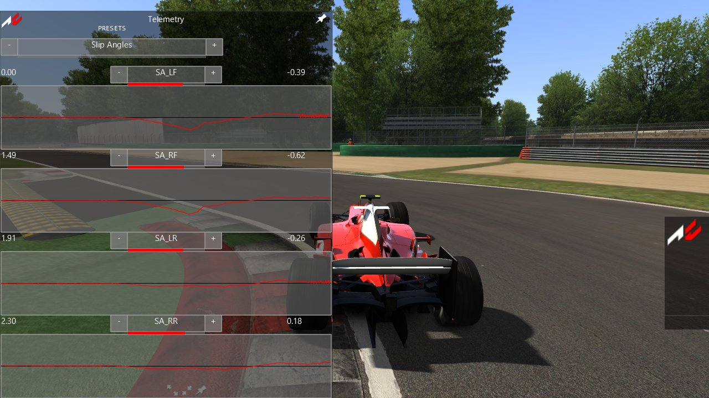
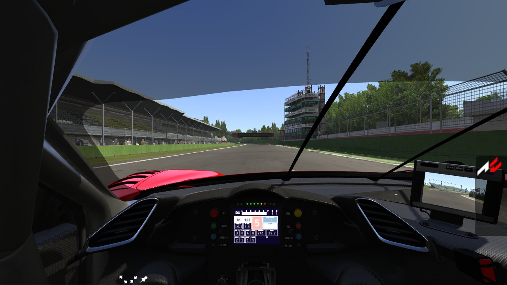

# Task 33b: the car-data apps and the dashboard panels

## Resume here

- Item 1 (digital panels, `RPM_GRAPH`, `DELTA_GRAPH`, `GEAR_TX`): **done.** It was already ported in
  Task 22; `DELTA_GRAPH` was the one item no proof had reached, and it is now proven (table 1).
- Item 2 (FormTelemetry): **done.** The app, its presets and `cfg/telemetry_user.ini`, in the GUI
  oracle (table 2) and in rustyac.exe (the physics thread records the channels while the app is shown).
- Item 3 (car-data apps): TyreWearingDebug and SetupDebug **done** (table 3). Next: CarPhysicsForm,
  ACDCarEngineer, then the 3D ones (ACSuspension, FormWings), TyreTesterForm.
- GUI proofs: `sh re/scratch/task33b/cmp.sh app_telemetry` (root `re/scratch/task33b/root`).
- Scratch: `re/scratch/task33b/` (git-ignored). Scene proofs: `sh re/scratch/task33b/scene.sh [filter]`,
  results in `re/scratch/task33b/scene_result.txt`.

## In plain English

(Filled in at the end.)

## Which cars have digital panels and the three items

Every installed car was looked at: the 138 already in `cardata/` and the others that ship a `data.acd` or
a `data` folder (extracted into `re/scratch/task33b/cardata/`, git-ignored). 70 Kunos DLC folders have no
car data at all (the DLC is not installed) and could not be read.

| What | Cars |
|---|---|
| `digital_panels.ini` | `vrc_formula_lithium_2023`, `vrc_formula_lithium_2023_csp` (and the test car `lithium_ers_front`) |
| `texture/display_panel/` | `rss_formula_hybrid_2020`, `vrc_formula_lithium_2023`, `vrc_formula_lithium_2023_csp` |
| `RPM_GRAPH` | `ferrari_599xxevo`, `formula_k`, `gt3_multilink`, `ks_ferrari_488_gt3`, `ks_mazda_787b`, `ktm_xbow_r`, `tatuusfa1`, `bdc_streetspec_aristo_v4`, `vrc_1988_mclaren_mp4-4_r02`, `_r04`, `_r09`, `_r10`, `vrc_formula_beta_2024` |
| `DELTA_GRAPH` | none |
| `GEAR_TX` | `ks_lamborghini_aventador_sv`, `ks_lamborghini_huracan_performante`, `ks_pagani_huayra_bc` |

The Formula Lithium's `digital_panels.ini` names a parent node its models do not have, so nothing of it is
drawn in either program (Task 22 found this); its proof uses a made-up file
(`re/scratch/task22/cars/lithium_panels/`). No car uses `DELTA_GRAPH`, so its proof uses the 488 GT3 with
a made-up `digital_instruments.ini` (`re/scratch/task33b/cars/488_delta/`): its first item turned into a
`DELTA_GRAPH` (`DIRECTION=0`, `DELTA_MAX=1.5`) and one more `DELTA_GRAPH` added (`DIRECTION=1`,
`DELTA_MAX=0.75`, orange).

## What is ported, with the game's addresses

### Item 1: digital panels and the three display items (Task 22)

- `DigitalPanels` (0xd8 bytes; constructor 0x1400820f0, `initPanels` 0x140082740, `update`
  0x140083f70) and `DisplayNode` (0x168; `render` 0x1400f74a0, `drawBase` 0x1400f6fb0,
  `drawBaseInverted` 0x1400f70e0, `drawTop` 0x1400f7210, `drawTopInverted` 0x1400f7360):
  `crates/rustyac-render/src/panels.rs`.
- `RPM_GRAPH`, `DELTA_GRAPH`, `GEAR_TX` in `DigitalInstruments`: `crates/rustyac-render/src/digital.rs`.
  `DELTA_GRAPH` reads the PerformanceMeter (`CarPhysicsState::performance_meter`, fed by Task 33's
  `performance_meter.rs`); `DIRECTION` picks the plain or the inverted drawing, `DELTA_MAX` the full
  scale, `DEBUG` above 0 draws it full.

### Item 2: FormTelemetry (the developers' "Telemetry")

`crates/rustyac-gui/src/app_telemetry.rs`: `FormTelemetry::FormTelemetry(CarAvatar&)` 0x14032f660,
`render` 0x140335b50, `~FormTelemetry` 0x1403306a0, `initChannels` 0x140332ff0, `applyPreset`
0x1403327d0, `getValuesFromPhysics` 0x140332ef0, `getValuesFromGraphics` 0x140332e10, the handlers
0x1403317f0 (a graph's spinner), 0x140331740 (presets), 0x1403316e0 (`OnPhysicsStepCompleted`: a
sample at most every 12 ms of physics time, only while the form is visible). Four graphs of 500 values,
each with a spinner over every channel (the map's sorted names), its live and smoothed value
(smoothing 0.003 a sample); the presets of `system/cfg/telemetry_presets.ini`; the preset of the
Documents' `cfg/telemetry_user.ini` at the start (none there: the first preset), written back to
rustyAC's own cfg when the game ends.

The channels: 104, plus `AWD2_LOCK` on an AWD2 car and `ARB_FRONT` / `ARB_REAR` with a dynamic anti-roll
bar controller (these two range themselves: min and max both 0). Every channel's min, max, scale,
physics-or-graphics flag and frame skip is checked against the game's own map in the oracle.

In rustyac.exe the physics thread reads each channel after every step while the app is shown
(`view::telemetry_values`); the display hands the steps to the app each frame and the newest step's
values are what it reads for the graphics channels.

**Channels with no source in rustyAC (they show 0):** `AI_PUSH`, `AI_LIVE_OFFSET`, `AI_DIST_CORNER`
(the player's car has no AI driver in rustyAC's telemetry path), `ERS_TORQUE`, `OVERSTEER_FACTOR`,
`STEER_DEG_*` (the game's `getWheelSterAngleDEG`), `SKID_VOL_*` / `SKID_PITCH_*` (the sound's skid
voices live on the audio thread), `FF_FINAL`, `RIDE_HEIGHT_F` / `RIDE_HEIGHT_R`. The others read the
Rust car's fields that port the game's ones (`TyreStatus`, `TyreInputs::brakeTorque`, the thermal
model, `SuspensionStatus`, the drivetrain's clutch torque, root velocity and AWD2 lock, the ERS, the
brake discs, `Car::lastFF`, `accG`, the water temperature, the anti-roll bars' `k`). The values of each
channel were not compared with the game's car (the oracle feeds both sides the same made-up values).

### Item 3: the car-data apps

- `TyreWearingDebug` ("Tyre debug", `crates/rustyac-gui/src/app_tyre_debug.rs`): ctor 0x140319960,
  `render` 0x140319b10. Per tyre of the physics engine's first car (the player's, whatever the focus):
  `virtualKM`, the wear curve's value there times 100, the core temperature, whether the thermal model
  is active, one five-line string per tyre in the GUI's default font. It sets that shared font's size
  to 15 every frame, so every control drawn with the default font is 15 from then on, as in the game.
  rustyac.exe: `CarView::tyre_debug` from the Rust car's tyres.
- `SetupDebug` ("Setup debug", `crates/rustyac-gui/src/app_setup_debug.rs`): ctor 0x140317a80,
  `render` 0x140318010, `printString` 0x140317cb0, `printStringList` 0x140317d90 (every number floored
  to four decimals, then `%g`), `vec3f::toString` 0x1400533f0. Its own red Consolas 20; the focused
  car's physics state and of its `Car`: static tyre pressures, wing angles, rod lengths, the forward
  gears' ratios, the final ratio, the compound's name. rustyac.exe: the physics thread fills
  `view::setup_debug` after each step while the app is shown (the player's car: rustyAC's focus moves
  only the camera, the game's app reads the focused car's `Car`).

Item 1: scene sequences of the render oracle (`render_oracle compare`): the game's own car objects and
the port's draw the same car on WARP, the command logs and the pixels compared every frame.

Item 2: GUI sequences of the render oracle (`render_oracle gui`): the game's own `FormTelemetry` is built
on a stand-in car (an `Engine` with the game's vtable for `getLimiterRPM`, a clutch torque, AWD2, both
anti-roll bar controllers ready), its channel map is walked and checked against the port's table, then
each channel is pointed at a value the sequence writes; physics steps go through the game's own
`OnPhysicsStepCompleted` handler (five a frame, 3 ms apart). The port gets the same values. Command
logs, WARP pixels, control state and events are compared every frame. The game's `telemetry_user.ini`
is read from the oracle's own Documents folder; the form is never destroyed, so the game writes nothing.

Item 3: GUI sequences, as item 2. TyreWearingDebug: the game's form reads a stand-in `Car` placed in
`PhysicsEngine::cars`, whose tyres carry the game's own wear `Curve` (built with `Curve::Curve` and
`addValue`); the port computes the wear value with rustyAC's `Curve` from the same points, so the curve
lookup is compared too. SetupDebug: one stand-in `Car` behind every avatar's race engineer, with
wings, suspensions and gears the sequence writes each frame; the physics state comes from the tapes,
as for the other apps.

## Results

### Table 1: digital panels and display items

| # | Sequence | Frames | Command log | Pixels |
|---|---|---|---|---|
| 1 | imola, 488 GT3 with two `DELTA_GRAPH` items; delta -2, -0.4, 0, 0.3, 1.2, 4 s | 35 | identical | identical |
| 2 | magione, Formula Lithium with a made-up `digital_panels.ini` (race position, push-to-pass, `P2P_DASH`, `POSITION_CAR`), pause at frame 30 | 39 | identical | identical |
| 3 | imola, 488 GT3, `RPM_GRAPH` through its range, TC 3, ABS 5 | 29 | identical | identical |
| 4 | magione, Aventador SV, `GEAR_TX` through R, N, 1, 4 (the neutral delay) | 49 | identical | identical |

### Table 2: FormTelemetry

| Sequence | What happens | Frames | Command log | Pixels | State and events |
|---|---|---|---|---|---|
| `app_telemetry` | no `telemetry_user.ini` (preset 0, Slip Angles); each graph's spinner forward and back, the presets forward; hidden and shown | 388 | identical | identical | identical (36 events) |
| `app_telemetry_user` | `telemetry_user.ini` says AI Debug; graph 0 forward onto `ARB_FRONT` (auto range), back, forward; hidden and shown | 434 | identical | identical | identical (12 events) |

### Table 3: the car-data apps

| Sequence | What happens | Frames | Command log | Pixels | State and events |
|---|---|---|---|---|---|
| `app_tyredebug` | four tyres, the distance past the curve's end, temperatures through %g's shapes, the thermal model on and off; hidden and shown | 428 | identical | identical | identical |
| `app_setupdebug` | negative and fractional values through the four-decimal floor, three wings, six gears; the focus to car 2 at frame 900; hidden and shown | 428 | identical | identical | identical |

## Pictures

Taken on the user's graphics card with `rustyac.exe --screenshot`.

| | |
|---|---|
|  |  |
| The Telemetry app, Slip Angles, Monza's first chicane (F2004, `--dev-apps --gui-do app:telemetry --at 34 --lead-in 6`) | The 488 GT3's display with its `RPM_GRAPH` bar, Imola (`--camera dash`) |

## Disk space

- Start: 39 GB free.
- End: (filled in at the end).

## Not done

(Filled in at the end.)

## Open questions

(Filled in at the end.)
