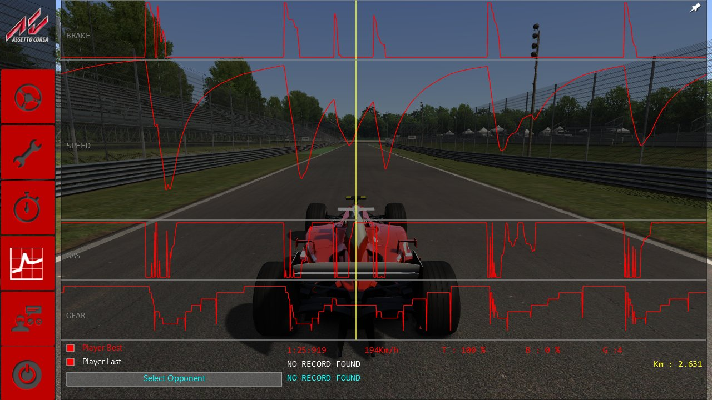
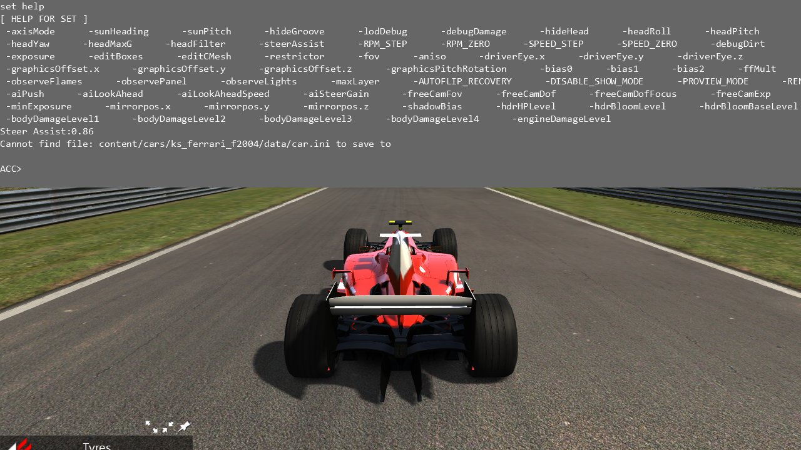
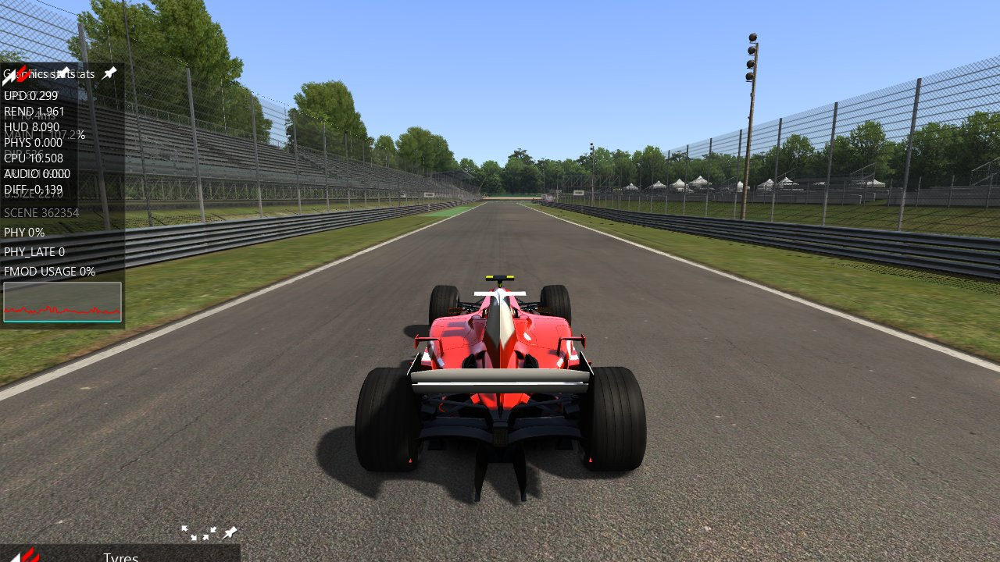

# AC's apps, part 2: telemetry, car data, stats, the console, translations (Task 33)

> **Task 38c:** the `re/scratch/task…` paths below are history: those folders were scratch and
> most were deleted in the disk cleanups of 2026-10-15 and 2026-10-18. Every proof of this report
> reruns from `tools/proofs` (`sh tools/proofs/run_all.sh`); `docs/port/proofs.md` lists each path
> and what replaces it.

## Resume here

State after the last commit (update after every commit):

- **Done and proven in the oracles:** translations; the ESC menu's Telemetry page; the
  PerformanceMeter (car oracle, every physics step); MicroSectors and Performance Delta's strip;
  the console; Render Stats and Graphics stats; Driver performances (with its records file); Race
  Fuel Monitor; SusTelemetry. All are made in `rustyac.exe`.
- **Done:** `--dev-apps` and `ENABLE_DEV_APPS`; Task 32's two answers.
- **Not done:** FormTelemetry, ACSuspension, CarPhysicsForm, ACDCarEngineer, FormWings,
  TyreTesterForm, TyreWearingDebug, SetupDebug, GPUProfilerApp, DigitalPanels and the three
  display items (see "Not done"). Their reader briefs are in `re/scratch/task33/*.md`
  (git-ignored).
- **Version:** v0.33.0, all end checks passed (see "Results").
- **End checks:** `sh tools/proofs/gui.sh` (was `sh re/scratch/task33/end_b.sh`, deleted) (every oracle sequence of Tasks 29 to 33,
  results in `re/scratch/task33/end/`), the end checks of `docs/release.md` (was `sh re/scratch/task33/end_a.sh`, deleted) (clippy, `--locked`
  builds and tests, tools, physics dumps against v0.32.0 in `re/scratch/task33/tgt_old`, the
  multiplayer tapes).

## In plain words

This task brought over the second group of AC's built-in apps, AC's developers' console and
the game's translations. As before, each piece was rebuilt in Rust statement by statement from
acs.exe and checked against the game's own code running in the oracles on the same data.

- **Telemetry:** the ESC menu's Telemetry page now works. It draws your best and last laps
  (and a lap of another driver from a `.tc` file) as speed, throttle, brake and gear graphs,
  with the values under the mouse. The Performance Delta app now shows a real delta: AC's
  `PerformanceMeter` runs in rustyAC's physics for the player's car, and its strip of 24
  micro-sectors (grey, green, purple) is drawn under it.
- **The console:** Home opens AC's console: the same panel, the same 12 lines, the same
  commands (`help`, `set`, `saveff`, `getSteerAssist`, `exit` ...), the same variable table in
  the game's order. `set` on a variable rustyAC has a counterpart for changes it (the eye point,
  the cockpit's field of view, the force feedback multiplier, the steer assist).
- **Translations:** every string of the GUI goes through the game's `acTranslate` with the
  game's `system/locales/<lang>.ini`. The menus, the setup editor and the apps were proven in
  German and Italian.
- **Stats:** Render Stats (frames per second, frame time, CPU, draw calls, triangles,
  physics, FMOD) and the developers' Graphics stats show rustyAC's own numbers, gathered the
  way the game gathers them.
- **Developers' apps:** Driver performances (0-50-0 ... 0-160-0 and 100 m ... 1 km
  timers, with their records saved in rustyAC's own `savedData\driverPerformances\`), Race
  Fuel Monitor and SusTelemetry. Developers' apps only get an icon with the game's
  `ENABLE_DEV_APPS`, or with rustyAC's new `--dev-apps`.

**Task 32's two answers:**

- rustyac.exe now reads back what the apps saved in its own `cfg\` (`car.ini`, `dash_cam.ini`,
  the wheel's effects in `controls.ini`).
- The pitch of car 0's `view.ini` now applies to every car, as in the game.

Several apps of the group are not done (the live channel graph, the suspension wireframe,
the car engineer apps, the tyre tester, the GPU profiler) and neither are the dashboards'
extra panels; see "Not done".

## The apps

| App | Class | Status |
|---|---|---|
| Telemetry page (ESC menu) | `ComparativeTelemetry` | ported, proven; the ESC menu's button works |
| Performance Delta's delta | `PerformanceMeter` | ported into the physics, proven at every step of a race |
| Performance Delta's strip | `MicroSectors` | ported, proven |
| Console | `Console`, `ConsoleSet` | ported, proven |
| Render Stats | `FormRenderStats` | ported, proven (the numbers are this PC's) |
| Graphics stats | `FormGameStats` | ported, proven (developers' app) |
| GPU profiler | `GPUProfilerApp`, `GPUProfiler` | **not done** |
| Driver performances | `ACDriverPerformance` | ported, proven, its records file proven |
| Race Fuel Monitor | `RaceFuelMonitor` | ported, proven |
| SusTelemetry | `TelemetryApp` | ported, proven |
| Telemetry (live channels) | `FormTelemetry` | **not done** |
| Suspensions | `ACSuspension` | **not done** |
| Car physics | `CarPhysicsForm` | **not done** |
| Car engineer | `ACDCarEngineer` | **not done** |
| Wings | `FormWings` | **not done** |
| Tyre tester | `TyreTesterForm` | **not done** |
| Tyre debug | `TyreWearingDebug` | **not done** |
| Setup debug | `SetupDebug` | **not done** |
| Dashboard pages | `DigitalPanels`, `RPM_GRAPH`, `DELTA_GRAPH`, `GEAR_TX` | done in Task 22 (see `apps_car_data.md`) |

## What is ported, with the game's addresses

All new `.rs` files carry the license header and the "Ported from" line.

- `crates/rustyac-gui/src/locale.rs`: `acTranslate` 0x140240cf0 (`translatedText`, one table
  for the process as in the game), `loadMainINI` 0x140240ee0 (a written `\n` in a key or value
  becomes a line break), `acLocaleSetLocale` 0x140240980 (the setup editor's tables only when
  the main table loaded; `kglSetFontLocale` zh-CN / zh-HK for chs / cht), `initLocalization`
  0x1400c15c0 (Documents `cfg/launcher.ini [WINDOW] LANGUAGE`, "en" without the file).
- `comparative_telemetry.rs`: `ComparativeTelemetry::ComparativeTelemetry` 0x14006dff0,
  `initOpponentSelectionForm` 0x140070600, `addToGraph` 0x140070570, `updateBestPlayerData`
  0x140072a40, `updateLastPlayerData` 0x140072d20, `onVisibleChanged` 0x140070cb0,
  `onMouseMove` 0x140070bb0, `render` 0x1400710f0, `renderPlayerStats` 0x140071f20, the
  handlers 0x14006fa20 / 0x14006f990 / 0x14006f970 / 0x14006f4c0 / 0x14006f390;
  `ComparativeTelemetryRecorder::getCTOpponents` 0x1400741a0 and `loadCTOpponent`
  0x140075730. `Form::setIconSize` 0x140246cb0 and a form's own `onTitleClicked` (vtable +0xa8)
  were added to the framework.
- `crates/rustyac-physics/src/car/performance_meter.rs`: `PerformanceMeter::init` 0x14026b7c0,
  `reset` 0x14026b880 (`Car::onNewSession`), `step` 0x14026b8e0 (`Car::stepComponents`, the
  player's car), `getCurrentSplit` 0x14026b700 with `TimeTransponder::isInOpenTrackTransition`
  0x140290960, `hasData` 0x14026b7a0.
- `micro_sectors.rs`: `MicroSectors::MicroSectors` 0x14009e9d0, `initialize` 0x14009fb40,
  `update` 0x14009fe20, `getSectorsPerformance` 0x14009fab0, `drawSectors` 0x14009f290,
  `CarAvatar::isInPit` 0x1400d8bd0; the call from `PerformanceMeterApp::render` 0x140303090.
- `console.rs`: `Console::Console` 0x1401888c0, the `operator<<` sinks 0x1401894b0 /
  0x1401890e0 / 0x140188f40, `addCommand` 0x14018a530, `addVar` 0x14018a6c0, `addVarLambda`
  0x14018a830, `initCommands` 0x14018aa80, `show` 0x14018c7f0, `onKeyChar` 0x14018b480,
  `onKeyDown` 0x14018b620, `parse` 0x14018bf50, `renderHUD` 0x14018c550, `onSetVar`
  0x14018b6e0, `ConsoleSet::execute` 0x14018c8f0, `OptionsManager::OptionsManager` 0x14018d470
  with `loadOptions` 0x14018da20.
- `app_stats.rs`: `FormRenderStats::FormRenderStats` 0x1402d69d0, `render` 0x1402d7540,
  `Sim::update`'s statistics block (0x14019f1e0..0x14019f660), `FormGameStats::FormGameStats`
  0x1402e7a10, `render` 0x1402e8140, `GameTime::update` 0x14044c250 (after its clock).
- `app_driver_perf.rs`: `ACDriverPerformance::ACDriverPerformance` 0x140303bd0, `render`
  0x140305d90, `updateData` 0x140307650, `renderOnVideo` 0x140305e00, `fromFloatToString`
  0x140305120, `loadDriverRecords` 0x1403052e0, `saveDriverRecords` 0x140306df0;
  `RaceFuelMonitor::RaceFuelMonitor` 0x140338250, `render` 0x140338460.
- `app_sus_telemetry.rs`: `TelemetryApp::TelemetryApp` 0x140302180, `render` 0x1403024a0.

In rustyac.exe (`crates/rustyac-game`):

- `render/gui.rs`: the language at the GUI's start; `Sim::Sim`'s `devEnabled`
  (`dev_apps_enabled`); the Telemetry page's link (the recorder's laps every frame, its best
  file read first as the recorder's constructor does, the opponents in `ctelemetry\opponents`);
  MicroSectors from `gameplay.ini [GUI] SHOW_SECTORS`; the console; the statistics (`frame_stats`,
  `frame_end`).
- `render/console.rs`: the registrations in `Sim::Sim`'s order and what each `set` and command
  does in rustyAC (see "The console").
- `render/gui_apps.rs`: the new apps in `Sim::Sim`'s order, `Sim::addForm`'s rule for
  developers' apps, the records' folder `savedData\` beside rustyAC's `cfg\`.
- `render/ac.rs`: `Game::onIdle`'s intervals (update, scene, HUD) by the frame's clock, the
  renderer's `GraphicsManager::stats` counters (`draw_primitive`, already the game's).
- `physics_thread.rs`: the last step's own time (`PhysicsDriveThread::run`'s occupancy) and
  the late-loop count.
- `view.rs`: the PerformanceMeter's two values, the pit box, the packer ranges.
- `desktop.rs`: Home, the console's `exit`; Task 32's answers (the saved car files, the wheel's
  effects, the jobs `SetFfMult` / `SetSteerAssist` at the start); `--dev-apps`, `--language`.

## How it is proven

**The render oracle** (`tools/render_oracle gui --gui <sequence>`), as in Tasks 29 to 32:

- The game's own classes are made in-process on hand-laid `Sim` / `CarAvatar` / `RaceManager`
  blocks, and the port draws the same script.
- Every frame, both sides' D3D11 command logs, WARP pixels, control states and events are
  compared.
- At the end, the files both sides wrote are compared byte for byte, and so are the "effects"
  logs (what was set in the game's objects).

New in this task:

- `<sequence>#<lang>` runs any sequence in a language: the game's own `acLocaleSetLocale` with
  its real `acTranslate` (the stand-in of Tasks 29 to 32 is left out), the port's `Locale::load`.
- `esc_telemetry` (`gui_seq_tele.rs`): the game's `ComparativeTelemetry` in its ESC menu, on a
  `ComparativeTelemetryRecorder` block among `Sim`'s game objects with the user's own `.tc`
  laps (Monza in the F2004; read only, copied into the scratch root). The script covers:
  - the mouse along the lap;
  - the two boxes off and on;
  - the opponents' folder (three files, two of this track and car);
  - a driver chosen and let go;
  - a new best and last lap, miles an hour;
  - the page closed and opened.
- `app_delta_sectors`: the game's own `MicroSectors` (its constructor, then switched on as
  `SHOW_SECTORS=1` does), updated once a frame on both sides, on the six-car race tapes.
- `console` (`gui_seq_console.rs`): the game's own `Console` with its `initCommands` on the
  first car, its `OptionsManager` reading `system/cfg/options.ini`, a `CameraForward` scene
  camera. The script types every kind of line:
  - help, set help;
  - a set of each kind (target, lambda, option callback, a callback with no effect);
  - an unknown variable and command, too few words;
  - `saveff` with a loose `car.ini`;
  - Backspace, the history past both ends, more than 12 lines;
  - typing while hidden.

  Compared at the end: the `car.ini` that `saveff` wrote, and the values the sets changed
  (`fov`, `maxLayer`, the eye point, `Car::ffMult`).
- `app_stats`: the game's `FormRenderStats` (on `Game::gameTime`) and `FormGameStats` (on
  `Game::stats`), the renderer's counters written into the game's `GraphicsManager::stats`
  after its `beginScene`, the numbers changing five times. `Sim::update`'s statistics block is
  the port's own code on both sides (the oracle cannot run `Sim::update`), so the proof covers
  the forms, not that block's arithmetic.
- `app_driverperf`: the game's `ACDriverPerformance` and `RaceFuelMonitor` on the race from
  the grid (the five seconds' wait, the runs), then the game's `saveDriverRecords` against the
  port's at the "end".
- `app_sustelemetry`: the game's `TelemetryApp` on the race tapes.

**The car oracle** for the PerformanceMeter. With `CAR_ORACLE_PERF_METER=1` the game's meter
stays on, the recording gets a header key `meter` and three more columns (the game's
`currentDiff` as two words and `currentSpeedDiffMS`), and the port's meter is compared at every
physics step: `car_oracle multi --scenario rc_race --track magione --steps 112000 --threads 0`.

**Effects:**

- The console's sets are proven against the game's own objects through the effects log (above).
- The car data the apps saved goes into the physics as jobs (`SetFfMult`, `SetSteerAssist`).
  Recordings carry these jobs, so replays repeat them.

## Results

Final run of every sequence of this task on the final code (`re/scratch/task33/end/task33.txt`):

| Sequence | Frames | Command log | Pixels | State and events | Files |
|---|---|---|---|---|---|
| esc_telemetry | 49 | IDENTICAL | IDENTICAL | IDENTICAL (9861 lines, 58 events) | - |
| app_delta_sectors | 613 | IDENTICAL | IDENTICAL | IDENTICAL (15332 lines, 7 events) | layout 0: IDENTICAL (349 bytes) |
| console | 67 | IDENTICAL | IDENTICAL | IDENTICAL (3618 lines, 0 events) | the game's objects the console set (fov, maxLayer, the eye point, ffMult): IDENTICAL (474 bytes); content/cars/ks_ferrari_f2004/data/car.ini: IDENTICAL (1547 bytes) |
| app_stats | 280 | IDENTICAL | IDENTICAL | IDENTICAL (11765 lines, 5 events) | layout 0: IDENTICAL (635 bytes) |
| app_driverperf | 1802 | IDENTICAL | IDENTICAL | IDENTICAL (43248 lines, 0 events) | layout 0: IDENTICAL (716 bytes); savedData/driverPerformances/magione/ks_ferrari_f2004.ini: IDENTICAL (1035 bytes) |
| app_sustelemetry | 554 | IDENTICAL | IDENTICAL | IDENTICAL (11640 lines, 6 events) | layout 0: IDENTICAL (361 bytes) |
| esc_menu#it | 61 | IDENTICAL | IDENTICAL | IDENTICAL (9133 lines, 41 events) | - |
| pause_menu#de | 88 | IDENTICAL | IDENTICAL | IDENTICAL (4834 lines, 26 events) | - |
| hud_messages#it | 90 | IDENTICAL | IDENTICAL | IDENTICAL (4860 lines, 0 events) | - |
| app_essentials#it | 613 | IDENTICAL | IDENTICAL | IDENTICAL (20235 lines, 6 events) | layout 0: IDENTICAL (361 bytes) |
| app_tyres#de | 554 | IDENTICAL | IDENTICAL | IDENTICAL (33247 lines, 7 events) | layout 0: IDENTICAL (345 bytes) |
| app_volumes#it | 414 | IDENTICAL | IDENTICAL | IDENTICAL (49041 lines, 188 events) | layout 0: IDENTICAL (355 bytes); cfg/audio.ini: IDENTICAL (209 bytes); cfg/camera_manager.ini: IDENTICAL (47 bytes); the sound's settings (master level calls, every car's mix, the views' sounds): IDENTICAL (12013 bytes) |
| app_ffb@short#de | 131 | IDENTICAL | IDENTICAL | IDENTICAL (8567 lines, 183 events) | layout 0: IDENTICAL (339 bytes); cfg/controls.ini: IDENTICAL (129 bytes); content/cars/ks_ferrari_f2004/data/car.ini: IDENTICAL (1544 bytes); the force feedback's settings (the gains, the FF mult, the wheel's effects, the messages): IDENTICAL (4919 bytes) |
| setup_tabs#it | 1898 | IDENTICAL | IDENTICAL | IDENTICAL (1818584 lines, 5863 events) | - |
| setup_io#de | 179 | IDENTICAL | IDENTICAL | IDENTICAL (172250 lines, 1273 events) | - |
| esc_menu_race#de | 65 | IDENTICAL | IDENTICAL | IDENTICAL (9733 lines, 41 events) | - |
| tab_12#it | 18 | IDENTICAL | IDENTICAL | IDENTICAL (2296 lines, 10 events) | - |
| end_race_12#de | 36 | IDENTICAL | IDENTICAL | IDENTICAL (4752 lines, 24 events) | - |

The PerformanceMeter in the car oracle (`CAR_ORACLE_PERF_METER=1 car_oracle multi --scenario rc_race
--track magione --steps 112000 --threads 0`): **IDENTICAL** in all 112,000 steps (141,568,000 values,
the meter's three columns among them); the meter moved in 89,150 steps (up to 46.0 s and 82.8 m/s
in size), so the comparison is not one of zeros.

The earlier GUI sequences on the final oracle (`re/scratch/task33/end_b.sh`, `end_b2.sh`, `end_b3.sh`):

| Task | Sequences | Result |
|---|---|---|
| Task 32 (apps) | 22 | all identical (files and effects too) |
| Task 30 (menus) | 38 | all identical |
| Task 29 (GUI, HUD) | 14 | all identical |
| Task 31 (setup editor) | 5 | all identical |

Unchanged elsewhere (`re/scratch/task33/end_a.sh`):

| Check | Result |
|---|---|
| clippy `--workspace --all-targets -D warnings` | clean |
| clippy CI line | clean |
| clippy wasm32-unknown-unknown | clean |
| clippy wasm32-wasip1 | clean |
| `cargo build --release --workspace --locked` | builds |
| `cargo test --release --workspace --locked` | 60 suites, 298 passed, 0 failed |
| web build (`python web/build.py`) | built |
| tool audio_oracle `--locked` | builds |
| tool car_oracle `--locked` | builds |
| tool chassis_compare `--locked` | builds |
| tool math_proof `--locked` | builds |
| tool ode_oracle `--locked` | builds |
| tool sctm_oracle `--locked` | builds |
| tool tyre_oracle `--locked` | builds |
| tool web_pack `--locked` | builds |
| physics dump served.ryin | v0.32.0 09953746b56c9a6d, now 09953746b56c9a6d; state hash bebb73dd826046ac (0 workers), state hash bebb73dd826046ac (8 workers) |
| physics dump spa.ryin | v0.32.0 4238c5617a2e49ce, now 4238c5617a2e49ce; state hash b4c7538a6fa7289c (0 workers), state hash b4c7538a6fa7289c (8 workers) |
| physics dump missed.ryin | v0.32.0 8c2fe6e41d7e4dee, now 8c2fe6e41d7e4dee; state hash a528aca4ee0fa29d (0 workers), state hash a528aca4ee0fa29d (8 workers) |
| physics dump practice.ryin | v0.32.0 a21587be85a4a9ba, now a21587be85a4a9ba; state hash 889a180a3ae928bf (0 workers), state hash 889a180a3ae928bf (8 workers) |
| multiplayer tapes (desktop, desktop-browser, desktop-gateway, wasm) | 20 of 20 tapes: all four ways identical |

## The console

`Console` (Home; not while Ctrl and Shift are held, nor in a rustyAC replay, where Home is its
"back to the start"). The output: 12 lines, the prompt `ACC> ` with its blinking `_`, English
only (the game translates nothing here), an unknown command prints nothing. The keys reach the
GUI and the game too, as in the game (the console only gets them first).

| Command | In the game | In rustyAC |
|---|---|---|
| `help` | lists the commands and their help | the same |
| `set <var> <value>` | sets a variable (target and lambda: `[ var = value ]`; unknown: `[error: set var is unknown]`; `set help`: the names, 9 a row) | the same; what it changes: the table below |
| `exit` | `Game::shutdown` | closes rustyac.exe |
| `refresh_instruments` | `REFRESHING digital_instruments.ini`, the dashboard read again | prints the line; rustyAC's dashboard is read once at the car's loading (not again) |
| `testCrash` | `ksGenerateCrash`: SEH exception 0x29a, the game closes | prints what the game would do; rustyAC carries on |
| `saveff` | the car's FF mult x 1000 into its loose `car.ini` `[CONTROLS] FFMULT` (or `Cannot find file: ...`) | the same text; the file is rustyAC's own copy in `cfg\content\cars\<car>\data\car.ini` (read back at the next start) |
| `getSteerAssist` | `Steer Assist:<value>`, one line a car | the same, each car's `Car::steerAssist` |
| `vote_next`, `vote_restart`, `vote_kick` | online only: a vote to the server | not registered (rustyAC sends no votes yet) |
| `rSsA` | resets the Steam achievements | prints the game's `RESETTING STEAM ACHIEVEMENTS` (no Steam) |

The variables, in the order an offline session registers them (`set help` lists them so), and
what a `set` does in rustyAC:

| Variables | In the game | In rustyAC |
|---|---|---|
| `driverEye.x`, `.y`, `.z` | the player's eye point (`CarAvatar::driverEyesPosition`) | the cockpit camera's eye point (as Onboard settings moves it) |
| `fov` | the scene camera's field of view (the cockpit camera sets `onBoardFov` again every frame) | the cockpit view's field of view |
| `ffMult` (typed x 1000) | `Car::ffMult` through the physics thread | the job `SetFfMult` (recorded, replays repeat it) |
| `steerAssist` | `Car::steerAssist` | the job `SetSteerAssist` |
| `AUTOFLIP_RECOVERY`, `DISABLE_SHOW_MODE`, `PROVIEW_MODE`, `RENDER_SPLINE` | `OptionsManager`'s values (`system/cfg/options.ini`) | kept in the console's table, nothing reads them |
| `aniso` | nothing (no branch takes it) | nothing |
| `aiLookAheadSpeed`, `TURBO_STEP`, `TURBO_ZERO` | nothing (an empty lambda; a dangling pointer) | nothing |
| `axisMode`, `sunHeading`, `sunPitch`, `hideGroove`, `lodDebug`, `debugDamage`, `hideHead`, `headRoll`, `headPitch`, `headYaw`, `headMaxG`, `headFilter`, `RPM_STEP`, `RPM_ZERO`, `SPEED_STEP`, `SPEED_ZERO`, `FUEL_*`, `wATER_*` (as the car's `analog_instruments.ini` has them), `debugDirt`, `exposure`, `editBoxes`, `editCMesh`, `restrictor`, `graphicsOffset.x/y/z`, `graphicsPitchRotation`, `bias0..2`, `observeDigital`, `observeFlames`, `observePanel`, `observeLights`, `maxLayer`, `aiSteerGain`, `aiPush`, `aiLookAhead`, `freeCamFov`, `freeCamDof`, `freeCamDofFocus`, `freeCamExp`, `freeF5`, `minExposure`, `mirrorpos.x/y/z`, `shadowBias`, `hdrHPLevel`, `hdrBloomLevel`, `hdrBloomBaseLevel`, `bodyDamageLevel0..4`, `engineDamageLevel` | the game's objects (see `re/scratch/task33/console.md`) | registered and echoed as in the game, **no effect yet**: their counterparts in rustyAC (the AI driver's tuning, the driver model's head, the analog needles, the lights, the damage, the free camera, the HDR levels) are not wired to the console (see "Not done") |
| `remoteSpring`, `remoteDamper`, `remoteFactor` | online only | not registered |

A `set` whose number cannot be read (`set fov abc`) makes the game throw an uncaught C++
exception; rustyAC does nothing (see "Open questions").

## Languages

The game's `system/locales/` has `en`, `it`, `de`, `fr`, `es`, `chs`, `cht`; `--language
<code>` picks one, else Documents `cfg/launcher.ini [WINDOW] LANGUAGE`. German and Italian were
proven in the oracle. Chinese sets the font locale as the game does (zh-CN / zh-HK); it was not
proven in the oracle.

## Pictures

Taken on the user's graphics card with `rustyac.exe --screenshot` (Monza, F2004).

| | |
|---|---|
|  |  |
| The ESC menu's Telemetry page with a best lap (red) | The console after `set help`, `getSteerAssist`, `saveff` |
|  | |
| Render Stats under Graphics stats (`--dev-apps`) | |

No picture of a digital panel: the panels are not done.

## Disk space

57 GB free at the start; 41 GB free at the end. This task's scratch folder holds 39 MB (the v0.32.0 build, its worktree, the scratch build target and the oracle pictures are deleted). The drop of 15 GB fell mostly in a pause in which other work ran on the PC (42 GB free when the task went on); the rest is the repository's own `target` folder, which grew with this task's builds (clippy for the two wasm targets, the tools).

## Not done

- **FormTelemetry** (the live channel graph, `telemetry_presets.ini`, `cfg/telemetry_user.ini`):
  about 100 channels to map onto rustyAC's car; brief `re/scratch/task33/telemetry_apps.md`.
- **The car-data apps** ACSuspension (the 3D wireframe needs the suspensions' debug lines and a
  3D pass for the GUI), CarPhysicsForm, ACDCarEngineer, FormWings (its 3D outlines), TyreTesterForm
  (it runs the tyre model on a stub hub), TyreWearingDebug, SetupDebug: briefs
  `suspension_app.md`, `carphys_apps.md`, `tyre_apps.md`.
- **GPUProfilerApp** and the D3D11 timestamp queries (`GPUProfiler`, the pass names): brief
  `stats.md` section 5.
- **DigitalPanels** and the display items `RPM_GRAPH`, `DELTA_GRAPH`, `GEAR_TX`: were already ported in
  Task 22 (`rustyac-render` `panels.rs`, `digital.rs`); see `apps_car_data.md`.
- **Render Stats' FMOD usage and the audio time:** `Game::stats.renderAudioTime` and the FMOD
  update usage are not measured in rustyac.exe (0, as the game shows them without an audio
  engine).
- **The console's other variables:** listed above, registered without effect.
- **Votes from the console** online.
- **The PerformanceMeter outside the GUI:** the shared memory page, the online car updates and
  the "recover time" penalty keep reading `performance_split`, which stays 0. The car oracle's
  game side has its meter switched off, so the dumps, tapes and earlier proofs stay the same.

## Open questions

- An empty `LANGUAGE` in Documents' `launcher.ini` (this PC) makes the game load
  `system/locales/.ini`, which fails: every string stays English and the Help app reads
  `help/.tag` (nothing). rustyAC does the same.
- `set <var> abc` throws in the game (an uncaught `std::invalid_argument`); rustyAC ignores the
  line.
- Home in a rustyAC replay stays "back to the start" (the replay's own key); the console opens
  on Home everywhere else.
- `fov` sets the cockpit view's field of view, which the game's cockpit camera itself takes
  every frame from `onBoardFov`; a free or chase camera's field of view is not touched.
- The PerformanceMeter's values are not sent online, not on the shared memory page (see "Not
  done").
- `Car::aiLapsToComplete` is -1 for every car in rustyac.exe (Race Fuel Monitor's `LTC`):
  rustyAC's AI drivers race without a lap count. `isRequestingPitStop` is not carried (white).
- Driver performances' records go to `savedData\driverPerformances\` beside rustyAC's `cfg\`
  (with `--cfg-dir` beside that folder); the game's own records are read when rustyAC has none.
