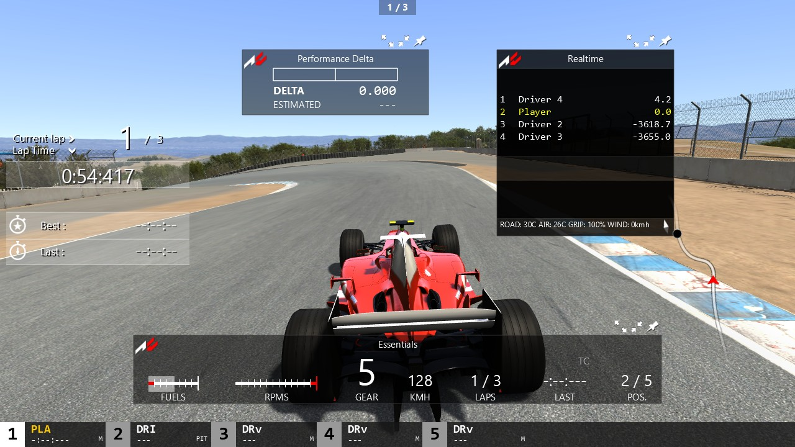
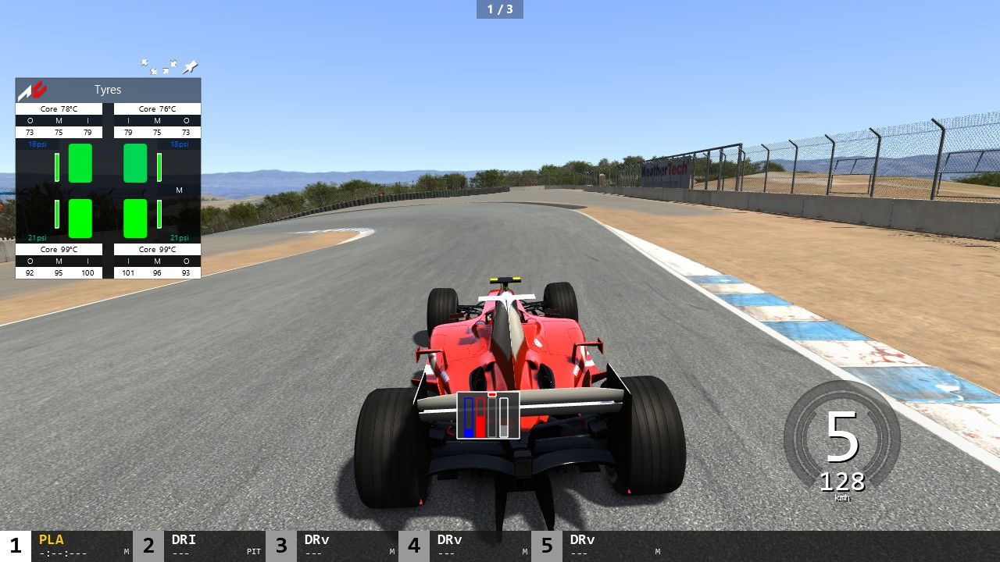

# AC's built-in apps, part 1: the apps players use (Task 32)

## Resume here

State after the last commit (update after every commit):

- **Done and proven in the oracle** (command log, WARP pixels, state, events and the files the
  apps write, all identical to acs.exe's own apps): the app framework
  (`crates/rustyac-gui/src/apps.rs`), Laps, Race Position, Essentials, Performance Delta,
  Realtime, Tyres, Pedals, Electronics, Gears, Track map, Help, Hide all Apps, Running Time,
  Time of the day, Track Description, Audio, Force Feedback Controller, Onboard settings, ERS
  Management, Ballast, Friends Leaderboard. All of them are made in `rustyac.exe`
  (`crates/rustyac-game/src/render/gui_apps.rs`), their files go to rustyAC's own `cfg`, their
  settings reach the sound, the physics thread and the cockpit camera.
- **Oracle:** `tools/render_oracle/src/gui_seq_apps.rs` (scripts and the files compared),
  `gui_ac_apps.rs` (the game's apps on a hand-laid `Sim`), `gui_port_apps.rs`. One sequence:
  `sh re/scratch/task32/cmp.sh app_volumes` (`@short` for a shorter one). Everything:
  `sh re/scratch/task32/final_b.sh` (about an hour; results in `re/scratch/task32/end/`).
  Tapes (git-ignored, under `oracle/t32/`): `race` (`CAR_ORACLE_PERF_METER=1
  tools/car_oracle/target/release/car_oracle.exe multi --scenario rc_race --track magione
  --steps 112000 --threads 0 --audio-tape --out oracle/t32/race --root re/scratch/task32/croot`,
  then delete the `.mcrec`), `sf15t` (Task 27's `spa_hybrid_lap`), `laguna` (`mc_field`).
- **Not done:** Render Stats, Triple screen, Post Process Filter, FormOpenVR; the Onboard
  settings' 3D crosses; see "Not done".
- **Briefs** (git-ignored, from the disassembly): `re/scratch/task32/*.md`.

## In plain words

AC's apps are the small windows a player opens from the bar on the right of the screen: lap
times, the tyres, the pedals, a map of the track, the sound levels, the force feedback and so
on. This task rebuilt 22 of them in Rust, statement by statement from acs.exe, and checked each
one against the game's own app: the game's code runs inside the oracle with the same session
data, and both draw frame after frame. Every Direct3D call, every pixel, every control's state
and every click came out the same; so did every settings file the apps write
(`audio.ini`, `camera_manager.ini`, `controls.ini`, a car's `car.ini` and `dash_cam.ini`,
`view.ini`, `camera_onboard.ini`, the track map's `map.ini` and `map.png`), byte for byte.

In `rustyac.exe` the apps open from the bar as in the game, in the game's order, and do what
they do there: the Audio app changes the FMOD mix (the master with the game's 0.9-second fade,
every car's levels, the bonnet / bumper view's inside or outside sound), the force feedback
app changes the gain the wheel gets and the car's FF multiplier through the physics thread's
command queue (recorded in input files, so replays repeat them), Ballast adds weight the same
way, Onboard settings moves the cockpit camera's eye point, its field of view and its pitch.
What they save goes to rustyAC's own `cfg` folder and is read from there at the next start;
the game's folder and `Documents\Assetto Corsa` are only ever read.

## The apps

| App | Class | Status |
|---|---|---|
| Essentials | `ACEssentials` | ported, proven |
| Laps | `PlayerCurrentTime` | ported, proven |
| Performance Delta | `PerformanceMeterApp` | ported, proven (the micro-sector strip is not: `MicroSectors` is not ported) |
| Realtime | `FormRealTimeTiming` | ported, proven |
| Race Position | `RacePosition` | ported, proven |
| Tyres | `TyresApp` | ported, proven |
| Gears | `FormGear` | ported, proven (KERS / ERS gauges on the SF15-T) |
| Pedals | `CarPedalsForm` | ported, proven |
| Electronics | `ElectronicAidsForm` | ported, proven |
| Track map | `TrackMap` (+ `TrackMapHandler`, `TrackMapSupport`) | ported, proven (map.png and drawn from the AI line) |
| Render Stats | `FormRenderStats` | **not done** (needs the GPU's statistics) |
| Help | `ACHelp` | ported, proven |
| Hide all Apps | `ACHideAll` | ported, proven |
| Running Time | `FormRunningTime` | ported, proven |
| Time of the day | `ACTimeFlow` | ported, proven |
| Track Description | `TrackDescription` | ported, proven |
| Audio | `FormVolumes` | ported, proven, files and FMOD effect proven |
| Force Feedback Controller | `FFBForm` | ported, proven, files and values proven in the GUI oracle |
| Onboard settings | `DriverEyesPositioner` | ported, proven (2D app, files, values); the 3D crosses are not done |
| ERS Management | `FormMGU` | ported, proven |
| Ballast | `FormBallast` | ported, proven |
| Triple screen | `FormTripleScreen` | **not done** |
| Post Process Filter | `PostProcessFilterSelector` | **not done** (YEBIS is not ported, it would change nothing) |
| Friends Leaderboard | `FriendsLeaderboardDisplayer` | ported as it is without Steam, proven |
| (VR) | `FormOpenVR` | skipped, as the task says |

## What is ported, with the game's addresses

All in `crates/rustyac-gui/src/` (each file has the license header and the "Ported from" line).

- `apps.rs`: the framework. An app's own members live beside its form (`FormData::app`), its
  virtual functions (`render`, the mouse, `onVisibleChanged`, `scaleByMult`, `shutdown`) go to
  the `App` trait, whose defaults are `ksgui::Form`'s. What it reads of `Sim` comes in an
  `AppLink` filled every frame (the cars' `CarAvatar::physicsState`, the `RaceManager`'s laps
  and positions, the track, the sound's and the camera's state); what it asks of the session
  (a file, a setter of the game, a message) is left in `AppLink::actions` in call order. The
  events the apps hear: `RaceManager::evOnLapCompleted`, `Sim::evOnNewSession`,
  `evOnReplayStatusChanged`, the bar's `Taskbar::evAppOpened` / `evAppDismiss`.
  `write_profile_string` is Windows' `WritePrivateProfileStringW` as the apps use it (checked
  against the real API on 16 files, unit test `apps::tests::as_windows_writes`).
- `app_essentials.rs`: `ACEssentials::ACEssentials` 0x14031bc60, `render` 0x14031d670, the
  static `gears` (0x140015240), the layout constants at 0x14151fb80.
- `app_laps.rs`: `PlayerCurrentTime::PlayerCurrentTime` 0x1402d9660, `render` 0x1402da350,
  `renderBackground` 0x1402db5d0, `getSectorSplitsString` 0x1402da220.
- `app_delta.rs`: `PerformanceMeterApp::PerformanceMeterApp` 0x140302570, `render` 0x140303090.
- `app_realtime.rs`: `FormRealTimeTiming::FormRealTimeTiming` 0x14032b8a0, `render`
  0x14032cda0, its lap handler 0x14032c7b0 and new-session handler 0x14032cca0;
  `CarAvatar::getDistancesOnSpline` 0x1400d3330, `getTimeDifferenceOnSpline` 0x1400d3860.
- `app_position.rs`: `RacePosition::RacePosition` 0x1402fe0f0, `render` 0x1402feb80.
- `app_tyres.rs`: `TyresApp::TyresApp` 0x140338860, `render` 0x14033a6d0.
- `app_gears.rs`: `FormGear::FormGear` 0x1402e8280, `render` 0x1402e9ac0 (its gauges with the
  game's `ksCircularRPM` shader; the painter got shader variables and a shader quad).
- `app_pedals.rs`: `CarPedalsForm::CarPedalsForm` 0x1402dbc80, `render` 0x1402dc4d0;
  `ElectronicAidsForm::ElectronicAidsForm` 0x1402ea500, `render` 0x1402eae30.
- `app_track_map.rs`: `TrackMap::TrackMap` 0x1402ee8e0, `initParameters` 0x1402ef150,
  `loadMap` 0x1402ef590, `createMap` 0x1402eeee0 (the map drawn from the AI line into a render
  target and written as `map.png` / `data\map.ini`), `render` 0x1402efd50,
  `showMapOnScreenZoom` 0x1402f00d0, and `TrackMapSupport`'s functions (0x14033c420 …
  0x14033d810).
- `app_small.rs`: `ACHelp::ACHelp` 0x140307900; `ACHideAll::ACHideAll` 0x14030f3e0 with its
  handlers 0x14030f710 / 0x14030f6d0 / 0x14030f6a0; `FormRunningTime::FormRunningTime`
  0x1402dc760, `render` 0x1402dca90; `ACTimeFlow::ACTimeFlow` 0x14030cb10, `render`
  0x14030d270, its replay handler 0x14030d1f0; `TrackDescription::TrackDescription`
  0x1403270e0, `render` 0x1403273c0 (`TrackAvatar::getSectionName` 0x1401c80c0).
- `app_volumes.rs`: `FormVolumes::FormVolumes` 0x1402f8fd0, `render` 0x1402fc010, `setSound`
  0x1402fcc80, `saveVolume` 0x1402fcb30, `setSpinner` 0x1402fcf80, `refreshDrivers`
  0x1402fbd80; the eight spinners' handlers (0x1402face0 master, 0x1402fae60, 0x1402fb680,
  0x1402fb1a0, 0x1402fb340, 0x1402fab40, 0x1402fb4e0, 0x1402fa8c0), the four view buttons'
  (0x1402fba60, 0x1402fbac0, 0x1402fbb10, 0x1402fba20), SET DRIVER's (0x1402fb000).
- `app_ffb.rs`: `FFBForm::FFBForm` 0x140314a10, `render` 0x1403172c0, `saveFFB` 0x140317750,
  `shutdown` 0x140317a70; the arrows (0x140316f10 / 0x140316f50 into
  `CarAvatar::modifyUserFFGain` 0x1400d90f0), "Auto FFB" 0x1403164e0, "Quick Adjust"
  0x140316f90, the lap handler 0x1403167d0, the four effects' spinners 0x140316ae0 /
  0x1403166f0 / 0x140316bc0 / 0x140316400, "Save" 0x140316100.
- `app_eyes.rs`: `DriverEyesPositioner::DriverEyesPositioner` 0x14030fa60, `render`
  0x140312a70, `saveSettings` 0x140313920, `saveToINI` 0x1403144e0, `saveToDashINI`
  0x140314120, the arrows', spinners' and buttons' handlers (0x140312000 … 0x140311930).
- `app_mgu.rs`: `FormMGU::FormMGU` 0x1402eb080, `render` 0x1402ec440;
  `FormBallast::FormBallast` 0x1402f0ef0, its handler 0x1402f1330
  (`CarAvatar::setBallastKG` 0x1400d9de0).
- `app_friends.rs`: `FriendsLeaderboardDisplayer::FriendsLeaderboardDisplayer` 0x140324fc0,
  `render` 0x140326540 (the gates; the rows come only from Steam).

Around them:

- The physics thread's command queue (`PhysicsAvatar::executeOnPhysicsThread` 0x140121f20) is
  rustyAC's `SetupJob`: new jobs `SetUserFfGain` (`CarAvatar::setUserFFGain` 0x1400dad50),
  `SetFfMult` (`setFFMult` 0x1400da160), `SetFfUpgrade` (the wheel's `DICarControl::ffUpgrades`),
  `SetBallastKg` (`Car::setBallastKG` 0x1402759e0); they are written into and read from input
  files like the setup editor's.
- `rustyac.exe` (`render/gui_apps.rs`): every app made at the first frame in `Sim::Sim`'s
  order, fed from the cars, the referee and the sound; its files written into `cfg`; the
  Audio app's calls carried out on `GameAudio` (`AudioEngine::setVolume`, every car's
  `MixVolumes`, the views' sounds), the force feedback and ballast jobs sent to the physics
  thread, Onboard settings' eye point / FOV / pitch put into the player's `CarShape`, the
  apps' `shutdown` at the end (the force feedback app saves there).
- The bar: `ev_app_opened` / `ev_app_dismiss` handlers fire before `setVisible`, as in
  `Taskbar`.

## How it is proven

The render oracle (`tools/render_oracle gui --gui <sequence>`) runs acs.exe's own apps
in-process on WARP: each app's real constructor on a hand-laid `Sim` / `CarAvatar` / `Car` /
`RaceManager` with the stand-ins listed in `gui_ac_apps.rs` (the `RaceManager` getters, the
audio engine's `setVolume` / driver list, `executeOnPhysicsThread` running the job at once,
`SystemMessage::addMessage` written down, Steam's two leaderboard calls doing nothing,
`INIReaderDocuments::basePath` pointed at the stand-in Documents). The port draws the same
script. Per frame both sides log every D3D11 call (objects named by content), the picture is
read back, and every control's state and every event are dumped; at the end the files both
sides wrote are compared byte for byte, and an "effects" log (what the app set in the game's
own structures: the master level calls, every car's `MixVolumes`, the views' sound flags,
`CarAvatar::userFFGain`, `Car::userFFGain` / `ffMult`, the `DICarControl` gains,
`driverEyesPosition`, `CameraOnBoard::onBoardFov` and pitch, `Car::ballastKG`, the messages)
is compared line by line against the port's actions.

The data are tapes of real runs of the game's physics (`car_oracle multi`): six F2004s racing
three laps at Magione with the game's `PerformanceMeter`, an SF15-T lap of Spa with its ERS,
a Laguna Seca field. The scripts move the session through race, qualifying, replay, timed
sessions, MPH, wind, focus changes, and click the apps the way a player does (title drags,
pin, zoom, the app bar, every button and spinner the apps have, held arrows).

Settings effects with the existing oracles:

- **Sound**: `audio_oracle compare --tape oracle/audio_e2e/spa_launch.audiotape --frames 600
  --audio-ini <the audio.ini the Audio app wrote> --master-at 120:0.3` (new options) runs the
  game's own sound code and the port with the levels the app saved and the app's Master change
  at frame 120: the FMOD call logs (222,245 lines) are **identical**, the mixes agree within
  0.06 dB rms. The log shows `channel_set_volume` on the master group with 0.3 at frame 120 and
  then the game's 0.9 s ramp, the levels of `audio.ini` in the events' `event_set_volume`.
- **Force feedback** and **camera**: the GUI oracle's effects log (above) shows the game's own
  `Car::userFFGain`, `ffMult`, `DICarControl` gains, `driverEyesPosition`, `onBoardFov` and
  pitch frame by frame equal to what the port asks for. The FFB values after a gain change
  through `car_oracle` / `chassis_compare` and the camera matrices after a seat change through
  an oracle were not done (see "Not done").

## Results

Final run of every sequence on the final code (`re/scratch/task32/end/apps.txt`):

| Sequence | Frames | Command log | Pixels | State and events | Files |
|---|---|---|---|---|---|
| app_laps | 613 | IDENTICAL | IDENTICAL | IDENTICAL (13492 lines, 6 events) | acos.ini identical (341 bytes) |
| app_position | 613 | IDENTICAL | IDENTICAL | IDENTICAL (15330 lines, 5 events) | acos.ini identical (361 bytes) |
| app_essentials | 613 | IDENTICAL | IDENTICAL | IDENTICAL (20235 lines, 6 events) | acos.ini identical (361 bytes) |
| app_delta | 613 | IDENTICAL | IDENTICAL | IDENTICAL (15332 lines, 7 events) | acos.ini identical (349 bytes) |
| app_realtime | 613 | IDENTICAL | IDENTICAL | IDENTICAL (28818 lines, 7 events) | acos.ini identical (361 bytes) |
| app_tyres | 554 | IDENTICAL | IDENTICAL | IDENTICAL (33247 lines, 7 events) | acos.ini identical (345 bytes) |
| app_pedals | 554 | IDENTICAL | IDENTICAL | IDENTICAL (13851 lines, 1 events) | acos.ini identical (333 bytes) |
| app_electronics | 554 | IDENTICAL | IDENTICAL | IDENTICAL (12747 lines, 5 events) | acos.ini identical (353 bytes) |
| app_gears | 554 | IDENTICAL | IDENTICAL | IDENTICAL (12191 lines, 3 events) | acos.ini identical (345 bytes) |
| app_gears_ers | 503 | IDENTICAL | IDENTICAL | IDENTICAL (11072 lines, 6 events) | acos.ini identical (345 bytes) |
| app_mgu | 554 | IDENTICAL | IDENTICAL | IDENTICAL (17179 lines, 5 events) | acos.ini identical (341 bytes) |
| app_mgu_ers | 503 | IDENTICAL | IDENTICAL | IDENTICAL (15598 lines, 5 events) | acos.ini identical (341 bytes) |
| app_trackmap@spa | 538 | IDENTICAL | IDENTICAL | IDENTICAL (9147 lines, 1 events) | acos.ini identical (330 bytes) |
| app_trackmap@laguna | 538 | IDENTICAL | IDENTICAL | IDENTICAL (9147 lines, 1 events) | acos.ini identical (330 bytes) |
| app_trackmap | 538 | IDENTICAL | IDENTICAL | IDENTICAL (9147 lines, 1 events) | acos.ini identical (330 bytes) |
| app_trackmap@ailine | 538 | IDENTICAL | IDENTICAL | IDENTICAL (9147 lines, 1 events) | acos.ini identical (330 bytes); data/map.ini identical (125 bytes); map.png pixels identical (344 x 860) |
| app_small | 412 | IDENTICAL | IDENTICAL | IDENTICAL (22256 lines, 8 events) | acos.ini identical (1566 bytes) |
| app_volumes | 414 | IDENTICAL | IDENTICAL | IDENTICAL (49041 lines, 188 events) | acos.ini identical (355 bytes); cfg/audio.ini identical (209 bytes); cfg/camera_manager.ini identical (47 bytes); sound effects identical (12013 bytes) |
| app_ffb | 1287 | IDENTICAL | IDENTICAL | IDENTICAL (82623 lines, 255 events) | acos.ini identical (339 bytes); cfg/controls.ini identical (129 bytes); content/cars/ks_ferrari_f2004/data/car.ini identical (1547 bytes); FFB effects identical (7547 bytes) |
| app_eyes | 397 | IDENTICAL | IDENTICAL | IDENTICAL (19623 lines, 1361 events) | acos.ini identical (395 bytes); cfg/cars/ks_ferrari_f2004/view.ini identical (110 bytes); cfg/camera_onboard.ini identical (21 bytes); content/cars/ks_ferrari_f2004/data/car.ini identical (1544 bytes); content/cars/ks_ferrari_f2004/data/dash_cam.ini identical (46 bytes); camera effects identical (22829 bytes) |
| app_ballast | 244 | IDENTICAL | IDENTICAL | IDENTICAL (6644 lines, 56 events) | acos.ini identical (355 bytes); ballast effects identical (391 bytes) |
| app_friends | 22 | IDENTICAL | IDENTICAL | IDENTICAL (422 lines, 4 events) | acos.ini identical (383 bytes) |

The earlier GUI sequences on the final oracle (`re/scratch/task32/older.sh`):

| Task | Sequences | Result |
|---|---|---|
| Task 30 (menus) | 38 | all identical |
| Task 29 (GUI, HUD) | 14 | all identical |
| Task 31 (setup editor) | 5 | all identical |

Unchanged elsewhere (`re/scratch/task32/final_a.sh`, `tape_proof.py`):

| Check | Result |
|---|---|
| clippy `--workspace --all-targets -D warnings` | clean |
| clippy CI line | clean |
| clippy wasm32-unknown-unknown | clean |
| clippy wasm32-wasip1 | clean |
| `cargo build --release --workspace --locked` | builds |
| `cargo test --release --workspace --locked` | 60 suites, 294 passed, 0 failed |
| web build (`python web/build.py`) | built |
| tool audio_oracle `--locked` | builds |
| tool car_oracle `--locked` | builds |
| tool chassis_compare `--locked` | builds |
| tool math_proof `--locked` | builds |
| tool ode_oracle `--locked` | builds |
| tool sctm_oracle `--locked` | builds |
| tool tyre_oracle `--locked` | builds |
| tool web_pack `--locked` | its lock file lacked rustyac-gui's new dependency on rustyac-math (the track map's sines): updated and committed, then builds `--locked` (audio_oracle's the same) |
| physics dump served.ryin | v0.31.0 09953746b56c9a6d, now 09953746b56c9a6d; state hash bebb73dd826046ac (0 workers), state hash bebb73dd826046ac (8 workers) |
| physics dump spa.ryin | v0.31.0 4238c5617a2e49ce, now 4238c5617a2e49ce; state hash b4c7538a6fa7289c (0 workers), state hash b4c7538a6fa7289c (8 workers) |
| physics dump missed.ryin | v0.31.0 8c2fe6e41d7e4dee, now 8c2fe6e41d7e4dee; state hash a528aca4ee0fa29d (0 workers), state hash a528aca4ee0fa29d (8 workers) |
| physics dump practice.ryin | v0.31.0 a21587be85a4a9ba, now a21587be85a4a9ba; state hash 889a180a3ae928bf (0 workers), state hash 889a180a3ae928bf (8 workers) |
| multiplayer tapes (desktop, desktop-browser, desktop-gateway, wasm) | 20 of 20 tapes: all four ways identical |

## Settings files kept in rustyAC's own cfg

`rustyac.exe` keeps them beside itself in `cfg\` (`--cfg-dir` elsewhere); it reads its own copy
first and the game's file (Documents or the game folder) only when it has none, and never writes
there. The first write copies the game's file so that the other keys stay.

| File | Written by | Read back by rustyac.exe |
|---|---|---|
| `cfg\audio.ini` (`[LEVELS]`, `[SETTINGS] DRIVER_NAME`) | Audio | the sound at start (levels; the driver name only matters to FMOD's device choice, as in the game after a restart) |
| `cfg\camera_manager.ini` (`[AUDIO] BONNET_EXTERNAL`, `BUMPER_EXTERNAL`) | Audio | the sound at start |
| `cfg\controls.ini` (`[FF_ENHANCEMENT]`) | Force Feedback ("Save") | the force feedback app's start values; the wheel itself still reads AC's controls.ini at start (see "Not done") |
| `cfg\content\cars\<car>\data\car.ini` (`[CONTROLS] FFMULT`, `STEER_ASSIST`; `[GRAPHICS] DRIVEREYES`, `ON_BOARD_PITCH_ANGLE`) | Force Feedback (Auto FFB off, shutdown), Onboard settings ("Save car.ini") | not read back (see "Not done") |
| `cfg\content\cars\<car>\data\dash_cam.ini` (`[DASH_CAM] POS`) | Onboard settings ("Save Dash") | not read back |
| `cfg\cars\<car>\view.ini` | Onboard settings ("Save"; deleted by the two others) | the cockpit camera at start |
| `cfg\camera_onboard.ini` (`[MODE] FOV`) | Onboard settings ("Save") | the cockpit camera at start |
| `cfg\maps\<track>\map.png`, `data\map.ini` | Track map (a track without a map) | the map at the next start |
| `cfg\acos.ini` | every app (place, size, shown) | the apps at start |

## Pictures

Taken on the user's graphics card with `rustyac.exe --screenshot` (Laguna Seca, F2004, five
AI cars, a layout in `--cfg-dir`).

| | |
|---|---|
|  |  |
| Essentials, Laps, Performance Delta, Realtime and the track map | Tyres, Pedals and Gears |

## Disk space

58 GB free at the start; 59 GB free at the end (the v0.31.0 build, the scratch build target and
the oracle outputs deleted; the tapes under `oracle/t32/`, 452 MB, kept for re-running the proofs).

## Not done

- **Render Stats** (`FormRenderStats`): it shows the GPU's own statistics (draw calls, frame
  times of the render passes), which rustyAC's renderer does not gather.
- **Triple screen** (`FormTripleScreen`): rustyAC has no triple-screen camera to set.
- **Post Process Filter** (`PostProcessFilterSelector`): the filters are YEBIS sets, and YEBIS
  is not ported (rustyAC runs with `[POST_PROCESS] ENABLED=0`, so the game would not even make
  this app); porting the form alone would change nothing.
- **FormOpenVR**: skipped, as the task says.
- **Onboard settings, the 3D part**: the two crosses (the driver model's head and the eye
  point) drawn into the 3D view while the app is open (`onRenderFinished` 0x140312620) need a
  hook in the scene's opaque pass and a driver model; "Auto Pos" therefore only sets the field
  of view to 54 in rustyac.exe (there is no head to put the eyes at). The app always edits car
  0, as the game does.
- **The wheel's effects at the next start**: the wheel (`input/wheel.rs`) reads `[FF_ENHANCEMENT]`
  from AC's own `controls.ini` (or rustyAC's `rustyac_controls.ini`), not from the copy the
  force feedback app saves in `cfg\controls.ini`; the running session takes every change.
- **Saved car files**: `car.ini` / `dash_cam.ini` written by the force feedback and Onboard
  settings apps (only for cars whose data is a loose folder) are kept in `cfg\content\cars\`
  but rustyAC's car loader does not read them back; the running session takes the change
  (FF multiplier through the physics thread, the eye point through the camera).
- **Proofs through other oracles**: the force feedback values after a gain change were not run
  through `car_oracle` / `chassis_compare` (they have no way to change a car value in the middle
  of a recording without a new recording format), and the cockpit camera's matrices after a
  seat change were not run through an oracle (the render oracle gives both sides the same
  camera). Both are shown by the GUI oracle's effects log instead.
- **Performance Delta's micro-sector strip** (`MicroSectors`) and the game's `PerformanceMeter`
  in rustyAC's physics (the app shows 0 in rustyac.exe; the oracle feeds it the game's).
- **Friends Leaderboard's rows**: they come from Steam only; without Steam the app shows its
  gates ("NO LEADERBOARDS FOUND" in a hot lap with penalties), as a game whose requests never
  answer does. The row drawing is not ported.

## Open questions

- The Audio app writes `TRANSMISSION=-1.000000` for "ENGINE" and rewrites a hand-edited level
  in steps of 0.1 the first time it is shown (the game's own behaviour, kept).
- `WritePrivateProfileStringW` puts a new key before a key line without `=` at the end of the
  last section; rustyAC's writer does not (no app writes such files).
- The Onboard settings app reads `view.ini` of car 0 for every car's pitch in the game
  (`CameraOnBoard::CameraOnBoard`); rustyac.exe applies the saved file to the player's car only.
- The game's `FFBForm` "Quick Adjust" and the lap's auto-adjust write a car's `car.ini` in the
  game folder; rustyAC keeps the copy in its `cfg` (should rustyAC read car data overrides from
  there?).
- Running Time blinks by the half second (`rem / 500`), not by the second as the brief read.
