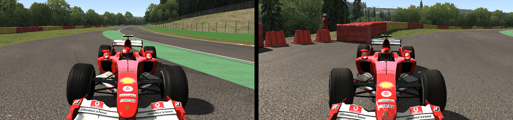
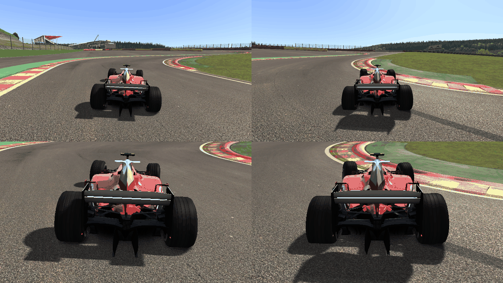
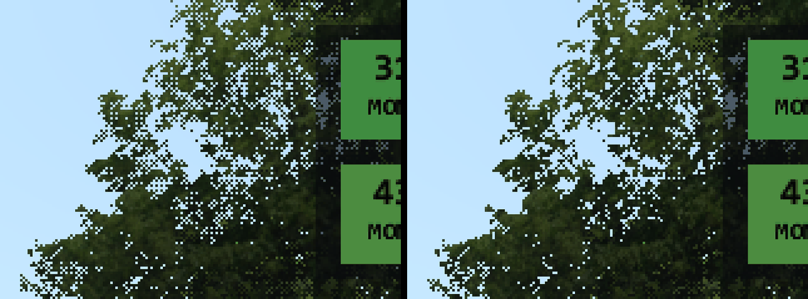

# Task 22b: suspension damage, popped tyres, white sparkles, max graphics, the audio oracle's WAV rule

## Resume here

**Task 22b is finished** and tagged `v0.22.1` (not pushed). Nothing is in work. To pick any part up again: the exact commands are in section 6, the scratch files in `re/scratch/task22b/` (reader and reviewer reports `reader_r0..2.md`, `review_r0..2.md`; result files named in each section), the recordings in `oracle/t22b_*` (git-ignored, about 1.3 GB: delete them when they are no longer wanted; `sh re/scratch/task22b/crash_all.sh` after re-recording brings every table of section 1 back). Left for Task 23: multisampling (which should also end the dotted trees of section 3), FXAA, post-processing, motion blur.

## Plain-English summary

1. **Suspension damage works, and it is Assetto Corsa's own rule that makes it rare.**
   - The port does what `acs.exe` does, bit for bit: five new crash recordings (double wishbone,
     strut, rear steer, multilink, rigid axle) are 100 % identical to the game, including the
     bent steering rods, the toe they cause and where the car goes afterwards.
   - Two things can keep it from showing, and I cannot tell from here which one you met:
     - **Your settings.** When this task started, `assists.ini` said `DAMAGE=0` (written by the
       session of 01:04). At 0 nothing bends and no tyre can burst, in plain AC too. Content
       Manager wrote `DAMAGE=100` at 12:23 while I worked, so rustyAC now starts with damage on.
     - **The game's rule.** A corner only bends when a *front or rear* zone **and** a *side*
       zone of the body have both been hit. In the game's own code the F2004 went into Spa's
       walls three ways without any side-zone hit and without any bend: straight on at
       61 km/h, into the barrier at 283 km/h, and 3.2 seconds of sliding along a wall. Only
       the fourth crash, one corner first, touched a side zone (by 2.2 km/h) and bent two rods.
   - When the rule is met the effect is large: the F2004's right front wheel is toed
     18.5 degrees further, and with nobody at the wheel the car's heading turns 40.5 degrees in
     2.7 seconds. The same crash with the same controls and damage off: 0.7 degrees.
   - New: `--damage <percent>`, a start-up line when damage is off, and burst tyres in the
     HUD's damage panel (which already showed the zones and the bent corners).
2. **A popped tyre looks full in plain AC too.** `acs.exe` has no flat-tyre picture at all: no
   mesh swap, no scale, no material value. The wheel is drawn full size at the lowered hub, so
   the corner sits lower and the tyre sinks a little into the road. The port draws exactly
   that (49 frames of a burst, pixel-identical with the game's renderer). A visibly flat tyre
   would be a Custom Shaders Patch feature; nothing was added to Vanilla.
3. **The white sparkles are Assetto Corsa's look without anti-aliasing on your graphics card.**
   - They are sky-coloured dots in trees, fences, grass and crowds. Those are drawn with
     "alpha to coverage", which only works properly with multisampling; with one sample per
     pixel the AMD driver turns it into a dot pattern.
   - Plain `acs.exe`'s own renderer, run on your Radeon with `AASAMPLES=1`, draws exactly the
     same pixels as rustyAC (byte-identical frame).
   - Your real AC has `AASAMPLES=4`, which rustyAC does not do yet. **Multisampling
     (Task 23) is what should remove the dots; FXAA alone should only soften them.** That is
     what alpha to coverage is made for, but it is not tested here. Vanilla's picture was not
     changed.
4. **Max graphics without touching your `video.ini`:** `--graphics max`, `--graphics low`,
   `--video-ini <file>`, and a frame-rate counter on **Ctrl+F** (or F9). `max` is slow on this PC; the costliest single
   setting is the 2048 reflection cube map (see the tables).
5. **The audio oracle's 16 "FAIL"s were the tool's rule, not the sound.** FMOD writes a varying
   number of silent blocks while it starts up. Counted from the first audible block, the game,
   the game again and the port are equally long in every drive. All 18 drives are now `ok`.

## 1. Suspension damage

### 1.1 The cause, with numbers

| Checked | Result |
|---|---|
| The `DAMAGE` multiplier | `acs.exe`: `DrivingAssistManager` 0x1400fbd90 reads `cfg/assists.ini [ASSISTS] DAMAGE` and sets `mechanicalDamageRate = DAMAGE * 0.01` (race.ini has no such key). rustyAC reads the same file the same way (`session.rs`, `Assists::from_ini`). **Your file: `DAMAGE=0` at the start of this task (file of 01:04:32), `DAMAGE=100` since 12:23:58** (Content Manager writes it anew for every session). At 0: `d = closing speed * 0 = 0`, no zone ever rises, nothing bends, and `Tyre::stepPuncture` never bursts a tyre. |
| The zone condition | `Car::onCollisionCallBack` 0x140274650: a contact is a *front/rear* one when the contact point, seen from the body's origin, lies within 45 degrees of the car's length (`abs(dir.z) > 0.707`), else a *left/right* one. Each zone keeps the highest closing speed (km/h) it saw. A wheel is bent only when **its end zone and its side zone are both above 0**: LF = front + left, RF = front + right, LR = rear + left, RR = rear + right. The amount is `min((mean of the two zones - MIN_VELOCITY) * GAIN, MAX_DAMAGE)`. |
| Is it met in a real crash at Spa? | Mostly not. The game's own code, F2004, re-recorded for this report (`re/scratch/task22b/walls_result.txt`; zones are front, rear, left, right): `spa_wall_low`, straight on at 61 km/h: 52.0, 11.8, **0, 0**, no bend. `spa_wall_high`, off the road at 283 km/h and into the barrier at an angle: 135.7, 154.9, **0, 0**, no bend. `spa_wall_slide`, steered into a wall at 101 km/h and 3.2 s along it: 77.4, 52.2, **0, 0**, no bend. `spa_wall_gravel`, over the run-off at 288 km/h and into the barrier one corner first: 190.0, 166.3, 0, **2.2**: RF and RR bent. A side zone of 2.2 km/h is enough, because the rule takes the mean of the two zones. Why the sides stay at 0 against a wall was not taken apart; what is observed is that the car meets a flat wall with its ends. |
| `MIN_VELOCITY` | F2004: 30 km/h, gain 0.0006 m per km/h, most 0.05 m. E30, 488 GT3: 40, 0.0004, 0.05. The 812 stops at 0.02 m. |
| Does `damageAmount` reach the steering rods? | Yes, in the port as in the game: `setSteerLengthOffset` moves the body end of the steering rod by `damageDirection * damageAmount` metres sideways (DWB and multilink: joint 4; strut: joint 2). `SteeringSystem::step` calls it every step for the front wheels, and for the rear wheels **only on a car with rear steer** (`ctrl_4ws.ini`); on every other car a rear rod shift is stored and shown but turns nothing. |
| Does `SuspensionAvatar` show it? | Yes. The wheel is drawn at the physics hub's matrix. On cars with animated suspension arms (32 of 137, the F2004 among them) `SuspensionAnimator` 0x1401b25a0 turns the two front hub nodes by the physics hub's angle and nothing else: the arms do not bend, a rear wheel is not turned. That is the game, not the port: 11 frames of the crashed F2004 from the front are pixel-identical between the game's renderer and the port (`re/scratch/task22b/bent/result.txt`). |
| The `rand()` draw of `damageDirection` | One draw per wheel in the constructor (LF, RF, LR, RR; a rigid axle draws none): `rand() * 3.051851e-05 * 100 >= 50` gives +1, else -1. rustyAC's car draws from `MsvcRand(1)` (41, 18467, 6334, 26500: -1, +1, -1, +1) when the session draws nothing before it (no wind, fixed grip); the game's own seed is the clock. The recordings carry the direction and it is compared. |
| Per suspension class | Double wishbone and strut: as above. **Multilink never bends in plain AC:** `SuspensionML::loadINI` does not read `[DAMAGE]`, so gain and most stay 0. A rigid axle has no damage data. |

### 1.2 What was changed

Nothing in the physics. Added:

- `rustyac.exe --damage <percent>`: assists.ini's `DAMAGE` whatever the file says.
- A start-up line when damage is off:
  `mechanical damage is OFF (assists.ini DAMAGE=0) ... --damage 100 turns it on`.
- The HUD's damage panel (top left, under the numbers; it was there already and shows the
  zones in km/h, each corner's bend in per cent and the engine) now also says `tyre burst: LR`.
- In your real AC the same switch is the "Mechanical damage" percentage: Content Manager,
  Drive, Assists; in the plain launcher under Realism. Both write `assists.ini`.
- `car_oracle`: scenario `spa_crash`; columns `sus.<w>.damageAmount` and
  `sus.<w>.damageDirection` (the game's `SusDamageDef` itself); `--pop <wheel>@<seconds>`
  (the step is seconds x 333).
- `chassis_compare`: compares the new columns; three damage faults in `faults16`;
  `excerpt22b`; a value-by-value print when an excerpt does not replay.
- A golden excerpt of the crash for `cargo test`:
  `crates/rustyac-physics/tests/golden/collide_spa_crash_4343_420.chgold`.

### 1.3 The proof

`spa_crash`: flat out towards Blanchimont and straight on into the barrier, one corner first;
then six seconds with nobody at the wheel and a little throttle, eight seconds of the driver
following the line again, then the brakes. Free run from step 0: the Rust car gets only the
driver's controls.

| Car (suspension) | Steps bit-exact, free run | Replayed in `rustyac.exe` | Car speed at the first hit | Zones at the end (front, rear, left, right) | Rod shift, mm (LF, RF, LR, RR) | Toe change | Nobody at the wheel, 0.3 to 3 s after |
|---|---|---|---|---|---|---|---|
| `ks_ferrari_f2004` (double wishbone) | 100 % (12001/12001) | 100 % | 288 km/h | 190.0, 166.3, 0, 2.2 | 0, **39.67**, 0, **32.54** | RF -0.19 to **+18.33 deg**; RR unchanged (no rear steer) | 83 m, heading turned 40.6 deg |
| `bmw_m3_e30` (strut front) | 100 % (12001/12001) | 100 % | 162 km/h | 92.9, 52.4, 0, 15.3 | 0, **5.64**, 0, 0 | RF +0.10 to **+2.54 deg** | 77 m, turned 26.5 deg |
| `ks_ferrari_812_superfast` (double wishbone, rear steer) | 100 % (12001/12001) | 100 % | 241 km/h | 149.8, 92.8, 0, 88.4 | 0, **20.00**, 0, **20.00** | RF +0.13 to **+8.37 deg**, RR +0.03 to **-8.13 deg** | 23 m, turned 64.8 deg |
| `gt3_multilink` (multilink, test car) | 100 % (12001/12001) | 100 % | 217 km/h | 125.6, 64.7, 0, 60.3 | 0, 0, 0, 0 | none (plain AC's multilink has no damage) | 98 m, turned 3.7 deg |
| `ks_ferrari_250_gto` (double wishbone, rigid axle) | 100 % (12001/12001) | 100 % | 187 km/h | 123.9, 0.4, 0, 31.9 | 0, **15.16**, 0, 0 | RF +0.24 to **+5.18 deg**; the axle has no damage data | 18 m, turned 5.0 deg |



- "Car speed at the first hit" is the car's speed, not the closing speed (that is the zone
  value: 190 km/h for the F2004, whose collider mesh reaches the barrier at 197 km/h after the
  front wing).
- **A control, so that the turn is not blamed on the crash itself:** the F2004's replay file
  with `mechanical_damage_rate=0.0` in its header, the same recorded controls
  (`re/scratch/task22b/control/control_result.txt`). From 0.3 s to 3 s after the crash the
  heading turns **+40.5 degrees with damage on and +0.7 degrees with damage off**.
- Compared per step: 1822 to 2121 chassis values, 483 to 515 values of the other systems (the
  eight new damage values among them) and every force call (505 to 749 thousand a run).
- **The comparison can fail:** `faults16 spa_crash` on the F2004, E30 and 250 GTO: the damage
  gain one bit up, `MIN_VELOCITY` up by a ten-thousandth and the direction turned round are
  each noticed (at the step of the crash, or at step 0). On the 812 the first two cannot show
  (its rods are at the 0.02 m stop) and on the multilink car there is no damage to change;
  the direction fault is noticed on both.
- Toe is the hub body's yaw against the car body, from the recorded (and compared) body
  matrices: `re/scratch/task22b/toe.py`.
- `cargo test -p rustyac-physics --test chassis_golden`: the crash excerpt replays (420 steps).
  Its hash holds the hub bodies, the zones and each corner's bend as a share of the most
  (`getDamage`); the two new columns themselves are only in the full comparison above.
- Not covered: `game-replay` of a `--pop` recording (the input file format has no burst
  event; the whole-car comparison applies it).
- Result files: `oracle/chassis/results_t22b_<car>_whole.md`,
  `partial_t22b_<car>_game_replay.md`, `faults16_t22b_<car>_spa_crash.md`.

### 1.4 Does your description match plain AC?

- "One front wheel toed one way after a heavy crash": **yes, that is plain AC**, and the port
  has it. The wheel you see is the physics wheel; it is not a CSP picture.
- "Hard crashes never make the car steer badly": also plain AC for most single-car crashes,
  because of the side-zone rule. Races are different: a car that hits your door fills a side
  zone at once, and the next nose or tail contact then bends that corner. Whether CSP changes the rule in your real AC was not looked at.
- A bent rod does not heal. R (back to the start) and Shift+R repair the car, as the game's
  pit does.

## 2. Popped tyres in the picture

### 2.1 What plain `acs.exe` does

- The state is one number, `TyreStatus::inflation` (1, or 0 once burst). `Tyre::stepPuncture`
  0x1402849b0 sets it to 0 when damage is on and one of the three surface temperatures passes
  `[EXPLOSION] TEMPERATURE` (350 degrees unless the tyre says otherwise).
- Physics: `Tyre::addGroundContact` 0x14027d980 then uses the rim radius for the tyre's radius,
  and a spring of 200000 N/m once the wheel is on its rim. That is the drop you saw.
- Everything that reads the state outside the physics:
  - `CarAudioFMOD::updateWheels` 0x140068730: the FMOD parameter `inflation` (ported);
  - `TyresApp::render` 0x14033a6d0: the text `0psi` (an app, not ported);
  - `DamageDisplayer`: a red tyre icon in the HUD (not ported; rustyAC now has a text line).
- That list comes from a search of the decompiled code for the member and for the state's
  offsets; a scan of the raw machine code for indirect readers was not made. The render
  proof below covers every object the car is drawn with.
- Replays and network cars do not carry it at all (`ReplayRecorder::getPhysicsState` and
  `NetCarStateProvider` do not fill `tyreInflation`).
- **Nothing in the 3D car reads it:** not `CarAvatar`, `SuspensionAvatar` (0x1401b3840 copies
  the wheel matrix, no scale), `SuspensionAnimator`, `TyreBlur` (blur and dirt only),
  `BlurredObjects` (wheel speed only) or `VisualDamageManager` (body zones only). No node name
  with FLAT, RIM or BLOWN is switched. `getGraphicsRadius` has one caller, a debug print.

### 2.2 The proof

- `car_oracle run --track spa --collide --scenario spa_launch --pop 2@8 --audio-tape`: the
  game's own physics, left rear tyre burst at 8 s (the oracle writes `inflation = 0`, which is
  all `stepPuncture` does). The whole Rust car against that recording: **100 % (5662/5662
  steps)**.
- `render_oracle compare --track spa --view rear --car ks_ferrari_f2004 --tape
  oracle/t22b_pop/spa_launch.audiotape --tape-from 468 --frames 50`: the game's renderer and
  the port, frame by frame through the burst: **command log identical in all 49 frames,
  pixels identical in all 49 frames.**



Left: before. Right: after (drawn by `acs.exe`'s renderer; the port's frame is the same to the
pixel). The tyre is full size. The left rear hub is lower by the difference between tyre and
rim radius; in a picture of this size that is hard to see, which is the point.

### 2.3 What was changed

Nothing in the picture. A flat-tyre look belongs to the CSP layer (CSP has `isBlown`,
`ac.setTyreInflation` and "traces of blown wheels" in its skid-mark settings).

## 3. White sparkles

### 3.1 Reproduced

The same frame from `rustyac.exe --screenshot` on the Radeon Pro 5500M and with `--warp`
(1280 x 720, `--no-race-ini --autodrive --at 12`), compared pixel by pixel
(`re/scratch/task22b/spkdiff.py`, results in `spk/shots.txt`). The two columns are different
tests: the first counts pixels of which one colour channel differs by more than 96 of 255, the
second ("sparkle") pixels whose summed brightness is higher on the card than on WARP **and**
than their own neighbours by more than 150 of 765. A dot can pass the second and not the first.

| Frame | Pixels that differ by more than 96 of 255 | Sparkle pixels (card only) |
|---|---|---|
| Spa, F2004, chase | 259 | 234 |
| Spa, F2004, cockpit | 279 | 113 |
| Spa, E30, chase | 210 | 134 |
| Spa, E30, cockpit | 226 | 166 |
| Monza, F2004, chase | 1439 | 1632 |
| Monza, F2004, cockpit | 2074 | 2120 |
| Monza, E30, chase | 1111 | 972 |
| Monza, E30, cockpit | 912 | 843 |
| Laguna Seca, F2004, chase | 1754 | 524 |
| Laguna Seca, F2004, cockpit | 1341 | 424 |
| Laguna Seca, E30, chase | 394 | 171 |
| Laguna Seca, E30, cockpit | 919 | 384 |



- Where: only on alpha-tested things: tree tops against the sky, fences, grass tufts, the
  crowd. Monza has the most trees and the most dots.
- The values: not exact white and not NaN (the screen is 8-bit; a NaN would be black). They
  are the **sky's colour** seen through a hole, for example `(158, 197, 255)` where WARP has
  the tree's `(32, 40, 27)`.
- The pattern is fixed to the screen's pixels, which is why it does not move when the game is
  paused.
- The white dots along the F2004's panel lines are something else: specular aliasing. They
  are the same on WARP and in the game (351 isolated white pixels in the game's frame on the
  card, 351 in the port's, 356 on WARP).

### 3.2 The cause

- None of the game's 72 pixel shaders has a `discard` instruction (counted in their compiled
  code by one of the readers; I did not disassemble them myself). What I saw agrees: with
  alpha to coverage off, trees are solid cards. An alpha-tested material is drawn with blend state 2,
  `AlphaToCoverageEnable = 1` (`initBlendStates` 0x14001aeb0). In the logged Spa frame that is
  48 of 841 draws (55,727 triangles), with the pixel shaders `ksTree` (15), `ksPerPixelAT`
  (12), `ksParticle` (7), `ksPerPixelNM` (7), `ksGrass` (4) and `ksPerPixelReflection` (3).
- With one sample per pixel, alpha to coverage can only draw a pixel or leave it, and
  Direct3D leaves the choice to the driver. Both rasterisers end up with a dot pattern where
  the texture is half transparent; the AMD driver's is much denser than WARP's (picture
  above). How each one decides was not examined.
- **The switch test:** `--no-a2c` (blend state 2 without alpha to coverage). Monza, F2004,
  chase: the sparkle count goes from 1632 to **0** and the pixels that differ by more than 96
  from 1439 to **0** (`spk/noa2c_and_hardware.txt`). (It is a diagnosis only: without it trees and fences are solid cards,
  because nothing else cuts them out.)
- **Plain `acs.exe` on this card:** the render oracle with `RENDER_ORACLE_HARDWARE=1` runs the
  game's own renderer and the port on the Radeon instead of WARP. Spa, F2004, chase:
  `command log: IDENTICAL`, `pixels: IDENTICAL (3686400 bytes)`. The game's frame on the card
  against the game's frame on WARP shows the same dots (539 sparkle pixels). Note that the oracle asks Windows for its default
  graphics card; on this PC that is the Radeon (the frame equals `rustyac.exe`'s, which names
  the adapter).
- Not the cause: NaN or Inf (8-bit target), unbound samplers (all six are bound),
  uninitialised constants (both sides zero them), mip maps or anisotropy (the dots stay with
  `ANISOTROPIC=16` and go with `--no-a2c`).

### 3.3 The verdict

It is plain AC's look with anti-aliasing off on this graphics card; rustyAC's picture is the
game's. Your `video.ini` asks for `AASAMPLES=4` (not 1), and rustyAC still draws one sample
per pixel: it says so at start-up. **Multisampling (Task 23) is the expected cure:** with four
samples alpha to coverage has five coverage steps and the resolve blends them, which is what
it was made for. FXAA works on the finished picture and can only blur the dots. Neither was
tested here (I tried to see it in the four-sample HQ mirror, but the HUD covers the trees in
it), so Task 23 has to show it on this card. Nothing was changed in Vanilla's picture; the
WARP proofs are as before (section 7).

## 4. Max graphics

### 4.1 The options

| Option | What it does |
|---|---|
| `--video-ini <file>` | Reads this file instead of `Documents\Assetto Corsa\cfg\video.ini` (also its `LOCK_STEER`, `HIDE_ARMS`, `HIDE_STEER`). A missing file is an error. Your own file is only ever read. |
| `--graphics max` | A built-in `video.ini` with every setting this renderer knows at the highest value AC's own launcher offers: `SHADOW_MAP_SIZE=4096`, `WORLD_DETAIL=5` (clouds, crowds, skid marks), `ANISOTROPIC=16`, `[CUBEMAP] SIZE=2048 FACES_PER_FRAME=6`, `[MIRROR] SIZE=1024 HQ=1`, smoke in mirrors, `SMOKE=5`, the virtual mirror on. It also asks for `AASAMPLES=4`, FXAA, post-processing and motion blur, and prints one line for each: they come in Task 23. |
| `--graphics low` | Everything off or lowest: shadows 512, world detail 0, anisotropic off, no reflections (`SIZE=0`, the launcher's "None"), no mirrors, no smoke. |
| `--cube-size <n>` | The reflection cube map's side, over any of the above. |
| `--show-fps`, **Ctrl+F** or **F9** | The frame-rate counter (top right): FPS, average and longest frame time of the last half second, physics steps a second and step time. |

The older options still win over a preset: `--world-detail`, `--mirror-hq`, `--mirror-size`,
`--cube-faces`, `--weather`. `--graphics` and `--video-ini` cannot be given together.

### 4.2 Frame rates on this PC

Off screen (`--headless --bench-render`, not waiting for a display), the F2004 driven by the
autodriver, 20 s a cell, counted from the first frame. Each cell: frames a second (average frame
time, longest frame). The better of two passes (`re/scratch/task22b/fps/rows_pass1.txt`,
`rows_pass2.txt`).

| Picture | Track | Camera | `--graphics max` | `--graphics max --cube-size 1024` | your `video.ini` | `--graphics low` |
|---|---|---|---|---|---|---|
| 1280 x 720 | Spa | chase | 15 FPS (65.1 ms, longest 95) | 107 FPS (9.4 ms, longest 26) | 195 FPS (5.1 ms, longest 10) | 231 FPS (4.3 ms, longest 11) |
| 1280 x 720 | Spa | cockpit | 15 FPS (66.1 ms, longest 101) | 100 FPS (10.0 ms, longest 30) | 163 FPS (6.1 ms, longest 11) | 215 FPS (4.6 ms, longest 10) |
| 1280 x 720 | Nordschleife | chase | 15 FPS (66.9 ms, longest 101) | 94 FPS (10.7 ms, longest 18) | 179 FPS (5.6 ms, longest 10) | 197 FPS (5.1 ms, longest 12) |
| 1280 x 720 | Nordschleife | cockpit | 15 FPS (66.4 ms, longest 96) | 91 FPS (11.0 ms, longest 20) | 155 FPS (6.5 ms, longest 11) | 198 FPS (5.0 ms, longest 10) |
| 1920 x 1080 | Spa | chase | 15 FPS (66.0 ms, longest 109) | 91 FPS (11.0 ms, longest 25) | 153 FPS (6.5 ms, longest 11) | 170 FPS (5.9 ms, longest 19) |
| 1920 x 1080 | Spa | cockpit | 15 FPS (67.5 ms, longest 108) | 85 FPS (11.8 ms, longest 28) | 132 FPS (7.6 ms, longest 12) | 170 FPS (5.9 ms, longest 11) |
| 1920 x 1080 | Nordschleife | chase | 15 FPS (68.7 ms, longest 105) | 85 FPS (11.8 ms, longest 22) | 154 FPS (6.5 ms, longest 11) | 178 FPS (5.6 ms, longest 10) |
| 1920 x 1080 | Nordschleife | cockpit | 15 FPS (67.7 ms, longest 102) | 80 FPS (12.5 ms, longest 31) | 125 FPS (8.0 ms, longest 14) | 177 FPS (5.6 ms, longest 11) |

- **`--graphics max` is 15 FPS everywhere; the same with `--cube-size 1024` is 80 to 107 FPS.**
- Your own `video.ini` gives 125 to 195 FPS, `--graphics low` 170 to 231.
- The PC's state matters a lot: the first pass, taken an hour into this task with the
  processor reported at 1.8 of 2.4 GHz (a warm laptop) and Roblox open, was 30 to 50 % slower
  than the second (your `video.ini` at Spa, chase, 1280 x 720: 96 against 195 FPS). A pass
  before that fell into an Assetto Corsa session that started at 12:23 and was thrown away.
  Run `sh re/scratch/task22b/fps.sh 20` yourself, or drive with `--show-fps`.

What each setting costs (Spa, 1280 x 720, `sh re/scratch/task22b/fps_breakdown.sh`,
`fps/breakdown.txt`, taken right after the second pass):

| One setting changed against the base | FPS | Frame time | More than the base |
|---|---|---|---|
| the base: shadows 2048, world detail 0, anisotropic 2, reflections 512 with no face redrawn, no mirrors | 198 | 5.0 ms |  |
| shadows 4096 | 199 | 5.0 ms | -0.0 ms |
| anisotropic 16 | 194 | 5.1 ms | +0.1 ms |
| world detail 5 | 181 | 5.5 ms | +0.5 ms |
| reflections 1024, no face redrawn | 205 | 4.9 ms | -0.2 ms |
| reflections 2048, no face redrawn | 33 | 30.0 ms | +25.0 ms |
| reflections 512, 6 faces a frame | 126 | 8.0 ms | +2.9 ms |
| reflections 2048, 6 faces a frame | 16 | 63.0 ms | +57.9 ms |
| mirrors 1024 (cockpit camera) | 148 | 6.8 ms | +1.3 ms |
| mirrors 1024 in high quality (cockpit camera) | 155 | 6.4 ms | +1.0 ms |
| the base: shadows 2048, world detail 0, anisotropic 2, reflections 512 with no face redrawn, no mirrors (cockpit camera) | 182 | 5.5 ms |  |

- **The 2048 reflection cube map is the whole problem:** 25 ms a frame even when no face is
  redrawn, 58 ms with six faces a frame. At 512 six faces cost 2.9 ms, at 1024 nothing
  measurable when no face is redrawn.
- Shadows 4096 and anisotropic 16 cost nothing measurable here; world detail 5 half a
  millisecond; 1024 mirrors about 1.3 ms in the cockpit, in high quality no more.
- 1920 x 1080 costs about a millisecond a frame more than 1280 x 720.


## 5. The audio oracle's WAV rule

- **Why the length varies.** FMOD's clock-less WAV writer mixes one block (800 samples) per
  `update`, and also while one of its calls waits for the loader thread during start-up (bank
  loading, `flushCommands`). How long that wait is depends on the PC's load, so a run starts
  with a different number of silent blocks every time (7 to 55 in the run below; Task 22 saw a
  difference of 1 to 3 on a quiet PC). The harness cannot stop that: the blocks are written inside
  FMOD's own calls.
- **What is constant.** From the first audible block to the end, every run of a drive has the
  same number of blocks: the game, the game again and the port.
- **The new rule** (`tools/audio_oracle`, `compare`): the leading whole silent blocks are cut
  off; the remaining lengths of all three runs must be **equal to the block** and not empty; the
  levels are compared over that. No tolerance was needed. The call-log comparison is as strict as before.
- A line under each row now shows the counts, for example
  `blocks: 1544 / 1536 / 1537 written (game, game again, port), of them 16 / 8 / 9 silent
  start-up blocks; from the first audible block: 1528 / 1528 / 1528`.

All 18 drives, run once more (`sh re/scratch/task19/compare_all.sh re/scratch/task22b/audio_rows.txt`):
**18 of 18 `ok`**, every call log identical to the game's. In this run a drive started with 7 to
55 silent blocks, and the three runs of one drive differed by up to 43 of them; from the first
audible block on, the three were equally long in all 18.

| Car | Drive | Camera | FMOD calls | Call log, port told the game's event states | Game twice | Port left to itself | Mix: game against game again | Mix: game against port | Blocks written (game, again, port) | Silent start-up blocks | Blocks from the first audible one | Verdict |
|---|---|---|---|---|---|---|---|---|---|---|---|---|
| `ks_ferrari_f2004` | `spa_launch` | cockpit | 534008 | identical | identical | identical | 0.27 dB rms, 0.78 dB at most | 0.18 dB rms, 0.46 dB at most | 1544 / 1536 / 1537 | 16 / 8 / 9 | 1528 / 1528 / 1528 | **ok** |
| `ks_ferrari_f2004` | `spa_launch` | chase | 529820 | identical | identical | identical | 0.24 dB rms, 1.13 dB at most | 0.28 dB rms, 1.31 dB at most | 1537 / 1536 / 1537 | 10 / 9 / 10 | 1527 / 1527 / 1527 | **ok** |
| `ks_ferrari_f2004` | `spa_launch` | trackside | 529298 | identical | identical | differs | 0.07 dB rms, 0.27 dB at most | 0.11 dB rms, 0.26 dB at most | 1536 / 1537 / 1538 | 9 / 10 / 11 | 1527 / 1527 / 1527 | **ok** |
| `ks_ferrari_f2004` | `spa_grass` | cockpit | 354436 | identical | identical | identical | 0.27 dB rms, 0.77 dB at most | 0.49 dB rms, 1.38 dB at most | 1056 / 1057 / 1056 | 8 / 9 / 8 | 1048 / 1048 / 1048 | **ok** |
| `ks_ferrari_f2004` | `spa_kerb_strike` | cockpit | 357034 | identical | identical | identical | 0.09 dB rms, 0.19 dB at most | 0.09 dB rms, 0.19 dB at most | 1057 / 1057 / 1057 | 9 / 9 / 9 | 1048 / 1048 / 1048 | **ok** |
| `ks_ferrari_f2004` | `spa_wall_gravel` | chase | 441499 | identical | identical | identical | 0.29 dB rms, 1.01 dB at most | 0.24 dB rms, 0.67 dB at most | 1297 / 1298 / 1297 | 10 / 11 / 10 | 1287 / 1287 / 1287 | **ok** |
| `ks_ferrari_f2004` | `spa_wall_high` | trackside | 443153 | identical | differs | identical | 0.04 dB rms, 0.10 dB at most | 0.07 dB rms, 0.20 dB at most | 1296 / 1297 / 1297 | 10 / 11 / 11 | 1286 / 1286 / 1286 | **ok** |
| `ks_ferrari_f2004` | `pt_shifter` | cockpit | 158406 | identical | identical | identical | 0.08 dB rms, 0.19 dB at most | 0.05 dB rms, 0.10 dB at most | 769 / 768 / 769 | 8 / 7 / 8 | 761 / 761 / 761 | **ok** |
| `ks_ferrari_f2004` | `pt_protect` | cockpit | 132118 | identical | identical | identical | 0.15 dB rms, 0.36 dB at most | 0.12 dB rms, 0.23 dB at most | 649 / 649 / 649 | 8 / 8 / 8 | 641 / 641 / 641 | **ok** |
| `ks_ferrari_f2004` | `brake` | chase | 211860 | identical | identical | identical | 0.05 dB rms, 0.15 dB at most | 0.17 dB rms, 0.68 dB at most | 1009 / 1009 / 1008 | 8 / 8 / 7 | 1001 / 1001 / 1001 | **ok** |
| `bmw_m3_e30` | `wc_stops` | cockpit | 166277 | identical | identical | identical | 0.15 dB rms, 0.57 dB at most | 0.20 dB rms, 0.75 dB at most | 834 / 827 / 827 | 14 / 7 / 7 | 820 / 820 / 820 | **ok** |
| `vrc_formula_alpha_2026` | `hy_deploy` | cockpit | 444628 | identical | identical | identical | 0.05 dB rms, 0.20 dB at most | 0.06 dB rms, 0.21 dB at most | 1862 / 1853 / 1853 | 19 / 10 / 10 | 1843 / 1843 / 1843 | **ok** |
| `vrc_formula_alpha_2026` | `spa_hybrid_timing` | chase | 1145275 | identical | identical | identical | 0.09 dB rms, 0.27 dB at most | 0.09 dB rms, 0.35 dB at most | 2997 / 2997 / 2997 | 14 / 14 / 14 | 2983 / 2983 / 2983 | **ok** |
| `ks_ferrari_250_gto` | `trk_kerb_strike` | cockpit | 325325 | identical | identical | identical | 0.05 dB rms, 0.16 dB at most | 0.05 dB rms, 0.15 dB at most | 1091 / 1048 / 1049 | 55 / 12 / 13 | 1036 / 1036 / 1036 | **ok** |
| `ferrari_f40` | `trk_lap` | cockpit | 1429392 | identical | identical | identical | 0.47 dB rms, 1.99 dB at most | 0.82 dB rms, 2.87 dB at most | 3522 / 3508 / 3513 | 25 / 11 / 16 | 3497 / 3497 / 3497 | **ok** |
| `bmw_m3_e30` | `trk_lap` | chase | 2552307 | identical | identical | identical | 0.61 dB rms, 4.11 dB at most | 0.78 dB rms, 3.08 dB at most | 7820 / 7819 / 7819 | 11 / 10 / 10 | 7809 / 7809 / 7809 | **ok (1 run(s) repeated: FMOD crashed)** |
| `ks_ferrari_488_gt3` | `trk_lap` | cockpit | 3604373 | identical | identical | identical | 0.40 dB rms, 1.45 dB at most | 0.35 dB rms, 1.31 dB at most | 9107 / 9095 / 9096 | 23 / 11 / 12 | 9084 / 9084 / 9084 | **ok** |
| `ks_ferrari_f2004` | `trk_lap` | cockpit | 3345169 | identical | identical | identical | 0.24 dB rms, 1.42 dB at most | 0.21 dB rms, 1.49 dB at most | 9177 / 9176 / 9177 | 9 / 8 / 9 | 9168 / 9168 / 9168 | **ok** |

- "Game twice: differs" (one drive) and "Port left to itself: differs" (one drive) are the known
  effect of Task 19: a one-shot sound's end time depends on FMOD's random sample choice. The
  verdict takes the scripted run, as before.
- The last two conditions of the rule (the game's two runs equally long, not silent) were
  added after this run; every row above meets them (the last three columns), and two drives
  were run again with them (`re/scratch/task22b/audio_recheck.txt`: `ok`, `ok`).
- That FMOD mixes while its calls wait for the loader thread is the reading of the numbers
  (the count rises with the PC's load); FMOD's clock was not logged call by call.
- One run was repeated because FMOD itself crashed (the known 1-in-100 crash inside
  `fmod64.dll`).

## 6. Exact commands

```
# drive with everything at its highest, the frame-rate counter on, damage on
target\release\rustyac.exe --car ks_ferrari_f2004 --track spa --graphics max --show-fps --damage 100

# the same without the one costly setting
target\release\rustyac.exe --car ks_ferrari_f2004 --track spa --graphics max --cube-size 1024 --show-fps

# the lowest, and your own settings from another file
target\release\rustyac.exe --track spa --graphics low
target\release\rustyac.exe --track spa --video-ini C:\somewhere\video.ini

# frame rates (off screen, 20 s each; not while Assetto Corsa is running)
sh re/scratch/task22b/fps.sh 20

# the crash proof: record with the game's own code, compare, faults, replay in rustyac.exe
tools/car_oracle/target/release/car_oracle.exe run --track spa --collide --scenario spa_crash --car ks_ferrari_f2004 --out oracle/t22b_f2004
tools/chassis_compare/target/release/chassis_compare.exe run --dir oracle/t22b_f2004
tools/chassis_compare/target/release/chassis_compare.exe faults16 spa_crash --dir oracle/t22b_f2004
tools/chassis_compare/target/release/chassis_compare.exe game-replay spa_crash --dir oracle/t22b_f2004
sh re/scratch/task22b/crash_all.sh          # all five cars: compare, faults, replay, toe
python re/scratch/task22b/toe.py oracle/t22b_f2004/spa_crash.carrec
tools/chassis_compare/target/release/chassis_compare.exe excerpt22b
cargo test --release -p rustyac-physics --test chassis_golden

# a burst tyre: the game's physics, the Rust car, then both renderers
tools/car_oracle/target/release/car_oracle.exe run --track spa --collide --scenario spa_launch --car ks_ferrari_f2004 --pop 2@8 --audio-tape --out oracle/t22b_pop
tools/chassis_compare/target/release/chassis_compare.exe run --dir oracle/t22b_pop
tools/render_oracle/target/release/render_oracle.exe compare --track spa --view rear --car ks_ferrari_f2004 --tape oracle/t22b_pop/spa_launch.audiotape --tape-from 468 --frames 50 --dump 5,45 --out re/scratch/task22b/pop

# the sparkles: card against WARP, the switch test, the game's renderer on the card
sh re/scratch/task22b/spk_shots.sh
target\release\rustyac.exe --track monza --no-race-ini --autodrive --at 12 --no-a2c --screenshot x.png
RENDER_ORACLE_HARDWARE=1 tools/render_oracle/target/release/render_oracle.exe compare --track spa --view chase --car ks_ferrari_f2004 --pose re/scratch/task20/poses/f2004_spa_rest.pose --out re/scratch/task22b/hw

# the 18 sound drives (on a quiet PC)
sh re/scratch/task19/compare_all.sh re/scratch/task22b/audio_rows.txt
```

## 7. Everything that worked before still works

Re-run at the end, with the final code:

| Proof | Result |
|---|---|
| `cargo test --release --workspace --locked` (golden files of the tyre, ODE, chassis, track, contacts, hybrid and suspension work, the game's replays, the renderer's three golden tests, the browser crate) | 207 tests passed, 0 failed |
| Render frames, Task 20 (`sh re/scratch/task20/batch.sh`, the game's renderer against the port on WARP) | 21 of 21: command log identical, pixels identical |
| Car render sequences, Task 21 (`sh re/scratch/task21/batch.sh`) | 27 of 27 identical |
| Scene render sequences, Task 22 (`sh re/scratch/task22/batch.sh`) | 23 of 23 identical (row for row what Task 22 had) |
| Sound, all 18 drives (`sh re/scratch/task19/compare_all.sh`) | 18 of 18 `ok`, every call log identical |
| Crash recordings of this task (five cars: free run, replay in `rustyac.exe`) | 100 % of 12001 steps each |
| The older contact scenarios, recorded again (`spa_wall_low`, `_high`, `_slide`, `_gravel`) | the zones and bends Task 13 and 17 reported |
| `cargo clippy --workspace --locked -- -D warnings`, and the same for `wasm32-unknown-unknown` (`rustyac-web`) and `wasm32-wasip1` (math, ODE, content, physics, game) | clean |
| `cargo build --release --locked` of the workspace and of every tool | builds |

- The WARP proofs are untouched by this task: the only change in `rustyac-render` is the
  diagnosis switch, which is off unless `--no-a2c` is given, and the render oracle draws on
  WARP unless `RENDER_ORACLE_HARDWARE=1` is set.
- The recordings of the car, track and hybrid tasks were deleted after those tasks, so their
  full comparisons were not run again; their golden excerpts are part of `cargo test`.


## 8. Open questions and decisions

1. **Which of the two causes you met.** I cannot tell from here whether your crashes were
   driven with `DAMAGE=0` or were front/rear-only hits. The HUD's damage panel shows it: `DAMAGE front
   120 rear 15 left 0 right 0` after a crash means the rule was not met; all zones at 0 after a
   hard hit means damage is off (the start-up text says so too).
2. **`--no-a2c` stays in as a diagnosis switch.** It is marked "NOT Assetto Corsa" and is off
   unless asked for. It is not a stopgap: the trees turn into solid cards.
3. **`--graphics max` takes the launcher's ranges**, not Direct3D's (an 8192 shadow map or
   `AASAMPLES=8` can be written into a file and given with `--video-ini`). `[CUBEMAP]
   FARPLANE` is left at the game's default: the launcher has no slider for it.
4. **`--graphics max` is slow on this PC** (15 FPS) because of one setting, the 2048 reflection
   cube map: the game makes its mip levels every frame (`GenerateMips` on a 2048 x 2048 x 6
   half-float cube), also when no face is redrawn (table in 4.2). It is what plain AC does
   with "Reflection Quality: High". I left 2048 in `max` (you asked for the highest) and added
   `--cube-size`: `--graphics max --cube-size 1024` runs at 80 to 107 FPS.
5. **The frame rates are off screen**, not through the window's swap chain, and with the
   autodriver. Real windowed numbers will be a little lower with `--vsync 0` and are capped at
   the display's rate without it.
6. **Ctrl+F and F9** are rustyAC's own keys for the counter. AC has no key for it (its
   frame-rate counter is an app). F9 is there because F alone is the keyboard's second DRS key:
   with a DRS car driven on the keyboard, Ctrl+F also opens the wing.
7. **Multilink damage.** Plain AC's multilink suspension cannot bend. Left as it is.
8. **The oracle's tyre burst is scripted** (`inflation = 0` written at a chosen step). Getting
   a tyre to 350 degrees by driving was not tried; `stepPuncture`'s own test is covered by the
   tyre oracle.
9. **A golden excerpt is now replayed without the track's loose objects** being part of its
   hash (they sleep through it); before, an excerpt cut from a recording with loose objects
   could not be written at all.
10. **No per-draw readback.** The task named it as one way to find which draw wrote a sparkle.
    I did not build it: the switch test (blend state 2 without alpha to coverage: 1632 dots to
    0) and the list of the 48 draws that use that state answered the question.
11. **Multisampling as the cure is not shown yet** (see 3.3).
12. **The measurements are on a PC in use.** An Assetto Corsa session started during the first
    frame-rate pass (discarded); Roblox was open during the later ones.
13. **The result files named here are under `re/` and `oracle/`,** which git ignores: they are
    on this PC, not in the public repo. The golden excerpt and the code are in the repo.

### For the CSP layer (not in Vanilla)

- A visible flat or shredded tyre (CSP: `isBlown`, "traces of blown wheels").
- Whatever CSP changes in the damage rule (not examined).
- CSP's own anti-aliasing and alpha-test handling of trees.
