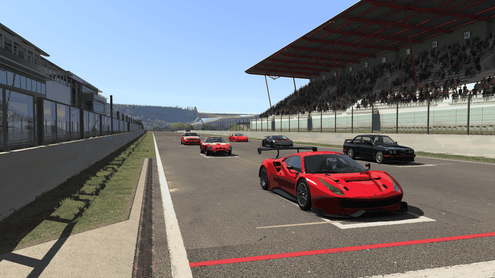
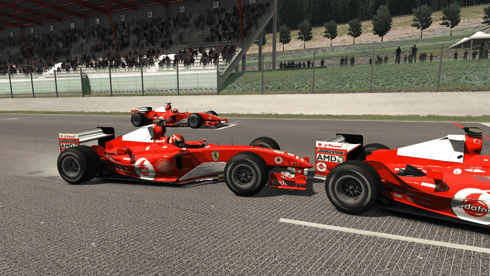
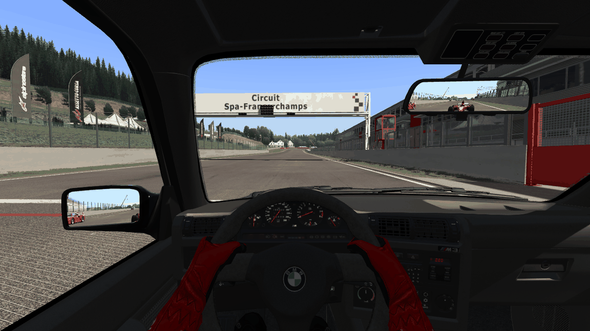

# Task 24b: every car drawn and heard, race.ini's cars, the focused car

## Resume here

**The task stopped early at a usage limit: NOT released, no tag, version still 0.24.0.** Items 1 to 6 are written, committed and proven (sections 3 to 7). Nothing is half-wired. Left to do:

- **Performance (section 9) is not measured.** `sh re/scratch/task24b/perf.sh` on a quiet machine writes the rows (1, 6, 12, 24 cars, and the runs that tell what limits the frame rate).
- **The older picture batches of Tasks 21 and 22 were still running** (`re/scratch/task24b/old/batch21_result.txt`, `batch22_result.txt`: 18 of 27 identical so far, none different). Tasks 20, 22c and 23 are done, all identical.
- **Three code reviews** (`re/scratch/task24b/review_*.md`): the first is in and not acted on yet. Its points: the other cars' lollipop men never rise (`in_pit = false` for every crew); a `--screenshot` of several cars without `--lead-in` draws the other cars with wheel and pedals at 0 (frame time 0); the player's lap count comes from the lap list and the others' from the transponder (mixed in the real-time order and the grooves); rustyAC's own HUD is not under the fade. Reviews 2 and 3 were still being written.
- Then: section 9, the version `0.24.1`, the lock files, the tag (`docs/release.md`).

- The task text is `prompts/24b_draw_hear_cars.md`: draw every car, the focused car and its keys, hear every
  car, race.ini's `[CAR_n]` cars, collision events for every car, `--graphics max` without post-processing.
  What is not done is in section 10.
- To run a proof again:
  - picture: `sh re/scratch/task24b/batch.sh` (19 sequences of several cars, about 25 minutes; needs the tapes
    of `oracle/t24b/`, see section 12);
  - sound: `sh re/scratch/task24b/audio_batch.sh` (14 drives, about 12 minutes);
  - race.ini: `car_oracle race-ini re/scratch/task24b/race/race6.ini --root re/scratch/task24b/race_root`;
  - without the game: `cargo test --release -p rustyac-render --test golden_cars`.
- On disk, git-ignored: `re/scratch/task24b/` (three reader briefs `spec_*.md`, three reviews `review_*.md`,
  the patch scripts, the batches and their results, the test race.ini files, the pictures' raw files),
  `oracle/t24b/` (the tapes of several cars).
- Task 25 (AI drivers) starts from section 10.

## 1. Plain-English summary

Since Task 24 several cars drive in one world, bit for bit as in Assetto Corsa, but only your own car was
drawn and heard. **Now every car is drawn and heard, the way the game does it**, and a session set up in
Content Manager with other cars starts with those cars.

- **Every car is drawn.** Each car has the full car of Tasks 20 to 23: its levels of detail by distance, its
  driver, lights, damage, tyre smoke, skid marks, flames, blur, ground shadow, mirrors. With several cars the
  game adds a few rules of its own, all ported as they are:
  - the cars' draw order is set every frame by a sorter that draws one car last: **the car whose number equals
    the number of the camera in use** (car 0 in the cockpit, car 1 with the first chase camera). That is what
    the machine code does; it has nothing to do with distance or with the car you watch;
  - every car but yours turns its steering wheel and works its pedals **softly**: the game blends them towards
    the physics' values at ten times the frame time a frame;
  - from 26 cars on, the largest tyre-smoke setting is halved;
  - **one** rear-view picture is drawn per frame, from the car the camera is on; every car's mirror glass shows it;
  - the reflections (the cube map) never contain a car, with one car or with twenty.
- **The camera can go to another car.** `Ctrl + numpad 3` goes to the car **ahead on the track**, `Ctrl +
  numpad 1` to the car behind, `Ctrl + numpad 2` or `F4` back to yours (the keys of your `controls.ini`, as in
  the game). The picture fades to black and back in a fifth of a second, and the change happens at the black
  frame, as in the game. The dashboard that lives, the mirror, the HUD and the microphone go with the camera.
  You keep driving your own car: the game does not hand you another car's controls, and neither does rustyAC.
- **Every car is heard.** Each car has its own sounds, with the game's rules for cars that are not the
  camera's: only their outside sounds, at the level of `audio.ini [LEVELS] OPPONENTS`; the seven nearest
  engines, six turbos, four sets of tyre squeal, three sets of road noise; the far ones of those fade out;
  a crash is heard at the car that was hit.
- **race.ini's cars.** A session with other cars now starts with them: the car, the skin (also the game's
  pick when the file's skin does not exist), ballast, restrictor, pit box and grid slot of each `[CAR_n]`,
  exactly as the game's own start-up code reads them. Until rustyAC has AI drivers (Task 25) each of them is
  driven by the simple line follower, and the program says so when it starts.
- **`--graphics max`** leaves post-processing off (4 samples per pixel stay).

**How it was proven.** As in the tasks before: the game's own code and the port are given the same input, and
what they do is compared call by call.

- **Picture:** the game's own renderer with 2 to 26 of its own cars against the port, **19 sequences, 581
  frames, 8.4 million Direct3D calls: every call and every pixel identical.** The cars' states come from
  the game's own physics with several cars (Task 24's oracle now writes them down 60 times a second).
- **Sound:** 2 to 26 of the game's own car sound objects against the port, **14 drives, 10.4 million FMOD
  calls: identical.**
- **race.ini:** the game's own start-up function (`RaceManager::initOffline`) is run on a file and writes down
  the cars it makes; the port reads the same file: **9 readings, identical**. This check found a mistake in what
  had been read from the machine code before (section 6).
- **Nothing old broke:** a one-car session gives the same bytes as v0.24.0 (12 replays, three pictures); the
  several-car physics gives the same numbers as v0.24.0; all older picture and sound proofs were run again
  (section 7).

**What is still missing** (section 10): AI drivers (Task 25); the name tags above cars and the panel that names
the car you switched to; more than 32 cars are drawn and heard but the order of equals in two sorts is then not
proven; the "remote" car of multiplayer.







## 2. What is ported

| Part | In AC (`acs.exe`) | In rustyAC |
|---|---|---|
| A car's picture per car: models and levels of detail, driver, suspension, damage, lights, smoke, skid marks, flames, blur, ground shadow; the car's number (guid) | `Sim::addCar` 0x1401978a0, `CarAvatar::init3D` 0x1400d3b90, `initCommonPostPhysics` 0x1400d6190, `onPostLoad` 0x1400d92b0 | `AcRenderer::load_car` (once per car), `CarAvatar::init_3d(.., guid)`: the port of Tasks 20 to 23, now one per car |
| The cars' draw order | `CarNodeSorter::sort` 0x14006be30 (constructor 0x14006bb60, `addCar` 0x14006bdf0), called by `Sim::update` 0x14019ef90 before the cars update | `Scene::sort_cars` |
| The state a car's picture and sound get: the physics' newest step; steering, throttle and brake of every car but the first blended | `CarAvatar::setNewPhysicsState` 0x1400da420 | `CarAvatar::set_new_physics_state` (picture), `AudioWorld::frame` (sound) |
| The order of a frame with several cars: every car's update in the order the cars were made, then every car's handlers of the post-update event | `Game::update` 0x140243010, `Game::evOnPostUpdate` | `AcRenderer::draw` |
| The smoke cap from 26 cars on | `TyreSmoke::TyreSmoke` 0x1401d0000, `RaceManager::carsToBeLoaded` (0x141559b00) | `CarAvatar::cars_to_be_loaded`, `AcRenderer::set_cars_to_be_loaded` |
| The rear-view picture of the focused car, that car hidden in it | `Sim::renderScene` 0x14019e570, `MirrorTextureRenderer::render` 0x140114410, `CarAvatar::setVisible` 0x1400dade0 | `AcRenderer::draw` hands the focused car to `MirrorTextureRenderer::render` |
| The focused car and the commands that move it | `Sim::focusedCarIndex`, `Sim::onKeyDown` 0x14019a940 (the block at 0x14019be6e; F4 at 0x14019d77d), the three handlers 0x1401966c0 / 0x140196780 / 0x1401967c0, `CommandManager::CommandManager` 0x1400e8b70 (`[NEXT_CAR]`, `[PREVIOUS_CAR]`, `[PLAYER_CAR]`) | `rustyac_game::focus` (`Focus`, `FocusCommand`), `Bindings::key_next_car` … |
| Which car is "next" and "previous" | `Sim::nextCar` 0x14019a740, `Sim::previousCar` 0x14019e180 | `focus::neighbour_car` |
| The fade of a change of the focused car | `ACCameraManager::fadeIn` 0x140033690, `registerToFadeInEvent` 0x140033ce0, the camera manager's handler of `Game::evOnPostGui` 0x140032770, `Sim::cameraFadeTime` (`system/cfg/fades.ini [CHANGE_CAMERA_FADE] MS`) | `Focus::command`, `Focus::post_gui`, `rustyac_render::gl::fade_overlay` |
| A car's sound per car, the rules for cars that are not the camera's | `CarAudioFMOD::CarAudioFMOD` 0x140062830, `renderAudio` 0x1400669b0, `startStopEvents` 0x1400678c0, `setEventVolumes` 0x140067330, `shouldUseInternalSounds` 0x140067810, `MixVolumes::MixVolumes` 0x140064a40 (`OPPONENTS`) | `rustyac-audio` (ported in Task 19, run with several cars for the first time now); `GameAudio` builds one `CarSound` per car |
| The cars ranked by distance to the microphone | the block at 0x14019f39d of `Sim::update`, `AudioEngine::listenerDistance` 0x1401fa610, `CarAvatar::isInPit` 0x1400d8bd0 | `AudioWorld::listener_priorities` (Task 19) |
| Collisions handed to the car they name | `Sim::stepPhysicsEvent` 0x14019ebd0, `CarAudioFMOD::onCarHit` 0x140066480 | `audio::events_of` (every car's events), `AudioWorld::step_physics_events` |
| race.ini's cars | `RaceManager::initOffline` 0x14013a6c0 (the `[CAR_n]` loop 0x14013c1a0 to 0x14013cc8f), `isSkinAvailable` 0x14013ebc0, `getModelSkins` 0x140138c20, `ksRand` 0x1400337c0, `CarAvatar::setBallastKG` 0x1400d9de0, `setRestrictor` 0x1400da6b0, `setSpawnPositionIndex` 0x1400da760 | `rustyac_physics::session::race_grid`, `conditions::race_cars`, `sim::spawn_place` |

What the game does **not** do with several cars, checked in the machine code:

- **Collision events have one reader: the sound.** `Sim::stepPhysicsEvent` hands each event to the sound of the
  car it names and to nothing else: not to the damage picture, not to the HUD. What you see of a crash comes
  from each car's own state (its damage zones, its bent suspension), which every car's picture now gets. So
  "collision events for every car" came down to the sound: every car's events now reach it (before, only yours).
- **No car is ever in the reflections.** The cube map is drawn from the track's part of the scene only.
- **Only car 0 is "the player".** Controls, the telemetry, the lap rules stay with car 0 whatever the camera
  looks at. The sound's "outside view is louder" setting stays with the car that was focused when the camera
  *mode* last changed: a change of the focused car does not move it. Copied as it is.

## 3. The picture: results

`render_oracle compare --tapes <prefix>` builds the game's own objects for every car in one `Sim` (each car
with the game's own constructors, the game's own `CarNodeSorter`, its own `setNewPhysicsState`, its own mirror
code) and the port's, runs both through the same frames and compares every Direct3D call and every pixel
(software rasteriser). The cars' states are tapes of the game's own physics with several cars:
`car_oracle multi --audio-tape` (section 12).

| # | Sequence | Frames compared | Direct3D calls (fewest to most a frame) | Draw calls | Command log | Pixels (WARP) |
|---|---|---|---|---|---|---|
| 1 | 6 F2004 on the grid, chase view from the last car, mirror texture and virtual mirror, smoke | 29 | 541,897 (18,473 to 18,735) | 71,813 | identical | identical |
| 2 | 6 F2004, cockpit of the first car: five cars in the mirror | 29 | 340,200 (11,523 to 11,788) | 40,835 | identical | identical |
| 3 | 6 F2004, cockpit of the fourth car: cars ahead and in the mirror, virtual mirror | 29 | 437,237 (14,775 to 15,444) | 53,166 | identical | identical |
| 4 | 4 different cars (F2004, M3 E30, Sesto Elemento, 250 GTO), chase view from the last: the others pull away through the levels of detail | 99 | 1,008,957 (9,772 to 11,432) | 139,951 | identical | identical |
| 5 | two F2004: the rear-end crash from beside the car that is hit (damage, smoke, skid marks) | 59 | 473,342 (6,839 to 8,912) | 64,601 | identical | identical |
| 6 | two F2004: the rear-end crash from behind the car that hits | 49 | 346,344 (6,650 to 7,478) | 43,073 | identical | identical |
| 7 | 6 F2004 at dusk, every car's headlights on, chase view from the last car | 19 | 368,950 (19,306 to 19,455) | 50,688 | identical | identical |
| 8 | 6 F2004 at dusk, headlights, from in front of the first car | 11 | 237,792 (21,593 to 21,817) | 34,321 | identical | identical |
| 9 | 6 F2004: the focus goes from car 0 to 2 to 5 and back, cockpit view with the mirror | 31 | 421,442 (11,518 to 17,645) | 51,795 | identical | identical |
| 10 | 6 F2004: the focus changes in the chase view (the sorter's order changes with the camera only) | 17 | 261,676 (11,601 to 18,231) | 32,910 | identical | identical |
| 11 | 26 F2004 (the smoke cap), SMOKE=5, chase view from the middle of the field at the launch | 29 | 755,629 (25,318 to 26,594) | 92,087 | identical | identical |
| 12 | 26 F2004, from the last car: every level of detail in one picture | 39 | 1,398,743 (35,789 to 36,134) | 166,729 | identical | identical |
| 13 | 26 F2004, cockpit of the first car: the field in the mirror, with smoke in the mirror | 19 | 263,888 (12,425 to 14,755) | 29,441 | identical | identical |
| 14 | 6 cars drawn with carsToBeLoaded = 26 and SMOKE=5 (the cap alone) | 19 | 328,331 (17,190 to 17,339) | 43,221 | identical | identical |
| 15 | 4 F2004: the pile-up from behind the last car, smoke | 39 | 356,967 (8,937 to 9,653) | 44,316 | identical | identical |
| 16 | 4 different cars, 4 samples, high-quality mirror, cockpit of the first | 15 | 146,596 (9,720 to 10,107) | 19,815 | identical | identical |
| 17 | 6 F2004, the post-processing frame with motion blur, chase view from the last car | 15 | 267,494 (17,556 to 17,945) | 35,060 | identical | identical |
| 18 | 6 F2004: the camera's fade to black and back around a change of the focused car (cockpit, mirror) | 19 | 252,778 (11,518 to 15,606) | 30,513 | identical | identical |
| 19 | 6 F2004: the fade in the chase view with the virtual mirror | 15 | 221,533 (11,946 to 18,075) | 28,030 | identical | identical |

What the sequences show:

- **3 to 6 cars, chase and cockpit, mirrors** (1 to 4, 16): the other cars ahead and in the mirror texture, in
  the virtual mirror, with different cars (struts, four-wheel drive, a live axle), with 4 samples and the
  high-quality mirror.
- **Levels of detail** (4, 12): from the last car the others pull away through all four levels (the number
  of calls a frame falls from 11,432 to 9,772 as they go); with 26 cars every level is in one picture.
- **A crash between two cars** (5, 6, 15): damage, smoke and skid marks on both.
- **Headlights at dusk** on six cars (7, 8).
- **A change of the focused car** (9, 10) and **the fade around it** (18, 19): the dashboard that lives, the
  hidden car of the mirror, the driver's arms; the black quad of the game's own fade handler.
- **26 cars** (11 to 14): the smoke cap (with `SMOKE=5` the buffers are 4,000 particles, not 8,000), also with
  only 6 cars drawn and the count set to 26.
- **Post-processing frame with motion blur** (17).

**The comparison can fail.** With one thing left out on the port's side
(`RENDER_ORACLE_FAULT=…`, sequence 3 shortened to 8 frames):

| Left out on the port's side | Result |
|---|---|
| the sorter (`nosort`) | command log different in 6,479 lines (the first at line 7); the pixels equal (the order of opaque cars does not change the picture) |
| the blend of the other cars' wheel and pedals (`nosmooth`) | command log different in 1,350 lines, 169,721 pixels different |
| the mirror drawn from car 0 while car 3 is focused (`focus0`) | command log different in 16,863 lines |

**The golden test** (`cargo test --release -p rustyac-render --test golden_cars`): two F2004 and an M3 E30 at
Magione, 2.5 s after a start, chase camera of the last car, mirror 512, smoke: 9,186 calls, 1,237 draws. Its
log is the game's own from the oracle but for the back buffer's flags, its picture's hash is the game's
(0x5c69c603ce16bd10). NOT TESTED without Assetto Corsa or without WARP.

**In `rustyac.exe`** (on the graphics card, off screen; the three pictures of section 1):

```
rustyac.exe --car ks_ferrari_488_gt3 --track spa --no-race-ini --spawn start --opponent bmw_m3_e30:auto ^
    --opponent ks_ferrari_250_gto:auto --opponent ks_lamborghini_sesto_elemento:auto --opponent bmw_1m:auto ^
    --opponent ferrari_f40:auto --graphics max --no-hud --at 0.7 --free-camera 4.2,1.5,8.5/-1.5,0.5,-12/42 --screenshot grid.png
rustyac.exe --car ks_ferrari_f2004 --track spa --no-race-ini --spawn start --opponent ks_ferrari_f2004:parked ^
    --opponent ks_ferrari_f2004:flat.ryin --graphics max --no-hud --at 3.42 --lead-in 1.2 ^
    --free-camera 4.5,1.3,-0.5/0,0.4,-3.5/50 --screenshot crash.png
rustyac.exe --car bmw_m3_e30 --track spa --no-race-ini --spawn start --opponent ks_ferrari_488_gt3:auto ^
    --opponent ks_ferrari_f2004:auto --opponent ferrari_f40:auto --graphics max --no-hud --camera cockpit --at 0.7 --screenshot mirror.png
```

(`flat.ryin` is a recorded full-throttle drive, `--flat-out --record flat.ryin`: on grid slot 2 it runs into
the back of the standing car on pole after 3.15 s, at 47 km/h.) An unattended window was run for nine seconds
with four cars and scripted focus changes (`--focus-script next@2,previous@4,next@5,next@5.05,player@7`): the
focus went 0, 3, 0, 2, 3, 0, at 59 frames a second with the display's rate.

## 4. The sound: results

`audio_oracle compare --tapes <prefix>` builds the game's own `CarAudioFMOD` for every car in one fake `Sim`
and the port's `AudioWorld`, and logs every FMOD call. Per frame the harness does what `Sim::update` does
around the game's code: every collision event to the sound of the car it names, the game's own
`listenerDistance` for every car, the ranking, the game's own `setNewPhysicsState` for every car after the
first, the backfire test and the gear trigger per car, the listener at the camera of the focused car, then the
game's own `renderAudio` per car. Columns as in Task 19: the call log of the game against the port's run that
is told the answers the game got about its events' states (FMOD's mix is not repeatable, so those answers
differ from run to run: that is why the game's own two runs can differ).

| Drive | Cars | Listener | Frames | FMOD calls | Call log: game against port | Call log: the game run twice | Mix levels: game twice / game against port | Verdict |
|---|---|---|---|---|---|---|---|---|
| two cars passing: heard from the standing car's cockpit | 2 x F2004 | cockpit | 780 | 456,841 | identical | differs | 0.04 dB rms, 0.16 dB at most / 0.24 dB rms, 0.88 dB at most | ok (1 run(s) done again: FMOD itself crashed) |
| two cars passing: heard from beside the track | 2 x F2004 | trackside | 780 | 457,616 | identical | differs | 0.03 dB rms, 0.11 dB at most / 0.03 dB rms, 0.10 dB at most | ok |
| two cars passing: the camera on the passing car (chase) | 2 x F2004 | chase | 780 | 457,632 | identical | identical | 0.11 dB rms, 0.29 dB at most / 0.14 dB rms, 0.38 dB at most | ok (1 run(s) done again: FMOD itself crashed) |
| rear-end crash of two cars, chase view of the car that is hit | 2 x F2004 | chase | 400 | 238,539 | identical | identical | 0.11 dB rms, 0.30 dB at most / 0.07 dB rms, 0.16 dB at most | ok (1 run(s) done again: FMOD itself crashed) |
| rear-end crash of two cars, cockpit of the car that hits | 2 x F2004 | cockpit | 400 | 238,213 | identical | identical | 0.11 dB rms, 0.26 dB at most / 0.08 dB rms, 0.18 dB at most | ok (2 run(s) done again: FMOD itself crashed) |
| a field of 6 from the grid, cockpit of the first car | 6 x F2004 | cockpit | 600 | 860,247 | identical | differs | 0.15 dB rms, 0.45 dB at most / 0.14 dB rms, 0.31 dB at most | ok |
| a field of 6 from the grid, chase view of the fourth car | 6 x F2004 | chase | 600 | 862,708 | identical | differs | 0.19 dB rms, 0.58 dB at most / 0.18 dB rms, 0.55 dB at most | ok |
| a field of 6 from the grid, beside the track | 6 x F2004 | trackside | 600 | 862,359 | identical | differs | 0.12 dB rms, 0.40 dB at most / 0.04 dB rms, 0.10 dB at most | ok |
| a field of 6: the focus goes 0, 3, 5, 0 (cockpit) | 6 x F2004 | cockpit | 600 | 861,245 | identical | differs | 0.15 dB rms, 0.40 dB at most / 0.12 dB rms, 0.32 dB at most | ok |
| a field of 6: the focus goes 0, 2, 4 (chase) | 6 x F2004 | chase | 400 | 570,970 | identical | differs | 0.07 dB rms, 0.14 dB at most / 0.07 dB rms, 0.12 dB at most | ok (1 run(s) done again: FMOD itself crashed) |
| 4 different cars (F2004, M3 E30, Sesto Elemento, 250 GTO), cockpit of the last | F2004, M3 E30, Sesto Elemento, 250 GTO | cockpit | 600 | 596,624 | identical | differs | 0.13 dB rms, 0.27 dB at most / 0.14 dB rms, 0.41 dB at most | ok |
| 4 cars: the pile-up, chase view of the last car | 4 x F2004 | chase | 500 | 525,053 | identical | differs | 0.07 dB rms, 0.18 dB at most / 0.07 dB rms, 0.15 dB at most | ok (1 run(s) done again: FMOD itself crashed) |
| 26 cars (more than the 7 engines the game plays), cockpit of the car in the middle | 26 x F2004 | cockpit | 300 | 1,707,014 | identical | identical | 0.11 dB rms, 0.27 dB at most / 0.09 dB rms, 0.23 dB at most | ok (1 run(s) done again: FMOD itself crashed) |
| 26 cars, beside the track | 26 x F2004 | trackside | 300 | 1,703,199 | identical | identical | 0.09 dB rms, 0.23 dB at most / 0.08 dB rms, 0.15 dB at most | ok |

- **Two cars passing:** a standing car and one that passes it at 200 km/h, heard from the standing car, from
  beside the track, and with the camera on the passing car.
- **A field of six** from three places, and **the focus going round** in it: the interior and exterior sets
  change cars, the listener's place and speed follow.
- **Crashes** (rear-end, pile-up): the hit and scrape sounds at the car each event names.
- **Different cars** in one session (four sound banks).
- **26 cars:** more cars than the seven engines the game plays; ranks, gaps and the fades of ranks 5 and 6.

In `rustyac.exe`: a headless three-car session with the sound logged (`--audio-null --audio-log`): three cars'
sounds, "2 other car(s) with their own sounds, [LEVELS] OPPONENTS 0.8", 234,525 FMOD calls in 295 frames.
**Nobody has listened to it yet** (the checks keep the speakers quiet).

## 5. The focused car: how it works

- `Ctrl` + the key of `controls.ini [NEXT_CAR]` (numpad 3 when the section is missing), `[PREVIOUS_CAR]`
  (numpad 1), `[PLAYER_CAR]` (numpad 2); `F4` also goes back to your car. Only with more than one car, not
  while the pause menu shows. The game tests them in the order previous, player, next.
- **"Next" is the car just ahead of the focused one along the lap**, by each car's place on the track's line
  (0 to 1), not the next number. From the leader, "next" is therefore the *last* car (it is the one ahead
  round the lap). With nobody ahead the game answers car 0.
- The change goes through the camera's fade: black after `CHANGE_CAMERA_FADE` (100 ms in the game's file), the
  focus changes at that frame, back to clear after another 100 ms. A second key press during a fade makes the
  first change happen at once.
- What follows the focus: the camera, the mirror picture, the dashboard instruments that move (each car has its
  own; only the focused car's tick), the driver's arms and the steering wheel of the cockpit view, the full set
  of sounds, the listener, rustyAC's HUD (speed, gear, lap of the focused car). What stays with car 0: the
  controls, the lap list, the shared memory.

## 6. race.ini's cars: results

`car_oracle race-ini <file>` runs the game's own `RaceManager::initOffline` on the file. The functions it would
call into the rest of the game (`Sim::loadTrack`, `Sim::addCar`, the `CarAvatar` setters, the physics thread's
queue, the timing services) are replaced by small functions that write down what they are given; everything
else is the game's code: the reads of the file, the session list, the skin test and the random skin (its own
`isSkinAvailable`, `getModelSkins` and `rand()`), the ballast rule, the grid rule. The port
(`session::race_grid`) reads the same file with the same start of `rand()`, and the two lists are compared:
car, config, skin, ballast, restrictor, driver name, nation, the AI's level and aggression, pit box, grid slot.

| File | Pit boxes | `rand()` seed | Cars the game makes | Result |
|---|---|---|---|---|
| `race6.ini`: a race of 6 (F2004, two M3 E30, two 250 GTO, F2004), player 4th on the grid, skins that do not exist, ballast and restrictor, AI levels | 24 | 7 | 6 (all with a skin the game picked) | identical |
| the same | 24 | 1234 | 6 (other skins picked) | identical |
| the same, a track with 3 pit boxes | 3 | 2 | 3 | identical |
| `practice.ini`: a practice then a race, 5 cars, no skins named, no `[HEADER]` | 48 | 3 | 5 | identical |
| `gaps.ini`: `CARS=40`, sections 0, 2 and 5 to 29 missing, one section without `MODEL`, `[HEADER]` without `VERSION` | 24 | 5 | 24 | identical |
| the same | 48 | 77 | 40 | identical |
| `drag.ini`: a drag session, two cars | 2 | 9 | 2 | identical |
| `none.ini`: `CARS=3` with only `[CAR_0]` | 24 | 1 | 3 | identical |
| the same on a track without pit boxes ("CANNOT HAVE 0 CARS IN RACE.INI") | 0 | 1 | 0 | identical |

What the game does, in short (all of it is in `race_grid`):

- `[RACE] CARS` cars (at least 1, at most the pit boxes), in the order of their sections.
- `MODEL=-` keeps the car before's; so does `MODEL_CONFIG=-`.
- A skin that is empty or not a folder of the car: the game picks one. The first such car of a model draws one
  random place in the model's list of skins; the next ones of that model take the following skins, round the list.
- `BALLAST` and `RESTRICTOR` only with `[HEADER] VERSION` 2 or more, and only above 0; for every car.
- Pit box = the car's number. Grid slot: in a race, the player takes `STARTING_POSITION` (or the last place),
  the others fill the slots round it; else the car's number.
- **A missing `[CAR_n]` section does not skip the car.** The game skips the *reads* and makes the car from what
  the car before left behind: same model, same skin, same AI level. (The reading of the machine code done in
  Task 24 said the car is skipped; the oracle showed 24 cars where 3 sections existed, and the code at
  0x14013c208 confirms it. A file with `CARS=3` and only `[CAR_0]` gives three cars.)
- No setup is read for any car: every car starts with its default setup (the setup of `[CAR_0] SETUP` is a
  launcher's key that rustyAC loads for your car, as before).

In `rustyac.exe`: a session from `race6.ini` (`--race-ini <file> --car ks_ferrari_f2004 --track spa`) starts
with the five other cars on their grid slots, with their skins, ballast and restrictor, and says:

```
5 other car(s) from race.ini ([RACE] CARS=6, 24 pit boxes). Assetto Corsa gives each an AI driver; rustyAC has
none yet (Task 25), so each is driven by the stand-in line follower ("auto"), which follows the racing line
and knows nothing of other cars. --no-race-cars leaves them out; --opponent names cars of your own
  car 1: bmw_m3_e30, skin Sterling_Silver_metallic (picked as the game picks one: the file's is not a skin of the car), pit box 1, grid slot 0, restrictor 15, Opponent One
  ...
```

Its recording replays to the same hash over all six cars with 0 and with 8 worker threads.

## 7. Nothing old broke

**One car, and the several-car physics, against v0.24.0** (`python re/scratch/task24b/one_car_same.py`: the
program built from the tag `v0.24.0` against the new one):

| Check | What | Old (v0.24.0) against new |
|---|---|---|
| replay `car_random` | state dump of every step, 627 MB | identical |
| replay `car_wc_wc_stops` | state dump of every step, 106 MB | identical |
| replay `collide_spa_wall_high` | state dump of every step, 218 MB | identical |
| replay `collide_spa_wall_low` | state dump of every step, 153 MB | identical |
| replay `collide_spa_lap` | state dump of every step, 657 MB | identical |
| replay `awd_sesto_wc_spirited` | state dump of every step, 119 MB | identical |
| replay `hy_ks_ferrari_sf15t_hy_deploy` | state dump of every step, 321 MB | identical |
| replay `t17_bmw_m3_e30_wc_spirited` | state dump of every step, 121 MB | identical |
| replay `t18_monza___bmw_m3_e30_trk_object` | state dump of every step, 234 MB | identical |
| replay `conditions_spa_setup` | state dump of every step, 53 MB | identical |
| replay `lap_trk_lap` | state dump of every step, 1661 MB | identical |
| replay `t22b_f2004_spa_crash` | state dump of every step, 393 MB | identical |
| screenshot: debug view, F2004 on Spa, 6 s of the line follower | car state a06ef70c21bb1d84 / a06ef70c21bb1d84, picture 396554cbe8e1a4e0 / 396554cbe8e1a4e0 | identical, same picture |
| screenshot: AC renderer on WARP, F2004 on Spa, 6 s of the line follower | car state a06ef70c21bb1d84 / a06ef70c21bb1d84, picture e2232f5ac5f592b7 / e2232f5ac5f592b7 | identical, same picture |
| screenshot: AC renderer on WARP, cockpit, BMW M3 E30 on Magione, 9 s, mirrors and smoke | car state a54e3c60de7eea1c / a54e3c60de7eea1c, picture 7243aac84029fcc8 / 7243aac84029fcc8 | identical, same picture |
| 6 cars: a 12 s drive recorded by v0.24.0, replayed by both with 0 and 8 worker threads | hash over every car of every step: ca8c2e889c923e1e / ca8c2e889c923e1e / ca8c2e889c923e1e / ca8c2e889c923e1e | identical |
| 12 cars: a 12 s drive recorded by v0.24.0, replayed by both with 0 and 8 worker threads | hash over every car of every step: 7dd340641b56394b / 7dd340641b56394b / 7dd340641b56394b / 7dd340641b56394b | identical |

**The older proofs, run again with this task's code:**

| Proof | Runs | Result |
|---|---|---|
| Picture, Task 20: the track and one car (single frames) | 21 | all identical (log and pixels) |
| Picture, Task 21: the whole car (sequences) | 18 | all identical |
| Picture, Task 22: the scene | 0 of 0 identical (**see the result file**) | all identical |
| Picture, Task 22c: the leftovers | 18 | all identical |
| Picture, Task 23: multisampling | 8 | all identical |
| Picture, Task 23: the post-processing frame | 16 | all identical |
| Sound, Task 19: 18 one-car drives | 18 | call logs identical, all "ok" |
| Whole car against the game's recordings (`chassis_compare run`, 11 scenarios) | 70,006 steps | 100 % bit-exact |
| Contacts on Spa, recorded anew (`spa_wall_high`, `spa_kerb_strike`) | 12,001 steps | 100 % bit-exact |
| Rays on Spa (`car_oracle rays`, 20,000) | 20,000 | no difference |
| Several cars, the game's engine recorded anew: 6 F2004 (Spa), rear-end, pile-up, 4 different cars, **26 F2004**, a pass, 3 cars at Magione | 7 runs, 2 to 26 cars | identical |
| Several cars, the kept recordings with 0, 1 and 8 worker threads | 4 | the same for all |
| `cargo test --release --workspace` | 226 tests | all pass |
| `cargo clippy -D warnings`: native, `wasm32-unknown-unknown`, `wasm32-wasip1`; every tool builds `--locked` | | clean |

## 8. How to drive with other cars

```
# the session of Content Manager (Documents\Assetto Corsa\cfg\race.ini) with its other cars
rustyac.exe --car ks_ferrari_f2004 --track spa

# five more F2004s on the grid, each driven by the line follower; you drive car 0
rustyac.exe --car ks_ferrari_f2004 --track spa --no-race-ini --spawn start --cars 6

# name each other car: <car>[:<skin>]:<parked | auto | file.ryin>
rustyac.exe --car ks_ferrari_488_gt3 --track spa --no-race-ini --spawn start ^
    --opponent bmw_m3_e30:auto --opponent ks_ferrari_250_gto:parked --opponent ferrari_f40:my_lap.ryin

# watch another car from the start; a picture of the field from the last car
rustyac.exe --car ks_ferrari_f2004 --track spa --no-race-ini --spawn start --cars 6 --autodrive --focus 5
rustyac.exe --car ks_ferrari_f2004 --track spa --no-race-ini --spawn start --cars 6 --autodrive --focus 5 --at 3 --screenshot six.png
```

| Key | What it does |
|---|---|
| `Ctrl` + numpad 3 | the camera to the car ahead on the track (`controls.ini [NEXT_CAR] KEY`) |
| `Ctrl` + numpad 1 | the camera to the car behind (`[PREVIOUS_CAR]`) |
| `Ctrl` + numpad 2, or `F4` | the camera back to your car (`[PLAYER_CAR]`) |
| `F1`, `F6`, `F11` | as before, for the car the camera is on: the driving views, the car's own cameras, the virtual mirror |

- The numpad keys need Num Lock on (they are the numpad's key codes, as in the game). `Ctrl` is the modifier
  rustyAC uses for the game's other commands too (`[RUSTYAC] COMMAND_MODIFIER`).
- While the camera is on another car you still drive your own; the HUD says which car the camera is on.
- race.ini's other cars are loaded by default; `--no-race-cars` leaves them out, `--cars` or `--opponent`
  replace them, `--no-race-ini` reads no file at all (unattended checks should use it: Content Manager
  rewrites the file with every session).
- The other cars are driven by the line follower (`auto`): it follows the racing line at its own pace and does
  not know of other cars, so it runs into what is on its line. That is the stand-in until Task 25.
- `--focus <n>` starts with the camera on car n; `--focus-script next@2,previous@4,player@6` presses the keys
  by the clock (for unattended checks).
- Nobody has driven among drawn cars at the wheel yet, and nobody has listened: every check here ran off
  screen or in a window that closed itself, with the speakers quiet.

## 9. Performance

Still to come.

## 10. Not done

1. **AI drivers** (Task 25). The other cars are driven by the stand-in line follower, a recorded drive, or
   stand still. What an AI needs from the engine is in `docs/port/several_cars.md`, section 6; new here: each
   race.ini car's `AI_LEVEL` and `AI_AGGRESSION` are read as the game reads them (`RaceCar::ai_level`,
   `ai_aggression`, `RaceGrid::ai_level`) and not used yet; the game's AI cars also set a flag the backfire
   test reads (`aiState.isActive`), which stays off.
2. **The driver's name panel and the name tags.** When the focus changes the game shows a panel with the
   driver's and the car's name for five seconds (`SystemMessage::addCarMessage` 0x1401b60b0) and can draw name
   tags above the cars (`DriverNameDisplayer`). rustyAC prints the car on the console and in its own HUD.
3. **More than 32 cars.** They are drawn and heard, but the game's sorter and its ranking by distance use the
   C++ library's sort, which above 32 entries may put equal entries in another order than rustyAC's (which
   keeps their order). No track of the game has more than 32 pit boxes but one layout of the Nordschleife (32).
4. **The camera manager's four-second fade from black at a session's start**, the track cameras (F2, F3),
   the free cameras (F5, F7): rustyAC has the cockpit, the driving views and the car's own cameras, as before.
5. **Your own car from race.ini.** The player's car is still the one of `--car`; the file's `[CAR_0]` gives
   its place, ballast and restrictor, and (in a session with other cars, when `--car` is the file's car) its
   skin, the game's pick included. In a session of one car a skin that does not exist still gives the car's
   first skin, as before.
6. **The "remote" car of multiplayer** (Task 24's design, `docs/port/several_cars.md` section 7): not built.
7. **The race start for all cars** (the gearbox lock before the lights, the jump start): Task 26. The start
   lights are drawn as before.
8. **The shared-memory pages and `--dump-states`** still describe car 0 only.

## 11. Open questions and decisions

1. **The stand-in driver.** `auto` (the line follower) for every race.ini car, as the task says. It is not the
   game's AI and it crashes into cars on its line; a grid start works for the first seconds because every
   car eases onto the line at the same pace.
2. **A slot the track does not have.** The game puts a car whose pit box or grid slot does not exist at the
   origin of the world (or on a taken slot, when a spawn set was listed twice). rustyAC puts it on the slots
   again from the first and says so on the console. A race.ini car without a model (the game would stop
   loading) is left out with a line on the console.
3. **Hot-lap sessions with several cars.** The game puts every car on the one hot-lap slot, inside each other,
   and looks for no contacts for the first 0.75 s. Copied for race.ini's cars; `--cars` / `--opponent` still put
   the others on the grid, as in Task 24.
4. **Where "next car" goes from the leader**: to the last car. That is the game's rule (the car ahead round
   the lap), kept.
5. **The order of several cars' collision events within one physics step.** The game has one queue for all
   cars; rustyAC collects each car's events and hands them over car after car. Each event goes to its own
   car's sound, so only the order of FMOD calls of two cars hit in the same 3 ms could differ. In the oracle
   the game's own order is used.
6. **The first frame of another car.** The game blends the other cars' pedals from the values of a freshly
   made car (zero); the oracles start both sides from the first state of the tape. One frame, the first.
7. **The real-time position** on the dashboards that show one: by laps, then by the place along the lap.
   The game takes it from its race manager's list, which is not ported; `leaderboard position` is the same
   number plus one.
8. **Reader briefs are claims.** Two statements read from the machine code for this task were wrong (a missing
   `[CAR_n]` section skips the car; the fade handler takes the frame time by pointer). Both were caught by an
   oracle run, not by reading. Where this report says "the game does X" for something an oracle run covers, it
   was seen; the list of what was only read is section 2's "does not do" list.


## 12. Tools

- `car_oracle multi --scenario <mc_...> --track <t> [--cars a,b,…] [--steps n] --audio-tape --threads 0 --out <dir>`:
  the game's own engine with several cars, and a tape per car (`<scenario>.car<n>.audiotape`: the game's own
  `CarPhysicsState` 60 times a second; the physics events of all cars are in the first car's tape). New
  scenarios: `mc_train` (as many cars as `--cars` names, 26 by default, in two columns along the line: more
  cars than a grid has slots), `mc_pass` (a car passes a standing one).
- The tapes of the proofs (`oracle/t24b/`, git-ignored; seconds to record):
  `field` = `mc_field --track spa --steps 5000`, `rear` = `mc_rear_end`, `pile` = `mc_pile_up`, `mixed` =
  `mc_mixed --steps 5000`, `train` = `mc_train --steps 3000`, `pass` = `mc_pass`, `magione` = `mc_field --track
  magione --cars ks_ferrari_f2004,bmw_m3_e30,ks_ferrari_f2004 --steps 1200`.
- `render_oracle compare --tapes <prefix> [--max-cars n] [--loaded n] [--set focus=<car>[@frame],alllights=1]
  [--fade-at <frame>]`, or `--poses <car>=<file.pose>,…` (`render_oracle pose-of --tape <f> --tape-from <n>
  --pose <out>` cuts a pose out of a tape). `RENDER_ORACLE_FAULT=nosort|nosmooth|focus0`.
- `audio_oracle compare --tapes <prefix> [--max-cars n] [--focus 0,3@150,…] --camera cockpit|chase|trackside
  --frames n`.
- `car_oracle race-ini <file.ini> [--pit-slots n] [--seed n] --root re/scratch/task24b/race_root`.
- `rustyac.exe`: `--focus`, `--focus-script`, `--no-race-cars`; a screenshot of several cars prints every car's
  place, heading, speed and damage; `--record` also keeps a `--flat-out` drive.
- `re/scratch/task24b/`: `batch.sh`, `audio_batch.sh`, `old/*.sh` (the older picture batches with their
  results kept apart), `perf.sh`, `one_car_same.py`, `tables.py`, `fill_report.py`.
