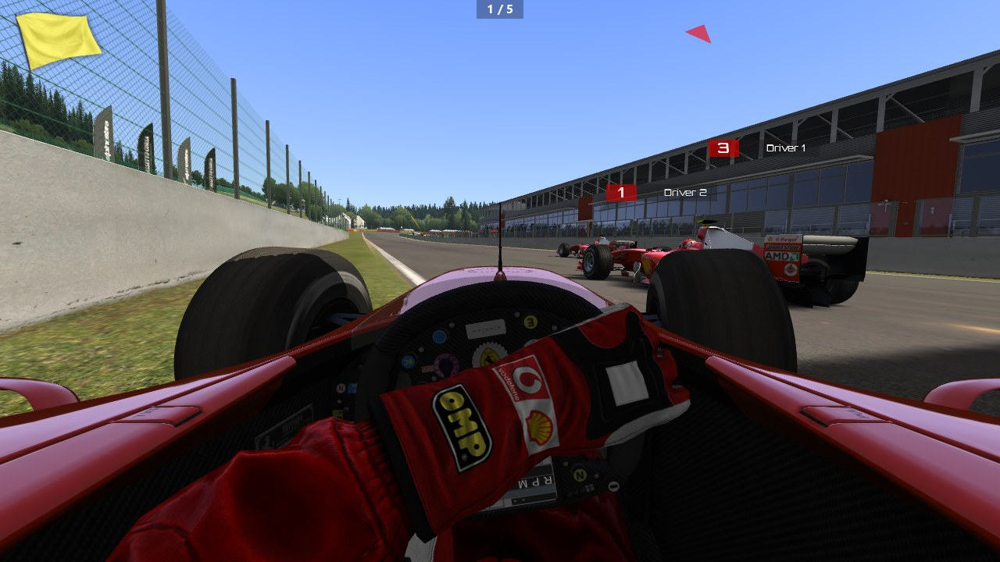
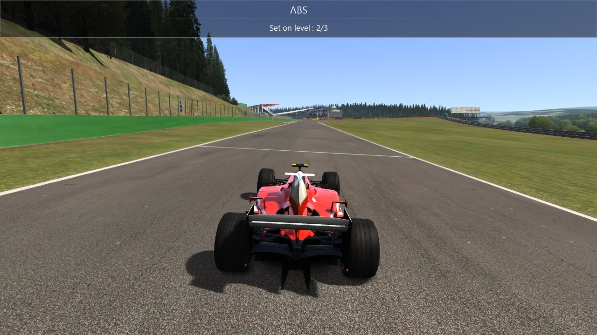
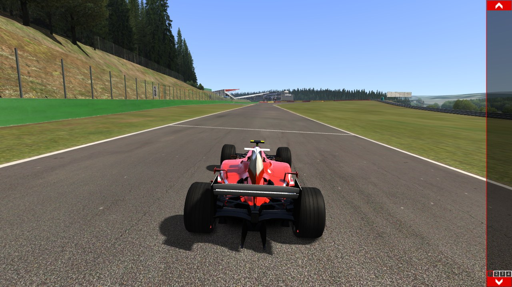

# AC's widget library, its fonts and the HUD (Task 29)

> **Task 38c:** the `re/scratch/task…` paths below are history: those folders were scratch and
> most were deleted in the disk cleanups of 2026-10-15 and 2026-10-18. Every proof of this report
> reruns from `tools/proofs` (`sh tools/proofs/run_all.sh`); `docs/port/proofs.md` lists each path
> and what replaces it.

## Resume here

State after the last commit (update after every commit):

- **Done and proven:** the text drawing (`crates/rustyac-render/src/fw1.rs`), all 23 objects
  of ksGUI (`crates/rustyac-gui`), input routing, form dragging, the app bar with its
  desktops, `acos.ini` read and written; every HUD object of the task (`hud.rs`,
  `hud_flags.rs`, `hud_cars.rs`).
- **In `rustyac.exe`:** `crates/rustyac-game/src/render/gui.rs` (`GameGui`) makes the GUI and
  the HUD objects and feeds them; `AcRenderer::draw` calls it at `GUI::render` and
  `Game::renderHUD`; the window sends mouse, keys and characters; Ctrl+H / U / L / J / Q and
  F10; `--debug-hud`, `--no-gui`, `--cfg-dir`, `--gui-do`. Own files go to `cfg` beside the
  exe (`acos.ini`, `gameplay.ini`).
- **Proof batch:** `sh tools/proofs/gui.sh` (was `sh re/scratch/task29/gui_all.sh`, deleted) (all 14 GUI sequences through the oracle,
  about 3 minutes; result lines in `re/scratch/task29/gui_all.txt`). One sequence:
  `tools/render_oracle/target/release/render_oracle.exe gui --gui <name> --root re/scratch/task29/root --out re/scratch/task29/out`
  (names: `text base forms forms_layout forms_overlap widgets_a widgets_b widgets_c hud_messages
  hud_flags hud_flags_triple hud_cars hud_cars_simple hud_cars_noflag`). The text backend
  without DirectWrite: `render_oracle.exe text-fallback --root … --out …`. Everything at the
  end of the task: `sh tools/proofs/gui.sh` (was `sh re/scratch/task29/end.sh`, deleted) (results in `re/scratch/task29/end/`).
- **Pictures:** `rustyac.exe --no-race-ini --track spa --autodrive --screenshot x.png --at 3
  --gui-do "message:ABS|Set on level : 2/3"` (more in the section "Pictures").
- **Next (nothing is half done):** see "Not done": the apps themselves (forms), the browser's
  painter, the VR path.
- **Briefs** (git-ignored, written by readers from the disassembly; claims, not facts, until
  the oracle agrees): `re/scratch/task29/spec_*.md`. Patch scripts used on the way:
  `re/scratch/task29/p*.py`.
- **Gotchas found:** a Bash heredoc with an apostrophe in it fails (write files with the
  Write tool); the oracle's `--root` must be absolute after the game's side changes directory
  (the option makes it so); the game's side needs its handlers hung on events before any
  script call can fire one (`hook_all` runs before every op); never run two oracle commands
  on one root at the same time.

## In plain English

Assetto Corsa draws everything that is flat on the screen with a small library of its own,
ksGUI: windows ("forms", which the game calls apps) that can be dragged, pinned and zoomed,
buttons, sliders, lists, graphs, and a bar on the right edge of the screen with four virtual
desktops. On top of that sit the HUD objects: the message banner, the session line, the
flags, the penalty banners, the name tags over the other cars, the red arrows for cars beside
you, the damage picture, the fuel light.

This task ported all of that library and those HUD objects to Rust, one to one from the
game's machine code, together with the way the game draws text (a library called
FW1FontWrapper on top of Windows' DirectWrite). `rustyac.exe` now shows AC's own HUD instead
of rustyAC's text panels (those are still there: `--debug-hud` or F10).

The port was checked against the game itself: the game's own code was run inside a test
program, fed the same scripted mouse moves, key presses and session states as the port, and
for every frame three things were compared: the list of commands sent to the graphics card,
the finished picture pixel by pixel, and the state of every control. All 14 scripts (1,262
frames, about 0.9 million graphics commands) are identical. The layout file the game writes
(`acos.ini`) comes out byte for byte the same.

What is not there yet: the apps themselves (no form of the game is ported, so the app bar is
empty), the GUI in the browser preview (only its text drawing is prepared), and the VR path.

## What is ported

Everything below is in `crates/rustyac-gui` (a new crate, GPL like the rest of the game's
code, with no platform code: it compiles for the browser's targets too) unless another path
is given. Addresses are of `acs.exe`.

### ksGUI (`ksGUI.lib`, namespace `ksgui`)

| Object (size) | File | Functions |
|---|---|---|
| `Control` (0x178), `Label` | `control.rs` | `Control::Control` 0x140244150, `render` 0x140244b80, `hitTest` 0x140244730, `getWorldRect` 0x1402446c0, `localToWorld` 0x140244770, `worldToLocal` 0x1402452b0, `setPosition` 0x1402450a0, `setSize` 0x140245120, `resetBaseRect` 0x140244ed0, `scaleByMult` 0x140244f50, `setVisible` 0x1402451a0, `stepRepeatInterval` 0x1402451c0, the mouse and key handlers 0x140244890 … 0x140244b10, `addControl` 0x140244690; `Label::Label` 0x14024ad70, `render` 0x14024afc0 |
| `GUI` (0x190) | `gui.rs` | `GUI::GUI` 0x140251ac0, `getSkinColor` 0x140253e60, `addControl` 0x140252e50, `render` 0x140254c10, `doRender2D` 0x1402539d0, `onMouseDown` 0x140254290, `onMouseMove` 0x140254320, `onMouseUp` 0x1402545c0, `onMouseWheelMoved` 0x140254720, `onKeyDown` 0x140254230, `onKeyChar` 0x1402541e0, `setCapturedForm` 0x1402556c0, `isFormInside` 0x140254070, `isPointInside` 0x140254190 |
| `Form` (0x1b8), `GameScreen` (0x1b0) | `form.rs` | `Form::Form` 0x140245890, `hitTest` 0x1402466a0, `onMouseMove` 0x140246720, `onTitleClicked` 0x140246830, `onVisibleChanged` 0x140246860, `scaleByMult` 0x1402468f0, `setAutoHideMode` 0x140246a30, `setBlocked` 0x140246ae0, `setIcon` 0x140246b10, `setIconVisible` 0x140246cc0, `setSize` 0x140246d60, `updateScaleByMult` 0x140246df0, the five handlers 0x140246490 … 0x140246540; `GameScreen::GameScreen` 0x140250bd0, `addControl` 0x140250d10, `render` 0x140250de0, `showDesktop` 0x140250e70, `shutdown` 0x1402510c0 |
| `Taskbar` (0x268), `TaskBarIcon` (0x218) | `taskbar.rs` | `Taskbar::Taskbar` 0x140258a20, `addDesktop` 0x1402599f0, `addForm` 0x140259c10, `cycleDekstop` 0x140259df0, `mouseWheelMoved` 0x140259eb0, `onMouseMove` 0x140259f70, `render` 0x14025a050, `selectVirtualDesktop` 0x14025a2b0, `updateAppIconsPosition` 0x14025a360; `TaskBarIcon::TaskBarIcon` 0x14025c1e0, `hide` 0x14025c720, `onMouseMove` 0x14025c7c0, `render` 0x14025c8d0, `setDescriptionText` 0x14025ca40, `setIcon` 0x14025cb60 |
| the layout file | `acos.rs` | `GUI::deserializeForm` 0x140252f90, `deserializeOldForm` 0x140253890, `fromIni` 0x140253b20, `deserializeFormDesktop` 0x1402533a0, `serializeMemoryForm` 0x1402553e0, `serializeForms` 0x140254d60 with its section writer 0x140252540, the desktop-change handler 0x140252490 |
| `ProgressBar` (0x188), `ActiveButton` (0x240), `CheckBox` (0x1a8), `Slider` (0x1c8) | `widgets.rs` | `ProgressBar` 0x14024def0, `render` 0x14024dff0 (+ `renderHorizontal` 0x14024e030, `renderVertical` 0x14024e1e0); `ActiveButton` 0x14024b160, `onMouseMove` 0x14024b470, `render` 0x14024b510, `setMultipleTexture` 0x14024b700, `setSelected` 0x14024ba80, `setText` 0x14024baa0; `CheckBox` 0x14024a870, `render` 0x14024abf0, `setCheck` 0x14024ad40; `Slider` 0x14024f9f0, `onMouseDown` 0x1402501c0, `onMouseMove` 0x140250310, `onMouseUp` 0x1402504a0, `render` 0x140250580, the marker functions 0x140250810 … 0x140250a90 |
| `ScrollBar` (0x1c0) with `MovingBar` (0x200), `TextBox` (0x190), `TextInput` (0x1d0), `PopOver` (0x188), `ConnectedLabel` (0x1d8), `TabBar` (0x200), `DefaultSystemMessage` (0x1b0) | `widgets2.rs` | `ScrollBar` 0x14025ae60, `drawArrow` 0x14025b5d0, `render` 0x14025bd60, `setItemsNumber` 0x14025c0a0, `setItemsPerPage` 0x14025c0b0, `setValue` 0x14025c150; `MovingBar` 0x14025ab60, `render` 0x14025bbd0; `TextBox` 0x14024e330, `render` 0x14024e5a0, `setFormattedText` 0x14024e6e0; `TextInput` 0x140245310, `onKeyChar` 0x1402455d0, `render` 0x140245700, `validateText` 0x140245820; `PopOver` 0x140255700, `render` 0x140255a20, `renderPopOver` 0x140255a70; `ConnectedLabel` 0x14044e800, `init` 0x14044ea00, `render` 0x14044ebb0; `TabBar` 0x140257990, `addTab` 0x140258120, `onTabClicked` 0x140258360, `render` 0x140258530, `updateTabs` 0x1402588b0; `DefaultSystemMessage` 0x14025a4a0, `render` 0x14025a8d0, `setMessage` 0x14025aab0 |
| `ListBox` (0x218), `ListBoxRow` (0x1a8), `Graph` (0x1b8) | `widgets3.rs` | `ListBoxRow` 0x140255dd0, `render` 0x1402563c0, `setRow` 0x140256680; `ListBox` 0x140248340, `addItem` 0x1402495f0, `render` 0x140249c30, `selectItem` 0x14024a290, the scroll functions 0x14024a030 … 0x14024a250; `Graph` 0x140247170, `addSerie` 0x140247620, `addValue` 0x140247700, `render` 0x1402478e0, `renderAxes` 0x140247ba0 |
| `Spinner` (0x270), `CustomSpinner` (0x1d8) | `spinner.rs` | `Spinner` 0x14024bac0, its four handlers 0x14024c810 … 0x14024ca40, `render` 0x14024cdd0, `resize` 0x14024d6b0, `setValue` 0x14024dd30; `CustomSpinner` 0x14024ead0, `render` 0x14024f0c0, `resize` 0x14024f3c0 |

Each file's first comment lists every function of its objects. Also there: the skin
(`content/gui/skin.ini`, read by `GUI::GUI`), `[GUI] ALLOW_OVERLAPPING_FORMS` of
`gameplay.ini`, `[AC_APPS] SCALE_STEP` of `assetto_corsa.ini`, and a form's `devApp` flag
(the switch `ENABLE_DEV_APPS` itself is read by the code that makes the apps, which is not
ported: see "Not done").

The game's objects point at each other. In the port every control lives in one list of the
`Gui` and is named by its index; what a subclass overrides is chosen by the control's kind.
Drawing goes through a trait (`painter::Painter`: the calls the game makes on `GLRenderer`,
`GraphicsManager`, the resource store and kgl's fonts), so the crate knows nothing of
Direct3D. `crates/rustyac-render/src/gui_paint.rs` implements the trait with the renderer's
ports of those classes.

### The frame

`AcRenderer::draw` (`crates/rustyac-game/src/render/ac.rs`) had the game's order already
(scene, `Game::evOnPreGUI`, the 2D pass's states, `Game::renderHUD`, `Game::evOnPostGui`).
Now `GUI::render` draws the game screen with its controls and the app bar where only the
three state calls were, and the HUD objects' `renderHUD` run in the HUD pass in the order
`Sim::Sim` 0x140192070 makes them: SystemMessage, WrongWayIndicator, LapInvalidatorAvatar,
DriveThroughPenaltyAvatar, LockControlsTimeAvatar, ProximityIndicator, DriverNameDisplayer,
DamageDisplayer, FuelLight. The update pass of the HUD objects runs right before
`GUI::render` instead of before the scene: nothing in between reads what they change.

### The HUD objects

| Object (size) | File | Functions |
|---|---|---|
| `SystemMessage` (0x98) with `DriverStatusSystemMessage` (0x228) and `SessionStatusSystemMessage` (0x58) | `hud.rs` | `SystemMessage` 0x1401b5610, `setMask` 0x1401b65d0, `addMessage` 0x1401b61c0, `addCarMessage` 0x1401b60b0, `clearMessage` 0x1401b6400, `loadDriversInfo` 0x1401b64f0, `update` 0x1401b66b0, `renderHUD` 0x1401b6520; `SessionStatusSystemMessage` 0x140169550, `update` 0x140169bc0, `render` 0x140169ac0; `DriverStatusSystemMessage` 0x14008e4a0, `loadDriversInfo` 0x14008f0b0, `render` 0x14008f800 |
| `SystemNotification` (0xa8) | `hud.rs` | 0x1401b68a0, `clearMessage` 0x1401b78b0, `showNotification` 0x1401b7910, `update` 0x1401b79c0 |
| `FlagManager`'s drawing (0x108) | `hud_flags.rs` | ctor 0x14009ab60, `addFlagControl` 0x14009bfb0, `update` 0x14009d140, `setFlag` 0x14009cf00, `clearFlag` 0x14009cb60, `setBlueFlag` 0x14009ce30, the black flag's handler 0x14009b830 |
| `LapInvalidatorAvatar` (0xb8) | `hud_flags.rs` | ctor 0x140111990, `renderHUD` 0x140111c00 |
| `DriveThroughPenaltyAvatar` (0x78) | `hud_flags.rs` | ctor 0x1400907b0, `renderHUD` 0x140090b50 |
| `LockControlsTimeAvatar` (0x90) | `hud_flags.rs` | ctor 0x14009d8c0, `renderHUD` 0x14009dc50 |
| `WrongWayIndicator` (0xb8) | `hud_flags.rs` | ctor 0x1401d83d0, `update` 0x1401d8940, `renderHUD` 0x1401d87a0 |
| `FuelLight` (0xd8) | `hud_flags.rs` | ctor 0x1400bb510, `renderHUD` 0x1400bc030, its flag handler 0x1400bbad0 |
| `DriverNameDisplayer` (0x138) with `CarLabel` (0x230) | `hud_cars.rs` | 0x14008c7e0, `projectPoint` 0x14008d550, `renderHUD` 0x14008d900, `setActive` 0x14008e070, `update` 0x14008e2c0; `CarLabel` 0x140069840, `resetRects` 0x14006a660, `updatePilotData` 0x14006a8a0; `Sim::getNationFlag` 0x140199350 |
| `ProximityIndicator` (0x60) | `hud_cars.rs` | ctor 0x140123880, `renderHUD` 0x140123a80 (with `Node::worldToLocal` 0x14020e730) |
| `DamageDisplayer` (0xb0) | `hud_cars.rs` | ctor 0x140078c10, `renderHUD` 0x14007ae80, `show` 0x14007b7f0, its 18 readers 0x14007a120 … 0x14007a4a0 |

Their settings are read as the game reads them: `system/cfg/messages.ini`,
`session_info.ini`, `name_displayer.ini`, `proximity_indicator.ini`, `damage_displayer.ini`
from the game's folder, and `gameplay.ini` (`[DRIVER_NAME_DISPLAYER] IS_ACTIVE`,
`[DAMAGE_DISPLAYER] IS_ACTIVE`, `[DOWNSHIFT_PROTECTION_NOTIFICATION]`). Where the game writes
back at its end (`acos.ini`, the two `IS_ACTIVE` switches) rustyAC writes its own copies into
its own cfg folder (`cfg` beside `rustyac.exe`, or `--cfg-dir`); a `gameplay.ini` there
starts as a copy of the one in Documents, which is only ever read.

The game's objects read the session through `Sim`. The ported ones are handed a `HudInput`
every frame (`hud.rs`). In `rustyac.exe` the glue `crates/rustyac-game/src/render/gui.rs`
fills it: the cars from the picture's own car views (place, fuel, damage, steering), the
session from the referee of Task 28 (`RefereeGui` in `crates/rustyac-game/src/referee.rs`:
session type and texts, time to the start, flags shown, the black flag's caption, penalty
seconds, drive-through laps, locked controls, lap validity, places and laps of every car, how
much the player's car points against the road), the pit penalty from the pit stop code, the
damage from the physics, and the names from `race.ini` and the cars' `ui_car.json`. The
messages the game's notifiers make for ABS, traction control, brake bias and the auto shifter
come up when those change; a change of the focused car shows that car's bar.

Things the oracle taught that the reading had wrong or had not seen:

- a `CarLabel`'s controls are named `L"CAR_LABEL" + index`, `L"Name" + index` and so on: the
  game adds the car's index to a pointer, so car 1's controls are called "AR_LABEL" and "ame";
- `FlagManager::setFlag(NoFlag)` sends its event as "not active" (the fuel light goes back to
  x = 25), unlike every other flag;
- `CarAvatar::isCurrentLapValid` says yes to everything during a replay, so "CUT DETECTED"
  never starts in one;
- the desktop buttons of the app bar draw no background; an icon's hover state belongs to the
  icon, not to its description box; `ScrollBar::setItemsPerPage` raises the maximum to n + 1
  when n is at or below it; a `CustomSpinner` draws neither border nor background.

## Fonts

The game's text is `kglBlitStringWide` 0x140019aa0 on a font wrapper made by
`kglCreateFont` 0x1400198b0: the library **FW1FontWrapper** (by Erik Rufelt, 2011), built
into `acs.exe`. It lays a string out with DirectWrite, rasterises each glyph once through a
GDI bitmap target into 512 x 512 one-byte glyph sheets, and draws the string as quads.
`crates/rustyac-render/src/fw1.rs` is a Rust translation of the part the game uses, as the
game has it: Kunos' build differs from the public source (a font collection of the game's own
for the text format, made of `content/fonts/*.ttf`, while the glyph provider keeps the system
collection; the geometry shader switched off). It calls Windows' own DirectWrite; CSP's
`dwrite.dll` in the game's folder was not opened.

**License.** FW1FontWrapper was published on CodePlex under the MIT License. The notice is at
the top of `fw1.rs` and in `LICENSING.md`. CodePlex is offline and the copies of the source
on GitHub have no license file, so the MIT statement could not be read at its source (see
"Open questions").

**Behind a trait.** The widgets ask for text through two calls of `painter::Painter`
(`font_wrapper`, `blit_string_wide`), which is where another backend plugs in.

**Without DirectWrite (the browser).** `crates/rustyac-gui/src/ttf.rs` is rustyAC's own
code: it reads the same `.ttf` files, takes the glyphs' outlines at the same size and on the
same base line, moves by the font's advances with the pairs of its `kern` table, and fills
exact area coverage into a picture of the string. No hinting, no GPOS kerning, no synthetic
bold. How close it comes, measured against the port of the game's path on 12 lines of the
HUD's fonts and sizes (`render_oracle text-fallback`):

| font | size | ink box of the game (x0 y0 x1 y1) | the fallback's, less the game's | ink, fallback / game | mean difference of coverage over the ink | ink pixels more than a quarter apart |
|---|---|---|---|---|---|---|
| Segoe UI | 12 | 25 12 160 20 | +0 +0 +0 +0 | 0.912 | 22.3 % | 37.8 % |
| Segoe UI | 15 | 25 13 343 23 | +0 +0 +0 +1 | 1.002 | 27.9 % | 43.3 % |
| Segoe UI bold | 16 | 25 14 232 28 | +0 +0 +0 +0 | 0.992 | 14.7 % | 26.7 % |
| Segoe UI | 17 | 25 13 147 27 | +0 +0 +0 +1 | 1.010 | 28.0 % | 50.7 % |
| Segoe UI | 21 | 24 15 412 30 | +0 +0 -4 +0 | 1.069 | 57.0 % | 74.9 % |
| Segoe UI italic | 21 | 25 15 298 33 | +0 +0 +0 +0 | 1.084 | 18.9 % | 30.5 % |
| Segoe UI bold | 25 | 24 16 336 40 | +0 +0 +0 +0 | 0.974 | 11.8 % | 18.8 % |
| Segoe UI | 30 | 25 19 539 39 | +0 +0 +0 +1 | 1.024 | 25.5 % | 44.7 % |
| Consolas | 14 | 24 11 338 23 | +0 +0 +0 +0 | 0.997 | 17.3 % | 25.3 % |
| Consolas bold | 18 | 25 14 319 24 | +0 -1 +0 +0 | 0.994 | 25.4 % | 40.0 % |
| Orbitron | 12 | 24 11 140 19 | +0 -1 +0 +0 | 1.052 | 18.0 % | 27.5 % |
| Orbitron bold | 18 | 24 13 134 25 | +0 +0 -4 +0 | 0.807 | 43.9 % | 53.0 % |
| all | | | | | 27.3 % | 41.4 % |

In words: the text starts at the same pixel and sits on the same line everywhere, and ends
within a pixel on 10 of the 12 lines. Two lines end 4 pixels early: one where the old `kern`
table pulls letters together more than DirectWrite's newer table does, one where DirectWrite
makes a bold face the font file does not have. Inside the letters the two pictures differ on
about four pixels in ten (DirectWrite hints the outlines to the pixel grid; this code does
not): readable and in place, not the same pixels. That is the honest distance of a browser
HUD from the desktop one until the outlines are hinted the way DirectWrite does it.

Only this text backend exists for the browser: the preview has no painter for the widgets
yet (see "Not done").

## How each part was proven

**The oracle.** `tools/render_oracle` maps `acs.exe` into its own process and calls the
game's functions by address (as in the renderer tasks). For this task it got `gui --gui
<sequence>`: one process runs the game's side, one the port's, both on WARP (Windows'
software rasteriser, so the pictures do not depend on the graphics card) with the same
scripted sequence of operations. After every frame three things are compared:

1. **the D3D11 command log**: every call with its arguments and the bytes of every buffer;
2. **the picture**, pixel by pixel;
3. **state and events**: a dump of every control (rectangle, colours, flags, text, font,
   scale, class) and of the HUD objects' members, and every event that fired (clicks, value
   changes, selections).

The scripts (`tools/render_oracle/src/gui_seq.rs`) build controls and forms, write members,
move and press the mouse, turn the wheel, type, and for the HUD set the session's state.
`forms_layout` also compares the layout file: the game's write is redirected into the
oracle's scratch root (`re/scratch/task29/root/documents/…`, never the real Documents), and
its bytes are compared with `Gui::serialize_forms`.

For the HUD the game's objects are built by their own constructors on a `Sim` laid out by
hand (zeroed blocks with the members they read; a handful of `RaceManager` functions replaced
by ones that answer with the script's values; `acTranslate` answering with its argument). The
three checks inside `FlagManager::update` (blue, yellow, penalty) are the referee's, proven in
Task 28; they are cut out there so that the script sets the flag. `FuelLight` is laid out by
hand (its constructor opens the car's data through a whole `CarAvatar`) with the game's own
handler on the flag event.

**What was not run against the game:** `WrongWayIndicator::update` (the count of metres needs
the game's AI line object), `DriverNameDisplayer::update` (two matrix reads and one
`XMMatrixMultiply`, whose port was proven in the physics tasks) and the triple-screen branch
of `projectPoint`. They are ported from the reading only.

**In `rustyac.exe`.** The glue was checked by pictures on the graphics card (section
"Pictures") and by a short run of the window that wrote `acos.ini` and `gameplay.ini` into a
scratch cfg folder (the Documents files are only read).

## Results

### The GUI oracle (game against port, every frame)

| sequence | what it exercises | frames | D3D11 calls | draws | command log | pixels (WARP) | state and events | layout file |
|---|---|---|---|---|---|---|---|---|
| `text` | the two fonts, sizes, styles, alignments, colours, the shadow | 3 | 1,355 | 33 | identical | identical | identical | |
| `base` | controls and labels: every member, nesting, hover, press, repeat | 104 | 41,012 | 2,063 | identical | identical | identical | |
| `forms` | forms dragged, pinned, zoomed, hidden; the app bar, its icons and four desktops; show desktop | 131 | 43,547 | 2,540 | identical | identical | identical | identical |
| `forms_layout` | forms that come up from a layout file, on its second desktop; the file written | 6 | 1,555 | 97 | identical | identical | identical | identical |
| `forms_overlap` | the same with `ALLOW_OVERLAPPING_FORMS=1` | 131 | 43,817 | 2,570 | identical | identical | identical | identical |
| `widgets_a` | progress bar, button, check box, slider | 25 | 13,939 | 1,027 | identical | identical | identical | |
| `widgets_b` | scroll bar, text box, text input, pop-over, connected label, tab bar, message banner | 261 | 350,268 | 22,883 | identical | identical | identical | |
| `widgets_c` | list box, graph, spinner, custom spinner | 184 | 311,238 | 20,306 | identical | identical | identical | |
| `hud_messages` | the banner, the session line with its gates, a car's bar in three kinds of session, the two notifications | 90 | 13,768 | 528 | identical | identical | identical | |
| `hud_flags` | every flag and its gates, the black flag's caption, the three banners, the wrong-way picture, the fuel light | 75 | 9,096 | 210 | identical | identical | identical | |
| `hud_flags_triple` | the same on a triple screen | 75 | 9,096 | 210 | identical | identical | identical | |
| `hud_cars` | name tags with flags (places, laps ahead and behind, pings, camera turns), arrows, the damage picture and its timer | 59 | 18,594 | 1,094 | identical | identical | identical | |
| `hud_cars_simple` | plain tags at scale 1.5, the focused car's too, the damage in numbers | 59 | 22,489 | 1,033 | identical | identical | identical | |
| `hud_cars_noflag` | tags without a flag at the largest scale | 59 | 17,799 | 1,025 | identical | identical | identical | |
| all 14 | | 1,262 | 897,573 | 55,619 | identical | identical | identical | identical |

### Unchanged, and the usual checks

All from `sh tools/proofs/gui.sh` (was `sh re/scratch/task29/end.sh`, deleted) on the final code (logs in `re/scratch/task29/end/`).

| check | result |
|---|---|
| Physics dumps against v0.28.2 (`rustyac.exe --replay <file> --headless --dump-states`, the v0.28.2 exe built from its tag): four recorded sessions (`practice`, `served`, `spa`, `missed`: AI cars, the referee, pit stops; 2 to 6 cars) | byte-identical, all four (sha1 of the dumps: `a21587be85a4a9ba`, `09953746b56c9a6d`, `4238c5617a2e49ce`, `8c2fe6e41d7e4dee` for both versions) |
| The same four with 0 and with 8 physics workers (`--state-hash`) | the same hash each (`889a180a3ae928bf`, `bebb73dd826046ac`, `b4c7538a6fa7289c`, `a528aca4ee0fa29d`) |
| Multiplayer tapes (Task 26's proof on Task 25's tapes: 20 golden files, each four ways: desktop, desktop with the browser's transport, through a real gateway, the wasm client under wasmtime) | 20 of 20 "ALL FOUR WAYS IDENTICAL" |
| The 14 GUI sequences once more, on the final code | 14 of 14 identical |
| `cargo test --release --workspace --locked` | 60 suites, 291 tests passed, 0 failed |
| `cargo clippy --workspace --locked --all-targets -- -D warnings` | clean |
| clippy for `wasm32-unknown-unknown` (`rustyac-web`, `rustyac-net`, `rustyac-gui`) | clean |
| clippy for `wasm32-wasip1` (math, ode, content, physics, net, game, gui) | clean |
| `--locked` builds: the workspace, `python web/build.py`, the gateway, the nine tools in `tools/*/` | all build (two tools' lock files, `audio_oracle` and `web_pack`, had to learn the new crate first: updated with the release commit) |
| `acos.ini` and `gameplay.ini` written by a short run of the window (`--cfg-dir` a scratch folder) | written there; the game's Documents files are only read |

## Keys

`Sim::onKeyDown` 0x14019a940 has no key table: it compares the key with the commands of
`controls.ini` (`CommandManager` 0x1400e8b70; the defaults below) and with fixed keys, and
polls Ctrl and Shift itself. Everything in a "Ctrl" row acts only while the pause menu is
hidden. The last column says what `rustyac.exe` does today.

| Key | With | What the game does | In rustyAC |
|---|---|---|---|
| A | Ctrl (+Shift: down) | ABS level (`CarAvatar::cycleAbsMode` 0x1400d2850) | yes, with the game's message |
| T | Ctrl (+Shift: down) | traction control level (`cycleTcMode` 0x1400d2d60) | yes, with the game's message |
| 1 / 2 / 3 / 4 | Ctrl (+Shift: down) | MGU-K recovery / MGU-K delivery / MGU-H mode / engine brake | yes (no message yet) |
| G | Ctrl | auto shifter on or off | yes, with the game's message |
| C | Ctrl | an AI driver takes the car (offline) | yes |
| I | Ctrl | ideal line on or off | yes |
| H | Ctrl | hide or show the apps (`GameScreen::showDesktop` 0x140250e70) | yes (new) |
| U | Ctrl | next virtual desktop (`Taskbar::cycleDekstop` 0x140259df0) | yes (new) |
| L | Ctrl | driver names on or off, with a message (`DriverNameDisplayer::setActive` 0x14008e070) | yes (new) |
| J | Ctrl | show the damage picture (`DamageDisplayer::show` 0x14007b7f0) | yes (new) |
| Q | Ctrl | damage picture enabled or disabled, with a message | yes (new) |
| Numpad 1 / 2 / 3 | Ctrl | camera on the previous car / your car / the next car, with that car's bar | yes; the bar is new |
| R | Ctrl | instant replay (offline) | yes (the replay of recorded frames) |
| F / D / S / N / P / Space | Ctrl | replay: fast forward, rewind, slow motion, next lap, previous lap, pause | yes, in a replay (Ctrl+F outside one is rustyAC's frame-rate counter) |
| O | Ctrl | restart the session | no: F8 does it (rustyAC's own key) |
| M | Ctrl | mouse steering on or off | no |
| P | Ctrl | also swaps the controls to a gamepad (a leftover of the developers) | no |
| F8 | Ctrl | hide the mouse cursor for good, or bring it back | no |
| Numpad + / - | Ctrl | on-board field of view, half a degree | no |
| Numpad + / - | Ctrl+Shift | colour saturation | no |
| Insert, Left, Right | Ctrl+Shift | the debug visualizer and its layers | no |
| F1 | | cockpit camera; again: the driving views in turn | yes (C too) |
| F2 / F3 | | track cameras (random / in order) | no |
| F4 | | camera back to your car | yes |
| F5 | | the orbit camera | no |
| F6 | | the car's own cameras; again: the next one | yes |
| F7 | | free camera, if allowed | no: F7 is "next session" (rustyAC's own key) |
| F8 | | screenshot | no: F8 is "restart session"; pictures come from `--screenshot` |
| F9 (polled) | | the gap display of the overlay leaderboard | no: F9 is rustyAC's frame-rate counter |
| F11 (polled) | | virtual mirror on or off | yes |
| TAB | held | the leaderboard | no (an app) |
| ESC | | the pause menu (or out of a replay) | no: ESC closes rustyAC |
| PgUp / PgDn | | camera exposure up or down by 1 %, with a message | no |
| Home | | the developer console | no (in a rustyAC replay Home goes back to its start) |
| Arrows | | the pit menu | the number pad's 4 8 6 2, or Alt + arrows |
| 0-9 | | turbo boost 100 % / 10 … 90 % | no |
| Numpad + / - | | force feedback gain by 1 %, with a message | no |
| Y / N (polled) | | vote yes or no (online) | no |
| F10 | | (nothing in the game) | rustyAC's own panels and numbers on or off (new) |

rustyAC's other own keys are unchanged: P or Pause (pause), R (back to the spawn point),
Shift+R (back onto the track), N (a new car), T / Y / [ / ] without Ctrl (aids and brake bias
where the bindings leave them free).

## Pictures

On this PC's graphics card (AMD Radeon Pro 5500M), 1280 x 720, from `rustyac.exe
--screenshot` with `--gui-do`.

A race at Spa, six cars, from the cockpit: the session line, a yellow flag, the name tags of
two cars ahead with their places, a proximity arrow:



The message banner (what the game shows when the ABS level changes):



The app bar with the mouse at the right edge: its two arrows and the four desktop buttons (no
app is ported, so it has no icons):



They were made with:

```
rustyac.exe --no-race-ini --track spa --ai-cars 6 --autodrive --camera cockpit --screenshot race.png --at 24 --gui-do "flag:yellow" --cfg-dir <a folder whose gameplay.ini has the name tags on>
rustyac.exe --no-race-ini --track spa --autodrive --screenshot message.png --at 3 --gui-do "message:ABS|Set on level : 2/3"
rustyac.exe --no-race-ini --track spa --autodrive --screenshot appbar.png --at 3 --lead-in 2 --gui-do "mouse:1279:300"
```

(On this PC the name tags are off in the game's own `gameplay.ini`, and rustyAC starts from
that file: Ctrl+L switches them on.)

## Not done

- **The apps.** No form of the game is ported (the leaderboard, the time table, the chat, the
  pit menu's window, the setup screen …). The widget library they are built from is complete;
  the app bar shows its desktops and no icon; `acos.ini` holds only its header until forms
  exist. With them: `ENABLE_DEV_APPS` (read where the apps are made), TAB, the ESC and pause
  menus.
- **VR.** `GUI::init3DMode` 0x140253f10, `preRender3D` 0x1402547c0, `render3D` 0x140254900,
  `renderVPointer` 0x140254c30 are not ported. The hook is `Gui::render_target_3d` (while it
  is set, `render` draws nothing, as in the game). Also not there: the control
  `DriveThroughPenaltyAvatar` makes for a headset, and the name tags switched off in VR.
- **The GUI in the browser preview.** Only the text backend exists (`ttf.rs`). The preview
  needs a `Painter` on its wgpu renderer (the `GLRenderer` calls, textures, states) before a
  widget can be drawn there.
- **Triple screen.** The flags, the fuel light and the drive-through lines have their
  triple-screen places (proven); the name tags' triple-screen projection is not ported
  (rustyAC has no such camera) and the tags are not drawn in that mode.
- **The wrong-way penalty.** The sign shows. The count of metres driven the wrong way, and
  what follows after 500 m (back to the pits with a message; online: locked controls) is
  ported (`WrongWayIndicator::update`) but not proven against the game and not called in
  `rustyac.exe`.
- **`FlagManager::update` in the game.** It is proven with its three checks cut out. In
  `rustyac.exe` the referee's own flag decision (Task 28) switches the pictures
  (`FlagDisplay::show`), and the fuel light stands at x = 30 beside a blue, yellow, penalty or
  chequered flag and at 25 otherwise, where the game moves it by its flag events (after a
  penalty ends the game leaves it at 30 until the next flag).
- **Messages not made yet:** "Not available" for an aid the car lacks, turbo boost, engine
  brake, the MGU messages; the camera's name on a car's bar (no camera manager); the online
  ones (chat, ballast, votes).
- **Values the picture's side does not have:** the damage picture's gearbox and tyre
  pressure parts are always healthy, the ping is never there, `gameplay.ini [OPTIONS]
  USE_MPH` is not passed on (the penalty banner says KMH).
- **Translation.** `acTranslate` gives the English text (the game's language tables are not
  ported).
- **Keys.** The rows marked "no" in the key table. The five new commands use the game's
  default keys; they are not read from `controls.ini` yet.
- **The text backend without DirectWrite** has no hinting, no GPOS kerning and no synthetic
  bold (measured above).

## Open questions

Choices made without asking; say so if another is wanted.

1. **A new crate, `crates/rustyac-gui`** (GPL), holds the widget library and the HUD objects
   with no platform code, so the browser can use it later; the Direct3D side is in
   `rustyac-render`.
2. **rustyAC's own cfg folder** is `cfg` beside `rustyac.exe` (`--cfg-dir` changes it), like
   the referee's `out`.
3. **rustyAC's text panels are off by default** now; `--debug-hud` or F10 brings them back.
   Pictures made with `--screenshot` show AC's HUD instead of the panels. Hints that only the
   panels showed ("click the window to drive", "the replay is over") are not on the screen
   without them.
4. **FW1FontWrapper's license** is taken to be MIT, as its CodePlex page said; that page is
   offline, the NuGet package only points at it and the GitHub copies have no license file.
5. **An uninitialised member.** `DriveThroughPenaltyAvatar` adds the flag's height + 20 to a
   member it never set (whatever the heap held). The port takes 0, which puts the two lines
   at y = 100, right under the flag.
6. **`CarLabel`'s names past the end of a word** (car 10 and later for "CAR_LABEL", car 4 for
   "Name"): the game reads whatever follows in its data; the port gives an empty name. Names
   are not drawn.
7. **More than 32 cars with name tags at the same distance:** the game's sort is not stable
   there; the port's is. Only the order of drawing of exactly equal distances would differ.
8. **`--gui-do`** is a new option for pictures and unattended checks (mouse, keys, a message,
   a flag shown whatever the referee says).
9. **ESC still closes rustyAC** (the game opens its pause menu, an app).
10. **The driver names** come from `race.ini`'s `[CAR_n] DRIVER_NAME` / `NATION_CODE`; without
    a session file they are "Player" and "Driver n".
11. **Background runs.** The harness writes the output of background commands and of the
    reading subagents into its own folder under the system temp folder; nothing of this
    task's own was written there.
