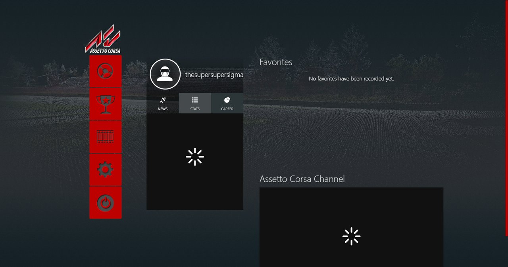
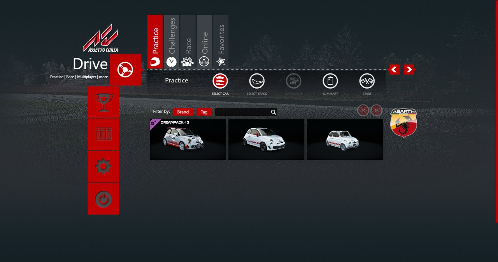
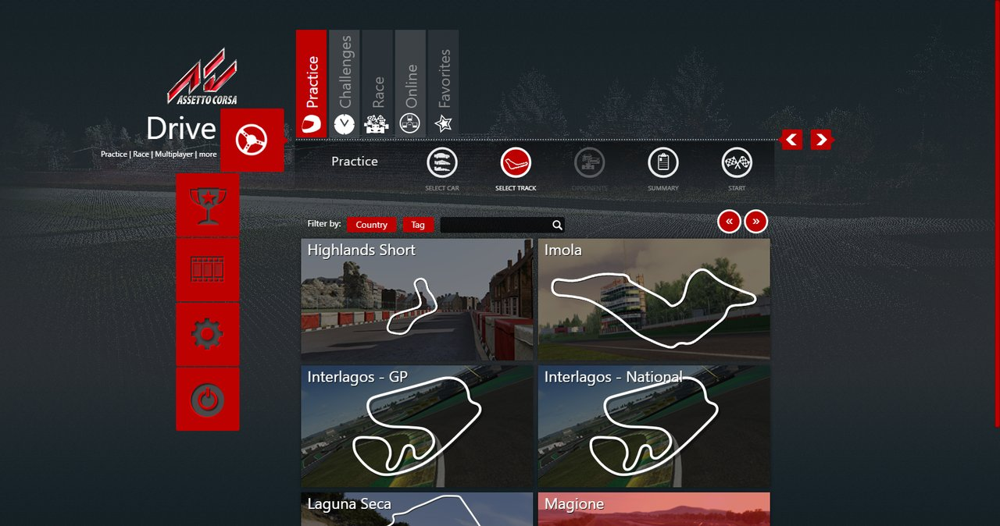
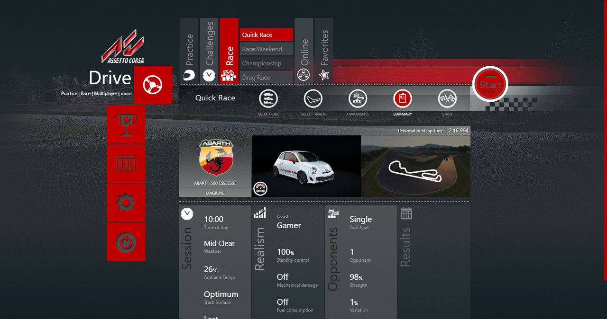
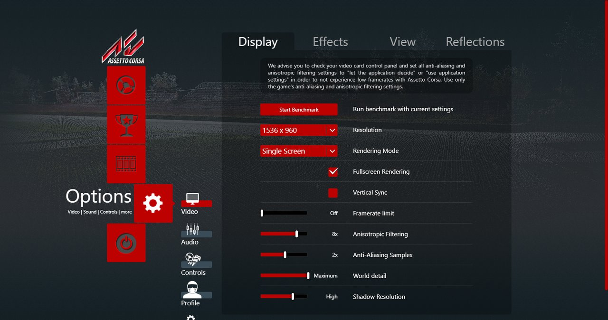
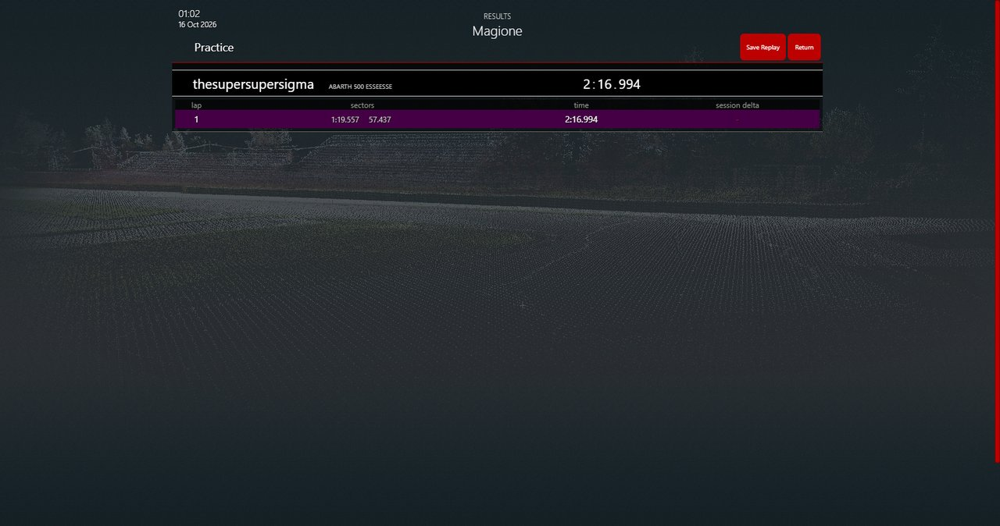

# Assetto Corsa's launcher

## Resume here

- Task 35 is done and released as v0.35.0: the launcher (`crates/rustyac-launcher`), its proofs
  (`tools/launcher_oracle`, `re/scratch/task35/cmp.sh`), all four sessions and Options driven
  by scripts, the end checks (tables below), this report. Next is Task 36 (see Not done).
- To redo a proof: `sh re/scratch/task35/cmp.sh req/<name>.txt <name>` then
  `python re/scratch/task35/tdiff.py out/<name>_o.txt out/<name>_r.txt` (in `re/scratch/task35`).
- To redo a scripted run: `re/scratch/task35/sessions.sh`, or the command under
  [How it was driven](#how-it-was-driven).

## In short

`rustyac-launcher.exe` is Assetto Corsa's launcher (`AssettoCorsa.exe`) ported to Rust. The
original is a .NET WPF program around an embedded Chromium (CEF3) that shows an HTML/JavaScript
"theme" from the game's folder (`launcher\themes\default`). The theme does all the drawing and
all the choosing; it asks the C# side for everything else through `ac://` addresses: the car
list, the track list, a setting from an ini file, "write this value into race.ini", "start the
game", "what were the results". The port shows **the player's own theme, unchanged**, in
Microsoft Edge WebView2 (the Chromium that comes with Windows) and answers the same `ac://`
requests with a Rust port of the C# handlers.

Start pressed in the theme writes `race.ini` and the other cfg files into rustyAC's own `cfg\`
(never into `Documents\Assetto Corsa`), runs `rustyac.exe`, and when the game exits the theme
reads `out\race_out.json` and shows its results page, as with the real game.

The proof is a .NET program (`tools/launcher_oracle`) that loads `AssettoCorsa.exe` as an
assembly and calls **its own** handlers. Both answer the same requests on the same scratch
folder. Every answer and every written file is compared byte for byte: **of 11 819 requests,
11 818 answers are identical and so is every written file**; the one left over is a file's
time stamp (see below).

## How the launcher works

Names are from the decompiled code (ILSpy, `re/launcher_cs/`, not in the repo).

- `Startup.Main` → `Startup.SetupUserDirectory` (makes `Documents\Assetto Corsa\` and its
  folders, copies `cfg\*.ini` from the game folder, merges new keys in with
  `AppIniFile.Merge`, tidies them with `AppIniFile.Format`, backs up the browser's databases,
  copies `cfg\templates`) → `App` (Steam: `SteamAPI.Init`) → `MainWindow`.
- `MainWindow` hosts the CEF browser (`AppCef`). It registers the scheme `ac` with the factory
  `ACSchemeHandler`, allows `file://` → `ac://`, turns web security off and file access from
  files on, and loads the theme's `index.html` as a `file://` page.
- `MainWindow.BrowserLoadEnded` → `JSIncludeDefaultLibs`: once `index.html` is loaded it runs
  the shared libraries of `launcher\themes\.base` (`init.js`, jQuery 1.9.1 and its plug-ins,
  `ac.utils.js`, `__ACClasses.js`, `__AC.js`, `__ACUI.js`) and then the theme's own scripts
  (`theme.ini` `[THEME] scripts=`).
- `ACSchemeHandler.DoProcess`: `ac://<handler>/<path>?<query>` → a `NameValueCollection`
  (`HttpUtility.ParseQueryString`, plus a POST body) → `ACRequestHandler.Handlers[<handler>]`
  (82 handlers) → an answer with a MIME type. Errors become answers too (`"No such file: "`,
  `"ERROR\n" + message`, the "name/value pair is required" text).
- Settings: `IniFile` calls Windows' own `GetPrivateProfileStringW` /
  `WritePrivateProfileStringW` (with a UTF-8-as-ANSI trick so names with accents survive);
  `AppIniFile.Get` copies a default cfg file into the user's folder when it is missing;
  `AppIniFile.GetAsJson` turns an ini file into JSON. `setsetting` is how the theme writes
  every line of `race.ini`.
- Content: `ListCars` (every `content\cars\*\ui\ui_car.json`, skins, `generatecss` for the skin
  previews), `ListTracks` (every `ui_track.json` of every layout), `ListSpecialEvents`,
  `ListSeries`, `ListShowrooms`, `getskinmeta`.
- Drive: the theme clears `[CAR_*]`, writes race.ini key by key, calls `formatfile/race` and
  `start`. `StartGame` formats race.ini and runs `AssettoCorsa.exe /spawn`, which runs
  `acs.exe`. A 2-second `DispatcherTimer` (`acping_Tick`) watches for `acs.exe`'s window and
  tells the theme `ACRunningEvent` / `ACStoppedEvent`; on the second the theme calls
  `getresults` (`out\race_out.json`, `warnings.json` and the file's date) and shows the results.

## What is ported

| Original | Port (`crates/rustyac-launcher/src/`) |
|---|---|
| `ACSchemeHandler.DoProcess`, `ACRequestHandler` (handlers, errors) | `bridge.rs` |
| `HttpUtility.ParseQueryString` / `UrlDecode` / `HtmlEncode`, `NameValueCollection` | `query.rs` |
| `JavaScriptSerializer` (the lenient reader and the writer, escapes, number forms) | `jss.rs` |
| `IniFile` (the same Win32 calls, the same buffers and the ANSI trick) | `ini.rs` |
| `AppIniFile` (`Get`, `Format`, `Merge`, `GetAsJson`) | `appini.rs` |
| `AppFolder` (every folder, `MirrorFolder`, `CreateIfNonExistant`) | `folders.rs` |
| `Startup.SetupUserDirectory` | `setup.rs` |
| `AlphaNumericStringSort` with .NET's `Array.Sort` (introsort, unstable) | `sort.rs` |
| `MainWindow` (browser, scheme, injection, `GetJSEvent`, `EnterTheme`, `acping_Tick`, `StartGame`) | `shell.rs` (WebView2 through `webview2-com`) |
| `ACUtility.GetAvailableResolutionsJSON`, `acVideoModes.dll`, `SystemParameters` | `sys.rs` |

Handlers that answer exactly like the original: `listcars listtracks listfiles listinis
listseries listseasons listspecialevents listshowrooms getsetting getsettings setsetting
delsetting initdata setdata getdata deldata copyini getiniasjson savejsontoini savetofile getcfg
getskinmeta carcount eventcount getresults loadjson savejson delfile getplayersetups
getthememodules utility getvideomodes generatecss formatfile getplayername` and the no-op ones
(`uimessage loading resizewindow uiready cleanup`, unknown names). `start`, `home`, `exit`,
`isowner`, `getguid`/`getid`, `getachievements`, `showsteamoverlay` are ported with what they now
mean (see [Steam](#steam)).

What the port does on its own:

- `start` runs `rustyac.exe --documents <the launcher's folder> --out-dir <its out>` plus
  `--car`, `--track`, `--layout` from race.ini's `[RACE] MODEL / TRACK / CONFIG_TRACK`
  (acs.exe takes those from race.ini; rustyac.exe from its command line). It watches the
  process it started instead of a window named "Assetto Corsa".
- The launcher's "Documents\Assetto Corsa" is the folder of `rustyac-launcher.exe`
  (`--docs` changes it): `cfg\`, `out\`, `setups\`, `launcherdata\` (WebView2's data, where CEF
  kept its cache) end up beside `rustyac.exe`. `rustyac.exe --documents <folder>` is new: it
  makes rustyac.exe read that folder's `cfg\race.ini`, `video.ini`, `controls.ini`,
  `assists.ini`, setups and replays instead of `Documents\Assetto Corsa`.
- `savetofile` with `location=appdata` writes into the user's themes folder: the original
  writes into the game's folder, which is read-only here.
- The version check of `SetupUserDirectory` answers OK by deleting only the launcher's `cfg`,
  `launcherdata` and `templates` (the original deletes the whole Documents folder, which here
  is rustyac.exe's folder).

## Proofs

### The oracle

`tools/launcher_oracle` (C#, .NET Framework 4.8, x86 like the original) loads
`AssettoCorsa.exe` and its support DLLs as assemblies (it never runs the program), sets every
`AppFolder` path that points into Documents to a fake folder under `re/scratch/task35/`, and
calls `ACRequestHandler`'s handlers and `Startup.SetupUserDirectory` by reflection. It refuses
a fake folder outside `re/scratch/task35`, refuses `start` and the Steam handlers, and takes a
snapshot of the real `Documents\Assetto Corsa` before and after every run (265 files, never
changed in any run). Its `AssemblyVersion` is the launcher's (0.18.115.5097), because
`SetupUserDirectory` writes the running program's version into `launcher.ini`.

`rustyac-launcher.exe --transcript <requests> <out>` runs the same list through the port.
`re/scratch/task35/cmp.sh` runs both on the same fake path (error messages name full paths),
compares the transcripts, then `diff -r` of the two folders (only the backup folder's name, a
time stamp, is left out).

### Results

The scripted runs' requests are taken from the launcher's log (`log2req.py`: every `ac://`
request the theme sent, in order, `start` and the online ones left out) and replayed through
both:

| Run | Requests | Identical answers | Written files |
|---|---:|---:|---|
| probe (every handler, odd inputs, errors, a name with `ü` and `漢`) | 59 | 59 | identical |
| Practice (start-up, car, track, start, results) | 1956 | 1956 | identical |
| Quick race (grid of 2) | 1974 | 1974 | identical |
| Race weekend | 2007 | 2007 | identical |
| Hotlap | 1974 | 1974 | identical |
| Options (video, audio, general; VSYNC changed) | 1843 | 1843 | identical |
| results (a real race_out.json + warnings.json) | 6 | 5 + 1 | identical |

The one result answer that differs is `getresults`'s time stamp: it is the file's last-write
time, and the two sides wrote their copies 2.4 s apart. Each side's number equals its own
file's time to the millisecond (`16 Oct 2026|01:33|1792114380337` and `...382699`).
`getresults` without a race_out.json dates its answer "now"; `tdiff.py` leaves that date out.

### The theme in the port's window

Scripts (`re/scratch/task35/scripts/*.txt`) click through the page with jQuery and check it:
`until`, `click`, `js`, `shot`, `game-exit`. Every run: no JavaScript error (errors,
unhandled rejections and console errors are logged), every choice reaches the bridge (the log
has each request), Start runs rustyac.exe, the results come back.

| Session | race.ini sessions | rustyac.exe (headless, autodrive) | The theme afterwards |
|---|---|---|---|
| Practice, abarth500 @ magione | Practice | 1 lap, 2:16.994 | "New personal best", then the results page |
| Quick race, single-make grid of 2 | Quick Race, 2 laps | 2 laps with an AI car, best 2:05.721 | new PB −11.273, results |
| Race weekend | Practice 30 min, Qualifying 30 min, Race 5 laps | `--next-session-at 40 80`; the race 2 laps in | results of 3 sessions |
| Hotlap | Hotlap | 1 lap, 2:09.994 | results |
| Practice without driving | Practice | no lap | "Invalid results", as the theme's own rule says (`totalPlayerLaps() == 0`) |

The Quick race first stopped at the theme's own "no grid" message (`ACNoGridEvent`: grid type
random, no opponents chosen), which the original does too; the script then picks a single-make
grid.

### How close it looks

The picture is the theme's own HTML and CSS in Chromium in both cases (CEF3's in the original,
WebView2's here), so the pages are the same pages: same fonts, images, layout and animations.
What is not there is the WPF frame around the browser in the original: the splash screen,
the Steam animation, the language picker shown on the first start, the window buttons drawn by
WPF. AssettoCorsa.exe is never run here, so there are no side-by-side pictures of the
original; the shots below are compared with the theme itself.

| | |
|---|---|
|  |  |
| Main menu (profile name from rustyAC's setting) | Car select (Abarth: the DLC car carries its "Dreampack #3" badge) |
|  |  |
| Track select (62 tracks and layouts) | Quick race setup (the PB comes from the earlier Practice run) |
|  |  |
| Video options (resolutions from the screen's display modes) | Results of the Practice run |

### Nothing else changed

`re/scratch/task35/end_a.sh` and `end_b.sh` on the final code:

| Check | Result |
|---|---|
| clippy `--all-targets -D warnings`, CI's line, wasm32-unknown-unknown, wasm32-wasip1 | clean (the launcher is native-only: not in the wasm lists, a stub `main` elsewhere) |
| `cargo build --release --workspace --locked`, the 10 tools' own lock files (`dotnet restore --locked-mode` for the oracle) | built |
| `cargo test --release --workspace --locked` | 63 suites, 306 passed, 0 failed |
| physics dumps, v0.34.0 (built once from the tag) against now, on two fresh recordings: Spa autodrive 60 s; Magione with 2 AI cars, a race | `spa.ryin` 0fecb9a12a360dd6 = 0fecb9a12a360dd6; `magione_ai.ryin` 937eb9639781e59f = 937eb9639781e59f; state hashes the same with 0 and 8 workers |
| the committed net tape (`laguna_join_3000.netgold`) | IDENTICAL at all 3000 steps three ways: desktop, browser transport, through a real gateway |
| plain CLI, `--no-race-ini --car abarth500 --track magione` | runs, exit 0 |
| a Content Manager race.ini, `--race-ini <file>` with a `[CAR_1]` AI car | runs: the AI car and the Quick Race session from the file |
| GUI sequences of Tasks 29–34 (41: 35 HUD/app/menu, 6 setup) | command log, pixels, state and events IDENTICAL in all 41 |

One thing the checks caught: `graphics.documents_folder` now means `Documents\Assetto Corsa`
(for `--documents`), and render_oracle's port side still handed it the Documents folder;
fixed in the oracle (`tools/render_oracle/src/port.rs`).

## How to use it

```
rustyac-launcher.exe                       the launcher; Start runs rustyac.exe beside it
rustyac-launcher.exe --docs D:\acdocs      another folder for its cfg, out, setups
rustyac-launcher.exe --player-name Name    the name shown and written as DRIVER_NAME
rustyac-launcher.exe --game-arg --windowed every Start runs rustyac.exe --windowed
rustyac-launcher.exe --help                all options
```

The player's name: `--player-name`, else `[PROFILE] NAME` of `<docs>\cfg\profile.ini`, else
`[CAR_0] DRIVER_NAME` of `Documents\Assetto Corsa\cfg\race.ini` (only read), else "You, the
player". AC's folder is found like rustyac.exe finds it (`AC_ROOT`, Steam's libraries).

### How it was driven

```
cd re/scratch/task35
../../../target/release/rustyac-launcher.exe --docs <fake folder> \
  --game-arg --headless --game-arg --no-steam --game-arg --autodrive --game-arg --duration --game-arg 160 \
  --script scripts/practice.txt --log out/practice.log --offscreen 1600x900
```

`--offscreen` puts the window off the screen at that size (WebView2 draws at scale 1 there);
the window closes after the script's last step and the exit code is 1 if a step failed.

## Steam

The launcher's Steam calls (Steamworks.NET), and what they answer now. Owning a car or track is
having it installed.

| Call | Where | Now |
|---|---|---|
| `SteamAPI.Init`, `InitSafe`, `IsSteamRunning`, `RestartAppIfNecessary`, `RunCallbacks`, `Shutdown` | `App` | not called: no Steam client is needed |
| `SteamFriends.GetPersonaName` | `getplayername` | rustyAC's name setting (above) |
| `SteamUser.GetSteamID` (4 places) | `getguid`, `getid`, online | a new GUID per call, the launcher's own answer without Steam (`Guid.NewGuid()`) |
| `SteamUser.UserHasLicenseForApp(244210)` | `isowner` | `True`: the game is installed |
| `SteamFriends.ActivateGameOverlay` | `showsteamoverlay` | `OK`, nothing shown |
| `SteamUtils.BOverlayNeedsPresent`, `SetOverlayNotificationPosition`, `SteamTimer` | `MainWindow` | not called |
| `SteamStatisticsReader.exe` (achievements) | `getachievements` | `{}` |

DLC cars and tracks are marked by their `dlc_ui_*.json` files, as the original marks them; the
launcher has no other DLC check.

## Disk

Free on C: at the start 33 GB, at the end 27 GB (after deleting the old build, see below).

## Not done

- Task 36's part: online (server lists, `getserver`, ping), special events and career pages
  beyond their lists, championships, stats, the replays page, the first-run wizard (those
  four: Task 36, docs/port/launcher_online.md), the showroom (`showroom`).
- The WPF parts around the browser: the splash and intro animation, the language picker (Task 36:
  the theme's first-run wizard asks instead), the controls window (`showcontrols`: rustyAC has its own
  bindings), the music player (`startmusic` / `stopmusic` / `setvolume`), the benchmark
  (`runtest`), wheel calibration (`calibrate`), the dev tools window, messages boxes for
  content errors (logged instead).
- Licences, forum, clipboard, browser links, crash and benchmark upload, printing.
- Off-screen shots include the window's frame in their size (1574×829 for a 1600×900 window).

## Open questions

- rustyac.exe writes `"skin": ""` for the player into race_out.json although race.ini names the
  skin; the theme does not show it, AC writes the skin.
- `getvideomodes` comes from DXGI because `acVideoModes.dll` is 32-bit; its list matched the
  oracle's on this PC, another driver could order modes differently.
- The theme's personal bests live in WebView2's storage under `launcherdata\`; the original
  kept them in CEF's. `rustyac-launcher --import-pbs` brings an install's in (Task 36,
  docs/port/launcher_online.md).
