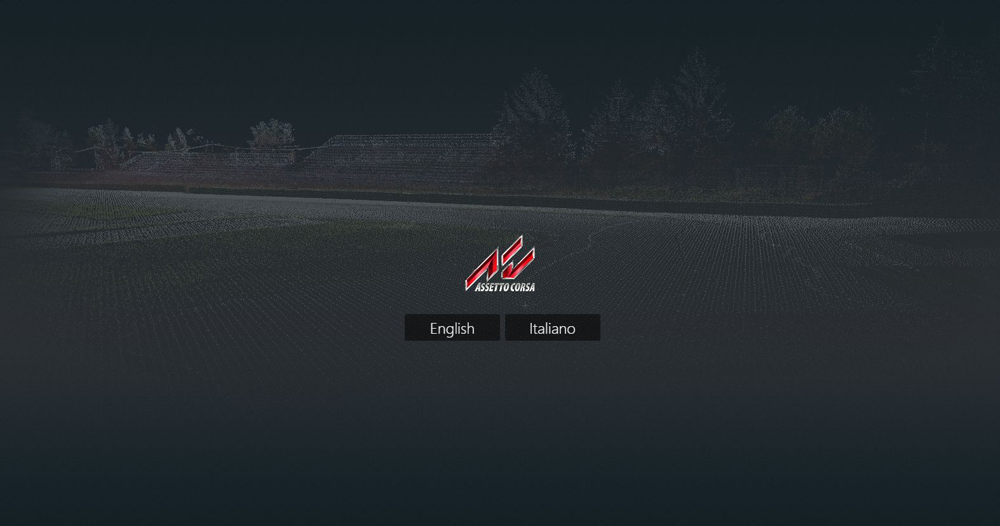
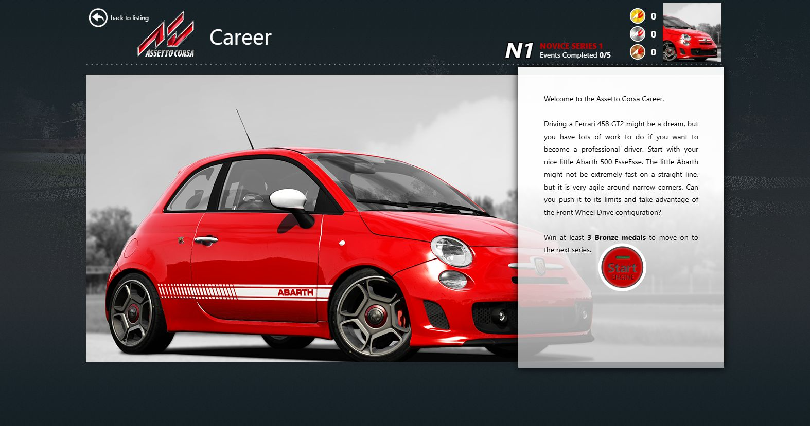
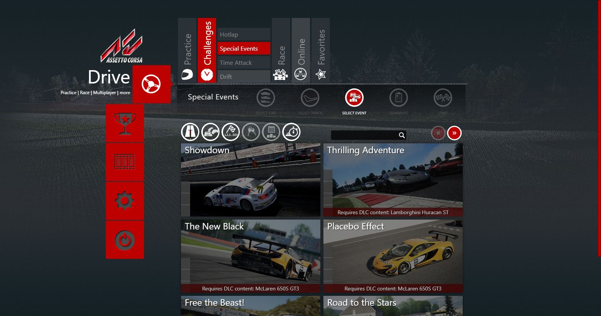
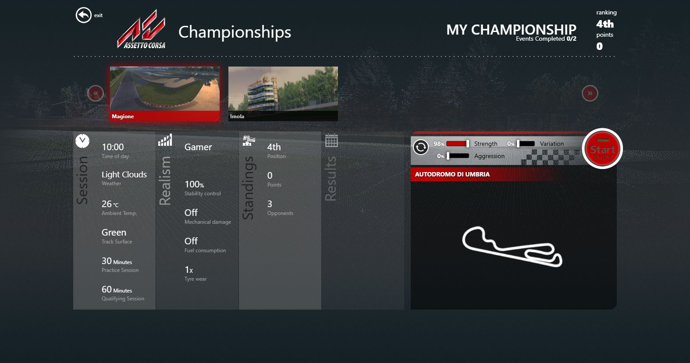
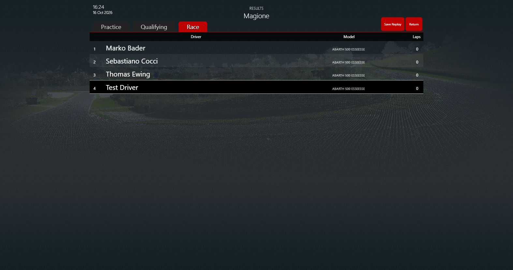

# The launcher's online pages, replays, stats and events (Task 36)

## Resume here

Task 36 is done (v0.36.0): the three small fixes, the online pages, the replays page, stats and
`--import-pbs`, the first-run language picker, special events, career and championships, and the
end checks. Next: Task 36b (see "Not done").

## In plain English

`rustyac-launcher.exe` now does almost everything AC's launcher does. The **Online** tab lists
Kunos' servers and the LAN servers, pings them and shows a server's details. **Join** writes
race.ini `[REMOTE]` as the original does, and rustyac.exe joins the server (password or not). The
**Replay** page lists, renames, deletes and plays replays. **Stats** and the PB manager work,
and `--import-pbs` copies the personal bests of an existing AC install in, when asked.
The **first run** asks for the language. **Special events**, the **career** and
**championships** write their race.ini, start the game and do their scoring afterwards.

Every handler was checked against the original's own code (`AssettoCorsa.exe` loaded by
`tools/launcher_oracle`): same answers byte for byte, same files. Long scripted runs of the real
pages came out identical: a career event (3,755 requests), a special event (3,823) and a
championship round (4,011). One bug of the port's was behind most of it: the pages save race.ini
by posting to `http://ac/...`, which the original's browser turns into `ac://`. The port caught
only `ac://`, so those saves never arrived. It catches both now.

Three small fixes: `getguid` gives the same id rustyac.exe uses online; race_out.json names the
player's skin in a one-car race.ini; the video-mode list comes in acVideoModes.dll's order.

## The three small fixes

| Fix | What changed | Proof |
|---|---|---|
| `getguid` / `getid` | One id for both programs: `rustyac_game::identity::resolve`, the function rustyac.exe's join uses. With Steam: the Steam id. Without: rustyAC's own id from `rustyac_net.ini` beside the exe. Only if that fails, a new GUID (the original's answer without Steam). | Two launcher runs answer the same id three times each. A local acServer logs the same GUID when rustyac.exe joins, with Steam and with `--no-steam`. |
| The player's skin in `race_out.json` | A race.ini of one car (hotlap, practice) made no grid, so the player had no skin and `"skin": ""` was written. Now car 0 of `race_grid` gives the player its skin also then, and a car left alone keeps it. | `car_oracle race-ini` on the launcher's hotlap race.ini: **IDENTICAL**, car 0 skin `0_white_scorpion`. rustyac.exe on the same file writes `"skin": "0_white_scorpion"`. |
| `getvideomodes` order | `acVideoModes.dll` (disassembled): `CreateDXGIFactory` (not Factory1), `EnumAdapters(0)`, `EnumOutputs(0)`, `GetDisplayModeList(R8G8B8A8_UNORM, 0)`, the modes kept in DXGI's order, no sorting. The port now makes the same calls. | launcher_oracle (x86, the real dll) and the port: transcripts **identical**, 6,370 bytes. |

## The online pages

How the original works: `online.js` asks `ac://getserverlist` (or `ac://getlanservers` on the
LAN page), draws the list, then fires `ac://pingserver` for every server it shows. Details come
from the list itself, players from the server's own `http://ip:port/JSON|guid`. Join writes
race.ini `[REMOTE]` (`SERVER_IP`, `SERVER_PORT`, `SERVER_NAME`, `SERVER_HTTP_PORT`,
`REQUESTED_CAR`, `NAME`, `TEAM`, `PASSWORD`, `GUID`, `ACTIVE=1`) and `[CAR_0]`, then
`ac://start`. Behind the handlers (`ACRequestHandler.cs`):

- `getserverlist`: `GET http://lobby.assettocorsa.net/lobby.ashx/list?guid=<id>` (`authkey` too
  when launcher.ini `[ONLINE] AUTHKEY` is set) with the header `.: MD5(MD5(reverse(id)+id))`
  (upper-case hex), gzip; a failed request moves to the fallback host
  `aclobby2.grecian.net:10080` for good.
- `getserver`: `lobby.ashx/single?ip=..&port=..&guid=..`. `getservercached`: the count of the
  last list (the real list is over .NET's 2 MB JSON limit, so the original throws, and so does the port).
- `pingserver`: up to 12 tries, 150 ms apart: 4 bytes (200) by UDP to the server's port, the 3-byte answer
  (200, http port) timed; the answer
  is `[ms, http port]`, `[-1,-1]` without one.
- `getlanservers`: one UDP broadcast probe (4 bytes, 200) per local address to every port from
  9000 to 10000, then `/INFO` of each one that answers, `"l":true`. The same server shows once per
  network interface, in `getaddrinfo` order.
- Favourites are the Drive page's race favourites (the page's own data store, ported in Task 35);
  the server list's filters (joined, password, ...) are page-side.

What's ported: `crates/rustyac-launcher/src/online.rs`, every one of those handlers. The page
waits on the network, so the shell answers them later from a thread of their own (a WebView2
deferral), as the original answers them asynchronously. `--lobby <host:port>` moves the lobby
for checks. rustyac.exe started with no car and no track reads `[REMOTE]` and joins; the
launcher now passes neither when `[REMOTE] ACTIVE=1`, and `--autodrive` no longer asks for a
track then.

| Proof | How | Result |
|---|---|---|
| Lobby list, single servers, cached count | The lobby recorded once (9,000 servers, 7.7 MB). `launcher_oracle --serve` serves the recording; the original (oracle, `--lobby 127.0.0.1:<port>`) and the port ask the same 5 requests | transcripts **identical**, trees identical; request lines and headers identical in the stand-in's log |
| LAN list, ping | A local acServer (made-up passwords); oracle and port, `getlanservers` + 2 × `pingserver` | **identical** once the live values are masked (the server's `timeleft`, the ms of the ping); 6 entries each |
| The page | The real theme in the port, scripted: Online → Server List → I agree → continue | 9,000 servers listed (`total servers listed: 9000/9000`); pings to the real servers stopped by the script |
| Join, password | LAN page → the local server → BMW Z4 GT3 → password → join | race.ini `[REMOTE]` written, rustyac.exe joins: the server logs `DRIVER ACCEPTED FOR CAR`. Wrong password: `Password check failed, client refused`, rustyac.exe exits 1 |

|  |  |
|---|---|

## The replays page

How the original works: `__AC.js` asks `ac://listreplays?bytime=true` (newest first) for the list,
`delreplay?name=`, `updreplay?oldname=&newname=` (the page strips `|&;?$%"<>()+,` first),
`storereplay?files=a,b` (from `temp/`, the autosaved ones) and `addreplay?car=&track=` (moves the
game's last replay `cr` to `car@track_yyyyMMddHHmmss`). Each row is
`[name, "dd/MM/yyyy HH:mm", MB "0.00", ms since 1970, bytes]`; the launcher joins them with commas
and splits them again, so a comma in a file name splits the name too (kept). Load writes race.ini
`[REPLAY] ACTIVE=1`, `FILENAME=<name>` and starts the game. Only the player's `replay\` folder
(and its `temp/`) is ever touched.

What's ported: `crates/rustyac-launcher/src/replays.rs`; the launcher starts rustyac.exe with
`--replay <replay folder>\<FILENAME>` when `[REPLAY] ACTIVE=1` (the file names its track and cars).

| Proof | How | Result |
|---|---|---|
| The five handlers | A made-up replay folder (sizes 0 to 1 MB, a name with a comma, `cr`, two in `temp/`), 14 requests: list, list by time, temp, rename (ok, to a name already there, a missing file), delete (twice, none), store (ok, a missing one, none), list again | transcripts **identical**, the folders left behind identical |
| The page | The real theme in the port, scripted: Replay → rename `x.acreplay` → delete `zero.acreplay` → Load | the list and files change as asked; rustyac.exe starts with `--replay ...barth500@magione_t36.acreplay` and reads it (`AC replay version 16: abarth500 on magione`) |

## Stats, personal bests and `--import-pbs`

How the original works: stats and the PB manager are page code only. They keep an IndexedDB
database `Stats` (stores `personalBest` and `journal`) in the browser's storage. At every start
the PB manager reads `personalbest.ini` of the player's folder (`ac://getiniasjson/personalbest`)
into it, keeping the better time of each `car@track`. After a new PB and when the launcher
closes, it writes its whole list back to that file (`http://ac/savejson/personalbest/?format=ini`).
acs.exe writes the same file. Both handlers are Task 35's, already proven identical.

Where the original's CEF keeps its storage: `CachePath = AppFolder.UserLauncherDataDir`
(`App.xaml.cs`), that is `Documents\Assetto Corsa\launcherdata\`. On this PC that folder holds
only `filestore\champs.ini`: no IndexedDB, so no stats journal to bring over. The PBs are in
`Documents\Assetto Corsa\personalbest.ini`, which the page itself loads at every start.

What's ported: `rustyac-launcher --import-pbs [<Documents\Assetto Corsa>]`
(`crates/rustyac-launcher/src/pbs.rs`). It runs only when asked and only reads the other folder.
For each combo in its `personalbest.ini` it copies `DATE` and `TIME` into ours, unless ours is as
good or better. It writes with the launcher's own ini writer, then exits; the page picks the PBs
up on its next start.

| Proof | How | Result |
|---|---|---|
| The import | A copy of the real `personalbest.ini` (27 combos) into a folder that already has 2 combos, one of them faster than the real one | `26 copied, 1 of ours as good or better kept`; a second run: `0 copied, 27 kept`; the source byte-identical before and after |
| The page | Made-up PBs imported, then the launcher started, scripted | the PB manager logs `new pb for` each of the 3 combos; Stats shows the last PB `1:24.321 BMW Z4 GT3 @ Laguna Seca` |

## The first-run wizard and the language picker

How the original works: when launcher.ini `[WINDOW] LANGUAGE` is empty, the WPF window shows
two buttons, English and Italiano, on its own intro screen (`MainWindow.xaml` `Languages`,
`SelectLanguage`). A click refreshes the window's texts, calls `$.setLanguage(...)` in the page
and writes `[WINDOW] LANGUAGE`. The theme also ships a first-run wizard
(`modules/firstrunwizard`) with the same two languages. It writes the same key
(`ac://setsetting/launcher?WINDOW/language=<it>`), calls `setlanguage/<it>` and `home`. But the
default theme's `ui.js` never loads it.

What's ported: rustyAC has no WPF intro screen, so the picker is the theme's own wizard. The
launcher loads it along with the theme's modules (`WIZARD_JS` in
`crates/rustyac-launcher/src/shell.rs`), and it shows itself only while the key is empty. The
port no longer writes `en` silently on the first run.

| Proof | How | Result |
|---|---|---|
| First run | A fake Documents folder whose launcher.ini has no `LANGUAGE`, scripted: wait for the flags, click Italiano | the flags are `en,it`; `setsetting/launcher?WINDOW/language=it`, `setlanguage /it`, `home`; launcher.ini then has `LANGUAGE=it` |
| Later runs | The page reloaded by `home` | the wizard loads and stays hidden (no second language selection) |

## Special events, career and championships

How the original works: all three are page code. A special event writes race.ini with
`http://ac/savejson/race/?format=ini&clear=false&ignore=EVENT,ASSISTS` (the event's own
`[SPECIAL_EVENT] GUID`, sessions and conditions), and then the player's car and skin. Career
(`career2`) writes the event's race.ini the same way, `clear=true`. Its progress (series, event,
tiers, unlocks) goes to `ac://setdata/career?...`, which is Documents\Assetto Corsa\launcherdata\
filestore\career.ini. Championships are `.champ` JSON files in `Documents\Assetto Corsa\champs\`
(`savejson/champs/<guid>.champ`), with standings in `setdata/champs?...`. After a race the page
reads `ac://getresults` (race_out.json). It then scores the event (career tiers from the event's
objectives, championship points from the points table), saves the scores and writes the next
round's race.ini. The `http://ac/` requests: the original's CEF request handler
(`CefWebRequestHandler.OnBeforeResourceLoad`) turns any `http://ac/...` into `ac://...` as a POST.

What's ported: the handlers were Task 35's. The missing piece was that `http://ac/` turn: the
port caught only `ac://`, so every `ACSaveToCfgIni` (special events, career, championships, the
PB manager's save) never reached the launcher. Career's Start button stayed disabled.
`crates/rustyac-launcher/src/shell.rs` now catches `http://ac/*` too and answers it as the `ac://`
POST. The rules inside the game (a special event's tiers, the career's objectives, as acs.exe
judges them) are Task 40.

| Proof | How | Result |
|---|---|---|
| Career | First run, Career → Novice Series 1 → the first event → Start; rustyac.exe drives 20 s (`--autodrive`); the results page; continue | the page scores the event (`Objectives:100,1500,3000`); the request list of the whole run (3,755 requests, `race_out.json` of the run seeded) through the original's handlers and the port's: transcripts **identical**, the folders left behind identical (race.ini, career.ini, the rest) |
| Special event | Drive → Challenges → Special Events (203 events) → Showdown (a drag race) → Start → results | 3,823 requests: **identical**, folders identical (race.ini with `[SPECIAL_EVENT] GUID=9`) |
| Championship | Drive → Championships → create (the theme's default: 4 cars, Magione then Imola) → save → compete → Start; rustyac.exe runs practice, qualifying and race (`--next-session-at`) → results | the page gives out the points (10, 8, 6, the player 3) and writes round 2's race.ini; 4,011 requests: **identical**, folders identical (the `.champ` file, champs.ini standings, race.ini) |

## How to use it

- `rustyac-launcher.exe` as before. New:
  - `--import-pbs [<folder>]`: reads `<folder>\personalbest.ini` (default: your
    `Documents\Assetto Corsa`; that folder is only read), copies every combo whose time beats
    ours into `<docs>\personalbest.ini`, prints how many, and exits. `<docs>` is the folder
    `--docs` names (default: the exe's own folder, as in Task 35).
  - `--lobby <host:port>`: the server list from there instead of Kunos' lobby (for checks: a
    recording served by `launcher_oracle --serve <folder> --port <n>`).
- Online: Drive → Online → Server List or LAN Session. Join writes `<docs>\cfg\race.ini`
  `[REMOTE]` and starts `rustyac.exe --documents <docs>` without car and track; rustyac.exe
  reads `[REMOTE]` and joins. The id it sends is the one `getguid` answers (Steam's, else
  `rustyac_net.ini` beside the exe).
- Replays: the Replay page works on `<docs>\replay\` (and `replay\temp\`) only. Load starts
  `rustyac.exe --replay <docs>\replay\<file>`.
- The first run (launcher.ini `[WINDOW] LANGUAGE` empty) asks English or Italiano and writes
  that key.
- Career progress: `<docs>\launcherdata\filestore\career.ini`. Championships: `<docs>\champs\*.champ`
  and `launcherdata\filestore\champs.ini`. Special event tiers live in the page's own storage
  (`launcherdata\`), as in the original.
- Checks: `tools/launcher_oracle` takes `--lobby`, `--serve`, `--port`, `--log`; a fake
  Documents folder must sit under `re\scratch\`.

## Nothing else changed

| Check | Result |
|---|---|
| clippy `-D warnings`: workspace `--all-targets`, CI's line, wasm32-unknown-unknown, wasm32-wasip1 (`--locked`) | clean, all four |
| `cargo build --release --workspace --locked`; `cargo test --release --workspace --locked` | built; 63 suites, 308 passed, 0 failed |
| web build (`web/build.py`) | built |
| tools `--locked`: audio_oracle, car_oracle, chassis_compare, math_proof, ode_oracle, render_oracle, sctm_oracle, tyre_oracle, web_pack; launcher_oracle `--locked-mode` | all built, 0 warnings |
| physics dumps vs v0.35.0 (built once in `re/scratch/task36/tgt_old`), fresh recordings: Spa 60 s; Magione with 3 AI cars, a 2-lap race | **byte-identical** dumps (`c175020dafc14eeb`, `726ded63cbc5848b`), the same state hash old and new, with 0 and 8 physics workers |
| the committed net tape (`laguna_join_3000.netgold`) | IDENTICAL at all 3000 steps three ways: desktop, browser transport, through a real gateway |
| plain CLI (no race.ini); a Content Manager race.ini | both run (333.33 Hz; the CM file's AI car and Quick Race session read) |
| Task 35's launcher answers (its 8 request lists, run again through the oracle and the port) | 9,828 of 9,829 requests identical (the 8 request lists kept in `re/scratch/task35/req`); the one left is Task 35's: the `"date"` of `getresults` after a race is the file's time stamp, "now" on each side; every written file identical; real Documents unchanged (260 files) after every run |
| GUI sequences of Tasks 29 to 34 (the GUI oracle, game vs port) | 41 sequences (35 HUD / app / menu, 6 setup): command log, pixels, state and events **IDENTICAL** in all 41 |

## Not done (→ Task 36b)

- The 20 multiplayer tapes of Tasks 25/26 four ways: their gold files (`re/scratch/task26/gold`)
  and the wasmtime used for the wasm way are no longer on disk, so only the committed tape was
  run (three ways). Task 35 had the same limit.
- Special events' Steam achievements (`getachievements` runs `SteamStatisticsReader.exe`): still
  `{}`. The page then says "Synchronization failed" and keeps its tiers in its own storage.
  Special event tiers as the game judges them are Task 40.
- The original's WPF intro screen (English / Italiano buttons, then its own menu); the theme's
  wizard asks instead.
- An import of the stats journal: the original's CEF storage on this PC holds no IndexedDB, so
  there was nothing to import or to test with.
- The showroom, splash and intro, music, controls window, benchmark, calibration, dev tools,
  licences / forum / upload / print (not in this task).
- `getservercached` with the full lobby list throws the original's own `maxJsonLength` error
  (the list is 7.7 MB); the port gives the same answer. The theme does not use that call.

## Open questions

- **Real servers were contacted during the first page runs (an incident).** Before the script
  blocked them, the online page did what it does in the original: it pinged about 2,400 real
  servers from the recorded list (one 4-byte UDP packet each, a few tries) and fetched one real
  server's `/JSON` page (51.195.176.104:9001). A loose filter then let 4 more pings through. No
  admin command, no join, no tsss-server or rustyac.com. Later runs block every non-local
  address, and the strict filter is in `re/scratch/task36/scripts/block.txt`.
- The lobby answers a made-up guid with an SQL error, so the recording was made with the
  player's own id (the one `getguid` gives). The id is not written anywhere in the repo.
- `--import-pbs` copies a combo only when its time is better, and the date goes with it. The
  original has no import at all; the PB manager itself keeps the better of the two when it
  reads the file, so this is the same rule.
- The language picker: the theme's own wizard, not a native window. It asks the same two
  languages and writes the same key, so no new window was written.
- The video modes: the original keeps DXGI's own order and sorts nothing. The port makes the
  same calls (`CreateDXGIFactory`, adapter 0, output 0, `R8G8B8A8_UNORM`), so another driver
  gives the same order on both. A mode with a refresh denominator of 0 gives 0 Hz in the port;
  the original would divide by zero (never seen).
- The gateway check sometimes finds no local port free for both TCP and UDP: Windows reserves
  19 UDP port ranges on this PC (Hyper-V). A second try passes. Nothing in the code changed.
- Server favourites: the online module has none; the Drive page's favourites (Task 35) are the
  only ones.

## Disk

Free on C: 54 GB at the start, 49 GB at the end (the tools' and the workspace's release builds grew; the v0.35.0 build in `re/scratch/task36/tgt_old` and the big outputs are deleted, `re/scratch/task36` keeps 480 MB of fake folders, recordings and scripts, git-ignored).
