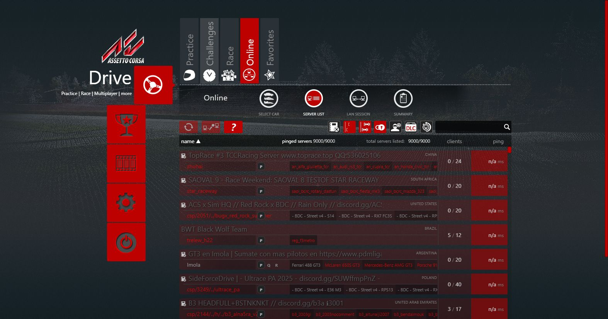
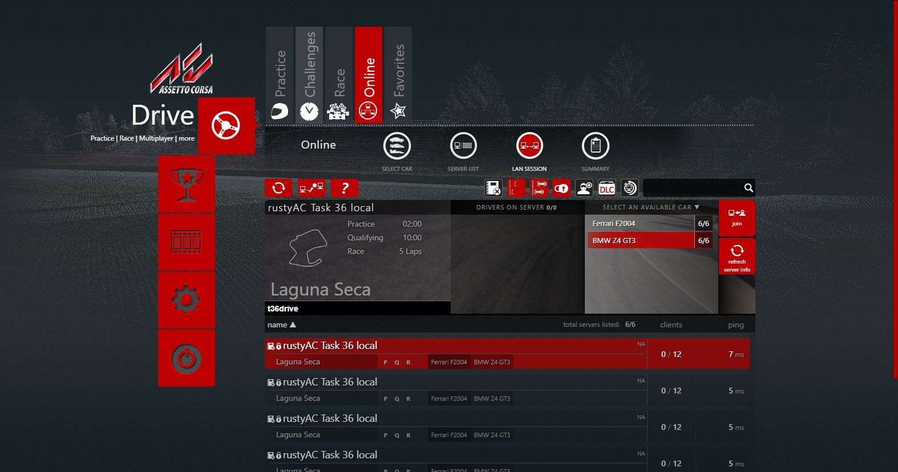
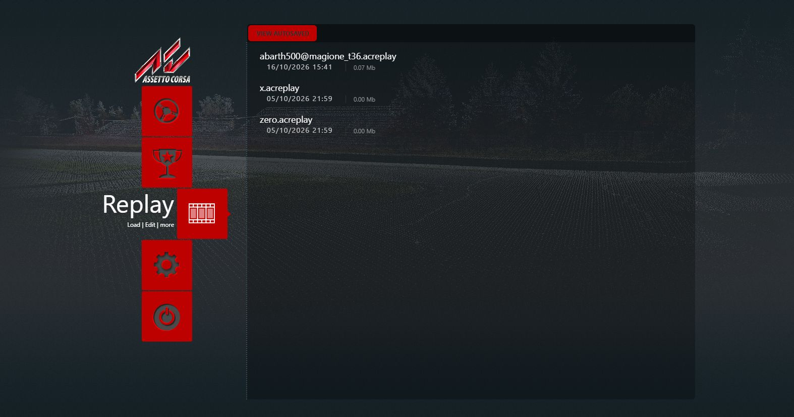
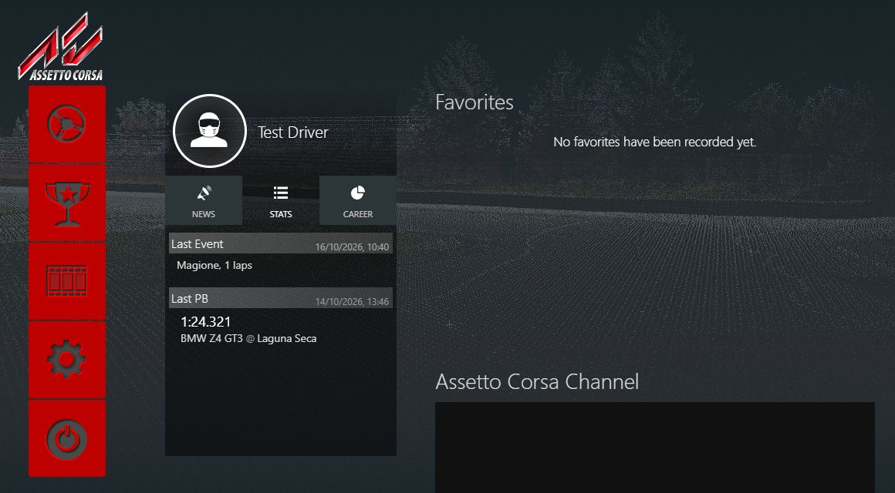

# The launcher's online pages, replays, stats and events (Task 36)

## Resume here

Done: the three small fixes; the online pages (lobby list, LAN, details, ping, password,
join); the replays page; stats, the PB manager and `--import-pbs`. Next: the first-run wizard and the
language picker.

## The three small fixes

| Fix | What changed | Proof |
|---|---|---|
| `getguid` / `getid` | One id for both programs: `rustyac_game::identity::resolve`, the function rustyac.exe's join uses. With Steam: the Steam id. Without: rustyAC's own id from `rustyac_net.ini` beside the exe. Only if that fails, a new GUID (the original's answer without Steam). | Two launcher runs answer the same id three times each. A local acServer logs the same GUID when rustyac.exe joins, with Steam and with `--no-steam`. |
| The player's skin in `race_out.json` | A race.ini of one car (hotlap, practice) made no grid, so the player had no skin and `"skin": ""` was written. Now car 0 of `race_grid` gives the player its skin also then, and a car left alone keeps it. | `car_oracle race-ini` on the launcher's hotlap race.ini: **IDENTICAL**, car 0 skin `0_white_scorpion`. rustyac.exe on the same file writes `"skin": "0_white_scorpion"`. |
| `getvideomodes` order | `acVideoModes.dll` (disassembled): `CreateDXGIFactory` (not Factory1), `EnumAdapters(0)`, `EnumOutputs(0)`, `GetDisplayModeList(R8G8B8A8_UNORM, 0)`, the modes kept in DXGI's order, no sorting. The port now makes the same calls. | launcher_oracle (x86, the real dll) and the port: transcripts **identical**, 6,370 bytes. |

## The online pages

How the original works: `online.js` asks `ac://getserverlist` (or `ac://getlanservers` on the
LAN page), draws the list, then fires `ac://pingserver` for every server it shows. Details come
from the list itself, players from the server's own `http://ip:port/JSON|guid`. Join writes
race.ini `[REMOTE]` (`SERVER_IP`, `SERVER_PORT`, `SERVER_NAME`, `SERVER_HTTP_PORT`,
`REQUESTED_CAR`, `NAME`, `TEAM`, `PASSWORD`, `GUID`, `ACTIVE=1`) and `[CAR_0]`, then
`ac://start`. Behind the handlers (`ACRequestHandler.cs`):

- `getserverlist`: `GET http://lobby.assettocorsa.net/lobby.ashx/list?guid=<id>` (`authkey` too
  when launcher.ini `[ONLINE] AUTHKEY` is set) with the header `.: MD5(MD5(reverse(id)+id))`
  (upper-case hex), gzip; a failed request moves to the fallback host
  `aclobby2.grecian.net:10080` for good.
- `getserver`: `lobby.ashx/single?ip=..&port=..&guid=..`. `getservercached`: the count of the
  last list (the real list is over .NET's 2 MB JSON limit, so the original throws, and so does the port).
- `pingserver`: up to 12 tries, 150 ms apart: 4 bytes (200) by UDP to the server's port, the 3-byte answer
  (200, http port) timed; the answer
  is `[ms, http port]`, `[-1,-1]` without one.
- `getlanservers`: one UDP broadcast probe (4 bytes, 200) per local address to every port from
  9000 to 10000, then `/INFO` of each one that answers, `"l":true`. The same server shows once per
  network interface, in `getaddrinfo` order.
- Favourites are the Drive page's race favourites (the page's own data store, ported in Task 35);
  the server list's filters (joined, password, ...) are page-side.

What's ported: `crates/rustyac-launcher/src/online.rs`, every one of those handlers. The page
waits on the network, so the shell answers them later from a thread of their own (a WebView2
deferral), as the original answers them asynchronously. `--lobby <host:port>` moves the lobby
for checks. rustyac.exe started with no car and no track reads `[REMOTE]` and joins; the
launcher now passes neither when `[REMOTE] ACTIVE=1`, and `--autodrive` no longer asks for a
track then.

| Proof | How | Result |
|---|---|---|
| Lobby list, single servers, cached count | The lobby recorded once (9,000 servers, 7.7 MB). `launcher_oracle --serve` serves the recording; the original (oracle, `--lobby 127.0.0.1:<port>`) and the port ask the same 5 requests | transcripts **identical**, trees identical; request lines and headers identical in the stand-in's log |
| LAN list, ping | A local acServer (made-up passwords); oracle and port, `getlanservers` + 2 × `pingserver` | **identical** once the live values are masked (the server's `timeleft`, the ms of the ping); 6 entries each |
| The page | The real theme in the port, scripted: Online → Server List → I agree → continue | 9,000 servers listed (`total servers listed: 9000/9000`); pings to the real servers stopped by the script |
| Join, password | LAN page → the local server → BMW Z4 GT3 → password → join | race.ini `[REMOTE]` written, rustyac.exe joins: the server logs `DRIVER ACCEPTED FOR CAR`. Wrong password: `Password check failed, client refused`, rustyac.exe exits 1 |

|  |  |
|---|---|

## The replays page

How the original works: `__AC.js` asks `ac://listreplays?bytime=true` (newest first) for the list,
`delreplay?name=`, `updreplay?oldname=&newname=` (the page strips `|&;?$%"<>()+,` first),
`storereplay?files=a,b` (from `temp/`, the autosaved ones) and `addreplay?car=&track=` (moves the
game's last replay `cr` to `car@track_yyyyMMddHHmmss`). Each row is
`[name, "dd/MM/yyyy HH:mm", MB "0.00", ms since 1970, bytes]`; the launcher joins them with commas
and splits them again, so a comma in a file name splits the name too (kept). Load writes race.ini
`[REPLAY] ACTIVE=1`, `FILENAME=<name>` and starts the game. Only the player's `replay\` folder
(and its `temp/`) is ever touched.

What's ported: `crates/rustyac-launcher/src/replays.rs`; the launcher starts rustyac.exe with
`--replay <replay folder>\<FILENAME>` when `[REPLAY] ACTIVE=1` (the file names its track and cars).

| Proof | How | Result |
|---|---|---|
| The five handlers | A made-up replay folder (sizes 0 to 1 MB, a name with a comma, `cr`, two in `temp/`), 14 requests: list, list by time, temp, rename (ok, to a name already there, a missing file), delete (twice, none), store (ok, a missing one, none), list again | transcripts **identical**, the folders left behind identical |
| The page | The real theme in the port, scripted: Replay → rename `x.acreplay` → delete `zero.acreplay` → Load | the list and files change as asked; rustyac.exe starts with `--replay ...barth500@magione_t36.acreplay` and reads it (`AC replay version 16: abarth500 on magione`) |

## Stats, personal bests and `--import-pbs`

How the original works: stats and the PB manager are page code only. They keep an IndexedDB
database `Stats` (stores `personalBest` and `journal`) in the browser's storage. At every start
the PB manager reads `personalbest.ini` of the player's folder (`ac://getiniasjson/personalbest`)
into it, keeping the better time of each `car@track`. After a new PB and when the launcher
closes, it writes its whole list back to that file (`http://ac/savejson/personalbest/?format=ini`).
acs.exe writes the same file. Both handlers are Task 35's, already proven identical.

Where the original's CEF keeps its storage: `CachePath = AppFolder.UserLauncherDataDir`
(`App.xaml.cs`), that is `Documents\Assetto Corsa\launcherdata\`. On this PC that folder holds
only `filestore\champs.ini`: no IndexedDB, so no stats journal to bring over. The PBs are in
`Documents\Assetto Corsa\personalbest.ini`, which the page itself loads at every start.

What's ported: `rustyac-launcher --import-pbs [<Documents\Assetto Corsa>]`
(`crates/rustyac-launcher/src/pbs.rs`). It runs only when asked and only reads the other folder.
For each combo in its `personalbest.ini` it copies `DATE` and `TIME` into ours, unless ours is as
good or better. It writes with the launcher's own ini writer, then exits; the page picks the PBs
up on its next start.

| Proof | How | Result |
|---|---|---|
| The import | A copy of the real `personalbest.ini` (27 combos) into a folder that already has 2 combos, one of them faster than the real one | `26 copied, 1 of ours as good or better kept`; a second run: `0 copied, 27 kept`; the source byte-identical before and after |
| The page | Made-up PBs imported, then the launcher started, scripted | the PB manager logs `new pb for` each of the 3 combos; Stats shows the last PB `1:24.321 BMW Z4 GT3 @ Laguna Seca` |

