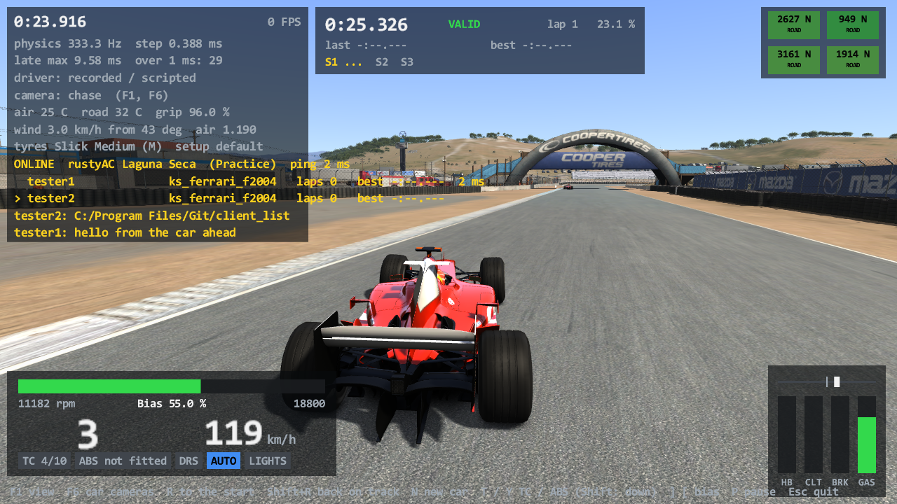

# Task 25 (M1): multiplayer on the desktop

## Resume here

State at `v0.25.0`: **M1 is done and proven** as far as the tables below say. Nothing is
half-wired. What is left is listed under [Not done](#not-done).

- **Where things are:** the protocol and session code is `crates/rustyac-net` (no platform
  code; builds for `wasm32-unknown-unknown`); the game's side is `crates/rustyac-game/src/`
  `join.rs`, `identity.rs`, `online.rs` and the online parts of `sim.rs`; the oracle is
  `tools/car_oracle net` (`src/game/net.rs`); the server kit is `server/`.
- **Proofs to re-run:** `sh re/scratch/task25/batch.sh` (the oracle, about 15 minutes, needs
  the tapes in `re/scratch/task25/interop` and `rich`, which are git-ignored),
  `cargo test --release -p rustyac-net` (golden + robustness), `sh re/scratch/task25/run_rich.sh`
  (a live four-client session that records new tapes).
- **M2 (Task 26) is done:** the browser and the WebSocket gateway are in
  [multiplayer_web.md](multiplayer_web.md). `Client::join` and `car_list` became the
  `Join` state machine there (`crates/rustyac-net/src/client.rs`).
- Briefs read from the machine code (git-ignored): `re/scratch/task25/spec_1_transport.md` to
  `spec_9_netcar_step.md`. Local test servers: `re/scratch/task25/server` (Spa),
  `server_laguna`, `server_rich` (a one-minute practice): copies of the game's `acServer.exe`
  with their own configs.

## Summary in plain English

rustyAC can now join a real Assetto Corsa server. `rustyac.exe --join <host:port>` talks to
Kunos' own `acServer` the way `acs.exe` does: it logs in, gets a car and the track from the
server, passes the server's file checks, sends its car's position 18 times a second and shows
the other players' cars, which you can see, hear and crash into. Laps and sector times are
reported to the server and counted by it, chat goes both ways, a new session (practice to
qualifying to race) resets the car, and the HUD shows who is on the server.

How it was checked:

1. **Against the game's own code.** The oracle loads `acs.exe`, runs the game's own
   `ACClient::onPhysicsStep` and `NetCarStateProvider::step` in the game's own physics
   engine, and feeds it the messages recorded from real sessions. The port gets the same
   messages. After every physics step every number of every remote car and of the local car
   is compared bit for bit, and every outgoing message byte for byte. 20 runs, 1.13 million
   steps, 2.6 billion values: all identical. Three deliberate faults are all caught.
2. **Against the real server.** Kunos' `acServer` 1.15 with two to four `rustyac.exe`
   clients: the server accepts the handshake and the file checksums, counts the laps, relays
   the chat, reports the collisions, changes session, and sees clean exits.
3. **Nothing offline changed.** The physics state hash of replays, an off-screen picture and
   all 583,963 sound calls of a replay are byte-identical between v0.24.1 and this version.

Two servers (Spa and Laguna Seca, Ferrari F2004 and BMW Z4 GT3) are ready to deploy on
tsss-server with the kit in `server/`. They were not deployed from here (no access was
used), and the Docker image was not run on this PC: see [Not done](#not-done).

## What is ported

Everything below was read from `acs.exe` 1.16.4 (protocol version 202). Addresses are the
game's.

### `crates/rustyac-net` (builds for wasm; ported files carry the "Ported from" line)

| File | What | The game's code |
|---|---|---|
| `packet.rs` | the byte buffer of every message: numbers little-endian, narrow strings (`u8` length + bytes), wide strings (`u8` count + 4 bytes a character), big wide strings (`u16` count) | `UDPPacket` 0x14025d800, `readString` 0x14025d9d0, `readStringW` 0x14025da90, `readBigStringW` 0x14025d8f0, `writeString` 0x14025dca0 / 0x14025dd70 |
| `transport.rs` | the `Transport` trait (a reliable channel and a datagram channel), the reliable channel's framing (`u16` length + payload, at most 2046 bytes), tapes (`Tape`, `Taped`, `TapePlayer`) | `UDPPacket::send` to TCP 0x14025db70, `TCPQueue::push` 0x14025e330, `getPacket` 0x14025e240 |
| `native.rs` (not on wasm) | TCP + UDP sockets of the desktop: a blocking connect with a timeout, then non-blocking; the UDP socket is bound to the TCP connection's local address | `TCPSocket::connect` 0x14025e1a0, `UDPSocket::receive` 0x14025d400 |
| `handshake.rs` | the join request, the accepted reply with every server rule, the refusals, the car list | `ACClient::handshakeTCP` 0x140048b50, `ACClient::getRemoteCarList` 0x140046f80 |
| `md5.rs` | MD5 (RFC 1321) for the file checks | `md5File` 0x14023a290, `md5Folder` 0x14023a450, `ACClient::getCarMD5` 0x140046070 |
| `car_update.rs` | the local car's update (62 bytes): Euler angles from the body's matrix, wheel speeds as one byte each, the status bits | `ACClient::sendCarPosition` 0x140052230, `Car::getFrontWheelAngle` 0x140270990 |
| `datagram.rs` | every datagram a server sends, the ping's answer, the association | `ACClient::onMessage` 0x14004b9d0, `UDPSocket::receive` 0x14025d400, `ACClient::associate` 0x140044640 |
| `messages.rs` | every message of the reliable channel both ways | `ACClient::onMessageTCP` 0x14004c840, `onLapCompleted` 0x14004b830, `onSectorSplit` 0x14004ff70, `onTyreCompoundChanged` 0x1400503d0, `updateDamageReport` 0x140054060, `sendChat` 0x140052a90, `sendVote` 0x140052ba0, `askForP2Pvalue` 0x140044470, `shutdown` 0x140052d30, `onNewSession` 0x14004e4a0 |
| `client.rs` | `ACClient`: join, car list, checksums, the work after every physics step (send when the interval is over, then up to ten datagrams and ten messages), the collision report (one entry per other car, the fastest hit), the session check | `ACClient::beginUpdateMode` 0x1400446e0, `onPhysicsStep` 0x14004f1d0, `update` 0x140053b30, `addCollisionEvent` 0x140043aa0, the collision lambda 0x14003fb60 |
| `net_car.rs` | the remote car: a 1000 kg box (1.4 x 1.0 x 4.0 m) with the car's collider mesh, three kept states, dead reckoning, the smoothed body matrix (quaternion blend), wheel rays, ghost / solid switching, the velocity blend after a hit | `NetCarStateProvider::NetCarStateProvider` 0x140116c70, `initPhysicsValues` 0x140119fe0, `onRemoteStateReceived` 0x14011b1e0, `projectNetStatePos` 0x14011b900, `getSmoothBodyMatrix` 0x140119310, `step` 0x14011bd00, `stepLagging` 0x14011cf60, `update` 0x14011d950, `getPhysicsState` 0x140119220, `Sim::addNetCar` 0x140197c30 |
| `dxmath.rs` | the DirectXMath functions the remote car's blending uses (a copy of `rustyac-render`'s, which cannot be built without Direct3D) | inlined in the functions above |
| `session.rs` | `NetSession`: the client and the remote cars as the physics engine's step hooks, in the game's order (after the world step: `ACClient::onPhysicsStep`, loose objects, the cars' post-step, then every `NetCarStateProvider::step`) | `PhysicsEngine::step` and the `evOnStepCompleted` handlers |
| `replay.rs` (not on wasm) | a session replayed from a tape, the golden excerpt format | (rustyAC's own) |

### The physics engine (`crates/rustyac-physics`)

- `engine::StepHooks` (`before_cars`, `after_cars`): where an online session works inside a step.
- `RigidBody::set_velocity`, `set_angular_velocity`, `set_mesh_collide_category`,
  `get_mesh_collide_category`: what a remote car's body needs.
- `engine.extra_wakes`: the remote cars' slipstreams (every remote car has one, there or not).
- `ReplayWorld::step_with`: a recorded world stepped with hooks.

### The game (`crates/rustyac-game`)

| File | What | The game's code |
|---|---|---|
| `join.rs` | `--join`, race.ini `[REMOTE]`, the checksums, plain-name checks on what a server names | `RaceManager::initOnline` 0x14013d160 |
| `identity.rs` | the player's id: Steam's through the game's `steam_api64.dll`, else rustyAC's own random one | `SteamInit` 0x1401a7950 (`SteamAPI_Init`, `SteamUser()->GetSteamID`) |
| `online.rs` | the session in the game: what is told to the server (laps, splits, damage, tyres, jump starts), what the server's messages do, the player list and chat for the HUD | the `ACClient` event handlers |
| `sim.rs` | `GameSim::new_online`: the server's rules (ABS, TC, stability, clutch, damage, fuel, tyre wear, blankets, tyres out, grip, jump-start penalty), remote cars in the world, new sessions, ballast and restrictor, weather numbers | `Sim::addNetCar`, `PhysicsEngine::setSessionInfo` |
| `view.rs`, `audio.rs`, `render/` | remote cars drawn and heard with Task 24b's code (a car that is not there is not drawn) | `NetCarStateProvider::getPhysicsState` |

## The protocol

Protocol version 202. One TCP connection and UDP datagrams to the same port.
TCP frame: `u16` length, then the message. First byte of every message: its id.
Strings: N = narrow (`u8` length + bytes), W = wide (`u8` count + 4 bytes a character),
BW = big wide (`u16` count + 4 bytes a character). All numbers little-endian.

### Joining (TCP)

| id | way | fields | when |
|---|---|---|---|
| 0x3d | out | `u16` 202, N guid, **W** name, N team, N nation code, N car, N password | first message |
| 0x3e | in | accepted: W server name, `u16` UDP port, `u8` send rate (Hz), N track, N layout, N car, N skin, `f32` sun angle, `i16` tyres out, `u8` blankets, `u8` TC, `u8` ABS, `u8` stability, `u8` auto clutch, `u8` jump-start mode, `f32` damage, `f32` fuel, `f32` tyre wear, `u8` forced virtual mirror, `u8` max contacts per km, `u32` race-over time, `u32` result-screen time, `u8` extra lap, `u8` gas penalty off, `u16` pit window start, `u16` end, `i16` inverted grid, `u8` **your slot**, `u8` n sessions x {`u8` type, `u16` laps, `u16` minutes}, the current session {N name, `u8` index, `u8` type, `u16` minutes, `u16` laps, `f32` grip, `u8` grid position, `i64` start}, `u8` n files x N path (to checksum), N legal tyres, `u32` random seed | answer to 0x3d |
| 0x3b | in | blacklisted | refusal |
| 0x3c | in | wrong password | refusal |
| 0x41 | in | `i32` ms: still booking | refusal |
| 0x42 | in | unsupported protocol | refusal |
| 0x45 | in | no free slot | refusal |
| 0x6e | in | session closed | refusal |
| 0x6f | in | W reason: the auth plugin said no | refusal |
| 0x3f | out | `u8` first index | asks for ten cars |
| 0x40 | in | `u8` the index asked, `u8` count, then per car: `u8` slot, N model, N skin, N driver, N team, N nation, `u8` spectator, 5 x `f32` damage | a page; fewer than ten ends the list |
| 0x44 | out | n x 16 bytes MD5 of the files 0x3e listed, then 16 bytes MD5 of the car's `data.acd` | once, from the first frame |
| 0x43 | out | (nothing) | leaving |

The send interval is `((1000 / Hz) / 3) * 3` whole milliseconds: 54 ms at 18 Hz.

### Datagrams (UDP)

| id | way | fields | when |
|---|---|---|---|
| 0x4e | out | `u8` slot | every send interval until the server answers |
| 0x4e | in | (nothing) | the server knows this client's UDP address |
| 0x46 | out | 62 bytes: `u8` sequence, `u32` clock ms, 3 `f32` position, 3 `f32` heading / pitch / roll, 3 `f32` velocity, 4 `u8` wheel speeds, `u8` steer, `u8` front wheel angle, `u16` rpm, `u8` gear, `u32` status bits, `i16` performance delta, `u8` gas, `f32` place round the lap | every send interval |
| 0x46 | in | `u8` slot + 60 bytes (the same fields without the last `f32`, with the server's idea of the time) | one car's state |
| 0x48 | in | `u32` server time, `u16` ping, `u8` count, then count x 57 bytes (slot + state without delta and gas) | "mega packet": several cars |
| 0xf9 | in | 4 bytes to echo, `u16` this client's ping | ping |
| 0xf8 | out | the ping with id 0xf8 and the client's clock (`u32` ms) at offset 5 | answer to every ping |
| 0x4f | out | `u8` session type | every two seconds |
| 0x57 | in | `i32` start time, `u32` this client's clock as the server thinks, `u16` ping | the session's start time (taken when fresh) |

### Session messages (TCP, after the join)

| id | way | fields | what rustyAC does with it |
|---|---|---|---|
| 0x0d | out | `u16` count, `u8` active (`ff ff 00`: asks for the value) | asked once after loading |
| 0x0d | in | `u8` slot, `i16` count, `u8` active | decoded (push-to-pass is not ported) |
| 0x0e | both | out: `u8` done; in: `u8` slot, `u8` done | decoded (mandatory pit is not ported) |
| 0x47 | out | `u8` slot, W text | `--chat`; at most one a second |
| 0x47 | in | `u8` slot (0xff: the server), W text | chat line on the HUD and the console |
| 0x49 | out | `u32` clock, `u32` lap time, `u8` n splits x `u32`, `u8` cuts, `u8` lap count | every valid lap of the local car |
| 0x49 | in | `u8` slot, `u32` lap time, `u8` cuts, `u8` n, n x {`u8` slot, `u32` time, `u16` laps, `u8` finished}, `f32` grip | player list, the track's grip |
| 0x4a | in | N name, `u8` index, `u8` type, `u16` minutes, `u16` laps, `f32` grip, one `u8` slot per car (the grid), `i64` start | new session: rules, grip, grid slot in a race, the car goes back |
| 0x4b | in | per car {`u8` slot, `u32` time, `u16` laps}, `u8` stay | results on the console; stay = 0 ends the sending |
| 0x4d | in | `u8` slot | the car is gone (a ghost, not drawn) |
| 0x50 | both | out: N compound; in: `u8` slot, N compound | sent when the local car's compound changes |
| 0x51 | in | `u8` 0, BW text | the welcome text (console) |
| 0x52 | in | `u8` fixed, `u8` n x {N name, `f32` value} | decoded (a fixed setup is not applied) |
| 0x53 | in | `u8` n x {`f32` start, `f32` end} | decoded (DRS zones are the track's own) |
| 0x54 | in | `f32` degrees | decoded (the sun stays where the join put it) |
| 0x56 | both | out: 5 x `f32`; in: `u8` slot, 5 x `f32` | the local car's damage is sent when it changes; a remote car's is shown |
| 0x58 | both | out: `u8` sector, `u32` time, `u8` cuts; in: `u8` slot first | every sector of the local car |
| 0x5a | in | `u8` slot, N name, N nation | a driver took a slot |
| 0x5b | in | `u8` n x {`u8` slot, W name} | driver names |
| 0x64 0x65 0x66 | out | next session / restart: `u8` yes; kick: `u8` slot, `u8` yes | encoded (no key for it yet) |
| 0x64 0x65 0x66 | in | `u8` target, `u8` quorum, `u8` votes, `u32` time left, `u8` last voter, `u8` last vote | decoded |
| 0x67 | in | `i32` (not used) | "Voting ended. Not passed" |
| 0x68 | in | `u8` slot, `u8` reason | who was removed and why |
| 0x70 | in | `u8` n x {`u8` slot, `f32` ballast kg, `f32` restrictor} | the local car's ballast and restrictor |
| 0x78 | in | `u8` air C, `u8` road C, N graphics, `i16` wind km/h, `i16` wind direction | air, road and wind numbers (the sky's look is not changed) |
| 0x82 | out | `u16` n x {0x0a `u8` slot or 0x0b, `f32` speed, 3 `f32` world position, 3 `f32` relative position}; or `0c`: jump start | collisions since the last send; a jump start |
| 0x82 | in | `0c`, `u8` slot | "Jumpstart detected for ..." |
| 0x3b | out | (nothing) | the wrecker protection's request (encoded, never sent) |

## Results

### 1. The oracle: the port against the game's own code

`tools/car_oracle net <tape> --scenario <name> --track ks_laguna_seca`. The game side is
`acs.exe` loaded in-process: its `PhysicsEngine` with the local car, a hand-built `ACClient`
with one `NetCarStateProvider` per other slot (made with the game's own state constructor,
`initPhysicsValues`, `createRigidBody`, `setMassBox`, `addMeshCollider`, `SlipStream::init`),
and its winsock imports replaced by stand-ins that play the tape. The game's own
`ACClient::onPhysicsStep` and `NetCarStateProvider::step` run from a detour on
`Car::postStep`, in the game's order. The port gets the same tape.

Compared after **every** step, bit for bit: the local car's whole row (129 values: world
contact count and hash, inputs, every rigid body) and, per remote car, 200 values (body
position, quaternion, both velocities, the mesh's collide category, the smoothed body
matrix, error vector, instant and smoothed velocity, the hit blend, the disconnected flag,
the newest state's time stamp and height, speed, wheel speeds, contact points, all four
suspension matrices and tyre rotations, acceleration, drivetrain speed, gas, brake, steer,
rpm, gear, status bits, ping). And every outgoing message, byte for byte.

The four scenarios are what the local car does: `net_watch` stands beside the racing line,
`net_block` stands on it (the tape's cars run into it), `net_drive` drives the line among
them, `net_pit` stands in the pit lane (every remote car is a ghost then).

The tapes are from live sessions on Kunos' `acServer` at Laguna Seca: `laguna_a/b` are the
two clients of the 200 s session; `rich_a/b/c` are three of the four clients of a session
where a car joins late, cars collide, one leaves cleanly, one is killed (the server tells
nobody, so that car goes stale and becomes a ghost after 5 s), chat lines pass, and the
practice ends and qualifying starts. `rich_c`'s tape ends at step 13,756 of 50,000: the
rest of that run is every car gone stale.

| Tape | Scenario | Steps | Values compared | Outgoing messages | Result |
|---|---|---|---|---|---|
| `laguna_a`: two clients, 200 s (slot 0) | `net_watch` | 66,000 | 153,714,000 | 3,865 | identical |
|  | `net_block` | 66,000 | 153,714,000 | 3,867 | identical |
|  | `net_drive` | 66,000 | 153,714,000 | 3,866 | identical |
|  | `net_pit` | 66,000 | 153,714,000 | 3,865 | identical |
| `laguna_b`: the same session (slot 2) | `net_watch` | 66,000 | 153,714,000 | 3,865 | identical |
|  | `net_block` | 66,000 | 153,714,000 | 3,867 | identical |
|  | `net_drive` | 66,000 | 153,714,000 | 3,866 | identical |
|  | `net_pit` | 66,000 | 153,714,000 | 3,865 | identical |
| `rich_a`: four clients, 150 s (slot 0) | `net_watch` | 50,000 | 116,450,000 | 2,926 | identical |
|  | `net_block` | 50,000 | 116,450,000 | 2,928 | identical |
|  | `net_drive` | 50,000 | 116,450,000 | 2,927 | identical |
|  | `net_pit` | 50,000 | 116,450,000 | 2,926 | identical |
| `rich_b`: the same session (slot 2) | `net_watch` | 50,000 | 116,450,000 | 2,926 | identical |
|  | `net_block` | 50,000 | 116,450,000 | 2,929 | identical |
|  | `net_drive` | 50,000 | 116,450,000 | 2,927 | identical |
|  | `net_pit` | 50,000 | 116,450,000 | 2,926 | identical |
| `rich_c`: the same session (slot 4, joins late, leaves at step 13,756) | `net_watch` | 50,000 | 116,450,000 | 2,819 | identical |
|  | `net_block` | 50,000 | 116,450,000 | 2,820 | identical |
|  | `net_drive` | 50,000 | 116,450,000 | 2,820 | identical |
|  | `net_pit` | 50,000 | 116,450,000 | 2,819 | identical |
| **20 runs** | | **1,128,000** | **2,627,112,000** | **65,619** | **all identical** |

What each run saw (from `rich_a`, the other tapes alike):

| Case of the task | Where it is covered | Seen in the runs |
|---|---|---|
| 2 to 3 remote cars driving | every `rich_*` run: three other cars (two F2004, a Z4 GT3) | e.g. slot 2 solid and moving for 49,212 of 50,000 steps |
| a car joining | `rich_a`, `rich_b`: slots 1 and 4 start gone and arrive | slot 4 gone for 36,668 steps, solid for 13,332 |
| a car leaving | message 0x4d given to the game's own handler and to the port | 5 reliable messages through the game's handlers per run |
| a stale car going ghost | slot 1 (killed): no 0x4d, the states just stop | ghost for 32,698 steps while still "there" |
| contact with a remote car | `net_block`: the remote cars hit the standing local car | 238 steps with contact joints; the report 0x82 identical; the hit blend runs for hundreds of steps |
| the local car in the pit lane | `net_pit` | every remote car a ghost for the whole run |
| new session | 0x4a at step 38,750 of `rich_a`, given to the game's handler | identical through it |
| chat | 0x47 in, given to the game's handler | identical through it |
| outgoing messages | 0x46 (car update), 0x4e (association), 0xf8 (pong), 0x0d (push-to-pass question), 0x82 (collisions) | 2,777 to 3,666 updates a run, all identical |

**Not compared, and why:**

- **0xf8, bytes 5 to 8** (the client's clock): in the game this is the wall clock at the
  moment the ping is read. Both sides are given the physics clock in the oracle, and the
  compare blanks the field anyway. The other bytes are compared.
- **0x4f** (session check): sent from `ACClient::update`, which runs on the render thread
  off the wall clock every two seconds. The oracle does not run that function.
- **The join itself (0x3d, 0x3f, 0x44) and 0x43**: the game's `handshakeTCP` reads the
  player's real race.ini and Steam and opens sockets and splash screens; it was not run in
  the oracle. These messages are checked by the real server accepting them (below) and by
  unit tests of their layout.
- **0x4b (race over), 0x49 and the other display messages** are not given to the game's own
  handlers (they need the game's result screens and leaderboards); the port decodes them
  and the live runs show them.

**The compare can fail.** Three faults given to the port alone (`--fault <step>:<kind>`):

| Fault at step 20,000 of `rich_a` + `net_watch` | The oracle says |
|---|---|
| one bit of one arriving car state (0x46) changed | DIFFERENT at step 20,001: slot2.body.pos[0] differs: game 43ac742a (3.4490753e2), port 42ac5b7b (8.617867e1) (exit code 1) |
| one ping (0xf9) lost | DIFFERENT at step 20,310: the outgoing messages differ (exit code 1) |
| one arriving car state (0x46) lost | DIFFERENT at step 20,001: slot2.body.pos[0] differs: game 43ac742a (3.4490753e2), port 43ac741e (3.4490717e2) (exit code 1) |

### 2. Live: Kunos' acServer and rustyac.exe clients (all on 127.0.0.1)

| Run | What happened | Result |
|---|---|---|
| handshake probe (`net_probe` example) | join, car list of 12, leave | accepted, clean exit |
| one client, Spa, Z4 GT3 | checksums of 3 files (`system/data/surfaces.ini`, the track's `surfaces.ini` and `models.ini`) + the car's `data.acd` | server log: `Car checksum bmw_z4_gt3 true`; UDP associated; collision report parsed by the server |
| two clients, Spa, 60 s | both drive, chat | 1,129 states of the other car taken in order (2 out of order dropped), chat relayed, clean exit |
| **two clients, Laguna Seca, 200 s** (`re/scratch/task25/interop/`) | both F2004s drive two laps | tester1 1:24.889 and 1:18.049, tester2 1:25.195 and 1:18.062, **all four told to the server and counted by it**; 3,719 states in order (4 out of order) each way; ping 3 ms; 67,120 steps at 333.33 Hz; no disconnect; server: `Clean exit, driver disconnected` |
| **four clients, Laguna Seca, 150 s** (`re/scratch/task25/rich/`) | a and b drive; d (Z4) joins at 10 s; c joins at 15 s; chat from three; c and d collide (server: `COLLISION BETWEEN: tester3 AND tester4 SPEED: 165.97`); d is killed at 40 s; c leaves at 55 s; practice ends at 60 s, qualifying starts | every client saw the joins (`Car 4 is now driven by tester3`), all three chat lines, `Player tester3 disconnected from the server`, the laps of both (1:25.015, 1:25.213), `The race is over` with the standings, `New Session : Qualify`; a and b kept driving to the end (50,898 steps) |
| two clients with the final build, off-screen picture (`re/scratch/task25/hud/hud.png`) | the follower draws 949 frames at 120 FPS | the HUD shows `ONLINE rustyAC Laguna Seca (Practice) ping 2 ms`, both drivers with car, laps, best lap and ping, the chat lines; the other F2004 is in the picture ahead |
| Steam identity (one 8 s join, Steam running) | no `--no-steam` | `your player id is your Steam id`; the server accepted it under the default name |



The last run, with the v0.25.0 release build (`re/scratch/task25/final/`): two clients at
Laguna Seca for 130 s: a lap each (1:24.943 and 1:25.199) told to and counted by the
server, both chat lines on both sides, 2,407 states of the other car taken in order (3 out of
order), 43,753 steps at 333.33 Hz, and the server's log ends with `Clean exit, driver
disconnected` for both.

### 3. Golden test and other tests

| Test | What | Result |
|---|---|---|
| `crates/rustyac-net/tests/golden.rs` `golden_laguna_join` | 3,000 steps of `rich_c` + `net_block` (three cars arrive, the Z4 hits the local car): the port must give the game's hash of every step (local car + remote cars + outgoing messages); one changed bit of one car state must be noticed | pass (NOT TESTED without the AC folder or `cardata/`) |
| `tests/robust.rs` | every message id x 96 lengths x 5 fill patterns through every decoder: never a panic | pass |
| `rustyac-net` unit tests (13) | packet strings, framing, tape round trip, handshake layout and refusals, MD5 vectors, update layout, wheel bytes, pong, mega packet, lap message, repeated records, reads past the end | pass |
| whole workspace `cargo test --release --workspace` | 50 test programs (doc tests counted), 242 tests | all pass, 0 failed |

### Golden tapes: where they live and how to make them again (Task 37)

Task 25's scratch folder (and with it the five tapes and 20 goldens above) was gone by
Task 37, so they were made again on v0.36.0, the same way, and now live in a folder that
stays: **`re/gold/net/`** (git-ignored, like all of `re/`; never delete it).

| What | Where |
|---|---|
| the five tapes (`laguna_a`, `laguna_b`, `rich_a`, `rich_b`, `rich_c`) | `re/gold/net/tapes/<name>.nettape` |
| the 20 goldens (each tape in `net_watch`, `net_block`, `net_drive`, `net_pit`, every step) | `re/gold/net/<tape>_<scenario>.netgold` |
| what the game's client said when it made them | `re/gold/net/gold.log` |

To make them again (all three scripts are committed, under `tools/net_gold/`):

1. `sh tools/net_gold/record.sh` (about 7 minutes): the two live sessions on 127.0.0.1, a
   fresh copy of `dist-server/`'s acServer each (made-up admin password, no lobby) and
   copies of `target/release/rustyac.exe` as clients, as in "2. Live" above. Work files
   in `re/scratch/task37/net_work/` (or `$NET_GOLD_WORK`).
2. `sh tools/net_gold/gold.sh`: the game's own client (`tools/car_oracle` built with
   `cargo build --release` in its folder) replays every tape in the four scenarios; it writes
   a golden only when its own replay matches the tape (IDENTICAL).
3. `sh tools/net_gold/check.sh [golden ...]`: the port against all 20 four ways: the
   desktop transport, the browser's WebSocket transport, through a real gateway, and the
   wasm build (`wasm32-wasip1`) under wasmtime. Every way must say IDENTICAL and print the
   same numbers; one line per golden and way in `re/scratch/task37/net_check/check.log`.

**wasmtime** is inside the repo, not on the system: `target/web-tools/wasmtime/bin/wasmtime.exe`,
installed with

```sh
CARGO_TARGET_DIR=re/scratch/task37/wasmtime_build cargo install wasmtime-cli --locked --root target/web-tools/wasmtime
```

(wasmtime-cli 49.0.3; Task 26's 25.0.3 no longer builds with rustc 1.97: an `ALIGN32`
assertion in `wasmtime-wasi`. Delete the build folder afterwards: 1.9 GB.)

The gateway way takes a port below Windows' dynamic range and outside every range
`netsh int ipv4 show excludedportrange protocol=udp` (and `=tcp`) lists, free for both TCP
and UDP, instead of trying random ports (the old "no port free for both TCP and UDP" flake:
a free TCP port can be a UDP port Windows keeps).

**Results on v0.36.0 (before Task 37's code):** 19 of the 20 new goldens were made; the game's
own client and the port disagreed on `rich_b` + `net_block` at step 8,335, in a collision
report (`0x82`): the game sent a 22.3 km/h hit, the port a 35.7 km/h one. All 19 others, four
ways each: 76 of 76 IDENTICAL. The cause: in the game, `ACClient`'s collision handler runs
inside `Car::onCollisionCallBack`, in the step's collision pass, *before* the step's
`onPhysicsStep` can send the five-second report; the port added the step's hits after it, so a
hit on a report's own step went into the next report. **Fixed** (`rustyac-net`'s session takes
the hits at the start of its before-cars hook). With the fix: **20 of 20 goldens made, 80 of 80
IDENTICAL** (desktop, WebSocket, gateway, wasm). The other tapes' digests changed with it too
(the port's own numbers; every step still the same as the game's).

### 4. Nothing offline changed (v0.24.1 against this version)

| Check | v0.24.1 | now |
|---|---|---|
| replay of a 25 s drive, F2004 at Spa (`--replay --headless --state-hash`, 8,795 steps) | `044986fc136e531f` | `044986fc136e531f` |
| replay of three cars at Laguna Seca (Z4 + F2004 line follower + parked Z4, 8,773 steps, 8 worker threads) | `5777df2f22cfb216` | `5777df2f22cfb216` |
| off-screen picture (`--screenshot`, WARP, 640 x 360, F2004 at Spa after 4 s) | | byte-identical PNG |
| every FMOD call of the Spa replay (`--audio-log`, 583,963 lines) | | byte-identical log |

(The WAV file itself is not comparable: FMOD's mix differs between two runs of the same
program, also with v0.24.1 alone: two runs of it gave files of different length.)

### 5. Builds

| Check | Result |
|---|---|
| `cargo clippy --workspace --locked -- -D warnings` | clean |
| `cargo clippy -p rustyac-web -p rustyac-net --lib --target wasm32-unknown-unknown --locked -- -D warnings` | clean |
| `cargo clippy -p rustyac-math -p rustyac-ode -p rustyac-content -p rustyac-physics -p rustyac-net -p rustyac-game --target wasm32-wasip1 --locked -- -D warnings` | clean |
| `cargo build --release --locked -p rustyac-net --lib --target wasm32-unknown-unknown` | builds |
| `cargo build --release --locked -p rustyac-game --target wasm32-wasip1` | builds |
| `--locked` builds of the workspace and of every tool | all build (the workspace and the nine tools in `tools/*/`) |

CI's two wasm clippy lines now include `rustyac-net`.

### 6. A read-only review

Three Sonnet readers went through the port against the briefs. Fixed from their findings:
a read after a message's end could panic (now zeros and an "overrun" mark); the car list
loop had no end against a server that keeps sending full pages; a datagram longer than
2 KB lost the connection (the buffer is 64 KB now, as the game's); paths and names a server
sends (checksum files, car, track, layout) must be plain names inside the game's folder;
the tape no longer holds the player id or the password; the identity file is never
replaced; a join that fails after the handshake says goodbye; `/client_list` stays local;
the race-over message's "stay" flag stops the sending; ballast, restrictor, grip and car
states that are not numbers are not taken.

## The server kit (`server/`)

No Kunos file is in git. `server/make_server_pack.py` copies what a server needs from
**your** Assetto Corsa install into the git-ignored `dist-server/`: the Linux `acServer`
(a static 32-bit program from `<AC>/server`), the two cars' `data.acd`, the tracks'
`surfaces.ini`, `models.ini` and `drs_zones.ini`, `system/data/surfaces.ini`, and the kit's
configs. About 12 MB.

| Server | Track | Game port (TCP + UDP) | HTTP port | Slots |
|---|---|---|---|---|
| `spa` | Spa | 9600 | 8081 | 6 x `ks_ferrari_f2004`, 6 x `bmw_z4_gt3`, pick-up mode |
| `laguna_seca` | Laguna Seca | 9610 | 8082 | the same |

Both: practice 30 min, qualifying 10 min, race 5 laps, looping; 18 updates a second; ABS
and TC as the car has them, no stability control; damage 50 %; not registered to Kunos'
lobby; the admin password comes from the environment, never from git.

### Deploy on tsss-server, step by step

The game port needs raw TCP **and** UDP. A Cloudflare Tunnel and Traefik carry HTTP only, so
the servers publish their ports on the host directly and players reach them over
**Tailscale** or the **LAN** (10.0.0.140). Nothing here opens a port to the internet.

1. On this PC, in the repo: `python server/make_server_pack.py`
   (makes `dist-server/`; add `--ac <folder>` if Assetto Corsa is not in the usual place).
2. Copy the kit and the pack to the server (PowerShell or Git Bash):
   ```
   ssh thesupersupersigma@10.0.0.140 "mkdir -p ~/rustyac"
   scp -r server dist-server thesupersupersigma@10.0.0.140:~/rustyac/
   ```
3. On the server:
   ```
   cd ~/rustyac
   AC_PACK_DIR=$HOME/rustyac/dist-server AC_ADMIN_PASSWORD=<choose one> \
       docker compose -f server/docker-compose.yml up -d --build
   docker compose -f server/docker-compose.yml logs --tail 30
   ```
   Each server's log must end with its session lines (`SESSION: Practice` ...), with no
   `ERROR`. `curl http://localhost:8081/INFO` answers with the Spa server's JSON, port 8082
   with Laguna Seca's.
4. If `ufw` is active on the server, allow the game ports from the LAN and the tailnet only:
   ```
   sudo ufw allow from 10.0.0.0/24 to any port 9600,9610 proto tcp
   sudo ufw allow from 10.0.0.0/24 to any port 9600,9610 proto udp
   sudo ufw allow in on tailscale0 to any port 9600,9610 proto tcp
   sudo ufw allow in on tailscale0 to any port 9600,9610 proto udp
   ```
   (and 8081, 8082 over TCP the same way if you want the info pages or Content Manager's
   server details from another machine).
5. Join from this PC: `rustyac.exe --join 10.0.0.140:9600 --car ks_ferrari_f2004` (Spa) or
   `--join 10.0.0.140:9610` (Laguna Seca); from outside the house use the server's Tailscale
   address instead of 10.0.0.140.
6. To stop: `docker compose -f server/docker-compose.yml down`. To change a setting: edit
   `server/<name>/server_cfg.ini`, run step 1 and 2 again, then
   `docker compose -f server/docker-compose.yml restart`.

With Coolify instead of the command line: add a "Docker Compose" resource from the repo
with `server/docker-compose.yml`, set `AC_PACK_DIR` and `AC_ADMIN_PASSWORD` in its
environment, and give it no domain (there is nothing for Traefik to route). The pack still
has to be copied to the host by hand (step 2), because it holds Kunos' files.

The servers' CPUs (Xeon E5620, no AVX) are fine: `acServer` is a plain 32-bit program.

## How to join

### rustyAC

```
rustyac.exe --join 10.0.0.140:9600 --car ks_ferrari_f2004
rustyac.exe --join 10.0.0.140:9610 --car bmw_z4_gt3 --name thesupersupersigma
rustyac.exe --join 127.0.0.1:9600 --password secret --team "my team"
```

- The port is the server's **TCP port** (`TCP_PORT` of its config), not the HTTP port.
- `--car` asks for a model; the server gives a free slot of it. **Name one**: Kunos'
  `acServer` gives its pick-up slots by the car's model, and a join without a model is
  refused with "no available slots" (found in Task 26; rustyAC then says so). The track,
  the car's skin and the rules are the server's. `--skin` has no effect online: the
  protocol has no field for it, the slot's skin is used, as in Assetto Corsa.
- `--name`: your driver name. Default: on this PC `thesupersupersigma` (the Windows user
  name); elsewhere the Windows user name, or "rustyAC driver" when there is none.
- `--password`: the server's join password.
- Your player id is your own Steam id when Steam is running (asked through the
  `steam_api64.dll` in your Assetto Corsa folder, as the game does). Otherwise it is a
  random id made once and kept in `rustyac_net.ini` next to `rustyac.exe`. `--no-steam`
  forces the second; `--net-identity <file>` keeps it in another file (a second player on
  one PC).
- Without `--join`: if `Documents\Assetto Corsa\cfg\race.ini` has `[REMOTE] ACTIVE=1` and
  the command line names no car and no track, rustyAC joins that server (`SERVER_IP`,
  `SERVER_PORT`, `NAME`, `TEAM`, `REQUESTED_CAR`, `PASSWORD`). That is what a launcher
  writes when you press "join". `--offline` never joins.
- You start in your slot's pit box. The HUD's top-left panel lists the drivers (car, laps,
  best lap, ping) and the last chat lines. Esc leaves cleanly.
- For checks: `--headless --autodrive --spawn start --duration <s>` drives without a
  window, `--chat "<text>@<seconds>"` says something, `--net-tape <file>` records every
  message (your id and the password are blanked in it; names and chat are in it),
  `--bench-render --bench-shot <png>` writes the last off-screen frame.

### Real Assetto Corsa (the Kunos launcher)

The kit's servers are not in Kunos' lobby (`REGISTER_TO_LOBBY=0`), so they do not show up
in the launcher's online list. Use the launcher's **LAN** tab (Drive > Online > LAN), which looks for servers on the
same network. I could not try this (I never start the game). For a server
that is not on your LAN (Tailscale), use Content Manager.

### Content Manager

Drive > Online > the **LAN** tab looks on the same network. For any address: Drive >
Online > add a server by its address, and type `10.0.0.140:8081` (the server's
address and its **HTTP** port: 8081 for Spa, 8082 for Laguna Seca; Content Manager asks the
HTTP port for the details and finds the game port itself). Then "Join". (Not tried from here either.)

### Testing real Assetto Corsa and rustyAC on the same local server

I never started `acs.exe`; this is for you to do by hand.

1. Start a local server from a copy (never from the game's folder):
   `python server/make_server_pack.py --windows`, then make a folder anywhere with
   `acServer.exe`, `content/`, `system/` from `dist-server/` and a `cfg` folder with
   `dist-server/cfg/laguna_seca/server_cfg.ini` and `entry_list.ini`; in `server_cfg.ini`
   replace `@ADMIN_PASSWORD@` and set `TCP_PORT`, `UDP_PORT` to 9600 and `HTTP_PORT` to
   8081. Start `acServer.exe` there (Windows may ask about the firewall: "Cancel" is fine
   for a test on the same PC). The test copy in `re/scratch/task25/server_laguna` is exactly
   that, if it is still there.
2. Start rustyAC: `rustyac.exe --join 127.0.0.1:9600 --car ks_ferrari_f2004 --no-steam`.
   `--no-steam` matters here: the server allows one connection per player id, and Assetto
   Corsa will use your Steam id.
3. Start Assetto Corsa through Content Manager: Drive > Online > add `127.0.0.1:8081`, pick
   the Ferrari F2004 or the BMW Z4 GT3, "Join".
4. What to look at: each sees the other's car and name; drive side by side and into each
   other; say something in the chat in both; finish a lap in each and see it in the other's
   leaderboard; leave with one and see the other report it.
5. Stop the server with Ctrl+C in its window.

## What M2 needs

M2 is the browser joining the same servers through a WebSocket gateway.

- **Already there for it:** `rustyac-net` has no platform code and builds for
  `wasm32-unknown-unknown` (checked by CI's clippy line). The whole session (`Client`,
  `NetSession`, `NetCarStateProvider`) only talks to a `Transport`: four functions
  (`send_reliable`, `send_datagram`, `poll_reliable`, `poll_datagram`) plus a blocking
  `wait_reliable` used only during the join.
- **A WebSocket transport** in `rustyac-web`: binary frames with one lane byte in front
  (reliable / datagram). `wait_reliable` cannot block in a browser: the join (handshake, car
  list) has to become a small state machine fed from `poll_reliable`, or run before the
  session starts with awaited messages. `Client::join` and `car_list` are short, so this is
  a contained change in `client.rs`.
- **The gateway** next to the servers: a small program (it can use `rustyac-net`'s framing)
  that accepts a WebSocket (through the Cloudflare Tunnel, which carries WebSockets), opens
  one TCP connection and one UDP socket to the `acServer` on localhost per browser client,
  and copies frames both ways. The server sees the gateway's address for everybody: fine,
  `acServer` tells clients apart by UDP source port and by slot.
- **Datagrams over a reliable stream:** car states will arrive late in bursts when the
  connection hiccups. The remote car's code already drops states that are out of order and
  smooths the time stamps, as the game does; whether WebSocket jitter looks acceptable has
  to be measured. WebTransport or WebRTC data channels would give real datagrams later.
- **Checksums in the browser:** the server asks for the MD5 of `data.acd` and of track
  files the browser preview does not have as files. The preview pack has to carry these
  digests (or the files) for the two cars and tracks, or the gateway answers the checksum
  on the client's behalf.
- **Identity:** no Steam in a browser: the random own id, kept in local storage.
- **The clock:** the session uses the physics clock everywhere it matters; the browser has
  one.

## Not done

- **The Docker image was not run.** There is no Docker on this PC and the server was not
  reached from here. The kit's configs are the ones the Windows `acServer.exe` ran with in
  every live test; the Dockerfile, entrypoint and compose file are written but unproven.
  The first `docker compose up` on tsss-server is the test.
- **Real Assetto Corsa and rustyAC on one server together** was not tried (I never start
  `acs.exe`). The steps are above.
- **The join's own messages against the game's code:** `handshakeTCP`, `getRemoteCarList`
  and the checksum message were not run inside the oracle (see the results). They are proven
  against the real server only.
- **Of a remote car:** its wing angles and DRS flap, push-to-pass, the spline position and
  everything the game's leaderboard and track map compute from it; headlight flash and horn
  (the status bits exist, nothing sets them for the local car and nothing shows them for a
  remote one); the tyre-compound look.
- **Server features that are decoded but not acted on:** a fixed setup (0x52), DRS zones from
  the server (0x53), the sun's movement (0x54), the weather's look (0x78 changes air, road
  and wind only), push-to-pass (0x0d), mandatory pit stop (0x0e), the welcome text as an
  overlay (it goes to the console), votes (no keys; the messages are encoded and decoded).
- **Game logic around a session:** the result screen and the teleport to the pits after a
  race, the wrecker protection's warnings and its blacklist request, spectators, the booking phase's waiting screen, typing chat
  in the window (chat is sent with `--chat` only; received chat is shown).
- **A car that joins a slot later is not rebuilt:** all twelve slots get their cars at the
  start, as the game does, so nothing is missing in pick-up mode; a server that swaps a
  slot's model mid-session (not something `acServer` does) would not be followed.
- **Driving out of the pits by the line follower:** `--autodrive` starts on the grid
  (`--spawn start`) in the checks, because the simple driver does not know the pit exit.
- **Lobby:** rustyAC has no server browser. Join by address.

## Open questions

Choices I made without asking, to revisit if you disagree:

1. **race.ini `[REMOTE]` is followed only when the command line names no car and no
   track.** A plain `rustyac.exe --car x --track y` stays offline even if the last launcher
   session was online. `--offline` forces it either way.
2. **race.ini's `GUID` is not read.** The game takes the id from Steam, not from the file,
   and so does rustyAC. The file's value could be somebody else's.
3. **Steam shows you as "playing Assetto Corsa" for the moment the id is read**, because the
   id is asked the way the game asks (`SteamAPI_Init` with app id 244210, then shut down).
   Steam's own library prints one line with the id on the console (`Steam_SetMinidumpSteamID`);
   rustyAC itself never prints or stores the Steam id. `--no-steam` avoids both.
4. **The pong carries the physics clock**, not the wall clock. It makes sessions replayable
   from tapes; the server only uses it to measure ping and time offset, and both clocks run
   at the same rate.
5. **Server kit choices:** `REGISTER_TO_LOBBY=0` (private servers; set to 1 only with the
   game ports open to the internet), 12 pick-up slots (6 + 6), practice 30 / qualifying 10 /
   race 5 laps looping, damage 50 %, no join password by default (`AC_PASSWORD` sets one).
6. **Ports 9600 and 9610** (game) and 8081, 8082 (HTTP), published on the host and not
   through Traefik. Change them in `server_cfg.ini` and `docker-compose.yml` together.
7. **Narrow strings with bytes above 0x7f** (a driver name with an accent in message 0x5a or
   the car list) are read as Latin-1. The game sign-extends each byte, which shows such a
   letter as a wrong character; this is a deliberate difference in display only.
8. **Numbers from a server that are not numbers** (NaN ballast, grip or car position) are
   dropped. The game would take them.
9. **`--skin` does nothing online** (the slot's skin is the server's).
10. **A Windows firewall prompt** may appear the first time a test `acServer.exe` copy runs
    (it listens on all interfaces). No rule was added from here; the local tests work
    without one.
