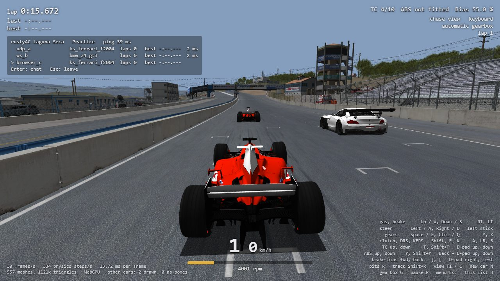

# Task 26 (M2): multiplayer in the browser

## Resume here

State at `v0.26.0`: **M2 is done and proven** as far as the tables below say. Nothing is
half-wired. What is left is under [Not done](#not-done).

- **Where things are:**
  - `crates/rustyac-gateway`: the WebSocket gateway (plain std, no dependency), its Docker
    image, and the WebSocket code the desktop client uses too.
  - `crates/rustyac-net`: `ws.rs` (`WsTransport`: both channels in one WebSocket), `client.rs`
    (`Join`, the join as a state machine), `native.rs` (`WsPipe`, the desktop's WebSocket),
    `replay.rs` (a tape replayed on any transport), `examples/net_golden.rs`.
  - `crates/rustyac-game`: `gateway.rs` (`--join ws://` / `wss://`, rustls), `online.rs`
    (`finish_join`: the checks and checksums shared by desktop and browser).
  - `crates/rustyac-web`: `net.rs` (the page's WebSocket as the transport), `session.rs`
    (`Session::new_online`), `gpu.rs` (other cars drawn), `web/app.js` (the Multiplayer
    section), `web/servers.json`.
  - `server/docker-compose.yml`: a gateway per server, every host port a variable.
- **Proofs to re-run** (scratch is git-ignored; the tapes are Task 25's):
  - `sh re/scratch/task25/batch.sh`: Task 25's oracle, 20 runs + 3 faults (15 minutes).
  - `sh re/scratch/task26/gold.sh` then `python re/scratch/task26/proof.py`: every tape
    four ways (desktop, the browser's way, through a real gateway, wasm under wasmtime),
    45 minutes. Needs `re/scratch/task26/bin/net_golden.exe` and `.wasm` (built from
    `crates/rustyac-net/examples/net_golden.rs`) and wasmtime in `re/scratch/task20w/tools`.
  - `sh re/scratch/task26/live.sh` then `python re/scratch/task26/latency.py re/scratch/task26/live`:
    the three-way live run and its delay numbers. `grid.sh`: the screenshot. `wss.sh`: TLS.
  - `cargo test --release --workspace`.
- **Next:** deploy (steps below; nothing was deployed from here), then try it through the
  real tunnel and on the Chromebook.

## Summary in plain English

A browser tab can now race on a real Assetto Corsa server. On the page you pick "Spa" or
"Laguna Seca", type a name and press Join; you get one of the server's cars, start in your
pit box, and see, hit and chat with everybody else on that server: other browsers, desktop
rustyAC and (not tried from here, I never start the game) Assetto Corsa itself.

A browser cannot speak the game's network protocol directly (it can open neither TCP nor
UDP). So a small program, the **gateway**, runs next to each server. The browser opens one
WebSocket to it, and the gateway passes every message on to the server over TCP and UDP and
back. A WebSocket is ordinary HTTPS traffic, so it goes through the Cloudflare Tunnel that
already carries the site.

The same gateway works for the desktop: `rustyac.exe --join wss://<site>/net/spa` joins
through the tunnel. **Nobody needs Tailscale or an open port any more.**

How it was checked:

1. **The browser's client is the desktop's, and both are the game's.** All five tapes of
   Task 25's live sessions were replayed in four ways: the desktop client, the client the
   way the browser runs it, the client through a real gateway over real sockets, and the
   WebAssembly build under wasmtime. Each run was held, step by step, against what the
   game's own code made of the same tape. 80 runs, 1.13 million steps each way: all
   identical, to the game and to each other.
2. **Live on this PC**, everything on 127.0.0.1: Kunos' `acServer`, the gateway, a desktop
   client over UDP, a desktop client over `ws://` and a headless Chrome. All three saw each
   other, the server counted everybody's laps, a chat line from each reached the other two,
   and when the browser was killed mid-race the gateway said goodbye for it: the server
   logged a clean exit and both desktops reported the player gone.
3. **The WebSocket costs next to nothing** against UDP on this PC: the same car state
   reached the `ws://` client within half a millisecond of the UDP client 95 times out of
   100. What the browser adds is the wait for its next frame (9 ms in the middle at 60
   frames a second), because a page only does work once per frame.
4. **Nothing old changed.** Task 25's oracle still says identical 20 times out of 20;
   replays, an off-screen picture and all 583,963 sound calls of a replay are byte-identical
   to v0.25.0; the browser preview's offline self test gives the desktop's number.

Not done from here: nothing was deployed, the Docker images were not built (no Docker on
this PC), and the real tunnel, Cloudflare Access and a real Chromebook were not tried. The
exact steps are below.



## How it fits together

```text
 browser tab (rustyac-web, wasm)                  desktop (rustyac.exe)            Assetto Corsa
 ┌──────────────────────────────┐      ┌──────────────────────────────┐           ┌────────────┐
 │ physics, remote cars, client │      │ physics, remote cars, client │           │  acs.exe   │
 │   = rustyac-net, the same    │      │   = rustyac-net              │           └─────┬──────┘
 │ WsTransport ── page's        │      │ WsTransport    or   Native   │                 │
 │                WebSocket     │      │  (--join wss://)   Transport │                 │
 └───────────────┬──────────────┘      └──────┬───────────────┬───────┘                 │
                 │ wss (HTTPS)                │ wss           │ TCP + UDP               │ TCP + UDP
                 ▼                            ▼               │ (LAN, Tailscale)        │
        ┌─────────────────────────────────────────┐           │                         │
        │ Cloudflare Tunnel + Access              │           │                         │
        │   /            -> the site (nginx)      │           │                         │
        │   /net/spa     -> gateway-spa           │           │                         │
        │   /net/laguna_seca -> gateway-laguna    │           │                         │
        └───────────────┬─────────────────────────┘           │                         │
                        ▼ ws (plain, on the server itself)    │                         │
              ┌───────────────────┐                           │                         │
              │ rustyac-gateway   │  per WebSocket:           │                         │
              │  [0][message]  <──┼── one TCP connection ──┐  │                         │
              │  [1][datagram] <──┼── one UDP socket ────┐ │  │                         │
              └───────────────────┘                      ▼ ▼  ▼                         ▼
                                                   ┌─────────────────────────────────────────┐
                                                   │ Kunos acServer (Spa 9600, Laguna 9610)  │
                                                   └─────────────────────────────────────────┘
```

- **One lane byte per WebSocket message.** `[0][message]` is one message of the server's
  TCP stream (the gateway adds or removes the 16-bit length TCP has in front of each);
  `[1][datagram]` is one UDP datagram. The gateway opens one TCP connection and one UDP
  socket per client, so the server tells clients apart exactly as it always does.
- **The gateway does not read what it carries**, with one exception: when a WebSocket ends
  and the server had let that client in (its first answer was `0x3e`) but the client never
  said the protocol's goodbye (`0x43`), the gateway says it. That is what makes a closed
  tab leave at once instead of standing on the track as a stale car.
- **The join is a state machine** (`rustyac_net::client::Join`). The game sends a question
  and blocks for the answer; a page cannot block. Now each answer is a message handed in.
  The desktop drives the machine with `wait` (blocking in the transport), the page with
  `poll` once per timer tick. The bytes on the wire and their order are unchanged.
- **Checksums** come from the browser's own files: the preview pack carries `data.acd`,
  `system/data/surfaces.ini` and the track's `surfaces.ini` and `models.ini` as they are,
  and the same code as on the desktop digests them (`online::finish_join`).
- **Remote cars** are the same `NetCarStateProvider` bodies in the same physics engine as
  on the desktop, so contact and ghosting are the game's. The picture draws them from the
  same state (`CarView::capture_remote`).

### What is where

| File | What |
|---|---|
| `crates/rustyac-gateway/src/gateway.rs` | the gateway: a listener, three threads per client (WebSocket to server, the server's TCP to WebSocket, its UDP to WebSocket), limits, `/healthz`, the goodbye |
| `crates/rustyac-gateway/src/ws.rs`, `sha1.rs` | the WebSocket protocol (RFC 6455) for both sides: handshake, frames, fragments, ping, close; a client over any byte stream |
| `crates/rustyac-gateway/Dockerfile`, `check_isa.py` | the image (a static program in an empty image); the check that a Linux build needs no AVX |
| `crates/rustyac-net/src/ws.rs` | `WsTransport` over a `Pipe` (whole binary messages); `TapePipe` for the proofs |
| `crates/rustyac-net/src/client.rs` | `Join`: handshake and car list as a state machine (`poll`, `wait`, `finish`, `abandon`) |
| `crates/rustyac-net/src/native.rs` | `WsPipe`: the desktop's WebSocket client on TCP or TLS |
| `crates/rustyac-net/src/replay.rs` | a tape replayed on any transport, `replay_on` with a report |
| `crates/rustyac-game/src/gateway.rs` | `--join ws://` / `wss://`: rustls (ring, Mozilla's roots compiled in), `--tls-root`, the Access service token |
| `crates/rustyac-game/src/online.rs` | `finish_join`: name checks, checksums through the virtual file system, used by desktop and browser |
| `crates/rustyac-web/src/net.rs` | `NetLink` (the page hands the WebSocket's messages in), `NetJoin` (the join the page steps), arrival times |
| `crates/rustyac-web/src/session.rs`, `web.rs` | `Session::new_online`, `Game.create_online`, the player list / chat / other cars as JSON, `chat`, `leave` |
| `crates/rustyac-web/src/gpu.rs` | any number of car models; other cars with their model near, as boxes far, not at all beyond |
| `web/app.js`, `index.html`, `servers.json` | the Multiplayer section, the join, the panel over the picture, Enter for chat, Esc to leave |
| `web/check.mjs` | `--chat`, `--arrivals`, `--shots`, `--end kill` for checks without a window |
| `server/docker-compose.yml` | `gateway-spa`, `gateway-laguna-seca`; every host port a variable |

### The gateway's settings

| Option (environment) | Default | What |
|---|---|---|
| `--listen` (`GATEWAY_LISTEN`) | `127.0.0.1:9601` | where WebSockets are accepted |
| `--server` (`GATEWAY_SERVER`) | `127.0.0.1:9600` | the game server's TCP port |
| `--udp-port` (`GATEWAY_UDP_PORT`) | the TCP port | the game server's UDP port |
| `--origins` (`GATEWAY_ORIGINS`) | `http://127.0.0.1:*,http://localhost:*` | which sites' pages may connect: exact, `host:*` for any port, `*` for all. A request without an `Origin` (a desktop client) is let in |
| `--max-clients` (`GATEWAY_MAX_CLIENTS`) | 24 (12 in the compose file) | clients at once; four times that plus 32 connections in all |
| `--max-message` (`GATEWAY_MAX_MESSAGE`) | 4096 | the largest WebSocket message taken, bytes (the protocol's own limit for a TCP message is 2046) |
| `--idle-timeout` (`GATEWAY_IDLE_TIMEOUT`) | 300 s | a client that sends nothing at all this long is dropped; one that sends no first message within 30 s too |
| `--ping-interval` (`GATEWAY_PING_INTERVAL`) | 20 s | WebSocket pings, so that a tunnel does not close a quiet connection |
| `--name` (`GATEWAY_NAME`) | `gateway` | for the log lines |
| `--check [addr]` | | asks `/healthz` and exits 0 or 1 (the image's health check) |

`GET /healthz` answers `ok`. The log holds connection numbers, addresses, counts and why a
connection ended; never anything that was carried (no player id, no password, no name, no
chat).

## Results

### 1. wasm = desktop = the game, and through the gateway = direct

`tools/car_oracle net <tape> --scenario <s> --csv-out <file>` writes a golden file per
tape and scenario: the local car's inputs, the tape, and per step the hash of what **the
game's own** `ACClient::onPhysicsStep` and `NetCarStateProvider::step` made of it (the
local car, every remote car's 200 values, every outgoing message). `examples/net_golden`
replays such a file and must give the game's hash at every step. Four ways:

| Way | The client's transport | The join |
|---|---|---|
| desktop | a tape player | waited for (`Join::wait`) |
| the browser's way | `WsTransport` over a pipe that plays the tape (lane bytes and all) | polled (`Join::poll`) |
| through a real gateway | `WsTransport` over a real WebSocket to a real `rustyac-gateway` on 127.0.0.1, which talks TCP and UDP to a stand-in server that plays the tape in step with the client | waited for |
| **wasm** | the browser's way, built for `wasm32-wasip1` and run under wasmtime 25 (pure-Rust maths, no MSVCR120) | polled |

In the gateway way the stand-in server also keeps what it received: it must be, byte for
byte and in order, what the client sent (plus the gateway's own goodbye at the end, when
the replay's client simply vanishes).

| Tape | Scenario | Steps | Values compared with the game | Messages the client sent in the steps | One number over all the steps' hashes (the same in all four ways) | What the stand-in server got through the gateway (TCP + UDP) | Desktop, browser's way, gateway, wasm |
|---|---|---|---|---|---|---|---|
| `laguna_a`: two clients, 200 s (slot 0) | `net_block` | 66,000 | 153,714,000 | 3,962 | `b1d92c7458cd99a1` | 6 + 3,960 | identical x 4 |
|  | `net_drive` | 66,000 | 153,714,000 | 3,961 | `fd3f7463cd8310a8` | 5 + 3,960 | identical x 4 |
|  | `net_pit` | 66,000 | 153,714,000 | 3,960 | `836e1514a1544a91` | 4 + 3,960 | identical x 4 |
|  | `net_watch` | 66,000 | 153,714,000 | 3,960 | `0ec737a1a1bb4d77` | 4 + 3,960 | identical x 4 |
| `laguna_b`: the same session (slot 2) | `net_block` | 66,000 | 153,714,000 | 3,962 | `3e98d4234aed8a0e` | 6 + 3,960 | identical x 4 |
|  | `net_drive` | 66,000 | 153,714,000 | 3,961 | `62787e615fb88ded` | 5 + 3,960 | identical x 4 |
|  | `net_pit` | 66,000 | 153,714,000 | 3,960 | `79e45cb3e9577f33` | 4 + 3,960 | identical x 4 |
|  | `net_watch` | 66,000 | 153,714,000 | 3,960 | `cc40c6a03ce1b51e` | 4 + 3,960 | identical x 4 |
| `rich_a`: four clients, 150 s (slot 0) | `net_block` | 50,000 | 116,450,000 | 2,999 | `03bf5d494abdd5c4` | 6 + 2,997 | identical x 4 |
|  | `net_drive` | 50,000 | 116,450,000 | 2,998 | `0ca8e8ee2d82a20f` | 5 + 2,997 | identical x 4 |
|  | `net_pit` | 50,000 | 116,450,000 | 2,997 | `f19c03f8e5435878` | 4 + 2,997 | identical x 4 |
|  | `net_watch` | 50,000 | 116,450,000 | 2,997 | `b7ff4b66958287a0` | 4 + 2,997 | identical x 4 |
| `rich_b`: the same session (slot 2) | `net_block` | 50,000 | 116,450,000 | 3,000 | `c3a6579b50570dd1` | 7 + 2,997 | identical x 4 |
|  | `net_drive` | 50,000 | 116,450,000 | 2,998 | `21bd3a7c70ed641d` | 5 + 2,997 | identical x 4 |
|  | `net_pit` | 50,000 | 116,450,000 | 2,997 | `c400599a21fa00b4` | 4 + 2,997 | identical x 4 |
|  | `net_watch` | 50,000 | 116,450,000 | 2,997 | `3bb55bba1510a059` | 4 + 2,997 | identical x 4 |
| `rich_c`: the same session (slot 4, joins late, leaves early) | `net_block` | 50,000 | 116,450,000 | 2,891 | `e7bff9acf5a7b6e2` | 5 + 2,890 | identical x 4 |
|  | `net_drive` | 50,000 | 116,450,000 | 2,891 | `1c2145c207665a9f` | 5 + 2,890 | identical x 4 |
|  | `net_pit` | 50,000 | 116,450,000 | 2,890 | `056e012ad989fcd4` | 4 + 2,890 | identical x 4 |
|  | `net_watch` | 50,000 | 116,450,000 | 2,890 | `9d3c93e97fc78122` | 4 + 2,890 | identical x 4 |
| **20 files x 4 ways = 80 runs** | | **1,128,000** per way | **2,627,112,000** per way | **67,231** per way | | **67,311** messages, byte for byte | **all identical** |

The tapes are Task 25's: `laguna_a/b` (two clients, 200 s), `rich_a/b/c` (four clients: a
late join, collisions, a clean exit, a killed client that goes stale, chat, a change of
session). The scenarios are what the local car does: stands beside the line, stands on it
(and is hit), drives among the others, stands in the pit lane.

**The compare can fail**: Task 25's three faults (one bit of a car state, a lost ping, a
lost car state) are still caught by the oracle (`re/scratch/task25/batch.sh`, re-run), and
`golden_laguna_join` spoils one bit and must notice.

### 2. Task 25's proofs still pass

| Check | Result |
|---|---|
| `car_oracle net`, 5 tapes x 4 scenarios, after the join became a state machine | **20 of 20 identical** (1,128,000 steps, 2,627,112,000 values, 65,619 outgoing messages) |
| the three faults | all three caught (exit code 1, the same steps as in Task 25) |
| live UDP join against Kunos' `acServer` | in every live run below: accepted, checksums true, laps counted, clean exit |

### 3. Live on this PC (all on 127.0.0.1)

Kunos' `acServer` 1.15 (Task 25's copy with the kit's Laguna Seca config, port 9600),
`rustyac-gateway` on 9601, `web/serve.py` on 8080 with the preview pack, and three F2004s
driven by the line follower from the grid:

| Client | How it joined | Slot |
|---|---|---|
| `udp_a` | `rustyac.exe --join 127.0.0.1:9600` (TCP + UDP) | 2 |
| `ws_b` | `rustyac.exe --join ws://127.0.0.1:9601/net/laguna` (the gateway) | 4 |
| `browser_c` | headless Chrome, the page's Multiplayer join (the gateway) | 0 |

| What | Result |
|---|---|
| the join | all three accepted; the server's log says `Car checksum ks_ferrari_f2004 true` 3 times (the browser's digests come from the pack's own files) |
| they see each other | the browser's panel lists `udp_a`, `ws_b` and itself with cars, laps and pings; it had both other cars in its physics and its picture (2 there); `ws_b` took 3,666 states of `udp_a` in order (1 out of order, dropped as the game does) |
| laps counted by the server | `LAP udp_a 1:25:240`, `LAP ws_b 1:25:452`, `LAP browser_c 1:25:006`, `LAP udp_a 1:18:108`, `LAP ws_b 1:18:102`: every lap of every client, each client's own time |
| chat across all three | each of the three lines (`hello from udp`, `hello from ws`, `hello from the browser`) is in the server's log and on the other two clients |
| the browser is killed mid-race (its process, 131 s after it connected: no goodbye from the page) | gateway: `#1 left after 131 s: the client's connection broke: An existing connection was forcibly closed by the remote host. (os error 10054) (the gateway said  ...`; server: `Clean exit, driver disconnected:  browser_c []`; both desktops print `Player browser_c disconnected from the server`: the car is gone at once (a remote car that left is not drawn and is a ghost for the physics) |
| the desktops drive on | `udp_a` 66637 steps and `ws_b` 65973 steps at 333.33 Hz, two laps each, then `Clean exit, driver disconnected:  ws_b []` and `Clean exit, driver disconnected:  udp_a []` |
| the browser's own numbers | 60 frames a second, 333.3 physics steps a second, 2.8 ms of work a frame (WebGPU, the track's 4.6 million triangles and two F2004 models), 4,214 datagrams in and 2,229 out, none dropped, ping 10 ms shown (a desktop shows 2 ms: the browser answers the server's ping in its next frame) |

The run is `re/scratch/task26/live.sh`; the picture above is `grid.sh` (the two desktops
stand on the grid, an F2004 and a Z4 GT3; the browser joins behind them: both cars are
drawn with their models, and the panel shows all three).

**`wss://`** (`re/scratch/task26/wss.sh`): a TLS front with a throw-away certificate in
front of the gateway (`examples/tls_front.rs`), `rustyac.exe --join
wss://localhost:9643/net/laguna --tls-root ca.pem`: joined, checksums true, drove 48 s
beside a UDP client, both chat lines on both sides, clean exit. Without `--tls-root` the
join stops with `TLS with localhost: invalid peer certificate: UnknownIssuer`, as it must.

### 4. Latency and jitter: WebSocket against UDP

`--net-arrivals` (desktop) and `?arrivals=1` (page) note when every car state arrived.
The same state (same slot, sequence number and position) reaches several clients, so the
lists of two clients say how much later one got it. From the live run above
(`re/scratch/task26/latency.py`):

**How evenly the states of one car arrive** (the server sends 18 a second; ms between two arrivals):

| Who receives, whose car | States | Median | Mean | Standard deviation (jitter) | 95 % below | Longest |
|---|---|---|---|---|---|---|
| desktop over UDP, the ws desktop's car | 3,689 | +54.00 | +53.67 | 4.10 | +54.58 | +56.66 |
| desktop over ws://, the UDP desktop's car | 3,666 | +54.00 | +54.00 | 0.87 | +54.72 | +57.93 |
| browser, the UDP desktop's car (at the WebSocket) | 2,037 | +54.00 | +54.00 | 2.08 | +57.40 | +88.20 |
| ... the same when the session reads them (once a frame) | 2,037 | +50.10 | +53.95 | 7.28 | +66.80 | +75.30 |
| desktop over UDP, the browser's car | 2,040 | +51.08 | +54.01 | 6.82 | +66.20 | +138.17 |
| desktop over ws://, the browser's car | 2,040 | +51.08 | +54.01 | 6.85 | +66.20 | +137.99 |

**The same state at two clients** (ms later at the second; the desktop notes an arrival at its next 3 ms physics step, the page at the socket itself, hence the small negative numbers):

| Compared | States | Median | Mean | Standard deviation | 95 % below | Largest |
|---|---|---|---|---|---|---|
| **desktop over ws:// against desktop over UDP** (the browser's car) | 2,041 | +0.02 | +0.04 | 0.52 | +0.49 | +3.34 |
| browser against desktop over UDP (the ws desktop's car), at the WebSocket | 2,038 | -1.80 | -1.12 | 1.54 | +1.61 | +38.80 |
| ... when the browser's session reads it | 2,038 | +7.13 | +7.22 | 5.42 | +14.56 | +101.99 |
| in the browser: from the WebSocket to the session (the wait for the frame) | 4,076 | +8.80 | +8.32 | 4.74 | +13.30 | +103.40 |

In words: through the gateway a state is as punctual as over UDP (the same state within half a millisecond of the UDP client 95 times out of 100; jitter 0.9 ms through the gateway and 4.1 ms over UDP in this run). The browser gets them just as punctually at its WebSocket and then waits for its next frame: 9 ms in the middle at 60 frames a second, more on a slower device. A browser's **own** car reaches the others less evenly (jitter 7 ms against 1 to 4 ms for a desktop's car, over UDP and over the gateway alike), because a page sends once per frame.

What this does and does not say: everything ran on one PC, so these are the gateway's and
the browser's own costs, not the internet's. Over a real connection the WebSocket adds what
TCP adds to UDP: a lost packet holds back the ones after it until it is sent again, so car
states can arrive late in a burst. The remote car's code already drops states that arrive
out of order and smooths their time stamps, as the game does. How that looks over the
tunnel has to be seen on the real thing.

### 5. Tests, builds, the processor

| Check | Result |
|---|---|
| `cargo test --release --workspace --locked` | 54 test programs, 260 tests: all pass, 0 failed |
| `rustyac-gateway` unit + integration tests (frames, fragments, both lanes both ways over real sockets, the goodbye for a vanished client and none for a refused one, refusals: origin, full, plain HTTP, bad lane, too long; `/healthz`; a server that is not there) | 13 pass |
| `rustyac-net` `join_polled_is_join_waited` | the polled join sends what the waited join sends and ends the same |
| `golden_laguna_join_the_browsers_way` (the golden test of this task) | 3,000 steps on the WebSocket transport with a polled join: the game's hash at every step, the desktop way's numbers and outgoing tape (NOT TESTED without the AC folder or `cardata/`). The same file under wasmtime is in table 1's method |
| `cargo clippy --workspace --locked -- -D warnings` | clean |
| clippy for `wasm32-unknown-unknown` (`rustyac-web`, `rustyac-net`) and `wasm32-wasip1` (six crates) | clean |
| `--locked` builds: the workspace, `python web/build.py`, every tool in `tools/*/` | all build (the workspace, the site, `rustyac-game` for `wasm32-wasip1`, the nine tools) |

**The gateway on a processor without AVX.** How it was made sure:

- The crate has **no dependency**: only Rust's standard library, which Rust ships built for
  the plain x86-64 baseline. No SIMD crate, no runtime-chosen fast path of its own.
- The image builds with `-C target-cpu=x86-64` (the baseline: SSE2, nothing newer), static,
  for `x86_64-unknown-linux-musl`.
- A build made exactly that way on this PC (cross-compiled, `rust-lld`) was disassembled
  whole: `python crates/rustyac-gateway/check_isa.py <binary>`: 1,186 functions, 116,624
  instructions, every function read to its end, **no AVX, AVX2, AVX-512 or FMA instruction**. The only instructions the
  disassembler files outside SSE/SSE2 are 24 `tzcnt`, which is written `rep bsf` and runs as
  `bsf` on a processor without BMI (the compiler only uses it where both agree).
- Not done: the binary was not **run** on a Xeon E5620 (or anywhere on Linux).

### 6. Nothing offline changed (v0.25.0 against this version)

| Check | v0.25.0 | now |
|---|---|---|
| replay of a 25 s drive, F2004 at Spa (`--replay --headless --state-hash`, 8,795 steps) | `044986fc136e531f` | `044986fc136e531f` |
| replay of three cars at Laguna Seca (8,773 steps, 8 worker threads) | `5777df2f22cfb216` | `5777df2f22cfb216` |
| off-screen picture (`--screenshot`, WARP, 640 x 360, F2004 at Spa after 4 s) | | byte-identical PNG |
| every FMOD call of the Spa replay (`--audio-log`, 583,963 lines) | | byte-identical log |
| the browser preview offline: the page's self test, Z4 GT3 at Laguna Seca, 5,000 steps | | `09d204f654f7970c` = the desktop's number |

(v0.25.0 built from its tag into `target/v0250src` for this.)

### 7. A read-only review

Three Sonnet readers went through the gateway, the client side and the page. Fixed from
their findings: the origin check could panic on an origin with multi-byte letters (and the
image aborts on a panic); connections that never ask for anything were not limited and
had no deadline for their request; the goodbye was skipped when the client's connection
broke under a datagram being written; frames could follow the gateway's close frame; no
write timeout towards the game server; a UDP "port unreachable" ended a session on Linux;
`docker stop` waited out its grace period; the desktop's car updates could block the
physics on a stalled connection (5 s write timeout now); the Access token went to any
gateway (now only over `wss://` to the host named in `CF_ACCESS_HOST`); skin names and
Windows device names (`CON`, `NUL` ...) from a server were not refused; the page's Join
button stayed off after opening a folder, did nothing after an offline drive, and a lost
connection left the page half alive; car updates piled up in a stalled WebSocket; `?server=`
in a link could send a visitor to somebody's gateway (now only on localhost).

## How to join

### From a browser

1. Open the site (`https://rustyac.example.com`; locally `http://127.0.0.1:8080` with
   `python web/serve.py`).
2. **Content**: the preview pack on the site is used by itself; without one, "Open your
   Assetto Corsa folder". The server's track and **every car model on the server** must be
   in it (the kit's servers: `ks_ferrari_f2004`, `bmw_z4_gt3`, `spa`, `ks_laguna_seca`: the
   default pack has exactly these).
3. **Multiplayer**: pick the server, pick a car or "any free car", type your name, **Join**.
4. The page asks the server for a car, fetches the files (the first time; kept in the
   browser afterwards) and puts you in your pit box. Drive out.
5. **Enter** opens the chat line (Enter sends, Esc closes). **Esc** leaves the server; the
   page starts afresh for the next drive. There is no pause on a server.

Address options: `?join=spa&name=<name>&mpcar=bmw_z4_gt3` joins without a click,
`&cars=<metres>` sets how far other cars keep their model, `&spawn=start` starts on the
grid. On localhost only: `?server=ws://127.0.0.1:9601/net/spa&join=address`.

### From the desktop, through the gateway

```
rustyac.exe --join wss://rustyac.example.com/net/spa --car ks_ferrari_f2004
rustyac.exe --join wss://rustyac.example.com/net/laguna_seca --car bmw_z4_gt3 --name thesupersupersigma
rustyac.exe --join ws://10.0.0.140:9601/net/spa --car ks_ferrari_f2004        (LAN, GATEWAY_BIND=0.0.0.0)
```

- `--car` must name one of the server's models: Kunos' `acServer` gives its pick-up slots
  by model and refuses a join without one ("no available slots"; found in this task, the
  Task 25 report said otherwise and is corrected).
- Everything else is as for `--join host:port` (`docs/port/multiplayer.md`): `--name`,
  `--password`, the Steam id or rustyAC's own, `--chat`, `--net-tape`.
- **Behind Cloudflare Access** a program cannot do the e-mail login. Make a service token
  (deploy step 4) and put it in the environment, once:

  ```
  setx CF_ACCESS_HOST rustyac.example.com
  setx CF_ACCESS_CLIENT_ID <the token's client id>
  setx CF_ACCESS_CLIENT_SECRET <the token's client secret>
  ```

  The token is only sent over `wss://` and only to that host. Without it the join says
  `the gateway answered "HTTP/1.1 302 ..." a login is asked for (Cloudflare Access?)`.
  (`--join-header "Name: value"` sends any other header.)
- `wss://` checks the certificate against Mozilla's root list (compiled in). For a gateway
  behind a certificate of your own: `--tls-root <file.pem>`.
- The direct way still works and is still the one with real UDP:
  `--join 10.0.0.140:9600` on the LAN or over Tailscale.

## Deploy on tsss-server, step by step

Nothing here was run from this PC. The names below use `rustyac.example.com`; put the real
host name in.

### 1. The servers and the gateways

The gateway's image is built from `crates/rustyac-gateway`, so the server needs the
repository (it is public), not only the `server/` folder as in Task 25.

```
# on tsss-server, once
git clone https://github.com/thesupersupersigma/rustyAC ~/rustyac-src
# later: cd ~/rustyac-src && git pull

# if the servers of Task 25 run from the copied kit: stop them first (the ports are the same)
docker compose -f ~/rustyac/server/docker-compose.yml down

# the settings of this host, next to the compose file (git ignores nothing here: do not commit it)
cat > ~/rustyac-src/server/.env <<'EOF'
AC_PACK_DIR=/home/thesupersupersigma/rustyac/dist-server
AC_ADMIN_PASSWORD=<choose one>
SPA_HTTP_PORT=8091
GATEWAY_ORIGINS=https://rustyac.example.com
EOF

cd ~/rustyac-src
docker compose -f server/docker-compose.yml up -d --build
docker compose -f server/docker-compose.yml ps        # four services; the gateways "healthy"
curl http://127.0.0.1:9601/healthz                    # ok   (Spa's gateway)
curl http://127.0.0.1:9611/healthz                    # ok   (Laguna Seca's)
curl http://127.0.0.1:8091/INFO                       # the Spa server's JSON
docker compose -f server/docker-compose.yml logs --tail 20 gateway-spa
```

- **`SPA_HTTP_PORT=8091`**: on this host 8081 is another container's. Every host port is a
  variable now (`SPA_GAME_PORT`, `SPA_HTTP_PORT`, `SPA_GATEWAY_PORT`, `LAGUNA_GAME_PORT`,
  `LAGUNA_HTTP_PORT`, `LAGUNA_GATEWAY_PORT`), each with the old number as its default, so
  the file runs unchanged elsewhere. Inside the containers the numbers stay the configs'.
  For Content Manager the Spa server is then `10.0.0.140:8091`.
- The pack (`dist-server/`) is the one of Task 25; nothing new is needed in it.
- The first build compiles the gateway (one small crate, no downloads but Rust's musl
  target; a minute or two on the Xeons). If the build cannot run there at all, build the
  image elsewhere or run the program without Docker: it is one static file.
- The gateways listen on `127.0.0.1` of the host (`GATEWAY_BIND`). If `cloudflared` runs
  **in a container**, it cannot reach the host's 127.0.0.1: set `GATEWAY_BIND=0.0.0.0` in
  `.env`, use `http://host.docker.internal:9601` (or the Docker bridge's address,
  usually `172.17.0.1`) as the service in step 2, and keep the two ports closed to the
  outside (`ufw`), unless LAN players should use `ws://10.0.0.140:9601` too.

### 2. Cloudflare Tunnel routes

**Recommended: paths on the site's own host name** (`/net/spa`, `/net/laguna_seca`), not a
host name of their own. Why:

- the page and its WebSocket have the same origin, so the browser sends the Access cookie
  with the WebSocket by itself and nothing has to be allowed across sites;
- one Access application protects the pack **and** the servers;
- `web/servers.json` stays `"/net/spa"` and works on any host name;
- no second DNS name.

A host name of its own (`net.rustyac...`) is only better if the gateways should be open to
everybody without Access; then set a join password (`AC_PASSWORD`) and list the site in
`GATEWAY_ORIGINS`.

In Zero Trust > Networks > Tunnels > the tunnel > *Public Hostname*, add two entries and
move them **above** the site's own entry (the first match wins):

| Subdomain / Domain | Path | Service |
|---|---|---|
| `rustyac` / your domain | `net/spa` | `http://localhost:9601` |
| `rustyac` / your domain | `net/laguna_seca` | `http://localhost:9611` |
| `rustyac` / your domain | (empty: the site, as now) | `http://localhost:80` |

With a `config.yml` instead of the dashboard:

```yaml
ingress:
  - hostname: rustyac.example.com
    path: ^/net/spa$
    service: http://localhost:9601
  - hostname: rustyac.example.com
    path: ^/net/laguna_seca$
    service: http://localhost:9611
  - hostname: rustyac.example.com
    service: http://localhost:80
  - service: http_status:404
```

The gateway answers on any path, so the path is passed through as it is. WebSockets need
no switch in a tunnel (the zone's *Network > WebSockets* setting is on by default). Check:
`curl https://rustyac.example.com/net/spa` from a logged-in browser session should answer
`426` with "this is rustyAC's WebSocket gateway" (a plain request on a WebSocket's address).

### 3. Access for browsers

Nothing to add: the application that covers `rustyac.example.com` covers `/net/...` too,
and the page's WebSocket carries the login cookie. Whoever can open the site can join.

### 4. Access for desktop players (a service token)

1. Zero Trust > Access > *Service Auth* > *Create Service Token*, name it
   (`rustyac-desktop`); copy the client id and the client secret (the secret is shown once).
2. Access > Applications > the rustyAC application > *Policies* > *Add a policy*: action
   **Service Auth**, *Include* > *Service Token* > that token.
3. On the player's PC: the three `setx` lines above, then
   `rustyac.exe --join wss://rustyac.example.com/net/spa --car ks_ferrari_f2004`.

One token can be given to several friends; taking it back means deleting it.

### 5. The web image (Coolify)

After `git push`: Coolify > the rustyAC site > **Redeploy**. The new image has the
Multiplayer section and `servers.json` (`/net/spa`, `/net/laguna_seca`). Nothing else
changes: same Dockerfile location, same port, same mount of the preview pack. The pack on
the server needs no rebuild (it already holds the files the servers want checksums of).

To offer other servers, edit `web/servers.json` and redeploy.

### 6. Try it

1. Browser: the site > Multiplayer > Spa > Join. The panel top-left must show the server's
   name and your name; `docker compose ... logs gateway-spa` shows `#1 connected ... (a
   browser)`.
2. A second device (the Chromebook) the same way: the two cars must see each other.
3. Desktop: `rustyac.exe --join wss://.../net/spa --car bmw_z4_gt3` with the token set.
4. Assetto Corsa itself: Content Manager > Online > add `10.0.0.140:8091` (LAN) > Join,
   with a browser on the same server.

### 7. As it is deployed: rustyac.com

The steps above say `rustyac.example.com` and were written before the first deployment. This is what the
real one looks like, where it differs:

- **The public site is `rustyac.com`**, a separate repository (**rustyACSite**). It downloads the newest
  release's web zip and serves it at `/play/app/`; the preview pack is mounted at `/play/app/preview` from
  `/storage/rustyac/preview` on the server (not `/srv/...`). See `docs/web.md`, "As it is deployed".
- **The gateways are reached as `wss://rustyac.com/net/spa` and `wss://rustyac.com/net/laguna_seca`**:

  ```
  rustyac.exe --join wss://rustyac.com/net/spa --car ks_ferrari_f2004
  rustyac.exe --join wss://rustyac.com/net/laguna_seca --car bmw_z4_gt3
  ```

  (`CF_ACCESS_HOST` is then `rustyac.com`.)
- **`cloudflared` runs as a container in Coolify's `coolify` network**, so it reaches neither the host's
  `127.0.0.1` nor a gateway bound there. The gateways publish on the **docker0 address** instead:
  `GATEWAY_BIND=10.0.1.1` on this server (`ip -4 addr show docker0` prints yours), and the tunnel routes
  point at `http://10.0.1.1:9601` (spa) and `http://10.0.1.1:9611` (laguna_seca). `0.0.0.0` is not needed
  and would open the ports to the network.
- **The two `/net/...` routes are listed above the site's own entry** in the tunnel's public hostnames (the
  first match wins; below it they would go to the site and answer 404):

  ```yaml
  ingress:
    - hostname: rustyac.com
      path: ^/net/spa
      service: http://10.0.1.1:9601
    - hostname: rustyac.com
      path: ^/net/laguna_seca
      service: http://10.0.1.1:9611
    - hostname: rustyac.com
      service: <the site, as before>
  ```

- **Cloudflare Access covers only `rustyac.com/play/app/preview` and `rustyac.com/net`, both in one
  application** (two paths of the same application, so one login and one cookie serve the pack and the
  WebSocket). The page itself is public and offers "Open your Assetto Corsa folder" to everybody else.
- **Browser Cache TTL: "Respect Existing Headers"** (Cloudflare -> Caching -> Configuration). Otherwise an
  update mixes an old cached `rustyac_web.js` with a new `.wasm` and the page stops with
  `function import requires a callable`.
- **A new file in the web zip** has to be added to the allowlist in rustyACSite's
  `scripts/fetch-web-preview.mjs` (`servers.json` already is).

## Not done

- **Nothing was deployed and no Docker image was built.** There is no Docker on this PC.
  The gateway's Dockerfile and the compose file are written and read through, the Linux
  binary was cross-compiled and disassembled, but `docker compose up` on tsss-server is the
  first real test (as for the servers themselves in Task 25).
- **The real tunnel, Cloudflare Access and the service token were not tried.** `wss://` was
  proven against a local TLS front with a certificate of my own. The dashboard's exact field
  for the path, and whether its entries can be reordered there, were written from memory.
- **A real Chromebook was not tried.** The limits for other cars (150 m and six models, 80 m
  and three on a device without compressed textures, boxes to 600 m) are chosen, not
  measured there. The headless Chrome on this PC drew two other cars' models at 30 to 60
  frames a second with other work running beside it.
- **Real Assetto Corsa with a browser on one server** was not tried (I never start
  `acs.exe`). The browser's client is proven identical to the desktop's, which Task 25
  proved against the game's code; the mixed session is step 6.4 above.
- **Other cars' looks:** every car of a model has the model's default skin (the pack holds
  no skin folders, and the page's folder scan skips them); no damage on other cars, no
  lights, no lower levels of detail (the pack holds each car's first only), no sound (the
  browser preview has none).
- **A tab in the background** stops driving (browsers stop a hidden page's frames): its car
  stands still for the others, and how long `acServer` keeps such a client was not measured.
  When the connection is gone the page says so and asks for a reload; it does not rejoin by
  itself.
- **The browser sends its car updates once per frame**, not on an even 54 ms clock, because
  all its physics steps of a frame run back to back. Others see a browser's car states
  arrive unevenly (see the table); the game's smoothing of remote cars covers it in the
  live runs, but a slow device will look jerkier to others than a desktop does.
- **In the browser's session:** no result screen, no votes, no kick keys, spectators not
  handled, a new session (practice to qualifying) is handled by the shared code that the
  tapes prove but was not seen live in a browser.
- **The gateway does not end sessions on `docker stop`**: it stops at once, the server sees
  the connections close, and the cars go stale and vanish after the server's own timeout
  instead of leaving at once.
- **A `wasm` step in CI.** CI builds and lints the wasm targets and runs the native golden
  tests; the wasmtime run of `net_golden.wasm` is a manual proof (wasmtime is not on CI).
- **Real datagrams for browsers** (WebTransport or WebRTC data channels) are a later step,
  if the WebSocket's bursts turn out to matter over real networks.

## Open questions

Choices I made without asking, to revisit if you disagree:

1. **The gateway is `crates/rustyac-gateway`, MIT OR Apache-2.0, with no dependency at
   all**, and I wrote its WebSocket code (and SHA-1) myself instead of taking `tungstenite`
   and `tokio`. Reasons: the no-AVX rule becomes checkable (nothing but std in the binary),
   the image builds in a minute on the old Xeons with no download, and the desktop client
   uses the same code. The price is some 600 lines of protocol code to own; they are tested
   against themselves, against real sockets and against Chrome.
2. **Its version is written out** in its own `Cargo.toml` (not inherited), because its
   image is built from its folder alone. `docs/release.md` says to bump both.
3. **The gateway says the goodbye for a client that vanished.** It is the one place where
   it knows the protocol (two message ids). Without it a closed tab stands on the track
   until the server times it out.
4. **A request without an `Origin` is let in** (that is every desktop client). The origin
   check keeps other websites' pages out; it is not a login. The login is Cloudflare Access
   in front, or the server's join password.
5. **Committed files say `rustyac.example.com`**, as `docs/web.md` does; the compose file's
   `GATEWAY_ORIGINS` default is that too, so it **must be set** on the real host (a browser
   from the real site is refused otherwise, with a log line that says so).
6. **Paths on the site's host name** are the recommended routing (reasons above).
7. **`TLS`: rustls with the ring provider and Mozilla's roots compiled in** (`webpki-roots`),
   not Windows' certificate store. Cloudflare's certificates chain to those roots. It adds
   `rustls`, `ring`, `webpki-roots` and their few dependencies to the desktop build only.
8. **The Access token comes from the environment** and is tied to `CF_ACCESS_HOST`, so it
   is in no command line and cannot go to another gateway by accident.
9. **"Any free car" tries the server's models one after the other**, because `acServer`
   refuses a join that names no model. On the desktop `--car` is simply needed.
10. **Esc leaves the server and the page reloads; no pause online.** A paused or menu-bound
    car would stand on the server's track. A drive's picture and memory are not taken apart
    piece by piece, hence the reload.
11. **Other cars: model up to 150 m for the six nearest, boxes up to 600 m, nothing
    beyond**; all other-car textures at 512 px within one 192 MB budget. `?cars=` changes the
    first number.
12. **Datagrams nobody reads are dropped, oldest first** (512 in the transport, 2,048 in the
    page's inbox), and outgoing car updates are dropped while the WebSocket has more than
    16 KB waiting. That is what UDP would have done with them.
13. **The browser's id is random and per browser** (local storage), the name is typed.
    Two tabs of one browser share the id, and `acServer` allows one connection per id.
14. **Gateway limits:** 12 clients per gateway in the compose file (the servers have 12
    slots), 4 KB per message, 300 s of silence, 30 s for the first message, 10 s for the
    request's head.
15. **`?server=` (a gateway from the address bar) only works on localhost.**
16. **One small change in `rustyac-physics`** (`engine/record.rs`): the track folder's name
    of a recording is taken after the last slash of either kind, so that a recording made
    on Windows replays under WASI. No physics is touched.
17. **`Client::join` now returns the client and the car list together** (it runs the state
    machine to its end); `Client::car_list` is gone.
18. **The game port's host variables** (`SPA_GAME_PORT`) move the port for rustyAC clients,
    but Content Manager reads the game port out of the server's own info page: change the
    config too if you ever move those.
