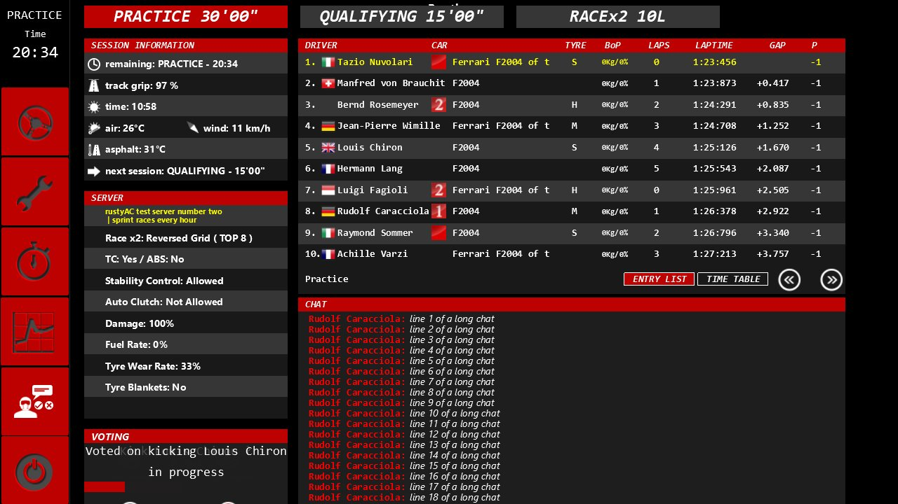
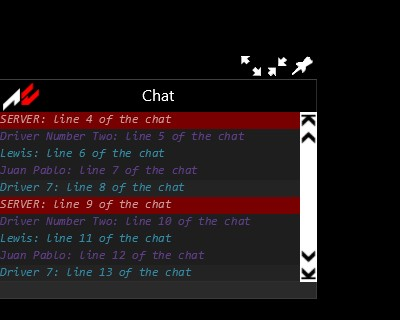
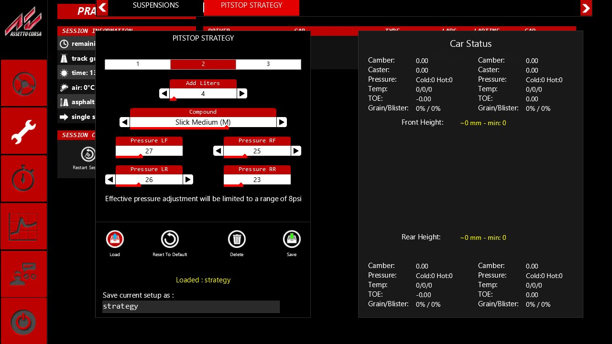

# Online menus, chat, voting, fixed setup, pit strategy (Task 34)

## Resume here

State after the last commit (update after every commit):

- **Task 34 is finished** (v0.34.0). What is left is in "Not done" below: the old mouse pit
  menu's drawing and game glue, a byte-for-byte oracle of the vote and chat messages, the
  online ESC menu's `+` and header in a live game.
- **Code:** `crates/rustyac-gui/src/race_control_online.rs` (server panel, voting panel, chat
  line, `OnlineLink`, `VotingManager`), `esc_menu.rs` (online branch), `app_chat.rs` (the Chat
  app), `setup_presets.rs` (the pit strategy page), `setup_screen.rs` (fixed setup);
  `crates/rustyac-game/src/online.rs` (`OnlineGui`, events, requests, messages, scripted votes),
  `physics_thread.rs`, `render/gui.rs`, `render/console.rs`, `render/scene.rs` (`StartCamera`,
  the free camera), `input/keyboard.rs` (mouse steering), `live.rs`, `desktop.rs`;
  `crates/rustyac-physics/src/race/pitstop.rs` (`MousePitstop`, `QuickMenu::load_fixed_setup`).
- **Oracles:** render oracle `tools/render_oracle/src/gui_seq_menu.rs` (`esc_menu_online`),
  `gui_seq_apps.rs` (`app_chat*`), `gui_seq_setup.rs` (`setup_server*`, `setup_pit*`),
  `gui_ac_esc.rs` / `gui_ac_apps.rs` / `gui_ac_setup.rs` / `gui_ac_pit.rs` (stand-ins),
  `gui_port_*.rs`; car oracle `mouse-micro`, `start-camera-micro`, `multi --scenario
  pit_mouse` (`tools/car_oracle/src/game/{mouse,camera,pit}.rs`). Scripts in
  `re/scratch/task34/`: `cmp.sh <sequence>` (one GUI sequence, `ROOT=` for the setup ones:
  `re/scratch/task31/root`), `mousepit.sh`, `live.sh`, `end_a.sh`, `end_b.sh`.

## In plain English

Online, rustyAC's ESC menu now looks and behaves like the game's: the "Race control" page
shows the server's rules, a voting panel (vote for the next session, a restart, or to kick a
driver; Y and N answer a vote) and a chat panel. The Chat app is there too, with the game's
fading, history, colours and its export to a text file (into rustyAC's own `out` folder). The
server's messages (who joined, who left, who was kicked, votes that failed, the server's own
lines) show the way the game shows them.

When a server gives a car a fixed setup, rustyAC now loads it the way the game does: it writes
`server_temp.ini`, loads it, and the setup editor shows the fixed values as read-only spinners.

The setup editor has the game's "PITSTOP STRATEGY" page: presets of fuel, tyres and pressures
that you can save as `.sp` files next to a setup and load back. The page and the in-car pit menu
are the same menu: a change on one is a change on the other.

Smaller things: a session that starts in the ESC menu now shows the game's slowly drifting
start camera, F7 gives the free camera (when `assetto_corsa.ini` allows it, like the game),
and Ctrl+M switches mouse steering on and off with the game's banner.

The old mouse pit menu's logic (its state, buttons, fuel gauge and what it does to the car) is
ported and proven against the game's own code, but it is not yet drawn or used by rustyAC.

Every one of these was checked against the game itself: the screens frame by frame in the
render oracle (the same draw calls, the same pixels, the same control state and events), the
files byte by byte, the physics and input values bit by bit, and the network part live against
a local copy of acServer with four rustyAC clients.

## What was ported (acs.exe addresses)

| Piece | Game code | Port |
|---|---|---|
| Online server panel | `RaceControlSessionServer` ctor 0x1400b5df0, `render` 0x1400b60c0, `setBackground` 0x1400b7dc0 | `race_control_online.rs` |
| Voting panel | `RaceControlVoting` ctor 0x1400b8a50, `render` 0x1400b97b0, `voteSpamCheck` 0x1400ba480, buttons 0x1400b9540 / 9590 / 95e0 / 9660, new session 0x1400b9520 | `race_control_online.rs` |
| Votes (Y/N, prompt, not passed) | `ACClientVotingManager`, `ACClient::sendVote` 0x140052ba0, console `vote_next` / `vote_restart` / `vote_kick` | `VotingManager`, `render/console.rs` |
| Chat line in Race control | `ACChat` ctor 0x140034aa0, Enter 0x1400350f0, `onChatMessage` 0x140035c00, `render` 0x140036380; `isAllowedToSendChatMessage` 0x14004b1a0 | `race_control_online.rs` |
| Online header in ESC menu | (ported in Task 30) now drawn online | `esc_menu.rs` |
| System messages | `SystemMessage::addMessage` 0x1401b61c0, `clearMessage` 0x1401b6400; the client's handlers (joins, leaves, kicks, votes, "SERVER:", new session) | `online.rs` |
| Chat app | `FormChat` ctor 0x140308190, `addMessage` 0x14030b780, `onChatMessage` 0x14030bd90, `onMouseMove` 0x14030c000, `render` 0x14030c180, `~FormChat` 0x14030a2c0 (export), `rgbToVec4f` 0x14030cac0, `ksTrim` 0x1402396f0 | `app_chat.rs` |
| Fixed setup (TCP 0x52) | `ACClient::onSetupReceived` 0x140050090, job 0x14003caf0 (writes `server_temp.ini`), `SetupScreen::loadSetupAbsolutePath(.., true)` | `online.rs`, `setup_screen.rs` |
| Pit strategy page | `SetupPitstopPresets` ctor 0x1401787d0, sync spinners 0x14017ac00, sync car pitstop 0x14017aa70, `render` 0x14017a7e0; `QuickMenuPitstop::loadFixedSetup` 0x1400b0850, `.sp` save 0x14017a8b0 | `setup_presets.rs`, `pitstop.rs` |
| Start camera | `CameraModeStart` 0x140060470 (the C library's `rand`) | `render/scene.rs` |
| F7 free camera | `Sim::onKeyDown` F7 → `setMode(eFree)` when `allowFreeCamera`; `CameraMouseControlBase::update` 0x14020ff30 | `render/scene.rs`, `desktop.rs` |
| Ctrl+M mouse steering | `KeyboardCarControl::readFromIni` 0x14010ff60 (`MOUSE_STEER`, `MOUSE_SPEED`, `MOUSE_ACCELERATOR_BRAKE`), `setMouseSteering` 0x140111350, `getMouseSteering` 0x14010fb70 | `input/keyboard.rs`, `live.rs` |
| Old mouse pit menu (logic) | `PitStop::isInPitPosition` 0x1400a98c0, `isPitStopDone`, `commitChanges` 0x1400a93e0, `getRealMaxFuel` 0x1400a97d0, `PitStopFuel::onMouseDown` 0x1400a9ce0, handlers 0x1400a7940 / 79d0 / 7740 / 7c60 / 8530 / 85e0 / 8490 / 8650 / 8510, `CarAvatar::setTyreCompound` 0x1400dabd0 | `pitstop.rs` (`MousePitstop`, `MousePitClick`, `apply_mouse`) |

## Proofs and results

### Render oracle (game vs port, every frame: command log, WARP pixels, control state and events)

`sh re/scratch/task34/end_b.sh` on the final code (results in `re/scratch/task34/end/`), WARP:

| Sequence | Frames | Command log | Pixels | State and events | Files |
|---|---|---|---|---|---|
| esc_menu_online (Race control online: server panel, chat line, voting, a kick vote, Y/N, not passed, system messages) | 54 | IDENTICAL | IDENTICAL | IDENTICAL (8188 lines, 30 events) | |
| app_chat (Chat app off line) | 118 | IDENTICAL | IDENTICAL | IDENTICAL (5651 lines, 259 events) | layout identical; no export on either side |
| app_chat_export (with `EXPORT_ON_CLOSE` and a time-stamped name) | 118 | IDENTICAL | IDENTICAL | IDENTICAL (4715 lines, 259 events) | `out/chat_20240517130409.txt` IDENTICAL (485 bytes) |
| app_chat_online (server and drivers' lines) | 93 | IDENTICAL | IDENTICAL | IDENTICAL (4239 lines, 33 events) | `out/chat.txt` IDENTICAL (852 bytes) |
| setup_server@bmw_z4_gt3 (fixed setup through `onSetupReceived`) | 1036 | IDENTICAL | IDENTICAL | IDENTICAL (850106 lines, 2582 events) | |
| setup_server1@bmw_z4_gt3 | 75 | IDENTICAL | IDENTICAL | IDENTICAL (61788 lines, 401 events) | |
| setup_pit@bmw_z4_gt3 (pit strategy page: presets, spinners, save / load `.sp`, fixed setup) | 302 | IDENTICAL | IDENTICAL | IDENTICAL (265163 lines, 1516 events) | `.sp` files identical (diff of both Documents) |
| setup_pitprobe@bmw_z4_gt3 | 11 | IDENTICAL | IDENTICAL | IDENTICAL (9681 lines, 79 events) | |

Older sequences on the same oracle build (nothing changed):

| Batch | Sequences | Result |
|---|---|---|
| Task 33 (telemetry, console, stats, translations) | 18 | all IDENTICAL (command log, pixels, state) |
| Task 32 apps | 22 | all IDENTICAL |
| Task 31 setup | 5 | all IDENTICAL |
| Task 30 menus (`gui_all.sh`) | 38 | all IDENTICAL |
| Task 29 HUD (`gui_all.sh`) | 14 | all IDENTICAL |

### Car oracle and tapes (the game's own code, bit for bit)

| Check | Result |
|---|---|
| `car_oracle mouse-micro` (9 `controls.ini` variants, `setMouseSteering`, `getMouseSteering` on made-up cursors and windows), seeds 34 and 7 → `mouse_steering_check` | IDENTICAL (20409 lines each) |
| `car_oracle start-camera-micro` (start camera and free camera) seeds 7 and 34 → `start_camera_check` | both IDENTICAL |

The old mouse pit menu: `sh re/scratch/task34/mousepit.sh`: `car_oracle multi --scenario
pit_mouse` drives the game's own `PitStop` with `useMousePitstop` on and clicks its own button
handlers, fuel gauge and confirm at made-up moments; workers 0, 1 and 8; Magione.

| Run | Cars | Steps | Stops begun / finished | Frames menu shown | Tyre / fuel / repair clicks | Result |
|---|---|---|---|---|---|---|
| m1 seed 1 | M3 E30 ×2 | 40000 | 12 / 3 | 12487 | 853 / 584 / 814 | IDENTICAL, race_out.json identical |
| m2 seed 2 | M3 E30 ×2 | 40000 | 18 / 7 | 12351 | 1337 / 1939 / 2971 | IDENTICAL, identical |
| m3 seed 3 | 488 GT3, M3 E30 | 40000 | 12 / 0 | 9555 | 1267 / 1145 / 485 | IDENTICAL, identical |
| m4 seed 4 | F2004, M3 E30 | 40000 | 27 / 5 | 11770 | 2714 / 1029 / 899 | IDENTICAL, identical |
| m5 seed 5 | R8 plus, M3 E30 | 60000 | 42 / 8 | 19071 | 1749 / 3076 / 1716 | IDENTICAL, identical |
| fault `PIT_FAULT=2000` | M3 E30 ×2 | 40000 | | | | DIFFERENT at step 12542 (the compare can fail) |

### Live run against a local acServer copy

`bash re/scratch/task34/live.sh`: acServer copy in `re/scratch/task34/server` (Laguna Seca,
votes 60 %, kicks 70 %, 12 s votes, the Z4 slots with `FIXED_SETUP=t34_z4.ini`), four rustyAC
clients (a, c: F2004; b, d: Z4 GT3), each with scripted chat and votes.

| What | Seen |
|---|---|
| join | all four in, "Car N is now driven by …" on the others |
| fixed setup | b and d: "the server's fixed setup: CAR=0 FUEL=30 WING_1=2 PRESSURE_LF=27 PRESSURE_RR=23 ARB_FRONT=3"; a and c none |
| chat both ways | every client saw all four lines ("hello from a", "hello from b", "c says hi", "d is here") |
| vote next session (a, b, d yes; c no) | passed: "New Session : Qualify" on every client |
| vote restart (a yes; b, c no) | "Voting ended. Not passed"; server "VOTES : 1 Quorum 2", "VOTE NOT PASSED !!" |
| vote kick tester4 (a, b, c yes; d no) | "SERVER: tester4 kicked from the server", "Kicked Driver tester4 Kicked until the server restarts" |
| admin kick (`/admin localtest`, `/kick tester3` from a) | "SERVER: OK. Kicking tester3" to a, tester3 kicked; server "ADMIN COMMAND: /kick tester3" |

### Unchanged

`sh re/scratch/task34/end_a.sh` (the machine went down once mid-run with a CPU machine-check
error; the multiplayer tapes were rerun on their own with `end_a2.sh`):

| Check | Result |
|---|---|
| clippy `--workspace --all-targets -D warnings`, CI's line, wasm32-unknown-unknown, wasm32-wasip1 | all clean |
| `cargo build --release --workspace --locked` | ok |
| `cargo test --release --workspace --locked` | 60 suites, 304 passed, 0 failed |
| `web/build.py` | ok |
| tools `--locked` (audio_oracle, car_oracle, chassis_compare, math_proof, ode_oracle, sctm_oracle, tyre_oracle, web_pack) | all build |
| physics dump served.ryin | v0.33.1 09953746b56c9a6d, now 09953746b56c9a6d; state hash bebb73dd826046ac with 0 and 8 workers |
| physics dump spa.ryin | v0.33.1 4238c5617a2e49ce, now 4238c5617a2e49ce; b4c7538a6fa7289c, 0 and 8 workers |
| physics dump missed.ryin | v0.33.1 8c2fe6e41d7e4dee, now 8c2fe6e41d7e4dee; a528aca4ee0fa29d, 0 and 8 workers |
| physics dump practice.ryin | v0.33.1 a21587be85a4a9ba, now a21587be85a4a9ba; 889a180a3ae928bf, 0 and 8 workers |
| multiplayer tapes (20: laguna_a/b, rich_a/b/c × block/drive/pit/watch) | all ALL FOUR WAYS IDENTICAL (desktop, desktop-browser, desktop-gateway, wasm); the gateway's stand-in server got byte for byte what the client sent |

## How to use

- **ESC menu online:** ESC, then "Race control": the server's rules (left), the voting panel
  and the chat panel. Type in the chat panel's line and press Enter to send.
- **Voting:** the panel's "Next Session" and "Restart Session" buttons ask for a vote (each
  request locks the buttons longer, like the game); a running vote shows "Yes" and "No" and a
  bar. Out of the ESC menu press **Y** or **N**. The console (the game's) has `vote_next`,
  `vote_restart` and `vote_kick <driver>`.
- **Chat app:** in the apps sidebar ("Chat"). It reads `system/cfg/chat_app.ini` like the game
  (fade time, history, colours, `EXPORT_ON_CLOSE`); the export goes into rustyAC's `out`
  folder (`chat.txt`, or with a time stamp when the ini asks for it).
- **Fixed setup:** nothing to do: on a server with `FIXED_SETUP` the setup arrives, is written
  to rustyAC's `setups\server_temp.ini` and loaded; the fixed values are read-only in the setup
  editor.
- **Pit strategy page:** ESC, setup editor, "PITSTOP STRATEGY" (only when pitstop.ini
  `[SETTINGS] USE_MOUSE_PITSTOP=0`, the shipped value). Pick a preset with its button, set fuel,
  compound and pressures; saving a setup saves `<name>.sp` beside it in rustyAC's `setups`
  folder; loading a setup loads its `.sp`. `.sp` files in Documents\Assetto Corsa are listed and
  loadable, never written.
- **Mouse steering:** Ctrl+M (keyboard drivers). `controls.ini [KEYBOARD] MOUSE_STEER=1`
  starts with it on, `MOUSE_SPEED` sets the speed, `MOUSE_ACCELERATOR_BRAKE=1` puts gas and brake
  on the mouse buttons.
- **F7 free camera:** only when `system/cfg/assetto_corsa.ini [CAMERA] ALLOW_FREE_CAMERA=1`
  (shipped 0), like the game; arrow keys move, right mouse button looks, Shift / Ctrl change the
  speed.
- **Session-start camera:** with the ESC menu at the start (`--esc-start`, or the game's
  default), the start camera drifts around car 0 until you drive.
- Live-run test hooks: `--chat "/vote next|restart yes|no@<s>"` and `--chat "/vote kick
  <driver> yes|no@<s>"` vote instead of chatting.

## Screenshots (the user's GPU)

All four drawn by rustyAC on the user's GPU (`RENDER_ORACLE_HARDWARE=1`); in the same runs the
game's frames were the same, draw call for draw call and pixel for pixel (esc_menu_online 54
frames, app_chat_online 93, setup_pit@bmw_z4_gt3 302: all IDENTICAL).

The online ESC menu's Race control: the server's rules, the chat panel and the voting panel
(its request lock running):

A kick vote in progress (Yes / No and the time bar):

The Chat app with system lines (red) and drivers' lines in the ini's colours:

The pit strategy page after saving the presets as `strategy.sp`:

## Disk

- At start: 35 GB free. At the end: 22 GB free (after deleting the scratch build folders `tgt_old` and `tgt`; the rest is the tools' build folders, the oracle outputs and Windows).

## Not done

1. **The old mouse pit menu in rustyAC.** Its logic is ported and proven
   (`MousePitstop`), but rustyAC still uses the quick pit menu for every driver; the menu's
   drawing (`PitStop`'s controls, `renderHUD` 0x1400aa300) and a render-oracle sequence are not
   done. The game gives every keyboard driver the mouse menu (`Sim::Sim` 0x140192070:
   `USE_MOUSE_PITSTOP` or the car's controls are the keyboard), and then no pit strategy page;
   rustyAC keeps the quick menu and the page for keyboard drivers too.
2. **Vote and chat messages byte for byte against the game's code.** The encoder
   (`ClientEvent::Vote`: `[0x64|0x65, yes]`, `[0x66, car, yes]`) follows `ACClient::sendVote`
   0x140052ba0 by reading, and a live acServer accepts it (above), but no car-oracle net tape
   runs the game's `sendVote` / `sendChat`.
3. **Pit strategy page edits in input files.** The page's changes reach the physics thread
   but are not recorded in `.ryin` input files, so a replay of an input file does not repeat
   them.
4. With `setup.ini` not ready the game still makes `PRESETS_COUNT` preset buttons and writes
   empty `[PRESET_n]` sections; the port makes none.
5. CameraOnBoardFree (F5) and the photo mode stay as before.

## Open questions

1. (Task 31's question 3) `last.ini` is written on the ESC menu's shutdown also with a fixed
   setup: rustyAC does what the game does, so a fixed setup can end up in `last.ini`.
2. The ESC menu online: the game puts the player in the pits and locks the controls for 20 s
   when the menu opens in the first 5 s of a session away from the pits; rustyAC does the same,
   untested live.
3. F7: the game's ESC menu may swallow F7 before `Sim::onKeyDown`; not checked, rustyAC lets it
   through.
4. The fixed setup's keys arrive in a different order on every run (acServer's Go map); the game
   keeps them in a `std::map`, so the file is the same; rustyAC sorts the same way.
