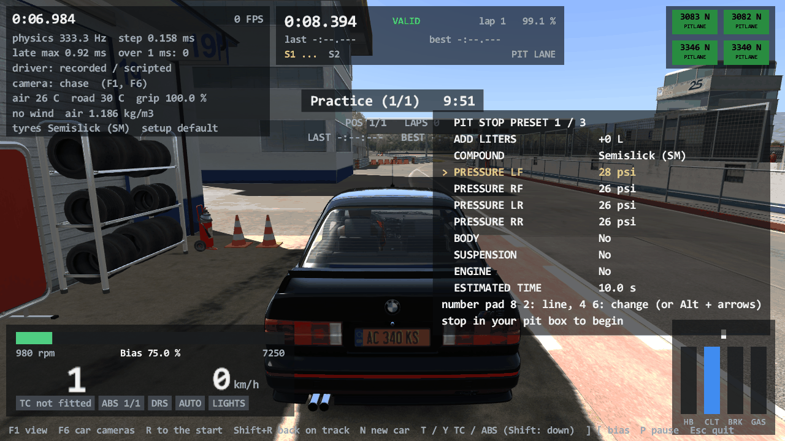

# Pit stops: AC's PitStop, the pit menu, the mandatory pit window (Task 28b)

## Resume here

State at v0.28.1:

- **Done and proven**: the player's pit stop (`crates/rustyac-physics/src/race/pitstop.rs`,
  wired into the referee in `race/referee.rs`), the pit menu as text with its keys
  (rustyac.exe and the browser), the mandatory pit window offline and on a server, the two
  leftovers of Task 28 (the AI divergence, clippy with `--all-targets`). See "Results".
- **Not done**: the four tyre changers and their wheel guns (`PitCrew`). The lollipop man
  and the pit box marker were already there (Task 22c) and now follow the real stop. See
  "Not done" for the whole list and where a follow-up starts.
- **To check the port again** (all read-only on the game):
  - `sh re/scratch/task28b/final.sh a`, `... b`, `... c` (three lanes side by side, about
    25 minutes): every proof of section 3 below. They need a copy of the oracle at
    `re/scratch/task28b/bin/car_oracle_final.exe`
    (`tools/car_oracle/target/release/car_oracle.exe`). `python re/scratch/task28b/tables.py`
    prints the result table from their logs.
  - `sh re/scratch/task28b/recheck.sh a|b|c`: the port replayed over the recordings of
    Task 27 (AI) and Task 28 (whole sessions); no acs.exe needed.
  - `cargo test --release -p rustyac-physics --test pit_stops`: two approved excerpts and the
    menu's rules, without the game.
  - `sh re/scratch/task28b/render_crew.sh`: the lollipop man and the marker in the game's
    renderer and the port's. `bash re/scratch/task28b/online.sh <label> <seconds>`: a live
    run against a local copy of the game's server with a pit window.
- Scratch files of this task: `re/scratch/task28b/`. The three reading briefs there
  (`spec_pitstop.md`, `spec_window_online.md`, `spec_crew.md`) say where every field of the
  game's classes is; `spec_crew.md` is the plan for the tyre changers.

## Summary in plain English

Until this version you could drive into your pit box in rustyAC and nothing happened. Now the
stop works as in Assetto Corsa: you pick what you want in a small menu (litres of fuel, new
tyres and which compound, tyre pressures, wing clicks on cars that allow them in a stop,
repairs of body, suspension and engine), you stop in your box, the controls lock, a
countdown runs for as long as the car's own data says the work takes, and then the car has
the new tyres, the fuel and the repairs. It is a translation of the game's own code
(`PitStop` and the quick pit menu), not a re-invention.

The mandatory pit stop is in too. It is off unless a window is set: then a stop only counts
when you came into the pit lane after the window opened, and who has not stopped when the
window closes gets the black flag, with the game's text. In the game that rule exists only
on a server; rustyAC also lets you switch it on for an offline race.

It was checked the way the earlier tasks were: the game's own `PitStop` code runs inside the
test program next to the game's own cars, physics, AI drivers and referee, the port replays
the same drive, and every value of every car has to be the same after every step, before,
during and after the stop: tyre wear and temperatures, pressures, fuel, damage. That holds
for a stop with fuel and another compound, a repair stop on a damaged car, a wing change, a
race in which two cars stop at the same time, races with a pit window (served, missed, too
early, timed race), and for 578 more stops on made-up situations drawn from a
seed. All with 0, 1 and 8 worker threads, bit for bit.

Two things from Task 28 were finished first. The one difference to the game that Task 28
had seen and not explained is found and fixed (an AI driver behind a car that stands still:
see the next section). And the four old code-style warnings are gone; the style check now
covers the tests too.

What is not there: the pit crew you see changing the wheels, and the sound of their wheel
guns. The man with the lollipop and the floating marker over your pit box are drawn (they
were already ported) and now react to the real stop.

## The divergence of Task 28: cause and fix

**What was seen.** In an early jump-start test of Task 28 the first car stood still on the
grid while AI cars started behind it, and one AI car's values left the game's at step 4677.

**Reproduced.** Six scenarios of their own (`car_oracle multi --scenario ai_pass_front |
ai_pass_mid | ai_pass_rev | ai_pass_free | rc_pass_front | rc_pass_rev`): the stopped car on
the first or the second grid slot, on its brakes, in neutral with the throttle open (the
early variant itself), with no pedal at all, with and without the referee. Before the fix
the port left the game in every one of them soon after the green light (step 2127 without
the referee, 2322 with it).

**Cause.** A car that stands still falls asleep: after a number of quiet steps the game's
`Car::step` stops its body, which sets the body's velocity to exactly zero. The rigid-body
step that follows gives it a tiny velocity again (0.0007 m/s here), and the next `Car::step`
zeroes it again. So during a step, the cars that come after the sleeping car see a speed of
exactly 0, the cars before it see 0.0007. An AI driver reads the speed of the car ahead
(`AIDriver::stepCarsAwareness2` @ 0x14029f8d0 through `Car::getVelocity`) and brakes for it
(`getLABraking` @ 0x14029d650): with 0 the brake point's target speed is 0, which the code
then treats as "no target"; with 0.0007 it is a target. The port asked all AI drivers before
it stepped any car (so that the cars can be stepped in parallel afterwards), and Task 27 had
found only one thing a car's own step changes that a later driver reads: the pit-lane flag.
The sleeping rule is the second.

**Fix** (`crates/rustyac-physics/src/car/chassis.rs`, `engine/mod.rs`). `Car::step` is cut in
two where the sleeping rule ends: `step_car_early` (controls, fuel burnt, penalties,
automatic clutch, sleeping rule) and `step_car_late` (everything that makes forces). The
engine now runs the early part of every car in the cars' order, each AI driver being asked
at its place in that order, and only the late parts run on the worker threads. The late
part reads nothing of another car, so the number of threads still cannot change a bit.

**Proven.** All six variants identical with 0, 1 and 8 workers (table in "Results"); the 16
AI scenarios of Task 27 and the 10 whole sessions of Task 28 replayed on the fixed port, all
identical as before; one variant is in `cargo test` as an approved excerpt
(`golden_ai_passes_a_car_asleep_on_the_grid`).

## What is ported

No Windows code: the same files run in the browser.

| Part | File | The game's functions (acs.exe) |
|---|---|---|
| The stop's state machine: idle, waiting for the driver, (choosing), operating, finished, undefined | `race/pitstop.rs` (`PitStop::update`) | `PitStop::PitStop` 0x1400a55d0 (what matters of it), `update` 0x1400ab190, the new-session handler 0x1400a7ce0 |
| In the box or not | `PitStop::is_in_pit_position`, `is_inside_pit_area` | `isInPitPosition` 0x1400a98c0, `isInsidePitArea` 0x1400a9af0, `isCarOutOfPitArea` 0x1400a9840 |
| The countdown, the end of the stop | `PitStop::is_pit_stop_done` | `isPitStopDone` 0x1400a9b80, `commitQuickMenuChanges` 0x1400a94b0 |
| The stop's time | `ai/car_ext.rs` (`get_pitstop_time`, from Task 27, its repair sum corrected), `pitstop.rs` | `Car::getPitstopTime` 0x140271e60, `CarAvatar::getPitstopTime` 0x1400d3570, `QuickMenuPitstop::getWingPitstopTime` 0x1400b0400 |
| The estimate, the HUD's shares | `get_estimated_time`, `QuickMenu::estimate`, `get_fueling_percentage`, `get_repairing_percentage` | `getEstimatedTime` 0x1400a9600, `getPitStopFuelingPercentage` 0x1400a9730, `getPitStopRepairingPercentage` 0x1400a9780 |
| The choices go into the car (physics thread) | `pitstop::apply` | the lambda 0x1400a7da0: `Tyre::setCompound` 0x1402834e0, `SetupManager::getSetupItem` 0x1402891b0, `CarAvatar::getWingAngle` 0x1400d3aa0, `Car::setRequestedFuel` 0x140275cb0, `FuelLapEvaluator::setIgnoreLap` 0x14028d350, `Engine::reset` 0x140287f90, `Car::setDamageLevel` 0x140275b20, the suspensions' `resetDamage`, `Car::lockControls` 0x1402745f0 |
| The events | `PitAction::Commit` / `Over` (`Referee::pit_began`, `pit_over`) | `evPitStopCommit`, `evPitStopOver` |
| The pit menu's items, values, keys, presets | `pitstop.rs` (`QuickMenu`, `QuickMenuSettings`) | `QuickMenuPitstop` ctor 0x1400aca70 (`system/cfg/pitstop.ini`), `buildControls` 0x1400ae7b0, `itemFuel` 0x1400b0570, `itemCompound` 0x1400b04b0, `itemPressure` 0x1400b0660, `itemWing` 0x1400b0750, `sendInput` 0x1400b1460, `getValue` 0x1400b03e0, `getMaxFuel` 0x1400b03c0, `resetControls` 0x1400b1420, `renderHUD` 0x1400b1230 (when it shows); `SetupPitstopPresets::loadPresets` 0x14017a570, `savePresets` 0x14017a8b0 |
| The pit strategy presets of `PitStop` | `PitStop::strategies` (`PitStopStrategy`) | the constructor 0x1400a7590 and the two entries `PitStop::PitStop` makes (30 l, no tyre change; 30 l, compound 2). No function of the game reads them, nor `currentStrategyIndex`: the presets a player has are the quick menu's (next row) |
| The car's `[PIT_STOP]` times | `ai/car_ext.rs` (Task 27, reused) | `Car::initPitstopTimings` 0x140274020 |
| The pit lane visits of the player's car | `race/referee.rs` (`PitAvatar`, `update_in_pitlane_state`) | `CarAvatar::updateInPitlaneState` 0x1400dd6d0 |
| The mandatory pit window | `race/manager.rs` (`update_pit_window`, `check_mandatory_pit`) | the window's part of `RaceManager::update` 0x140141550, `checkMandatoryPit` 0x140136830, `resetMandatoryPit` 0x140140600 |
| The black flag for a missed window | `race/referee.rs`, `car/chassis.rs` (Task 28) | `CarAvatar::setBlackFlag` 0x1400d9e70 with `eMandatoryPit`, the caption "You have been disqualified for not doing the Mandatory Pit" |
| Online | `crates/rustyac-game/src/online.rs` (`OnlinePit`) | the two numbers of the join reply (`ACClient::handshakeTCP` 0x140048b50), message 0x0e both ways (the lambda 0x14003e2c0, `onMessageTCP` 0x14004c840) |
| Lollipop man and pit box marker by the stop's state | `crates/rustyac-render/src/pit_crew.rs` (Task 22c; `PitIndicator::follow` is new) | `LollipopCrew::update` 0x140113ab0, the marker's part of `PitStop::update` |

**The rules, as the code has them** (worth knowing when you pit):

- The stop begins by itself when the car is on the pit lane, within 3 m of its pit box and
  slower than 1.5 km/h (once it has begun to count as "in position" it stays so up to
  2 km/h). There is no button to confirm: what the menu shows at that moment is what you get.
- The time is `max(tyres, fuel, repairs)`, not the sum: tyres take the car's
  `TYRE_CHANGE_TIME_SEC`, fuel `litres x FUEL_LITER_TIME_SEC`. Repairs do add up among
  themselves: each damaged body zone `(BODY_REPAIR_TIME_SEC - 2) x damage/100 + 2`, the engine
  `(1000 - life) x ENGINE_REPAIR_TIME_SEC x 0.1`, each bent suspension
  `damage x SUSP_REPAIR_TIME_SEC`. A wing change adds its `PITSTOP=` seconds from the car's
  setup.ini on top. Every part that is asked for also gets one and the same random extra of
  0 to 1 s (`rand() / 32767`).
- `maxPitTimer` is that whole time (the countdown starts from it; the HUD's "fuelling" and
  "repairing" shares are measured against it). `pitRandomModifier` is set to 0 by the
  constructor and never read again: the only random part is the one `rand()` above.
- A stop that asks for nothing takes no time and is over at once.
- While the countdown runs the controls are locked (brake on). At its end the choices are
  applied in this order: the four tyres (a fresh set of the chosen compound, at its own
  cold pressure), with them the four pressures (each at most 4 psi away from the setup's
  value per stop), the wings, the fuel (never more than the tank), the engine, the body, the
  suspensions; then the controls are free. The pressures only change together with a tyre
  change.
- "Repair suspension" repairs the body too. New tyres need a compound choice: with "No
  change" the old tyres stay on.
- After a stop the menu's wing clicks and repair switches go back to nothing; fuel, compound
  and pressures stay for the next stop.
- The stop works in practice, qualifying and race only, and not for a black-flagged car.

## How it fits together

The stop is a plain state machine like the referee of Task 28: every "frame" (three physics
steps, 9 ms) it is given what the game's `PitStop` would read of the player's car (on the pit
lane or not, where it is, how fast, how much fuel) and of the menu, and answers with jobs:
*lock the controls*, *the stop begins*, *apply these choices*, *the stop is over*. The jobs
that touch the car run at the start of the next physics step, as the game's main thread
hands them to its physics thread. The stop lives in the referee
(`Referee::pit`, `Referee::menu`), so it exists wherever a referee does: rustyac.exe with a
session list, the browser with `?sessions=`, a replay, the oracle. On a server, where the
server is the referee, a small copy of the same glue runs it (`OnlinePit`).

- **The random second** of the stop's time is drawn from the referee's own `rand()` stream
  (the game draws it on its main thread). A recording has the seed, so a replay draws the same.
- **A recording has what the stop needs**: the header key `pit_stop=` (the window, the four
  settings of pitstop.ini that matter, the menu's values when a presets file changed them)
  and four more buttons among the step events (the menu's keys). A recording without the
  key has no pit stop: every older recording replays as before.
- **The picture**: the frame's view carries the stop's state and the marker's visibility;
  the lollipop man and the marker follow them.

## The mandatory pit window: keys and defaults

It is **off by default**. Without a window nothing is checked and nothing changes.

| Where | Keys | Default | Meaning |
|---|---|---|---|
| A server (`server_cfg.ini`, `[SERVER]`) | `RACE_PIT_WINDOW_START`, `RACE_PIT_WINDOW_END` | 0, 0: no window (the game's shipped file does not have the keys) | the server sends both in its join reply; rustyAC reads them there as the game does |
| race.ini, `[RACE]` (rustyAC's own: **the game has no offline key**) | `RACE_PIT_WINDOW_START`, `RACE_PIT_WINDOW_END` | absent: no window | the same two numbers for an offline race |
| rustyac.exe | `--pit-window <open>,<close>` | none | the same, from the command line |

The two numbers are **laps of the leader** in a race of laps and **minutes** in a timed race.
`END` = 0 means "no window". The rules, exactly as `RaceManager::update` and
`checkMandatoryPit` have them:

- The window opens in the first frame in which the leader has completed `START` laps (or
  `START` minutes of the race have passed). It closes in the first frame in which the leader
  has completed `END - 1` laps (the leader is then on lap `END`), or after `END` minutes.
- A stop counts when its countdown ran during a visit to the pit lane **that began after the
  window opened**. A visit that began before does not count, even if the stop itself was
  inside the window. Nothing checks the window's end when counting: a visit that began in
  time counts even if the car leaves after the close. The stop must take time: a stop that
  asks for nothing does not count ("add min. 1 litre of fuel or do a tyre change", as the
  game's own hint says).
- From the close on, a car whose stop has not counted is black-flagged as soon as it is
  not on the pit lane: retired, and the flag's caption is "You have been disqualified for
  not doing the Mandatory Pit".
- Only the player's car is checked (the game checks nobody else: AI cars and other players
  are the server's business).
- With `START` = 0 the window "opens" before the green light with a negative time, and the
  game's code then counts no stop at all. The port copies that; use `START` >= 1.
- A new session, a restart and "next session" reset everything.

Online, a counted stop is told to the server (message 0x0e, one byte "done"); the server's
own 0x0e messages mark the cars that have done theirs (yours too).

## How each part was proven

Every comparison is bit for bit, no tolerance anywhere. The oracle is `tools/car_oracle`
(`src/game/pit.rs` is new): acs.exe is mapped into the test process and its own functions
run by address.

1. **The game's own `PitStop` in-process.** `PitStop` and `QuickMenuPitstop` are built by
   hand (their constructors build the menu's widgets): zeroed blocks with the game's vtables
   and the members the constructors set; the menu's items and presets are laid out from the
   port's reading of the car's setup.ini. Then the game's own code runs: `PitStop::update`
   with `isInPitPosition`, `isPitStopDone`, `commitQuickMenuChanges`, the menu's `getValue` /
   `getMaxFuel` / `getWingPitstopTime` / `resetControls`, `CarAvatar::getPitstopTime` and
   `Car::getPitstopTime` with `rand()` from the same seed, the new-session lambda,
   `getEstimatedTime`, `CarAvatar::updateInPitlaneState`, `RaceManager::checkMandatoryPit`,
   and the applying lambda on the game's real car through the physics thread's queue. After
   every frame every field of the stop, the menu's values and the pit-lane bookkeeping are
   hashed into the step's row beside the referee's state; the port has to give the same row.
2. **On made-up states** (`--scenario pit_feed --seed n`): what `PitStop::update` reads of
   the car (place round the pit box, speed round the 1.5 and 2 km/h limits, fuel, pit lane,
   black flag), the frame's length, the menu's values (also far outside their limits), the
   car's damage and engine life, and what `getEstimatedTime` is asked, are drawn frame by
   frame from the seed, on both sides. The stops that follow are real: the game's car gets
   the tyres, pressures, fuel and repairs, and every value of the car is compared after
   every step. This is the state machine, the times with the random part, and the applying
   job on many hundreds of stops.
3. **Whole drives** (`pit_box*`, `pit_ai_race`, `pit_window_*`): the game's cars, physics,
   AI drivers, referee and pit stop; recorded, then the port replays the inputs with 0, 1 and
   8 workers. In `pit_box*` the player's car is driven by recorded inputs: out of its box,
   back into it in reverse, the stop, and out onto the track. In the races the first car has
   the game's AI driver, which is called in (`AIDriver::requestPitStop` is set at a time of
   the run, on both sides): it drives in, is put into its box, and the player's stop runs
   while it stands there.
4. **The comparison can fail**: `PIT_FAULT=<frame>` gives the game's stop frames that are one
   float step longer from that frame on; the port then leaves the game at the next stop.
5. **The picture**: `tools/render_oracle` (the game's renderer and the port's, D3D11 command
   logs line by line and WARP pixels byte by byte) on two sequences with the lollipop man and
   the marker through a stop's states.
6. **rustyac.exe itself**: headless drives with an AI driver in the player's car, recorded
   and replayed with 0, 1 and 8 workers; a live run against a copy of the game's own server.

What the oracle does **not** run of the game: the pit menu's construction and its key
handling (`buildControls`, `sendInput`, the item functions build and repaint ksgui widgets);
they are ported from the listing and tested against their own rules
(`crates/rustyac-physics/tests/pit_stops.rs`). And the window's opening, closing and black
flag: that block of `RaceManager::update` only runs with a server, whose presence switches
the whole of `update` to its online path; the oracle has it as a second transcription of
the listing (`tools/car_oracle/src/game/pit.rs`), while `checkMandatoryPit`, which decides
what counts, is the game's own.

## Results

### 1. The leftover: an AI driver passing a stopped car

| Scenario | Cars | The stopped car | Steps | Values compared | Workers 0 / 1 / 8 |
|---|---|---|---|---|---|
| ai_pass_front | 4 x BMW M3 E30 | the first slot, on its brakes | 20,000 | 17,200,000 | IDENTICAL / IDENTICAL / IDENTICAL |
| ai_pass_mid | 5 x BMW M3 E30 | the second slot, on its brakes (an AI driver ahead of it, three behind) | 20,000 | 21,900,000 | IDENTICAL / IDENTICAL / IDENTICAL |
| ai_pass_rev | 4 x BMW M3 E30 | the first slot, in neutral with the throttle open | 20,000 | 17,200,000 | IDENTICAL / IDENTICAL / IDENTICAL |
| ai_pass_free | Ferrari F2004 (stopped), BMW M3 E30, Audi R8 Plus, Ferrari F40 | the first slot, no pedal at all | 20,000 | 15,640,000 | IDENTICAL / IDENTICAL / IDENTICAL |
| rc_pass_front | 4 x BMW M3 E30 | as the first, under the referee (race of 3 laps) | 20,000 | 17,240,000 | IDENTICAL / IDENTICAL / IDENTICAL |
| rc_pass_rev | 4 x BMW M3 E30 | the early jump-start variant of Task 28 itself | 20,000 | 17,240,000 | IDENTICAL / IDENTICAL / IDENTICAL |

### 2. Pit stops: whole drives and made-up states

Track: Magione. "applied" = stops whose countdown ended and whose choices went into the car.

| Scenario | Cars (the player's first) | What it is | Steps | Values compared | Workers 0 / 1 / 8 | race_out.json | The player's stops: begun / applied | Mandatory stop |
|---|---|---|---|---|---|---|---|---|
| pit_box | 3 x BMW M3 E30 | 12 l of fuel, another compound, three pressures changed | 30,000 | 18,810,000 | IDENTICAL / IDENTICAL / IDENTICAL | IDENTICAL, 804 bytes | 1 / 1 | - |
| pit_box | Ferrari 488 GT3, BMW M3 E30, Audi R8 Plus | the same menu keys on another car (tyres 20 s) | 30,000 | 17,250,000 | IDENTICAL / IDENTICAL / IDENTICAL | IDENTICAL, 817 bytes | 1 / 1 | - |
| pit_box_repair | 2 x BMW M3 E30 | a car damaged before the stop (four body zones, engine life 900, a bent suspension): body, suspension and engine repaired, 5 l, the tyres stay | 42,000 | 16,464,000 | IDENTICAL / IDENTICAL / IDENTICAL | IDENTICAL, 598 bytes | 1 / 1 | - |
| pit_box_none | 2 x BMW M3 E30 | the menu asks for nothing: the stop is over at once | 13,000 | 5,096,000 | IDENTICAL / IDENTICAL / IDENTICAL | IDENTICAL, 598 bytes | 0 / 0 | - |
| pit_box_wing | Ferrari F2004, BMW M3 E30 | 3 l and three clicks of front wing (2.5 s by the car's setup.ini) | 30,000 | 10,980,000 | IDENTICAL / IDENTICAL / IDENTICAL | IDENTICAL, 604 bytes | 1 / 1 | - |
| pit_ai_race | 4 x BMW M3 E30 | a race of 4 laps; the first two cars are called in on lap 1 and stand in their boxes at the same time; the first car's stop is also the player's | 135,000 | 127,845,000 | IDENTICAL / IDENTICAL / IDENTICAL | IDENTICAL, 3,020 bytes | 1 / 1 | - |
| pit_window_served | 3 x BMW M3 E30 | race of 4 laps, window 1 to 3, the first car called in on lap 2 | 135,000 | 96,120,000 | IDENTICAL / IDENTICAL / IDENTICAL | IDENTICAL, 2,311 bytes | 1 / 1 | counted |
| pit_window_missed | 3 x BMW M3 E30 | the same, nobody is called in | 135,000 | 96,120,000 | IDENTICAL / IDENTICAL / IDENTICAL | IDENTICAL, 2,034 bytes | 0 / 0 | not counted, black flag |
| pit_window_early | 3 x BMW M3 E30 | window 2 to 3, the car called in on lap 1: the stop is before the window | 135,000 | 96,120,000 | IDENTICAL / IDENTICAL / IDENTICAL | IDENTICAL, 2,037 bytes | 1 / 1 | not counted, black flag |
| pit_window_timed | 3 x BMW M3 E30 | timed race of 5 minutes, window from minute 1 to 3, called in after 70 s | 125,000 | 89,000,000 | IDENTICAL / IDENTICAL / IDENTICAL | IDENTICAL, 1,487 bytes | 1 / 1 | counted |
| pit_feed | 2 x BMW M3 E30 | seed 1 | 40,000 | 15,680,000 | IDENTICAL / IDENTICAL / IDENTICAL | IDENTICAL, 598 bytes | 160 / 38 | - |
| pit_feed | 2 x BMW M3 E30 | seed 2 | 40,000 | 15,680,000 | IDENTICAL / IDENTICAL / IDENTICAL | IDENTICAL, 598 bytes | 148 / 18 | - |
| pit_feed | Ferrari 488 GT3, BMW M3 E30 | seed 3 | 40,000 | 14,640,000 | IDENTICAL / IDENTICAL / IDENTICAL | IDENTICAL, 2,083 bytes | 112 / 5 | - |
| pit_feed | Ferrari F2004, BMW M3 E30 | seed 4 (a wing in the menu) | 40,000 | 14,640,000 | IDENTICAL / IDENTICAL / IDENTICAL | IDENTICAL, 1,941 bytes | 208 / 78 | - |
| pit_feed | Ferrari F2004, BMW M3 E30 | seed 5 | 40,000 | 14,640,000 | IDENTICAL / IDENTICAL / IDENTICAL | IDENTICAL, 604 bytes | 167 / 62 | - |
| pit_feed | Audi R8 Plus, BMW M3 E30 | seed 6 | 40,000 | 14,640,000 | IDENTICAL / IDENTICAL / IDENTICAL | IDENTICAL, 603 bytes | 145 / 40 | - |
| pit_feed | 2 x BMW M3 E30 | seed 7 | 90,000 | 35,280,000 | IDENTICAL / IDENTICAL / IDENTICAL | IDENTICAL, 2,066 bytes | 380 / 84 | - |
| pit_feed | Ferrari F2004, BMW M3 E30 | seed 8 | 90,000 | 32,940,000 | IDENTICAL / IDENTICAL / IDENTICAL | IDENTICAL, 2,071 bytes | 518 / 253 | - |

In all: 1,846 stops begun and 586 carried through to the end (the choices applied to the car), 1,838 and 578 of them on made-up states; 2,515,095,000 values compared in the 72 replays of both tables, none different.

The comparison can fail: with `PIT_FAULT=9000` (the game's stop is given frames one float step longer from frame 9000 on) the run of seed 1 is **DIFFERENT at step 27110** (the first stop after that frame).

(The two tables are one batch, `re/scratch/task28b/final.sh`, run on the code as it was when
the pit stop's last behaviour went in. Two changes that compute nothing came after it: the
record of `PitStop::strategies`, and the version number. On that last code `pit_box` and
`pit_feed` seed 1 were run once more, and the recordings of Tasks 27 and 28 replayed:
identical, see the next table.)

### 3. The earlier proofs, on this version's code

| Check | Result |
|---|---|
| The 16 AI scenarios of Task 27 (`re/scratch/task27/final.sh`): 15 replayed from the game's recordings of Task 27, the sixteenth (an old-format AI line) recorded anew | all **IDENTICAL** with 0, 1 and 8 workers, right after the fix and again on the final code |
| The 10 whole sessions of Task 28 (`rc_race`, `rc_timed`, `rc_timed_plain`, `rc_weekend`, `rc_weekend_q`, `rc_jump`, `rc_jump_dt`, `rc_cut`, `rc_cut_practice`, and the mixed-car race), replayed from the game's recordings | all **IDENTICAL** with 0, 1 and 8 workers, every `race_out.json` identical, right after the fix and again on the final code |
| The multiplayer tapes of Tasks 25 and 26, run afresh on this code (`re/scratch/task28b/tape_proof.py --again`) | 20 tapes, **all four ways IDENTICAL** to the game at every step (desktop, the WebSocket transport, through a real gateway, the wasm client under wasmtime), with the digests of Task 26 |

### 4. rustyac.exe itself

The program itself, headless, an AI driver in the player's car (`--ai-drive`), the menu set
by `--pit-key`. Each run was recorded and replayed with 0, 1 and 8 worker threads
(`sh re/scratch/task28b/exe.sh`).

| Run | What happened | The three replays |
|---|---|---|
| A practice of 30 minutes, 3 BMW M3 E30 on Magione; the menu asks for 3 l and the compound "Street" | 712,542 steps; the driver came in twice by itself and the player's stop ran both times (10.8 s and 10.7 s: the tyre change's 10 s and the random part) | state hash `cbb0e6810e549332` three times; `race_out.json` (5,592 bytes) and `laps.ini` (1,109 bytes) with the hashes of the live run |
| A race of 4 laps with `--pit-window 1,3`; the driver is called in after 110 s (`--ai-pit-at`) | 282,348 steps; 1 pit stop (10.7 s); "mandatory pit stop: done" | state hash `745bde66fc41f8b9` three times; the two files as in the live run |
| The same race, nobody is called in | 321,665 steps; no stop; "mandatory pit stop: not done: black flag" | state hash `405c4b0669e94fef` three times; the two files as in the live run |
| `--setup` with a presets file beside it (`.sp`: 17 l, the third compound, 30 psi, and a pressure of 99) | the menu starts with the file's values, the 99 psi kept to the car's limit of 40 | the replay starts with the same menu (the file's text travels in the recording) |

**On a server** (`bash re/scratch/task28b/online.sh`: a copy of the game's own `acServer.exe`
on 127.0.0.1 with `RACE_PIT_WINDOW_START=1`, `RACE_PIT_WINDOW_END=3`, a race of 4 laps, one
rustyac.exe client with the line follower):

| What | Seen |
|---|---|
| the join reply | "the server has a mandatory pit window: opens at 1, closes at 3" |
| after the client's first lap (the server's lap message makes it the leader with 1 lap) | "the pit window is open" |
| after its second lap, no stop made | "black flag: You have been disqualified for not doing the Mandatory Pit", "the pit window is closed"; the car is retired |

### 5. The picture and the sound

`sh re/scratch/task28b/render_crew.sh`: the game's renderer and the port's, each frame's
D3D11 command log line by line and the picture byte by byte (WARP), the stop's states given
to both.

| Sequence | Frames | D3D11 calls of the game | Command log | Pixels |
|---|---|---|---|---|
| Spa, Ferrari F2004, seen from the pit lane: the stop's state 1 (waiting for the driver: the lollipop comes up), 3 from frame 40 (the stop runs), 4 from frame 70 (over: the lollipop goes down) | 109 | 426,360 | IDENTICAL in all 109 frames | IDENTICAL in all 109 frames |
| Magione, BMW M3 E30, from the side: the pit box marker hidden, shown while the car is in the pit lane (frames 20 to 70), the lollipop up from frame 30 | 99 | 183,354 | IDENTICAL in all 99 frames | IDENTICAL in all 99 frames |

That is the lollipop man and the marker. **The crew mid-change and the wheel guns are not
compared because they are not ported** (see "Not done"): a stop makes no picture of
mechanics and no sound of its own yet, so there is no FMOD call log to hold against the
game's.

### 6. Sessions without a pit stop: v0.28.0 against this version

The executable of v0.28.0 (built from the tag in a throw-away worktree) against this one
(`python re/scratch/task28b/same.py`, `sh re/scratch/task28b/nopit.sh`):

| Check | Result |
|---|---|
| 39 recorded drives without race rules (every 4th file of `oracle/game/*.ryin`), `--replay ... --dump-states -` | **39 of 39 byte-identical dumps** (up to 1.36 GB each) |
| 4 recordings with AI drivers made by earlier versions, two of them with the referee (an AI race of 4 cars, 114,621 steps; an AI practice of 3 cars, 151,692 steps; a race of 6 cars, 996,574 steps; a weekend of 4 cars, 1,038,788 steps) | the same state hash in every one, and the same hashes of `race_out.json` and `laps.ini` |
| A new qualifying and race of 3 cars (192,445 steps) recorded by this version with `--no-pit-stop`, replayed by v0.28.0 and by this version | the same state hash (`9253ba66456505a0`) and the same two files |
| The same recording with the pit stop switched on (the header key `pit_stop=` added; nobody pits) | the same state hash and the same two files again |

A recording without the `pit_stop=` key has no pit stop, so old recordings replay as before.
One thing can differ from v0.28.0 by design: a drive in which an AI driver comes up behind a
car that sleeps now follows the game (the fix above); none of these recordings has that.

### 7. Tests and builds

| Check | Result |
|---|---|
| `cargo test --release --workspace --locked` | 278 tests pass in 57 suites, none fails (among them the golden files of every earlier task: single car, several cars, AI drivers, the referee, contacts, tracks, renderer, sound, multiplayer tapes) |
| `crates/rustyac-physics/tests/pit_stops.rs` (new) | an approved excerpt of 3,600 steps of `pit_feed` (20 stops begun, 9 applied, with the estimate of every frame) and one of 2,400 steps of an AI driver passing the sleeping car, each replayed with 0 and 3 workers; the menu's items and starting values for a car, its keys, its values as text and as a `.sp` file; the 3 m, 1.5 km/h and 2 km/h rules |
| `cargo clippy --workspace --locked --all-targets -- -D warnings` (now CI's command) | clean |
| clippy for `wasm32-unknown-unknown` (rustyac-web, rustyac-net) and `wasm32-wasip1` (math, ode, content, physics, net, game) | clean: the pit stop has no Windows code |
| `cargo build --release --workspace --locked`, `python web/build.py` | pass (the site's wasm is 4.65 MB) |

## How to make a pit stop in rustyac.exe

The stop is there whenever rustyAC runs sessions with the referee: with a race.ini from
Content Manager (the default), or with `--sessions`:

```
rustyac.exe --car bmw_m3_e30 --track magione --no-race-ini --ai-cars 5 --sessions p10,q5,r10
```

1. **Set the menu** any time, also while driving. The first key press only shows it.

   | Key | Does |
   |---|---|
   | number pad `8` / `2` (or `Alt` + up / down) | one line up / down |
   | number pad `4` / `6` (or `Alt` + left / right) | change the line's value; on the top line: the preset (1 to 3) |

   The lines: **ADD LITERS**, **COMPOUND** ("No change" keeps the tyres on), the four
   **PRESSURE** lines (if the car's setup has them), a line per wing that may be changed in a
   stop, **BODY**, **SUSPENSION**, **ENGINE** (repairs, Yes / No), and the estimated time.
   The menu is a block of text at the right of the screen (in the browser: under the
   referee's lines). It starts as the game's menu starts: no fuel, no tyre change, the compound's own
   pressures, no repairs. On the pit lane the menu stays on the screen; elsewhere it goes
   5 seconds after the last key.
   

2. **Drive into the pit lane and stop in your own pit box** (the floating marker; the man
   with the lollipop raises it for you): within 3 m of the box, slower than 1.5 km/h.
3. The controls lock, the middle of the screen counts down (`PIT STOP 7.3 s`, with what is
   being done). When it reaches 0 the car has what you chose, and you can drive off.

The three presets are three sets of choices to switch between quickly. A setup saved by the
game with pit stop presets (`<setup>.sp` beside the setup's `.ini`) is read with `--setup`.
`--no-pit-stop` gives the program as it was before. In the **browser** the keys are the
number pad's 8 2 4 6 (and F7 / F8 for the referee's buttons now work there too). On a
**server** the stop works the same way; the server's pit window, if it has one, is shown.

A race with a mandatory stop, offline:

```
rustyac.exe --car bmw_m3_e30 --track magione --no-race-ini --ai-cars 5 --sessions r10 --pit-window 2,6
```

(or `RACE_PIT_WINDOW_START=2` and `RACE_PIT_WINDOW_END=6` in race.ini's `[RACE]`). The HUD
says when the window opens, that it is open, closed, or that your stop is done.

Unattended (checks): `--pit-key <left|up|right|down>@<s>` presses a menu key at a time of the
run, `--ai-pit-at <s>` calls the AI driver of your car in (`--ai-drive`); at the end the
program prints your pit stops and whether the mandatory one was done.

## Not done

- **The pit crew that changes the wheels, and the wheel-gun sounds** (`PitCrew`, 41
  functions, 20.7 kB: four animated mechanics from `pitcrewtyre.kn5` / `.ksanim`, a copy of
  each of the car's wheels as "the new tyre", the camera's move out of the cockpit, the
  FMOD events `event:/common/screw` and `unscrew` started at given frames of the animation).
  It was the fifth of six steps in the task's order and did not fit: it needs a deep copy of
  a node tree in the renderer (`SceneGraphCloner`), the crew's time line, and in the render
  and audio oracles a `PitCrew` built by the game's own constructor on the stand-in car.
  Nothing of it is half-wired: the stop tells when it begins and ends
  (`Referee::pit_began` with the tyre change time and the total, `pit_over`), which is all
  the crew listens to. `re/scratch/task28b/spec_crew.md` has the class read out in full
  (layouts, the constructor's order, the time line's formulas, when the sounds start and
  stop) and a porting plan.
- **The render and audio oracle for "crew mid-change" and the wheel guns**: with the crew.
  The two parts of the stop's picture that exist (lollipop, marker) are compared.
- **The old mouse pit menu.** The game gives a keyboard driver another menu (`PitStop`'s own
  ksgui buttons, `Sim::useMousePitstop`); rustyAC has the quick menu for everybody. Of the
  mouse menu only `getEstimatedTime` is ported (and shown in the text menu).
- **The game's menu and HUD pictures** (`QuickMenuPitstop`'s look, `PitStop::renderHUD`'s
  fuelling / repairing / tyre-change images): the UI phase. The text menu has the same lines
  and values.
- **Fixed setups in the menu** (`QuickMenuPitstop::loadFixedSetup` 0x1400b0850: a server's or
  a championship's locked setup fixes pressures, wings and the tank size in the menu), and
  the server's setup message 0x52. Saving presets from rustyAC (`save_presets` writes the
  `.sp` text, nothing calls it: there is no setup screen yet).
- **A counted stop on a live server.** The live run shows the server's window arriving, the
  window opening and closing by the server's lap count, and the black flag. The message
  that tells the server "my stop counted" is written from the listing and its bytes are
  tested, but no live run produced a counted stop: nothing unattended parks the car in its
  box online (the line follower cannot, and an AI driver in the player's car is not told a
  server's session). The server is closed code: what it does with the message is unknown.
- **The stop's camera** (`STAY_IN_CAR=0` moves the camera out of the car during the stop):
  the flag is read and travels with the stop's start, no camera uses it yet (it belongs to
  the crew's code).
- **Pit stops of the other cars' crews**: the game draws a crew for the player only.

## Open questions

Choices made without asking, to be confirmed or changed:

1. **The pit window offline.** The game has it on a server only. I gave race.ini the
   server's two key names (`[RACE] RACE_PIT_WINDOW_START` / `RACE_PIT_WINDOW_END`) and the
   command line `--pit-window`; without them nothing changes. Content Manager does not write
   those keys.
2. **The stop's frame is the referee's**: three physics steps, 9 ms. The game counts the
   stop down in pictures. A different rhythm would be a different, equally valid run of the
   game; this one is the same on every PC and in every replay.
3. **The random part of the stop's time** comes from the referee's stream (seeded in the
   recording), not from the picture's `rand()` as in the game, where it is not reproducible
   at all. The picture's stream still loses one number at a stop, as in the game.
4. **Everybody gets the quick menu**, also keyboard drivers (see "Not done").
5. **The keys**: number pad 8 2 4 6, or Alt + arrows on the desktop. The game uses the bare
   arrow keys, which are rustyAC's keyboard driving keys.
6. **`ESTIMATED TIME` in the menu** is the game's `getEstimatedTime` idea applied to the
   quick menu (which has no estimate in the game).
7. **The shared memory** gets `mandatoryPitDone` and `PitWindowStart` / `PitWindowEnd` (the
   game leaves the two window numbers at 0 offline; rustyAC writes an offline window too).
8. **A bug of Task 27 found and fixed here**: `Car::getPitstopTime` summed its repair times
   in another float order than the machine code when the random extra was not 0 (seen by a
   reader of the listing, confirmed in the disassembly, proven by the repair stops). The AI
   proofs did not see it: an AI's stop there had no damage to repair.
9. **A gap of Task 28 fixed here**: in the browser F7 and F8 were not passed on by the page
   (they worked in the self test only).
10. **Online, an AI driver in the player's car** (`--ai-drive --join ...`) does not race: it
    is not told the server's session, and headless it does not keep to the clock. It was
    never part of a task; it is why the live run uses the line follower (and a server whose
    `START_RULE` holds a car that moves early instead of sending it to the pits, which the
    line follower cannot drive out of).
11. **The oracle's harness now reports every car's real compound** to the game's referee
    (`CarAvatar::getCurrentCompoundShortName`). Until now it kept the compound each car
    started on, which was the same thing in every run of Task 28; in a long practice an AI
    driver changes compound in its box, and a long `pit_feed` run showed the stale name as a
    difference in a lap's record. The port was right.
12. **`PitFeed`** (the made-up states of proof 2) lives in the physics crate beside the code
    it feeds, because the oracle and the replay both need it; nothing in the game uses it.
