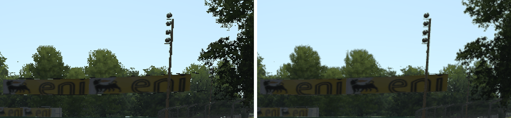
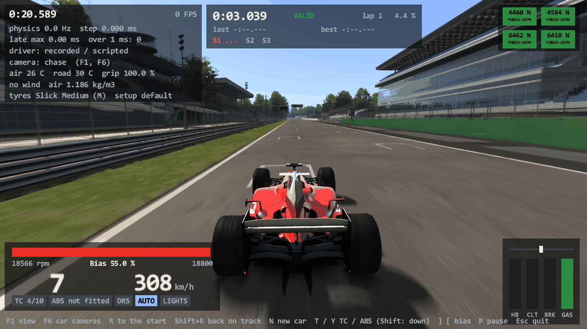
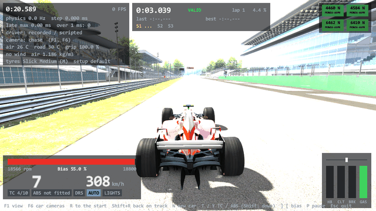

# Task 23: the picture after the scene, part 1 (multisampling, FXAA, motion blur, HDR levels, a map of YEBIS)

## Resume here

State after the last commit (kept up to date with every commit):

- **The task is finished** but for the points of section 9 ("Not done"). Version 0.23.0, tag `v0.23.0`.
- The task text is `prompts/23_msaa_fxaa_blur.md`. Its six items: multisampling, FXAA, motion blur, the HDR
  path, the start lights in the HUD pass, the YEBIS map. What is not done is in section 9.
- To pick the work up again: section 11 has the checks. `sh re/scratch/task23/batch_msaa.sh` and
  `sh re/scratch/task23/batch_post.sh` run the 24 new proof sequences (about 15 minutes); `batch20.sh`,
  `batch21.sh`, `batch22.sh`, `batch22c.sh` in the same folder run the older ones with this task's oracle.
- Task 23b (YEBIS itself) starts from `docs/map/yebis.md`, section 6 (the plan) and section 7 (what is ready).
- On disk, git-ignored: `re/scratch/task23/` (the eight reader briefs `spec_*.md` and `yebis_*.md` with their
  listings and scripts, the patch scripts `p_*.py`, the batches and their results, oracle output in `out*/`,
  the sparkle pictures in `spk/`, the frame-rate logs in `fps/`).

## 1. Plain-English summary

**What you get.**

- **Multisampling works.** rustyAC now follows `[VIDEO] AASAMPLES` of your `video.ini` (yours says 4), or
  `--aa 1|2|4|8`. Edges are smooth, and **the white dots on trees, fences, grass and crowds are gone**: at
  Monza, the frame that had 1,632 of them has 165 faint ones left with 4 samples and 2 with 8 (section 5).
- **FXAA and motion blur work**, as Assetto Corsa's own shader passes (`--fxaa 1`, `--motion-blur 0..12`, or
  from `video.ini`).
- **The start lights' six lamps at the top of the screen** are drawn, as the game draws them in its HUD pass.
- **`--graphics max` no longer says "Task 23"** for anything: it draws 4 samples, FXAA and motion blur.
- **A map of YEBIS** (the post-processing library) with a plan for porting it: `docs/map/yebis.md`.

**Three things the game's code turned out to say, which change what "ported" means here.**

1. **In `acs.exe`, FXAA and motion blur exist only together with post-processing.** With
   `[POST_PROCESS] ENABLED=0` (your `video.ini` today) the game draws neither, whatever the `FXAA` and
   `MOTION_BLUR` lines say. `[EFFECTS] FXAA` is read by nothing at all; `AAQUALITY` is read by nothing at all.
   Both effects live in the post-processing camera's frame (`CameraForwardYebis`), around YEBIS. So that
   frame is what was ported: the scene goes into a 16-bit target, is blurred there, resolved, handed to
   YEBIS, and FXAA runs on what YEBIS returns.
2. **The "plain HDR path" does not exist.** The old HDR code (`HDR.obj`, `hdr.ini`, the tone-map and bloom
   shaders) is dead: no `HDR` object is ever made, and the code that would draw with it is not in the
   program. "HDR on" in this engine means exactly one thing: post-processing (YEBIS) is on. The question of
   the atlas ("what does plain `CameraForward` do with HDR on") is settled: nothing, it cannot be on.
3. **With post-processing on, the engine lights the world three to four times brighter and leaves it to
   YEBIS' tone mapper to bring that back.** Without YEBIS the picture is washed out to white (picture in
   section 6). YEBIS is Task 23b.

**So, what rustyAC does until YEBIS is there:** with post-processing on it draws the game's post-processing
frame, with FXAA and motion blur, but keeps the light levels of post-processing off. Where the game would
call YEBIS there is a plain copy. That gives a correct-looking picture with both effects. It is a mix the
game itself never draws (the game has either everything or nothing), and it is said so at start-up.
`--hdr-levels` shows the game's own levels (washed out) if you want to see them.

**How it was proven.** As before: the game's own code and the port draw the same frame, and the Direct3D
command logs and the pictures are compared. New here: the oracle runs the game's own post-processing camera
with YEBIS taken out (its start-up returns at once, and its one call per frame is replaced by the same plain
copy the port draws). **24 new sequences, 818 frames**: every call and every pixel
identical, on the software rasteriser (which does 2, 4 and 8 samples the same way every time). On your
Radeon, the game's renderer against the port: identical with 1, 2, 4 and 8 samples, with FXAA, with motion
blur, and with the HUD lamps (section 4). All older proofs were run again and hold (section 4).

**Not done:** YEBIS itself (so no tone mapping, glare, depth of field, light shafts, heat shimmer, filters),
which was not asked for; and a few small things in section 9.

## 2. What is ported (addresses are `acs.exe`)

| What | The game's code | Where |
|---|---|---|
| Multisampling: the swap chain's and the depth buffer's sample count, the multisample bit of cull state 0, one sample whenever post-processing is on | `loadVideoSettings` 0x1400c18d0, `createDeviceAndSwapChain` 0x14001a1d0, `createDepthBuffer` 0x14001acc0, `initCullStates` 0x14001b0a0 (these were written in Task 20 and never switched on) | `rustyac-render/src/kgl.rs` |
| The post-processing camera's frame without YEBIS | `CameraForwardYebis::CameraForwardYebis` 0x140025db0, `initRenderTargets` 0x140029a90, `render` 0x14002a450, `renderApplyEffect` 0x14002a740, `resetYebisStates` 0x14002a650, `getYebisDestinationRenderTarget` 0x14002a630, `setSolveBlurRenderTarget` 0x14002a710, `onResize` 0x140029da0, the clears at the end of `updateYebisParameters` 0x140029e30 | `rustyac-render/src/post.rs` |
| The multisample resolve and the depth resolve | inside `renderApplyEffect`: `ResolveSubresource`, then a full-screen quad with `ksMSDepthResolve` | `post.rs` |
| FXAA | the end of `CameraForwardYebis::render`: the 8-bit target into slot 5, a full-screen quad with `ksFXAA` | `post.rs` |
| Motion blur | `CameraForward::CameraForward` 0x14021f230 (the blur target, `ksPostBlur` / `ksPostBlur_MS`), `renderBlurred` 0x14021fde0 (the `BLURRED` branch into the blur target, the solve, the `UNBLURRED` branch, the transparent pass), `solveBlur` 0x140220280 (the camera's movement and turn since the last frame as shader values), `onResize` 0x14021f990; the quality is twice the setting (`Sim::Sim` 0x140192070) | `rustyac-render/src/forward.rs` |
| The full-screen quad | `GLRenderer::initFullScreenQuad` 0x1401feb30, `fullScreenQuad` 0x1401feaa0 | `rustyac-render/src/gl.rs` |
| The camera's own render target in the scene pass | `CameraShadowMapped::renderPass` 0x14020cf20 (the branch for `Camera::renderTarget`) | `camera.rs` |
| The HDR levels, now reachable | the readers of `videoSettings.ppHDREnabled`: `getLDRColor` 0x140202a70 (displays), `getLDRScale` 0x140202bb0 (lamps), `Flames::loadFlames` 0x140101f90 (the clamp), `loadLightingSettings` 0x140203250 and `WeatherManager::applyCustomWeather` 0x1401d8110 (`HDR_OFF_MULT`: sun, sky, ambient, clouds, fog), `VirtualMirrorRenderer::renderVirtualMirror` 0x1401d1ea0 (0.3). All were ported in earlier tasks; none could be reached | `digital.rs`, `lights.rs`, `flames.rs`, `lighting.rs`, `mirror.rs` |
| The exposure pair | `Sim::initHDRLevels` 0x140199b00 (`lighting.ini [HDR]`), copied into the camera; nothing in the game reads it | `post.rs`, `camera.rs` |
| The HUD pass of the start lights | `ksgui::GUI::doRender2D` 0x1402539d0 (its three state calls), `StartingLights::renderHUD` 0x1401a2e80 (the 2D part), `renderLight` 0x1401a3420, `GLRenderer::quad` 0x1401ff420 | `start_lights.rs`, `gl.rs` |
| In `rustyac.exe` | `Sim::createCamera` 0x1401982e0 (which camera, blur only with post-processing), `loadVideoSettings` (the keys) | `rustyac-game/src/render/ac.rs` |

Things found on the way (all confirmed in the disassembly, most also by the oracle):

- `AASAMPLES` below 1 becomes 1; there is no upper limit and no check against the card. `AAQUALITY` is never
  read.
- With `ENABLED=0`, going from 1 to 4 samples changes five object descriptions at start-up and **not one
  call per frame**: there is no resolve, `Present` does it.
- With `ENABLED=1` the screen has one sample and the multisampling moves into the camera's own targets.
- The plain camera with motion blur would crash (`setSolveBlurRenderTarget` 0x140220250 reads the `HDR`
  object that is never made). It can only be reached with a `[CAMERA] MODE` the launcher does not write.
- The blur is the same for every camera (cockpit, chase, replay); the Delete key of the free camera switches
  it off (`debug_MotionBlurEnabled`). The triple-screen camera has no motion blur at all.
- The solve of a multisampled frame runs per sample (`ksPostBlur_MS`), which is why blur with 4 or 8 samples
  costs so much (section 7).
- The FXAA shader is Timothy Lottes' FXAA 3, one fixed quality, luma from red and green. It reads the
  picture through the anisotropic sampler.
- Each of the HUD's start lamps is drawn twice (`GLRenderer::quad` ends the drawing and `renderLight` ends
  it again), so the half-transparent picture is blended two times. Copied.
- The ideal line and the start lights do not depend on HDR at all (the task text assumed they did).
- Multisampling does not reach the mirrors: their texture has one sample unless `[MIRROR] HQ=1` (section 5).
- After a window resize the game keeps its FXAA target at the old size (a bug). rustyAC makes it again.
- `lighting.ini [HDR] MIN_EXPOSURE / MAX_EXPOSURE` reach nothing: YEBIS gets its limits from the filter file.

## 3. The oracle: what is new

- `--aa <n>`: `AASAMPLES` on both sides. The pictures compared are the resolved back buffers (the resolve
  that `Present` would do).
- `--post`: `[POST_PROCESS] ENABLED=1`. The game's side builds the game's own `CameraForwardYebis` with its
  own constructor and calls its `render` through its vtable. Two patches take YEBIS out:
  `CameraForwardYebis::initPostProcessing` 0x140024ca0 returns at once (YEBIS' context pointer stays null,
  and the game tests it before every YEBIS call), and `CameraForwardYebis::applyPostProcessing` 0x140025c30
  jumps to a stand-in: a plain copy of the source picture into the destination with the game's own
  `ksPostCopy` shader, made of the game's own calls (`setBlendMode`, `setDepthMode`, `kglSetRenderTargets`,
  `kglSetViewport`, `kglSetTextureRT`, `GLRenderer::fullScreenQuad`). The port draws the same copy
  (`post::stand_in_apply_effects`). Everything around it is the game's code untouched: the constructor, the
  filter file's reading, the targets, the clears, the scene, the blur, the resolves, the state reset, FXAA.
- `--fxaa`, `--motion-blur <0..12>`: `[POST_PROCESS] FXAA`, `[EFFECTS] MOTION_BLUR` (with `--post`).
- `--ldr-levels` (with `--post`): the mix `rustyac.exe` draws until YEBIS is there. On the game's side the
  flag `videoSettings.ppHDREnabled` is switched on only around the device's start, the camera's constructor,
  `beginScene` and the camera's `render`, and off for everything else (loading the lighting, the weather,
  the car, the displays, the flames; the virtual mirror's draw). So this mix, too, is drawn by the game's own
  code and compared call for call.
- **The HUD pass is now inside every compared frame**: after the scene both sides do what
  `ksgui::GUI::doRender2D` does with no form showing (`resetRenderStates`, depth off, alpha blending), then
  the game's own `StartingLights::renderHUD` with its lamps (the patch that used to skip `renderLight` is
  gone), and only then is the log closed and the picture read.
- What the harness still does itself: as before (`docs/port/renderer_core.md` section 3), plus the stand-in
  and the flag switching above.

## 4. Results

### New sequences (every frame compared; WARP, 1280 x 720)

| # | Sequence | Frames | Calls (per frame) | Draws | Command log | Pixels |
|---|---|---|---|---|---|---|
| 1 | monza, no car, chase, 2 samples: the trees and crowds through alpha to coverage | 1 | 2,052 (2052 to 2052) | 397 | identical | identical |
| 2 | monza, 1M lap, side camera, 4 samples: trees, crowds, grooves (10 laps) | 59 | 311,516 (5265 to 5403) | 46,783 | identical | identical |
| 3 | monza, no car, far camera, 8 samples | 1 | 2,053 (2053 to 2053) | 398 | identical | identical |
| 4 | spa, F2004 lap, chase, 4 samples: crowds, HQ mirror 512 (4 samples), virtual mirror, smoke, cube map 2 faces a frame | 59 | 435,440 (7129 to 7688) | 67,516 | identical | identical |
| 5 | spa, F2004 over the grass, onboard, 8 samples: smoke and grass pieces | 59 | 271,981 (4582 to 4642) | 37,447 | identical | identical |
| 6 | laguna seca, mid clouds, no car, chase, 4 samples: fences, cones, crowds | 1 | 2,956 (2956 to 2956) | 575 | identical | identical |
| 7 | imola, 488 GT3 lap, far camera, 2 samples, WORLD_DETAIL 3 | 39 | 139,828 (3555 to 3626) | 21,547 | identical | identical |
| 8 | spa, no car, chase, 4 samples: the start lights counting down, the ideal line | 59 | 150,627 (2553 to 2553) | 29,736 | identical | identical |
| 9 | spa, no car, chase, post-processing frame, 1 sample (HDR levels) | 1 | 2,480 (2480 to 2480) | 492 | identical | identical |
| 10 | spa, no car, chase, post-processing frame, 4 samples: the resolve and the depth resolve (HDR levels) | 1 | 2,492 (2492 to 2492) | 493 | identical | identical |
| 11 | spa, F2004 lap, chase, HDR levels: mirror 512 and the virtual mirror (0.3), smoke, FXAA | 39 | 233,362 (5973 to 5997) | 34,298 | identical | identical |
| 12 | monza, F40 lap, chase, HDR levels, 4 samples: flames (no clamp), smoke, HQ mirror 256 (4 samples), mid-clear clouds (no HDR_OFF_MULT) | 59 | 365,650 (6146 to 6246) | 53,037 | identical | identical |
| 13 | imola, 488 GT3 lap, dash camera, HDR levels: the displays and shift lights (no getLDRColor), lights on, mid clouds | 39 | 262,027 (6655 to 6755) | 36,982 | identical | identical |
| 14 | spa, no car, chase, HDR levels: the start lights counting down (red 510) and the ideal line (colours to 3.0) | 59 | 152,987 (2593 to 2593) | 29,795 | identical | identical |
| 15 | spa, no car, 25 m before the finish line, HDR levels, 2 samples: a time-attack gate (colour 1.5) | 5 | 13,762 (2752 to 2754) | 2,800 | identical | identical |
| 16 | monza, no car, chase, light levels of post-processing off: FXAA off | 1 | 2,090 (2090 to 2090) | 398 | identical | identical |
| 17 | monza, no car, chase, light levels of post-processing off: FXAA on | 1 | 2,098 (2098 to 2098) | 399 | identical | identical |
| 18 | laguna seca, mid clouds, no car, chase, 4 samples and FXAA (light levels of off) | 1 | 3,015 (3015 to 3015) | 578 | identical | identical |
| 19 | spa, F2004 lap, chase: motion blur 6 at speed (HDR levels) | 59 | 325,247 (5405 to 5629) | 49,227 | identical | identical |
| 20 | monza, 1M lap, side camera, 4 samples (the _MS blur shader), motion blur 12, FXAA, light levels of off: crowds, grooves | 59 | 316,413 (5348 to 5486) | 47,019 | identical | identical |
| 21 | imola, E30 lap, onboard, motion blur 4, light levels of off: mirror 512, virtual mirror, cube map 2 faces a frame | 59 | 387,423 (6247 to 6921) | 59,819 | identical | identical |
| 22 | spa, F2004 over the grass, far camera, motion blur 1 (quality 2), 8 samples, smoke (light levels of off) | 59 | 207,999 (3453 to 3589) | 27,431 | identical | identical |
| 23 | spa, no car, chase: the HUD pass with the six start lamps (grey, then red one by one) and the track's five lights a frame later, the start | 59 | 149,074 (2458 to 2544) | 29,533 | identical | identical |
| 24 | laguna seca (six lights), no car, chase, post-processing frame, 4 samples, FXAA, light levels of off: the lamps on top of the FXAA picture | 39 | 105,105 (2695 to 2695) | 21,372 | identical | identical |

**24 of 24 identical in command log and pixels, 818 frames in all.** Rows 1 to 8: multisampling. 9 to 15: the post-processing frame with the engine's HDR levels (what the game hands to YEBIS). 16 to 18: FXAA. 19 to 22: motion blur. 23, 24: the HUD pass.

### On the graphics card (AMD Radeon Pro 5500M): the game's renderer against the port

`RENDER_ORACLE_HARDWARE=1`, the same comparison on the card instead of WARP.

| Frame or sequence | Command log | Pixels |
|---|---|---|
| Monza, no car, chase, 1 sample | identical | identical |
| Monza, no car, chase, 2 samples | identical | identical |
| Monza, no car, chase, 4 samples | identical | identical |
| Monza, no car, chase, 8 samples | identical | identical |
| Spa, no car, chase, 4 samples | identical | identical |
| Laguna seca, no car, chase, 4 samples | identical | identical |
| Monza, no car, chase, post-processing frame, 4 samples, FXAA (light levels of off) | identical | identical |
| Spa, F2004 lap, chase, 4 samples, motion blur 6, FXAA, 20 frames (light levels of off) | identical | identical |
| Spa, no car, chase, 4 samples: the start lights and the HUD's lamps, 30 frames | identical | identical |

**9 of 9 identical on the card.**

### The golden tests (no game code; NOT TESTED without AC or WARP)

| Test | What it draws | Lines | Draws | Log hash | Result |
|---|---|---|---|---|---|
| `golden` (Task 20) | Magione, no car | 1,624 | 359 | `0xc4d48c2d20a02840` | as before |
| `golden_car`, `golden_scene`, `golden_leftovers` (Tasks 21, 22, 22c) | unchanged | | | | as before |
| **`golden_post`** (new) | Magione, no car, 4 samples, the post-processing frame with the HDR levels: the blurred branch, the motion blur's solve (the camera moves 1.2 m between the two frames), the unblurred branch, the resolve, the depth resolve, the copy that stands for YEBIS, FXAA, then the HUD pass with the six start lamps | 1,800 | 377 | `0x1ef3fc6e1d7efd65` | passes; the picture's hash `0xaf61c0c4debc2211` |

The four older golden tests draw through the plain camera and have no HUD pass of their own: their hashes did
not change.

### The older proofs, run again at the end with this task's oracle

Every frame of them now also holds the HUD pass's state calls (and, in the start-light sequences of Task 22c,
the lamps). With `AASAMPLES=1` and post-processing off nothing else of the frame changed.

**The sequences of Task 22c: 18 of 18 identical, 922 frames.**

<details><summary>the rows</summary>

| # | Sequence | Frames | Calls (per frame) | Draws | Command log | Pixels |
|---|---|---|---|---|---|---|
| 1 | spa, no car, chase: the ideal line on (frames 1, 2), then off | 3 | 7,344 (2442 to 2451) | 1,475 | identical | identical |
| 2 | imola (ideal_line.ai of version 2), 488 GT3 lap, chase: the ideal line, HQ mirror (4 samples, the line hidden in it), virtual mirror | 39 | 234,722 (5768 to 6778) | 32,333 | identical | identical |
| 3 | mugello (ideal_line.ai of version 3), no car, free camera: the ideal line | 1 | 2,275 (2275 to 2275) | 484 | identical | identical |
| 4 | vallelunga extended (ideal_line.ai of version 6), no car, chase: the ideal line | 1 | 2,530 (2530 to 2530) | 557 | identical | identical |
| 5 | spa, Lotus 49 with a made-up suspension_graphics.ini (four rods aimed at the hubs, one with an unknown source name, one whose node is missing), kerb strike, front camera | 59 | 207,333 (3490 to 3536) | 32,191 | identical | identical |
| 6 | spa, Ferrari 312T as installed (its file names a node the model does not have: no rod), front camera, the Lotus 49's drive | 9 | 37,650 (4179 to 4185) | 5,359 | identical | identical |
| 7 | spa, no car, chase: the five start lights of a race counting down (16 s, then 8.2 s to the start in jumps), the pause menu for five frames, the start | 159 | 402,439 (2458 to 2544) | 79,689 | identical | identical |
| 8 | laguna seca (six lights), no car, chase: the countdown, replay mode begun at frame 30 (the lights stand) and ended at 45, a practice session from frame 70 (lights out) | 89 | 231,530 (2548 to 2636) | 48,085 | identical | identical |
| 9 | drag strip (drag400), no car, chase: the semaphore's three ready steps and the start | 61 | 90,646 (1486 to 1486) | 19,581 | identical | identical |
| 10 | trento-bondone, no car, chase: the hill climb's semaphore | 41 | 105,985 (2585 to 2585) | 25,707 | identical | identical |
| 11 | nordschleife, no car, from 3.5 km above: the drifting balloons scattered again by two new sessions (frames 6 and 10) | 13 | 15,509 (1193 to 1193) | 2,717 | identical | identical |
| 12 | spa, F2004 over the grass with smoke, grass pieces and dirt: a new session at frame 60 (all of them cleared) | 99 | 443,587 (4002 to 4615) | 58,960 | identical | identical |
| 13 | spa (crew on the right), F2004, from the pit lane: the lollipop man raising his lollipop, lowering it from frame 70, his idle loops; the static crew in the car's colours | 149 | 583,790 (3909 to 3940) | 116,022 | identical | identical |
| 14 | magione (crew on the left), E30, from the side: the pit box marker hidden, shown in the pit lane (frames 20 to 70), the lollipop up from frame 30 | 99 | 183,354 (1833 to 1870) | 33,120 | identical | identical |
| 15 | imola, 488 GT3, from the pit lane at WORLD_DETAIL 4: no lollipop man (layer 5), the static crew stays; a hot-lap session (no marker) | 19 | 44,095 (2320 to 2335) | 7,828 | identical | identical |
| 16 | imola, 488 GT3 with a made-up digital_instruments.ini, dash camera: DELTA_GRAPH, TURBO_LEVEL, TOTAL_LAPS (practice, then a race of 12), EST_LAPS, FUEL_CONS in all four units, GFORCES x / y / z, KERS_LOAD both ways, POSITION_COUNT, FUEL_PERC, POWER_918, KERS_RECHARGE_SERIE, every input changing | 49 | 311,683 (6286 to 6436) | 47,271 | identical | identical |
| 17 | spa, no car, 25 m before the finish line: the time-attack gate of the next time line (the finish's, then line 1, none, the finish's again), hidden in a replay | 13 | 35,076 (2689 to 2704) | 7,250 | identical | identical |
| 18 | imola, 488 GT3 lap, chase, HQ mirror (4 samples) and virtual mirror: a gate in the main pass and in the mirror's | 19 | 119,101 (5796 to 6806) | 16,403 | identical | identical |

</details>

**The 23 sequences of Task 22: 23 of 23 identical, 1,413 frames.**

<details><summary>the rows</summary>

| # | Sequence | Frames | Calls (per frame) | Draws | Command log | Pixels |
|---|---|---|---|---|---|---|
| 1 | spa, heavy clouds drifting (TIME_MULT 400), F2004 lap, chase, mirror 512 + virtual mirror, cube map 2 faces a frame | 179 | 1,587,149 (8368 to 9244) | 246,736 | identical | identical |
| 2 | monza, light clouds drifting (TIME_MULT 2000), WORLD_DETAIL 3, 1M lap, far camera | 119 | 364,023 (2871 to 3486) | 50,702 | identical | identical |
| 3 | spa, mid clouds, no car, far camera (one frame) | 1 | 2911 | 538 | identical | identical |
| 4 | spa, crowds and grooves (laps 0, 4, 30), F2004 lap, chase, mirror 512 + virtual mirror, cube map 2 faces | 119 | 846,210 (6835 to 7468) | 126,939 | identical | identical |
| 5 | imola, crowds at WORLD_DETAIL 3, grooves (2 laps), E30 lap, far camera | 89 | 303,384 (3404 to 3418) | 46,181 | identical | identical |
| 6 | monza, crowds, grooves (10 laps), mid-clear clouds drifting, 1M lap, side camera | 89 | 486,338 (5394 to 5605) | 71,966 | identical | identical |
| 7 | laguna seca, loose objects (cones) shown, crowds, mid clouds, no car (one frame) | 1 | 2956 | 575 | identical | identical |
| 8 | magione, Formula Lithium with a made-up digital_panels.ini (race position, push-to-pass digits and light, P2P_DASH, POSITION_CAR), pause at frame 30 | 39 | 243,932 (6229 to 6272) | 32,273 | identical | identical |
| 9 | imola, 488 GT3, dash camera: RPM_GRAPH through its range, TC level 3, ABS level 5, air 12.7 | 29 | 181,330 (6190 to 6312) | 26,152 | identical | identical |
| 10 | spa, F2004, dash camera: TC_LEVEL 4 then 0 (off), air 31 | 29 | 188,634 (5960 to 6585) | 31,143 | identical | identical |
| 11 | magione, Aventador SV, dash camera: GEAR_TX through R, N, 1, 4 (the neutral delay) | 49 | 235,922 (4765 to 4863) | 30,800 | identical | identical |
| 12 | magione, McLaren P1, cockpit: DRS_SERIE with the wing at 5, 18, 27, 33 degrees, AMBIENT_TEMP 5.5 | 39 | 176,134 (4485 to 4544) | 22,802 | identical | identical |
| 13 | spa, F138, dash camera: KERS_LOAD_SERIE from empty to full, wing 3 then 20 | 39 | 254,521 (5845 to 6679) | 41,774 | identical | identical |
| 14 | spa, SF70H, dash camera: KERS_LOAD_SERIE inverted (ERS), from full to empty | 39 | 267,626 (6324 to 7069) | 43,866 | identical | identical |
| 15 | spa, F2004 launch, chase: HQ mirror (4 samples) with smoke in it, virtual mirror | 59 | 368,600 (6182 to 6340) | 56,847 | identical | identical |
| 16 | magione, E30 lap, cockpit: HQ mirror (4 samples), light clouds | 39 | 272,107 (6965 to 6996) | 45,826 | identical | identical |
| 17 | monza, F40 lap, chase: HQ mirror 256 (2 samples), smoke, flames, virtual mirror | 59 | 353,564 (5932 to 6044) | 52,035 | identical | identical |
| 18 | spa, F2004 without flame_presets.ini (flames version 1, three png textures) lifting off, rear camera | 149 | 811,394 (5293 to 5564) | 123,491 | identical | identical |
| 19 | magione, E30 without body_shadow.png: the five generated pictures and the frames after (first run: no shadow yet) | 9 | 50,055 (5550 to 5578) | 8,520 | identical | identical |
| 20 | spa, F2004 (animated suspension) without body_shadow.png: the five generated pictures and the frames after | 9 | 51,635 (5718 to 5751) | 8,135 | identical | identical |
| 21 | spa, F2004 launch with smoke: pause menu (40..60), replay mode begun (80), playing, paused (100), slow motion (115), ended (135) | 159 | 847,389 (5258 to 5449) | 125,428 | identical | identical |
| 22 | monza, 1M hard stops, side camera: replay mode, paused (20..40: discs' glow gate, blur), fast forward x2 (40..60) | 69 | 372,246 (5276 to 5492) | 56,635 | identical | identical |
| 23 | nordschleife, no car, from 3.5 km above: a hot-air balloon of [DYNAMIC_OBJECT_n] drifting (one frame after three updates) | 1 | 1193 | 209 | identical | identical |

</details>

**The 27 sequences of Task 21: 27 of 27 identical, 2,353 frames.**

<details><summary>the rows</summary>

| # | Sequence | Frames | Calls (per frame) | Draws | Command log | Pixels |
|---|---|---|---|---|---|---|
| 1 | spa, F2004 lap, dash camera, mirrors 512 (driver, wheel display, shift lights) | 59 | 428,065 (6656 to 7315) | 70,534 | identical | identical |
| 2 | magione, E30 lap, cockpit camera, mirrors 512 (driver, needles, three mirrors) | 59 | 376,946 (6358 to 6411) | 65,500 | identical | identical |
| 3 | monza, 1M lap, cockpit camera (driver, needles, digital items) | 59 | 280,662 (4731 to 4781) | 39,471 | identical | identical |
| 4 | monza, F40 lap, dash camera (needles, .ksanim v1 car) | 39 | 187,852 (4807 to 4839) | 26,056 | identical | identical |
| 5 | spa at night (SUN_ANGLE 84), 1M, headlights + brake lights + reverse gear, rear camera | 29 | 196,205 (6758 to 6778) | 32,070 | identical | identical |
| 6 | spa at night (SUN_ANGLE 84), 1M, headlights, front camera | 29 | 203,440 (7003 to 7043) | 33,611 | identical | identical |
| 7 | monza at night (SUN_ANGLE 84), F40, pop-up headlights coming out (.ksanim v1) | 49 | 326,467 (6658 to 6735) | 54,267 | identical | identical |
| 8 | spa, E30, lights flashing and brake lights by day, rear camera | 29 | 169,399 (5789 to 5928) | 27,171 | identical | identical |
| 9 | spa, 1M hard stops, side camera (glowing discs, brake lights) | 89 | 542,254 (5823 to 6260) | 80,800 | identical | identical |
| 10 | magione, E30 hard stops, side camera (glowing discs) | 69 | 375,084 (5341 to 5670) | 63,205 | identical | identical |
| 11 | spa, F2004 into the wall, chase (damage, hanging parts) | 59 | 304,862 (5095 to 5221) | 44,166 | identical | identical |
| 12 | spa, 1M along the wall, front camera (scratches, broken glass) | 59 | 310,336 (5250 to 5269) | 46,164 | identical | identical |
| 13 | spa, E30 along the wall, chase (scratches, broken glass) | 59 | 344,082 (5793 to 5973) | 54,353 | identical | identical |
| 14 | spa, 1M fully damaged at rest, front camera | 9 | 39,204 (4356 to 4356) | 5,544 | identical | identical |
| 15 | spa, F2004 launch, 7 s, chase (tyre smoke Normal, skid marks, virtual mirror, smoke in the mirror) | 419 | 2,558,081 (5886 to 6352) | 379,650 | identical | identical |
| 16 | spa, 1M launch, 6 s, side camera (tyre smoke Ultra, skid marks) | 359 | 1,863,437 (5009 to 5380) | 273,190 | identical | identical |
| 17 | spa, F2004 over the grass, chase (grass smoke and pieces, dirt on the tyres) | 119 | 532,058 (4002 to 4615) | 70,428 | identical | identical |
| 18 | spa, F2004 lifting off, rear camera (backfire flames) | 149 | 813,460 (5293 to 5632) | 123,717 | identical | identical |
| 19 | monza, F40 lap, rear camera (flames, smoke Normal) | 299 | 1,477,388 (4900 to 5103) | 204,398 | identical | identical |
| 20 | monza, 1M lap, chase, mirrors 512 and the virtual mirror | 39 | 208,707 (5327 to 5380) | 28,464 | identical | identical |
| 21 | magione, E30 lap, dash camera, mirrors 256 | 39 | 245,001 (6210 to 6323) | 41,809 | identical | identical |
| 22 | spa, F2004 lap, chase, cube map following the car (6 faces a frame) | 29 | 302,327 (10371 to 10479) | 48,869 | identical | identical |
| 23 | monza, 1M lap, chase, cube map following the car (2 faces a frame) | 29 | 164,293 (5552 to 5735) | 22,758 | identical | identical |
| 24 | magione, E30 lap, far camera (ground shadows, wheel blur, DIR_ nodes) | 39 | 134,061 (3410 to 3477) | 23,827 | identical | identical |
| 25 | spa, F2004 kerb strike, side camera (suspension, DIR_ nodes, ground shadows) | 59 | 295,701 (4952 to 5113) | 42,767 | identical | identical |
| 26 | imola, 488 GT3 lap, dash camera (digital display, driver) | 39 | 243,932 (6190 to 6293) | 35,270 | identical | identical |
| 27 | magione, 250 GTO over a kerb, cockpit camera (needles, driver) | 39 | 200,496 (5090 to 5238) | 31,081 | identical | identical |

</details>

**The 21 frames of Task 20: 21 of 21 identical, 21 frames.**

<details><summary>the rows</summary>

| # | Sequence | Frames | Calls (per frame) | Draws | Command log | Pixels |
|---|---|---|---|---|---|---|
| 1 | spa, no car, chase | 1 | 2442 | 491 | identical | identical |
| 2 | monza, no car, chase | 1 | 2052 | 397 | identical | identical |
| 3 | magione, no car, chase | 1 | 1681 | 362 | identical | identical |
| 4 | laguna seca, no car, chase | 1 | 2538 | 533 | identical | identical |
| 5 | spa, F2004 at rest, chase | 1 | 5462 | 841 | identical | identical |
| 6 | spa, F2004 turning (92 deg, 64 km/h), cockpit | 1 | 5899 | 963 | identical | identical |
| 7 | spa, F2004 at 227 km/h, chase, sun 40 | 1 | 6376 | 1,080 | identical | identical |
| 8 | spa, F2004 at 227 km/h, into the sun | 1 | 6094 | 954 | identical | identical |
| 9 | monza, 1M at rest, chase | 1 | 4689 | 650 | identical | identical |
| 10 | monza, 1M turning (-286 deg, 38 km/h), cockpit | 1 | 5621 | 886 | identical | identical |
| 11 | monza, 1M at 168 km/h, far camera | 1 | 3708 | 624 | identical | identical |
| 12 | monza, 1M turning, chase, sun 40 | 1 | 6450 | 1,030 | identical | identical |
| 13 | magione, E30 at rest, chase | 1 | 5265 | 863 | identical | identical |
| 14 | magione, E30 turning (-88 deg, 51 km/h), cockpit | 1 | 5915 | 1,045 | identical | identical |
| 15 | magione, E30 at 131 km/h, into the sun | 1 | 6185 | 1,049 | identical | identical |
| 16 | magione, E30 turning, chase, sun 40 | 1 | 6067 | 1,074 | identical | identical |
| 17 | laguna seca, E30 at rest, chase | 1 | 5392 | 819 | identical | identical |
| 18 | laguna seca, E30 turning (-311 deg, 38 km/h), cockpit | 1 | 5981 | 968 | identical | identical |
| 19 | laguna seca, F2004 at 113 km/h (-19 deg), chase, sun 40 | 1 | 5954 | 967 | identical | identical |
| 20 | laguna seca, F2004 at 243 km/h, into the sun, sun 40 | 1 | 6072 | 950 | identical | identical |
| 21 | magione, E30 at rest, chase, shadows -1, cube map 0, world detail 0 (the video.ini of this PC) | 1 | 5154 | 845 | identical | identical |

</details>

### Tests and lint

Run at the end, at version 0.23.0:

- `cargo clippy --workspace --locked -- -D warnings`: clean; the two wasm clippy runs (`rustyac-web` for
  `wasm32-unknown-unknown`; math, ode, content, physics, game for `wasm32-wasip1`): clean; the oracle's own
  clippy: clean.
- `cargo test --release --workspace --locked`: 214 tests pass (the five golden frames among them; new:
  `golden_post` and one of the exposure pair).
- `cargo build --release --locked` for the workspace, and every tool builds with its updated lock file.
- The browser preview's site builds (`python web/build.py`).
- **The car oracle**: `chassis_compare run` (the whole Rust car against the twelve recordings of the game's own
  physics): bit-exact, 100 % in every one.
- **The 18 sound drives of Task 19** (`sh re/scratch/task19/compare_all.sh`): in all 18 the port's FMOD call log
  with the game's answers is identical to the game's (16,704,341 calls), and all 18 level verdicts are ok (one
  drive repeated once after FMOD's own known crash).

The render batches ran with the oracle as built from commit `0a04abf` (three exe copies, three scratch roots,
at the same time); after that only texts and the version number changed.

## 5. The sparkles

The test is Task 22b's (`re/scratch/task22b/spkdiff.py`): the same frame from `rustyac.exe --screenshot` on
the Radeon and with `--warp`, 1280 x 720, `--no-race-ini --autodrive --at 12`; a "sparkle" is a pixel that is
brighter on the card than on WARP and than its own neighbours by more than 150 of 765. The second number
counts pixels of which one colour channel differs by more than 96 of 255.

| Frame: sparkles (pixels that differ by more than 96) | 1 sample | 2 samples | 4 samples | 8 samples |
|---|---|---|---|---|
| Monza, F2004, chase | 1,632 (1,439) | 693 (2,005) | 165 (37) | 2 (0) |
| Spa, F2004, chase | 234 (259) |  | 0 (0) |  |
| Spa, F2004, cockpit | 113 (279) |  | 1 (7) |  |
| Spa, E30, chase | 134 (210) |  | 0 (3) |  |
| Spa, E30, cockpit | 166 (226) |  | 8 (4) |  |
| Monza, F2004, cockpit | 2,120 (2,074) |  | 157 (77) |  |
| Monza, E30, chase | 972 (1,111) |  | 6 (27) |  |
| Monza, E30, cockpit | 843 (912) |  | 220 (344) |  |
| Laguna Seca, F2004, chase | 524 (1,754) |  | 2 (15) |  |
| Laguna Seca, F2004, cockpit | 424 (1,341) |  | 2 (27) |  |
| Laguna Seca, E30, chase | 171 (394) |  | 1 (0) |  |
| Laguna Seca, E30, cockpit | 384 (919) |  | 127 (299) |  |

All twelve one-sample numbers are Task 22b's, reproduced to the pixel.

- **Monza, F2004, chase: 1,632 dots with one sample, 693 with two, 165 with four, 2 with eight.** Pixels
  that differ by more than 96 of 255: 1,439, then 2,005, 37, 0.
- **Over the twelve frames: 7,717 with one sample, 689 with four**: 174 in the six chase frames, 515 in the
  six cockpit frames, which have the mirrors in view (below).
- What is left with four samples is of another kind. A dot with one sample was the sky's colour in place of
  a tree (a difference of up to 255). With four samples the card and WARP still pick different samples to
  cover at a half-transparent texel, but the difference is one sample of four: the leftover pixels differ by
  about 45 to 60 of 255 a channel (a quarter step), and none is a full hole. With eight samples it is one of
  eight and the test finds nothing. The card's and WARP's sample positions inside a pixel are not the same
  either (the game asks for quality 0, which leaves them to the driver), so every hard edge can differ by a
  step; the test was made for one sample and counts some of those: in the E30's cockpit the line along the
  upper edge of the windscreen.
- **The mirrors keep their dots unless `[MIRROR] HQ=1`.** The mirror's picture is a texture of its own with
  one sample; only the high-quality mirror gets the screen's sample count (`MirrorTextureRenderer`, Task 22).
  That is the game's behaviour. Monza, E30, cockpit, four samples: 220, of which most sit in the two
  mirrors; with `--mirror-hq 1`: 33. Your `video.ini` has `HQ=0`.
- **The game's own renderer on the card** (the oracle's Monza frame from the grid, the game's side, card
  against WARP): 543 with 1 sample, 358 with 2 samples, 7 with 4 samples, 0 with 8 samples. And the game's picture and the port's are identical on the card with every
  sample count (section 4).
- FXAA was not counted: it works on the finished picture and can only smooth what is there.



## 6. Screenshots (the graphics card, off screen) and how to drive





```
# your video.ini decides: AASAMPLES, and with [POST_PROCESS] ENABLED=1 also FXAA and [EFFECTS] MOTION_BLUR
target/release/rustyac.exe --car ks_ferrari_f2004 --track monza

# whatever video.ini says
target/release/rustyac.exe --car ks_ferrari_f2004 --track monza --aa 4
target/release/rustyac.exe --car ks_ferrari_f2004 --track monza --aa 4 --fxaa 1 --motion-blur 6
target/release/rustyac.exe --car ks_ferrari_f2004 --track monza --graphics max

# the pictures above
target/release/rustyac.exe --car ks_ferrari_f2004 --track monza --no-race-ini --no-audio --autodrive --camera chase \
    --world-detail 5 --at 22 --lead-in 1 --aa 4 --motion-blur 12 --fxaa 0 --screenshot blur.png
```

| Option | What it does |
|---|---|
| `--aa <1\|2\|4\|8>` | samples per pixel (`[VIDEO] AASAMPLES`) |
| `--post <0\|1>` | the post-processing frame (`[POST_PROCESS] ENABLED`), without YEBIS |
| `--fxaa <0\|1>` | AC's FXAA pass (`[POST_PROCESS] FXAA`); 1 switches the post-processing frame on |
| `--motion-blur <0..12>` | AC's motion blur (`[EFFECTS] MOTION_BLUR`); above 0 it switches the post-processing frame on |
| `--hdr-levels` | with the post-processing frame: the engine's HDR light levels (washed out until YEBIS is there) |
| `--graphics max` | now with 4 samples, FXAA, motion blur 6 |
| `--start-lights <s>` | as before; the six lamps at the top of the screen are new |

With `[POST_PROCESS] ENABLED=0` in `video.ini` (yours today) and none of these options, rustyAC draws what
the game draws: multisampling only, and it says in one line that `FXAA=1` does nothing then.

## 7. Performance

`rustyac.exe --headless --bench-render`, off screen, 20 s each, F2004 on Spa, chase camera, autodrive, on
this PC (AMD Radeon Pro 5500M), with this PC's `video.ini` of the moment plus the options of the row
(`sh re/scratch/task23/fps.sh`; Assetto Corsa was not running). Off screen there is no display to wait for.

| Settings (on top of this PC's `video.ini`) | 1280 x 720: FPS (ms a frame) | 1920 x 1080: FPS (ms a frame) |
|---|---|---|
| 1 sample | 198 (5.05) | 199 (5.04) |
| 2 samples | 191 (5.23) | 191 (5.24) |
| 4 samples | 195 (5.13) | 190 (5.26) |
| 8 samples | 187 (5.34) | 190 (5.26) |
| 4 samples, the post-processing frame alone | 169 (5.93) | 181 (5.52) |
| 4 samples, FXAA | 163 (6.13) | 170 (5.90) |
| 4 samples, motion blur 6 | 139 (7.17) | 118 (8.47) |
| 4 samples, FXAA, motion blur 6 | 118 (8.46) | 105 (9.53) |
| 1 sample, FXAA, motion blur 6 | 142 (7.05) | 154 (6.49) |
| `--graphics max` (4 samples, FXAA, motion blur 6, everything else at its highest) | 89 (11.29) | 69 (14.50) |
| `--graphics max --post 0` (4 samples, no FXAA, no blur) | 90 (11.06) | 94 (10.64) |
| `--graphics low` | 204 (4.90) | 181 (5.51) |

- **Multisampling is almost free on this card**: 198, 191, 195, 187 FPS for 1, 2, 4, 8 samples at 720p and
  199, 191, 190, 190 at 1080p. At these settings the frame is limited by the processor (about 650 draw
  calls), not by the card.
- **The post-processing frame alone** (a 16-bit target, the resolve, the depth resolve, the copy): 0.3 to
  0.8 ms a frame. **FXAA**: 0.2 to 0.4 ms more.
- **Motion blur is the expensive one**: 2 ms a frame at 720p and 3.2 ms at 1080p with 4 samples, because the
  solve's shader runs once per sample and the scene is drawn into two multisampled 16-bit targets. With one
  sample, blur and FXAA together cost 2 ms at 720p and 1.5 ms at 1080p.
- **`--graphics max`**: 89 FPS at 720p and 69 at 1080p (it was 90 and 94 without the post-processing frame:
  the row below it). At 1080p the motion blur with 4 samples is what the 25 FPS go to.
- The runs scatter by a few per cent (`--graphics low` came out slower at 1080p than one sample did): read
  differences below 0.3 ms as nothing.
- One run (4 samples, FXAA, blur, 720p) had a single frame of 268 ms; the others had none above 61 ms.
- Not measured: `acs.exe` itself with these settings (the oracle's timing mode could do it; with YEBIS in
  the frame the comparison belongs to Task 23b).


## 8. The YEBIS plan in short

The whole map is `docs/map/yebis.md`.

- YEBIS is 680 kB of code in 2,272 functions (Kunos' whole renderer: 479 kB). The PDB has its function names
  and nothing else. The game uses a part of it: tone mapping with automatic exposure, glare, light shafts,
  depth of field, heat shimmer, chromatic aberration, lens distortion, vignette, feedback, a colour matrix.
- **Its shaders are inside `acs.exe`, as plain compiled bytecode**: one container of 15.1 MB (69 % of the
  file) with 2,649 programs. No source, no compression. **rustyAC can read them from the player's own
  `acs.exe` at run time**, like the `.fxo` files; the container describes itself, so no fixed offsets are
  needed. But the shaders are the small half: which passes run in which order with which numbers is in the
  library's code.
- The `ppfilters/*.ini` files (about 190 keys) and `PostProcessEffectsUpdater` fill one block of parameters
  (`KGLPostProcessing`) that about 57 setter calls hand to YEBIS every frame.
- **Plan for 23b:** (1) the parameter block, proven by comparing its bytes with the game's; (2) the shader
  container's loader and the library's device layer; (3) the tone-map path, which is a setting the game
  itself offers (post-processing on with glare and depth of field off) and the part that makes the picture
  usable; (4) glare and light shafts; (5) depth of field; (6) the rest. **Five to seven tasks of this size,
  20 to 28 hours.**
- **Recommendation: port it 1:1 and prove it with the oracle**, in those stages. Everything YEBIS does goes
  through the device context, so the command log shows every state, shader and constant: the method that
  carried the whole renderer fits it. A look-alike would take one or two tasks and could never be held
  against the game; it would be the first picture of rustyAC that is not Assetto Corsa's. If stage 3 shows
  that something cannot be made exact (the candidates: the exposure's read-back from the card, the C
  runtime's vector maths), the question can be asked again with facts.
- Ready for it: the port's `CameraForwardYebis` without YEBIS, and the oracle hosting the game's; 23b takes
  two patches out.

## 9. Not done

1. **YEBIS** (Task 23b): tone mapping, automatic exposure, glare, depth of field, light shafts, heat shimmer,
   chromatic aberration, lens distortion, vignette, the filters, saturation. Of `CameraForwardYebis`:
   `readPPSetOptions`, `updateYebisParameters` (but for its clears), `initPostProcessing`,
   `setPostProcessing`, `applyPostProcessing`, the heat-shimmer particles, `PostProcessEffectsUpdater`.
   `video.ini`'s `QUALITY`, `GLARE`, `DOF`, `RAYS_OF_GOD`, `HEAT_SHIMMER`, `FILTER` and `[SATURATION]` are
   not read.
2. **The post-processing picture as the game shows it.** Until YEBIS is there, post-processing on means the
   game's frame with the light levels of off and a copy where YEBIS belongs (section 1). The game's own
   state (HDR levels) is ported and proven, and looks washed out without the tone mapper.
3. **The dead HDR class** (`HDR::HDR` 0x14022d430, `begin`, `reset`, `hdr.ini`, eight shaders): not ported.
   The game never makes one; there is no picture of the game to hold it against.
4. **The start lights' clock.** The game takes the time to the start from the wall clock (a stutter of half a
   second moves the countdown by half a second); rustyAC adds up frame times that are cut at 0.2 s. Only a
   stutter shows the difference.
5. **The rest of the game's HUD** (its other objects, forms and fonts). Of `Game::renderHUD` only the start
   lamps, the gates' flags and the pit marker are there; rustyAC's own HUD is still drawn on top.
6. **GPU profiler labels** (`SHADOW_MAP`, `BLUR_PASS`, `YEBIS` ...): the profiler is off in the game unless
   its app is open; not ported.
7. **Triple screen and VR**: their cameras have their own multisampled targets and FXAA; not ported.
8. **A check that the card can do the sample count.** The game has none either (`AASAMPLES=3` fails in both).
   `--aa` takes 1, 2, 4 and 8 only.

## 10. Open questions (choices made without asking)

1. **FXAA and motion blur without YEBIS.** The game has them only with post-processing on, where YEBIS sits
   between the scene and FXAA. I ported that frame as it is and put a plain copy where YEBIS belongs, so that
   you have both effects now; and I kept the light levels of post-processing off, because the game's HDR
   levels are unusable without the tone mapper. This mix is drawn by the game's own code in the oracle (the
   flag is switched around the camera's calls), so it is proven, but it is not a state the game is ever in.
   The other choice was to say "FXAA and blur need YEBIS, wait for 23b". Say if you would rather have that.
2. **Your `video.ini` has `[POST_PROCESS] ENABLED=0` and `FXAA=1`.** The game then draws no FXAA, and so does
   rustyAC (one line at start-up says so). `--fxaa 1` switches it on.
3. **`--graphics max` switches post-processing on** (4 samples, FXAA, motion blur 6), as the launcher's
   highest settings do, with the light levels of off. It costs frames: motion blur with 4 samples is the most
   expensive thing in the renderer (section 7). `--graphics max --motion-blur 0` or `--post 0` take it out.
4. **The stand-in for YEBIS is the game's `ksPostCopy` shader**, a shader that ships with the game and that
   the game itself never draws with (it belongs to the dead HDR class).
5. **Item 4 of the task ("the plain HDR path")** asked for `HDR`, `HDR::begin`, `hdr.ini`. They are dead
   code, so nothing of them was ported; what the HDR switch does turn on was made reachable and proven
   instead. The ideal line's and the start lights' colours do not depend on HDR.
6. **Item 5 ("one frame late").** The one-frame lag of the track's lights was already in the port and the
   oracle since Task 22c. What was missing of the HUD pass were the six lamps on the screen and the pass's
   states; those were added and are now inside every compared frame.
7. **The FXAA target after a resize**: made again at the new size, where the game keeps the old one.
8. **A screenshot draws its last frame twice**; the motion blur's memory of the frame before is put back in
   between, or the second draw would have nothing to smear.
9. **Reader agents** (Sonnet, high effort, three at a time, reading only) wrote the eight briefs. I ported the
   post-processing camera from my own reading of the disassembly before their briefs arrived, and used the
   briefs as a second reading; they agreed, and added what I had not looked for (the dead HDR class settled
   by a scan of every store into the camera's `hdr` member, the lamps' double draw, the FXAA target's resize
   bug, the wall clock). Nothing in them was found wrong by the oracle. One reader reported that it had written a
   scratch file into the system's temp folder by mistake and deleted it at once (rule 3 says never to).
10. **The time budget.** The task ran about 2 hours 15 minutes on the clock (20:20 to 22:35), about 40 minutes of it the final proof runs and the sound drives. The readers took 85 minutes for their eight briefs; the port did not wait for them.
11. `README.md`: no uncommitted change was there at the start; it was not touched.

## 11. Checks to run again

```
cargo clippy --workspace --locked -- -D warnings
cargo test --release --workspace --locked
cargo build --release --locked
for m in tools/*/Cargo.toml; do cargo build --release --locked --manifest-path $m; done
cargo test --release -p rustyac-render --test golden --test golden_car --test golden_scene --test golden_leftovers --test golden_post -- --nocapture
sh re/scratch/task23/batch_msaa.sh      # 8 multisampling sequences
sh re/scratch/task23/batch_post.sh      # 16 sequences of the post-processing frame and the HUD pass
sh re/scratch/task23/batch22c.sh        # the sequences of Task 22c
sh re/scratch/task23/batch22.sh         # the 23 sequences of Task 22
sh re/scratch/task23/batch21.sh         # the 27 sequences of Task 21
sh re/scratch/task23/batch20.sh         # the 21 frames of Task 20
sh re/scratch/task23/spk_aa.sh          # the sparkle counts, card against WARP (not while anything else uses the card)
sh re/scratch/task23/fps.sh             # the frame rates (not while Assetto Corsa is running)
sh re/scratch/task19/compare_all.sh     # the 18 sound drives (on a quiet machine)
```

Do not run two `render_oracle compare` on the same scratch folder at once (a second one needs its own exe
copy and `--root`), and do not run a compare on the card (`RENDER_ORACLE_HARDWARE=1`) while a WARP batch is
running: the WARP runs then fail with "device removed".
