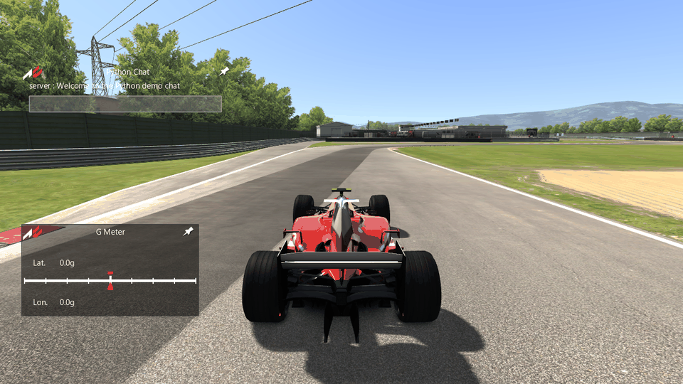
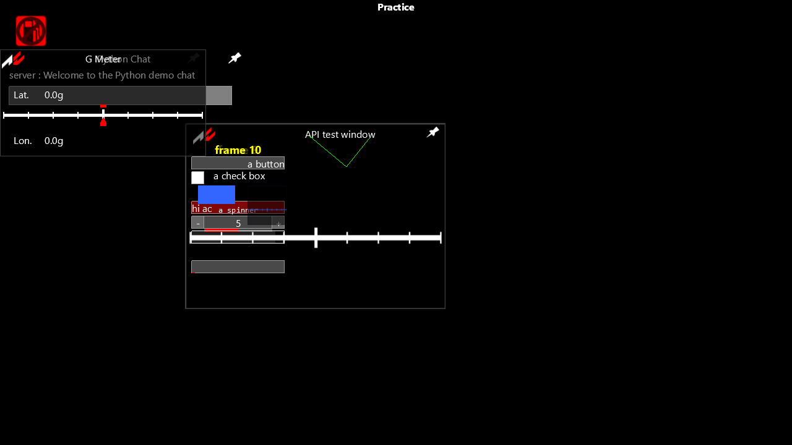

# Task 42: AC's Python app API

## Resume here (Task 42)

- Done: steps 1 to 4 on the desktop, and step 5 as a written plan (see "The browser").
  rustyac.exe loads the player's own `python33.dll`, gives the apps an `ac` module with the
  game's 116 functions, and runs AC's Chat and gMeter and any other app `python.ini` turns on.
- Proof: the render oracle runs the game's own `PythonInterface` (in acs.exe) and
  rustyac-python on the same apps in the same scripted session. Every frame's draw calls and
  pixels, the state, the console, `py_log.txt`, and the 6.9 MB of values the test apps log are
  identical (`py_apps`, 69 frames).
- Next: see "Not done (Task 42b)".
- Scratch: `re/scratch/task42/`. Disk free: 33 GB at start, 32 GB at end.

## How it works

- `crates/rustyac-python` (Windows only):
  - `ffi.rs` loads `<AC>/system/x64/python33.dll` at run time with LoadLibraryEx. It binds the
    same 28 functions acs.exe imports (its delay-load table) and no others. The DLL finds its
    standard library beside itself (`Python33.zip`), as it does for the game.
  - `ac.rs` is the `ac` module: all 116 functions, registered in the game's order (all 116
    `addFunc` calls in `PythonInterface::PythonInterface` 0x140124920), each a port of its
    handler. Ported behaviour includes:
    - argument formats;
    - returns: int `-1` on bad arguments with the error left set, float `1.0` from
      `log` / `console` / `glEnd`;
    - the "Control index %d out of range" messages;
    - the 73 `getCarState` ids with the game's fall-throughs (id 7 to 8; ids 43, 46, 48, 49 →
      -1);
    - `setCarFFB` adding instead of setting.
  - `lib.rs` is the lifecycle (`PythonInterface`, `PyPlugin`, `PyModule`, `PythonForm`):
    1. Start the interpreter with `ac` appended to the init table.
    2. Run `import sys`, `sys.dont_write_bytecode = 1`, then
       `sys.path.append('apps/python/system')`.
    3. For each `python.ini` section that names a folder `apps/python/<name>/<name>.py`
       (`ACTIVE` above 0): clear its `__pycache__`, add the folder to `sys.path`, and import
       it.
    4. Call `acMain(1.0)`, then `acUpdate(deltaT)` every frame and the render callbacks
       (`"f"`, deltaT) after each form draws.
    5. Call `acShutdown()`, then `Py_Finalize`.
  - Errors go to the console as `[PY ERROR]: <file> (<line>) <message>`. Missing files and
    import failures get the game's console lines, and `ac.log` writes `logs/py_log.txt`.
  - An app's window is a rustyac-gui form with an icon on the apps bar, saved in `acos.ini`
    like any other app.
- `crates/rustyac-game/src/render/gui.rs`:
  - With `gameplay.ini [PYTHON] ENABLE_PYTHON` above 0, `GameGui` starts Python after the
    game's own apps (as `Sim::Sim` does).
  - It sets the working directory to the game's folder. The apps open files relative to it,
    as in the game.
  - Each frame it runs `acUpdate`, passes on the console lines and carries out what the apps
    ask: shut down, restart, force feedback gain.
  - At the end it runs `acShutdown`.
- Without the DLL the game exits ("Failed to load Python, exiting", exit code 2).
  rustyac.exe says so on the command line and runs on without Python apps. Stopping the
  whole game for a missing optional feature would only make rustyAC worse.

## How to use it

- Apps go where AC keeps them: `<Assetto Corsa>\apps\python\<name>\<name>.py`. rustyAC reads
  that folder and never writes to it, except for deleting `__pycache__` folders, which the
  game also does.
- Turn Python on with `gameplay.ini [PYTHON] ENABLE_PYTHON=1`. AC's launcher writes it, and it
  is on in most installs.
- Turn each app on with `python.ini [<NAME>] ACTIVE=1`. Both files are read from rustyAC's own
  `cfg` folder first, then from `Documents\Assetto Corsa\cfg`.
- In the session, open an app's window from the apps bar on the right, as in AC.
- `py_log.txt` (what apps write with `ac.log`) is in rustyAC's own `logs` folder, beside its
  `cfg` folder (never in Documents). The console (Home) shows `ac.console` lines and the
  apps' errors.
- `rustyac.exe` prints `Python: 2 app(s): Chat, gMeter` at the start.

## Proof

### The oracle

- `render_oracle gui --gui py_quick|py_apps` (`tools/render_oracle/src/gui_py.rs`).
- The game side builds the GUI oracle's stand-in session with 6 race cars from the Task 32
  race tapes, the HUD and the console. It then runs acs.exe's own
  `PythonInterface::PythonInterface` on the player's `python33.dll` (the oracle fills acs.exe's
  delay-load table), calls `Game::update` on it every frame, and `Game::shutdownObject` at the
  end.
- The port side does the same with rustyac-python in its own process and its own copy of the
  folder.
- Both sides load the same apps:
  - AC's Chat, gMeter and `system/acsys.py`;
  - `acapi_ui`: every window, control, listener, font, texture and GL function, with good and
    bad handles and arguments;
  - `acapi_data`: every getter. Each call is made with 8 kinds of arguments, plus
    `getCarState` for 4 cars × ids -1 to 74 × 6 wheel arguments, every frame;
  - `py_raise` (acMain fails), `py_syntax` (the import fails), `py_off` (`ACTIVE=0`) and
    `missing` (no file).
- The test apps log every return value or exception to their own `calls.txt`.
- The script clicks a button and a check box, types into Chat's text input, presses Enter, and
  opens the console.

| sequence | frames | draw calls (game) | values logged | result |
|---|---|---|---|---|
| py_quick | 13 | 14,242 | 34,229 lines (1.35 MB) | command log, pixels, state (1,652 lines, 14 events), console, py_log.txt, both calls.txt: IDENTICAL |
| py_apps | 69 | 76,907 | 170,701 lines (6.97 MB) | command log, pixels, state (8,708 lines, 14 events), console, py_log.txt, both calls.txt: IDENTICAL |

### The `ac` names

- The game registers 116 names (`addFunc` in 0x140124920). rustyac-python registers the same
  116, in the same order.
- `dir(ac)` logged by `acapi_data` on both sides: the same 116.
- `acsys` is the game's own `apps/python/system/acsys.py`, loaded from the install on both
  sides. Its classes and members are logged on both sides and are identical.

log, console, newApp, setTitle, setPosition, setIconPosition, setTitlePosition, setText,
getText, getPosition, setSize, getSize, setVisible, setBackgroundColor, setBackgroundOpacity,
drawBackground, drawBorder, setBackgroundTexture, setFontAlignment, addRenderCallback,
addOnClickedListener, addOnValidateListener, addOnValueChangeListener, addOnCheckBoxChanged,
addOnListBoxSelectionListener, addOnListBoxDeselectionListener, addOnAppActivatedListener,
addOnAppDismissedListener, sendChatMessage, addOnChatMessageListener, initFont, setFont,
setFontColor, setFontSize, setCustomFont, addLabel, addButton, addCheckBox, addGraph,
addSerieToGraph, addValueToGraph, addListBox, addItem, removeItem, getItemCount,
setItemNumberPerPage, highlightListBoxItem, setAllowDeselection, setAllowMultiSelection,
getSelectedItems, addTextBox, addSpinner, setStep, addProgressBar, setRange, setValue,
getValue, addTextInput, setFocus, glBegin, glEnd, glVertex2f, glColor3f, glColor4f, glQuad,
glQuadTextured, newTexture, getCarState, getCarMinHeight, isCarInPitline, isCarInPitlane,
isCarInPit, isConnected, getCarBallast, getCarRestrictor, getCarTyreCompound, isAIControlled,
getCarEngineBrakeCount, getCarPowerControllerCount, getCarFFB, setCarFFB, getCarsCount,
getCarLeaderboardPosition, getCarRealTimeLeaderboardPosition, setCameraMode, getCameraMode,
isCameraOnBoard, getCameraCarCount, setCameraCar, focusCar, getFocusedCar,
freeCameraSetClearColor, freeCameraMoveForward, freeCameraMoveRight, freeCameraMoveUpWorld,
freeCameraRotatePitch, freeCameraRotateHeading, freeCameraRotateRoll, getDriverName,
getDriverNationCode, getTrackName, getTrackConfiguration, getTrackLength, getCarName,
getCarSkin, getLastSplits, getCurrentSplits, isAcLive, getWindSpeed, getWindDirection,
shutdown, restart, getServerName, getServerIP, getServerHttpPort, getServerSlotsCount.

### Where the game crashes (the test apps leave these out)

- These handlers have no check for a bad car: `getCarMinHeight`,
  `getCarLeaderboardPosition`, `getCarRealTimeLeaderboardPosition`, `getLastSplits`,
  `getCurrentSplits`, `isCameraOnBoard` and `getCameraCarCount`.
- `getCarState` ids 41, 42, 55 and 58 index past the wheel arrays when the wheel is -1 or 4.
- In each of these cases rustyAC returns -1 (or clamps the wheel) instead of crashing.
- `printErr` crashes the game when Python code raises an exception object: it reads the value
  as a string. rustyAC prints the line with an empty message.
- `ac.log(5)` crashes the game, because it builds a string from NULL.
- `getPosition` on a bad handle returns a tuple of two NULL items in the game, which Python
  cannot print. rustyAC returns -1.

### The proof area

- `tools/proofs/python.sh` is a new area: `py_quick` in `--quick`, plus `py_apps` in a full
  run. `areas.map` routes `crates/rustyac-python`, `crates/rustyac-gui`, the renderer and
  `tools/render_oracle` to it.

## The browser (step 5, not built)

What Python apps in the page would take:

1. **An interpreter.** The apps were written for Python 3.3. Pyodide (CPython 3.12 on
   WebAssembly, about 10 MB) runs nearly all of them. Building CPython 3.3 itself for
   wasm32-emscripten would match the game exactly, but nobody maintains such a build.
2. **The `ac` module.** `ac.rs` calls the DLL through 28 raw functions. In the page those
   would become a JavaScript bridge into Pyodide, or a C extension module built with
   Emscripten that calls into rustyac-web. The handlers themselves are portable Rust and could
   stay.
3. **The apps' files.** The page would have to read `apps/python` from the player's chosen
   folder (the content pack picker) and give Pyodide an in-memory file system holding them.
   It would also have to keep `py_log.txt` and `__pycache__` in memory.
4. **Proof.** The page would need the same `py_*` sequences against the desktop's call
   logs, the way Tasks 40 and 41 compare the HUD and the sound.

Rough size: one task the size of Task 41. The largest risk is Python 3.3 vs 3.12
differences in the apps themselves, outside our code.

## Not done (Task 42b)

- In rustyac.exe, `setCameraMode`, `setCameraCar`, `focusCar`, the free camera functions and
  `sendChatMessage` are logged on the command line ("not carried out"). The camera and the
  focused car do not move.
- Online, the chat listener never fires and the server getters answer as offline.
- `addOnAppActivatedListener` and `addOnAppDismissedListener` register (returning 1), but the
  callbacks never run. The game screen's events behind them are not traced.
- `newApp(name, 1)` (a setup-screen app) makes the form but does not put it on the setup
  screen.
- rustyac.exe's car data for the apps (`getCarBallast`, `getCarRestrictor`,
  `isAIControlled`, `getCarMinHeight`, camera counts, tyre compound, sector count) comes from
  defaults, not from the session. The oracle proof feeds both sides the same values, so it
  covers the handlers but not this wiring.
- The C++ plugin SDK (`apps/*.dll`) and CSP's Lua apps are not part of this task.

## Rule notes

- A read-only subagent (`spec_cardata`) wrote one stray file outside the repository
  (`%TEMP%\gcs.txt`, a disassembly dump). I deleted it; nothing else was written.
- No Python DLL, standard library or app is in the repository. The proof uses AC's own apps
  from the install, plus the test apps in `tools/render_oracle/py_apps`.

## Open questions

- What `ACTIVE` defaults to when a `python.ini` section has no such key. rustyAC reads it as 0;
  every file AC writes has the key.
- The operand order of the free camera's rotations (0x14020f940) is not checked against the
  game: no stand-in camera in the oracle reaches it.
