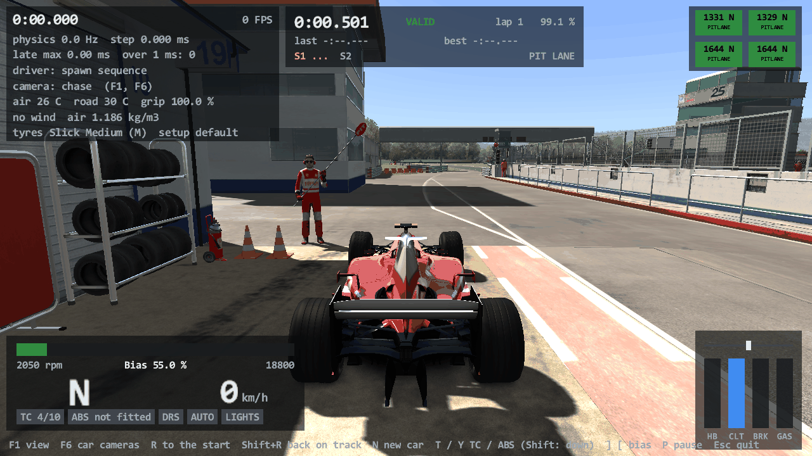
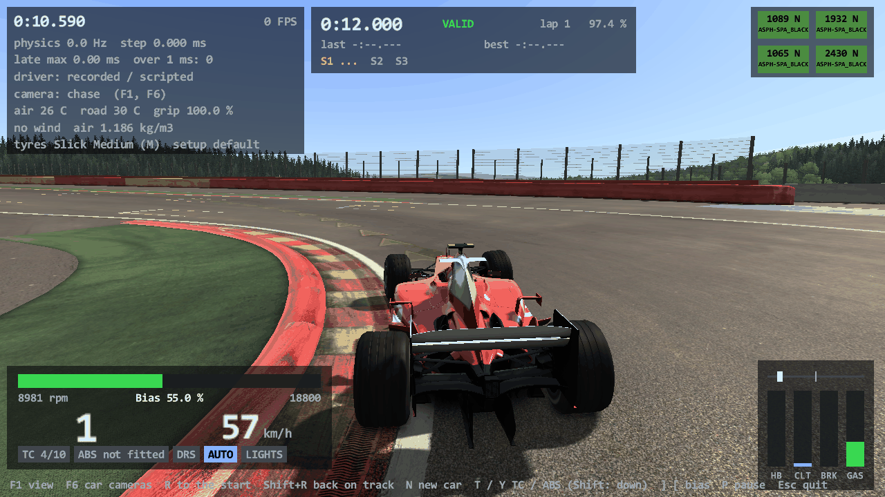
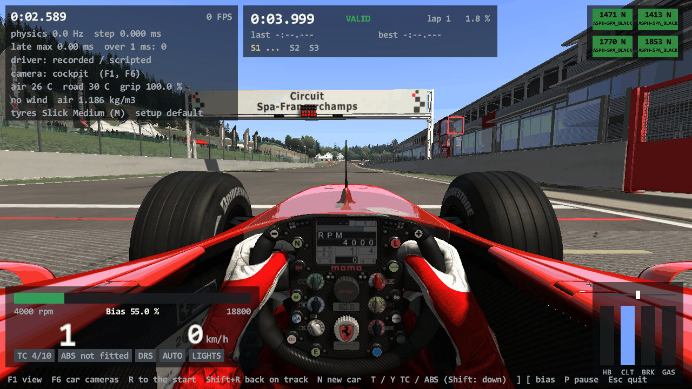

# Task 22c: the scene's leftovers

## Resume here

State after the last commit (kept up to date with every commit):

- **The task is finished** but for the points of section 8 ("Not done"). Version 0.22.2, tag `v0.22.2`.
- The task text is `prompts/22c_scene_leftovers.md` (the "Not done" list of Task 22, eleven items). Nine are
  done and measured against the game; two are not (section 8): the pit stop mechanics (they only show during a
  pit stop, which is Task 26) and the one oracle run with both the game's sound and its flames.
- To pick the work up again: section 10 has the checks. `sh re/scratch/task22c/batch.sh` runs the 18 new proof
  sequences (about 12 minutes); `batch22.sh`, `batch21.sh`, `batch20.sh` in the same folder run the older ones
  with this task's oracle.
- On disk, git-ignored: `re/scratch/task22c/` (the seven reader briefs `spec_*.md` with their disassembly
  listings, the patch scripts `p_*.py`, the batches and their results, the made-up test cars in `cars/`, oracle
  output in `out*/`, the cube-map measurements `cube_*.txt`).

## 1. Plain-English summary

Task 22 left a list of things Assetto Corsa draws that rustyAC did not. This task works through that list. Each
part was read from `acs.exe`, ported, and then measured the usual way: the render oracle runs the game's own code
and the Rust port side by side on the same inputs and compares every command sent to the graphics card and
every pixel.

- **The pit lane has people now.** Every pit box that has a car gets its lollipop man (he raises the lollipop
  while you are in the pit lane and lowers it when you have stopped in your box, and shuffles about while he
  waits), and the track's own crew figures, tyre racks and boards at your box are switched on and dressed in your
  car's colours. The red "PIT" marker over your box shows while you drive through the pit lane. As in the game,
  the lollipop man only shows with `WORLD_DETAIL` 5 (your `video.ini` has 0: use `--world-detail 5` or
  `--graphics max`).
- **The ideal line.** The coloured arrows on the road (green: flat out, red: brake). It is on the switch the game
  uses: `assists.ini` `IDEAL_LINE`, and Ctrl+I while driving.
- **The start lights.** The lamps on the gantry count down a race start one by one and go out at the start; the
  drag strip's and the hill climb's "Christmas tree" works too. rustyAC has no races yet, so the car is not held
  on the grid: `--start-lights 20` shows the countdown.
- **The time-attack gates.** The "CHECKPOINT" banner across the road at the next timing line, in a time-attack
  session.
- **The suspension rods of the classic F1 cars.** Ported and proven, with a surprise: in the game as installed
  **no car actually gets a rod from this code** (four of the six data files number their entries from 10, so
  the game reads none; the other two name a part their models do not have). A made-up file for the Lotus 49
  proves the port.
- **Dashboards.** The eleven display items that were ported "from the notes" in Task 22 are now measured, all
  identical. `FUEL_CONS` (fuel use) and `EST_LAPS` (laps of fuel left) show real numbers from your driving.
- **N (a new session)** now does what the game does to the picture: smoke and dirt are cleared and the
  hot-air balloons are scattered again.
- **Replay keys.** In a `--replay` window: Ctrl+Space (or P) play / pause, Ctrl+S slow motion, Ctrl+F faster (2
  to 5 times), Home back to the start. These are the game's own keys (they come from your `controls.ini`), but
  for Home, which is a button in the game. Rewind and the lap jumps are not there: the game steps back through
  recorded frames, a rustyAC replay is the drive simulated again.
- **Generated ground shadows are kept.** A car without its own shadow pictures gets them drawn once; from the
  next start they are read from `rustyac_cache\shadows\<car>\`, and drawn again only when the car's files changed.
- **The big reflection map.** I measured where the time goes and whether the game pays it too. It does: the
  game's own renderer and the port cost the same at every size on your graphics card (they send the same
  commands). A 2048 map is slow for two reasons: every face that is drawn again fills four times the pixels of a
  1024 one, and the map's smaller copies ("mip levels") are made again every frame, also when nothing was
  redrawn. Today that second part costs 3 ms a frame here, not the 25 ms Task 22b saw (section 6). `--graphics
  max` now uses **1024** (38 frames a second on today's throttled laptop against 27 with 2048; 80 to 107 in Task
  22b's better state against 15). `--cube-size 2048` still gives the launcher's highest.

**All 18 new sequences (922 frames) are identical to the game in command log and pixels**,
and the older proofs still are (section 4).

**Not done** (section 8): the pit stop mechanics (the four men who change the tyres), the single oracle run with
the game's sound and its flames together, replay rewind / lap jumps / instant replay, the ghost car.

## 2. What is ported (addresses are `acs.exe`)

| File | What | Addresses |
|---|---|---|
| `rustyac-render/src/pit_crew.rs` (new) | `TrackAvatar::initPitCrew` (lollipop men, the `AC_CREW_<n>` meshes with the car's suit / panel textures), `LollipopCrew` (0xd8), the pit box marker of `PitStop` with the rules that show and hide it | `initPitCrew` 0x1401ca630; `LollipopCrew` ctor 0x140112bf0, `loadCrewSkin` 0x1401136d0, `setMeshProperties` 0x140113a10, `update` 0x140113ab0, `updateCurrentPosition` 0x140113b40; `CarAvatar::isInPit` 0x1400d8bd0; `PitStop::PitStop` 0x1400a55d0 (the marker's part), `update` 0x1400ab190, `isInsidePitArea` 0x1400a9af0, `isCarOutOfPitArea` 0x1400a9840, `isInPitPosition` 0x1400a98c0, `renderHUD` 0x1400aa300 |
| `rustyac-render/src/ideal_line.rs` (new) | `IdealLine` (0xe8) and `SplineStripBuilder` (0x80); shader `ksIdealLine` | ctor 0x140109d10; `addPoint` 0x14021b6b0, `addVertex` 0x14021b9f0, `buildMesh` 0x14021bb20; the switch: `DrivingAssistManager` 0x1400fbd90, `update` 0x1400fcb20, `setIdealLine` 0x1400fcb00, the key in `Sim::onKeyDown` 0x14019a940 |
| `rustyac-physics/src/track/spline.rs` | `AiSpline::parse_fast`: `AISpline::loadFast` alone, with the old file versions (2, 3 and 6 are among the game's own `ideal_line.ai`) | `loadFast` 0x1402a83c0, `loadVersion6` 0x1402a85b0, `Spline::addPoint` 0x1401ed660 |
| `rustyac-render/src/start_lights.rs` (new) | `StartingLights` (0xf0): the `KS_START_LIGHT_<i>` meshes' own materials and their countdown; `StartingTrackSemaphore` (0x88) | ctor 0x1401a1a20, `renderHUD` 0x1401a2e80, the handlers 0x1401a2960 / 0x1401a2920; semaphore ctor 0x1401a37a0, `update` 0x1401a4cc0, `resetLights` 0x1401a4a50; `RaceManager::startRace` 0x140141470 |
| `rustyac-render/src/time_attack.rs` (new) | The gates of `TimeAttack` (0x2e0): the reader of `data/overlays.ini`, the gate's matrix, the draw at `BEFORE_CARS_NODE`, which gate shows | `loadOverlaysAndSectors` 0x1401bbc20, the render handler 0x1401b8dd0, `mat44f::createTarget` 0x14005ff50, `renderGuiStatus` 0x1401bd120 |
| `rustyac-render/src/suspension_graphics.rs` (new) | `SuspensionGraphics` (0xf0) | `generateConnections` 0x1401b4280, `getNodeFromName` 0x1401b4da0, ctor 0x1401b39d0, `update` 0x1401b3ca0, `Node::worldToLocal` 0x14020e730 |
| `rustyac-render/src/crowds.rs`, `car.rs` | The new-session handlers: the track's (drifting objects), the four `TyreSmoke`, `EngineSmoke`, `DynamicCarEffects::resetDirt`; the skid marks' rewind handler | 0x1401c6b70; 0x1401d09d0, 0x140093510, 0x140091970; 0x1400d0810 |
| `rustyac-game/src/replay_manager.rs` (new) | The replay transport's state machine | `ReplayManager::play` 0x1401591f0, `pause` 0x140159070, `stop` 0x14015b6f0, `fastForward` 0x140156780, `slowMotion` 0x14015b3b0, `updatePlayState` 0x14015b9a0 (the speed), `updateReplayAudio` 0x14015bc00; the keys of `CommandManager` 0x1400e8b70 |
| `rustyac-physics/src/car/fuel_lap_evaluator.rs` (new) | `FuelLapEvaluator` (0x48): fuel per lap, distance per litre | `step` 0x14028d360, `getFuelLaps` 0x14028d260, `getFuelPerLap` 0x14028d290, the handlers 0x14028d180 / 0x14028d140; `CarAvatar::getKmPerLiter` 0x1400d3510 |
| `rustyac-render/src/fake_shadow.rs`, `rustyac-game` | The shadow cache (rustyAC's own: `stamp.txt` beside the five pictures) | |

Wired into `rustyac.exe` in `crates/rustyac-game/src/render/ac.rs` (everything above), `desktop.rs` (keys,
options), `physics_thread.rs` (a replay's speed and restart), `sim.rs` / `view.rs` (new-session counter, fuel
use), `shm.rs` (`idealLineOn`).

What was found on the way:

- **The lollipop men are on layer 5**: with `WORLD_DETAIL` below 5 the game does not draw them (and never in the
  mirrors or the reflections). The static crew meshes are not gated.
- **No installed car draws a suspension rod** (above).
- **Six of the game's own `ideal_line.ai` files are old-format** (Imola, Magione, Silverstone GP: version 2;
  Mugello: 3; Vallelunga extended: 6). The port's AI-line reader refused those; the ideal line has its own plain
  reader now. All three old versions are in the proofs.
- **The ideal line is never in the reflections and is hidden in the mirror** (inside
  `MirrorTextureRenderer::render`, not in `Sim::renderScene` as the Task 22 note said).
- **The start lights' meshes look different in every session**, not only in a race: the game gives them a
  material of their own at start-up (diffuse and ambient 0.3, no specular). Their red is `(510, 0, 0)`: the
  file's 255 times `INTENSITY` 2, never brought down to 0..1.
- **The start lights are written in the HUD pass**, after the picture is drawn: every change shows one frame
  late. Ported that way (and measured that way). While the pause menu shows they stand.
- **The drag strip's green lamps burn in a practice session** (the semaphore does not look at the session).
- **The pit box marker is hidden while you stand in your box** (within 3 m), shown while you drive in the pit
  lane, and on a start from the grid it flashes for exactly one frame. All from `PitStop::update`.
- **The time-attack gates' places come from a file the game writes into the track's folder** the first time
  the mode is used there (`data/overlays.ini`). rustyAC only reads it.
- **Replay keys need Ctrl and are not hard-wired**: they are the commands `FFWD`, `REV`, `SLOWMO`,
  `PAUSE_REPLAY`, `NEXT_LAP`, `PREVIOUS_LAP`, `START_REPLAY` of `controls.ini` (defaults F, D, S, Space, N, P, R).
  The game has no key for Stop.
- **A windowed `--replay` used to start running while the picture was still loading** (the first seconds were
  never seen on a slow start). It now waits for the first frame.
- **`--car <folder>` used the installed car's models**, whatever folder was given; it now takes the models
  beside the given data (found while testing the shadow cache).
- The oracle's two sides disagreed on one default (the number of cars of the session without mirrors: 0 in the
  game's stand-in, 1 in the port); only `POSITION_COUNT` shows it. Fixed in the harness.

## 3. The oracle: what is new

`tools/render_oracle` now also hosts, each built by the game's own constructor on its stand-in blocks:

- `IdealLine` (on the game's own `AISpline::loadFast`; its rays are the port's, through a stand-in `Track` whose
  `rayCast` slot is a Rust function), `StartingLights` and `StartingTrackSemaphore` (with a stand-in
  `RaceManager` for the session's kind and start time; the game's own two event handlers are fired),
  `TrackAvatar::initRespawnPositionSet` and `initPitCrew` with every `LollipopCrew::update`, the gates' render
  handler of `TimeAttack` (through its own `std::function` body), `SuspensionGraphicsGenerator` and every
  `SuspensionGraphics::update`, the track's and the car's new-session handlers (the track's needs the physics
  thread's job queue: made with the C++ runtime's own constructor), `CarAvatar::updateERSCharge`.
- **By hand**: the pit box marker's model is loaded with the game's `KN5IO` and placed at the game's own pit
  node, but **its show / hide rules are the port's on both sides** (`PitStop::update` needs the game's whole
  pit menu). So the marker's drawing is proven; its rules are written from the disassembly and not run against
  the game. The HUD's own 2D start lamps are switched off on the game's side (`renderLight` patched to return).
- New `--set` names: `ideal`, `tts` (ms to the session's start at that frame; it runs down from there), `pitstate`,
  `gate`, `newsession`, `kmpl`, `cars`, `maxfuel`, `torque`, `ratio`, `sessionlaps`, `turbolevel`, `fuellaps`,
  `accg=x:y:z`. New views: `pit`, `pit2` (at the first pit box), `gate` (25 m before the first gate).
  `--frames <n>` without a car gives a sequence of the track alone.
- `RENDER_ORACLE_TIMING=1` (with `RENDER_ORACLE_HARDWARE=1`): each side prints its frame times, drawn on the
  real device context without the command log (the logger costs 2 s a frame on the card).

## 4. Results

### New sequences (every frame compared; WARP, 1280 x 720)

| # | Sequence | Frames | Calls (per frame) | Draws | Command log | Pixels |
|---|---|---|---|---|---|---|
| 1 | spa, no car, chase: the ideal line on (frames 1, 2), then off | 3 | 7,326 (2436 to 2445) | 1,475 | identical | identical |
| 2 | imola (ideal_line.ai of version 2), 488 GT3 lap, chase: the ideal line, HQ mirror (4 samples, the line hidden in it), virtual mirror | 39 | 234,449 (5761 to 6771) | 32,333 | identical | identical |
| 3 | mugello (ideal_line.ai of version 3), no car, free camera: the ideal line | 1 | 2,269 (2269 to 2269) | 484 | identical | identical |
| 4 | vallelunga extended (ideal_line.ai of version 6), no car, chase: the ideal line | 1 | 2,525 (2525 to 2525) | 557 | identical | identical |
| 5 | spa, Lotus 49 with a made-up suspension_graphics.ini (four rods aimed at the hubs, one with an unknown source name, one whose node is missing), kerb strike, front camera | 59 | 206,979 (3484 to 3530) | 32,191 | identical | identical |
| 6 | spa, Ferrari 312T as installed (its file names a node the model does not have: no rod), front camera, the Lotus 49's drive | 9 | 37,596 (4173 to 4179) | 5,359 | identical | identical |
| 7 | spa, no car, chase: the five start lights of a race counting down (16 s, then 8.2 s to the start in jumps), the pause menu for five frames, the start | 159 | 390,389 (2451 to 2456) | 78,069 | identical | identical |
| 8 | laguna seca (six lights), no car, chase: the countdown, replay mode begun at frame 30 (the lights stand) and ended at 45, a practice session from frame 70 (lights out) | 89 | 226,657 (2543 to 2549) | 47,437 | identical | identical |
| 9 | drag strip (drag400), no car, chase: the semaphore's three ready steps and the start | 61 | 90,280 (1480 to 1480) | 19,581 | identical | identical |
| 10 | trento-bondone, no car, chase: the hill climb's semaphore | 41 | 105,780 (2580 to 2580) | 25,707 | identical | identical |
| 11 | nordschleife, no car, from 3.5 km above: the drifting balloons scattered again by two new sessions (frames 6 and 10) | 13 | 15,431 (1187 to 1187) | 2,717 | identical | identical |
| 12 | spa, F2004 over the grass with smoke, grass pieces and dirt: a new session at frame 60 (all of them cleared) | 99 | 442,993 (3996 to 4609) | 58,960 | identical | identical |
| 13 | spa (crew on the right), F2004, from the pit lane: the lollipop man raising his lollipop, lowering it from frame 70, his idle loops; the static crew in the car's colours | 149 | 582,896 (3903 to 3934) | 116,022 | identical | identical |
| 14 | magione (crew on the left), E30, from the side: the pit box marker hidden, shown in the pit lane (frames 20 to 70), the lollipop up from frame 30 | 99 | 182,760 (1827 to 1864) | 33,120 | identical | identical |
| 15 | imola, 488 GT3, from the pit lane at WORLD_DETAIL 4: no lollipop man (layer 5), the static crew stays; a hot-lap session (no marker) | 19 | 43,981 (2314 to 2329) | 7,828 | identical | identical |
| 16 | imola, 488 GT3 with a made-up digital_instruments.ini, dash camera: DELTA_GRAPH, TURBO_LEVEL, TOTAL_LAPS (practice, then a race of 12), EST_LAPS, FUEL_CONS in all four units, GFORCES x / y / z, KERS_LOAD both ways, POSITION_COUNT, FUEL_PERC, POWER_918, KERS_RECHARGE_SERIE, every input changing | 49 | 311,389 (6280 to 6430) | 47,271 | identical | identical |
| 17 | spa, no car, 25 m before the finish line: the time-attack gate of the next time line (the finish's, then line 1, none, the finish's again), hidden in a replay | 13 | 34,994 (2682 to 2697) | 7,250 | identical | identical |
| 18 | imola, 488 GT3 lap, chase, HQ mirror (4 samples) and virtual mirror: a gate in the main pass and in the mirror's | 19 | 118,968 (5789 to 6799) | 16,403 | identical | identical |

**18 of 18 identical in command log and pixels, 922 frames in all.**

### The golden tests (no game code; NOT TESTED without AC or WARP)

| Test | Frame | Lines | Draws | Log hash (a failure if other) | Pixel hash (a note if other) |
|---|---|---|---|---|---|
| `golden` (Task 20) | Magione, no car, chase | 1624 | 359 | `0xc4d48c2d20a02840` | `0x624b188b7f99c384` |
| `golden_car` (Task 21) | Magione, E30, chase, smoke Normal, mirrors 512 | 5059 | 820 | `0x2102bd772ce7b800` | `0xc4f1fdfac428a971` |
| `golden_scene` (Task 22) | the same, with heavy clouds, crowds, grooves, loose objects and the HQ mirror | 5283 | 840 | `0x827b6b23e6d6c9e0` | `0xb48298d680871e36` |
| `golden_leftovers` (new) | the same car in a race about to start: ideal line, start lights lit, lollipop man, crew, pit box marker, a gate | 5172 | 830 | `0xbe5fa9519b891183` | `0xa4e403c2be72d35c` |

The new frame was compared with the game by the oracle (`render_oracle compare --track magione --view chase --car
bmw_m3_e30 --pose crates/rustyac-render/tests/data/e30_magione.pose --smoke 3 --mirror 512 --set
ideal=1,session=3,tts=5000,pitstate=1,pit=1,gate=0`: command log and pixels identical); the test's log is the
oracle's port log but for the frame's name and the back buffer's bind flags (5 lines), and its picture hash is the
hash of the game's picture.

### The replay keys (rustyac.exe, a window that takes no focus, keys pressed by the clock)

A 10 s recorded drive (3,775 steps), `--replay drive.ryin --windowed --no-focus --replay-script …`:

| Script | What happened | The car at the end |
|---|---|---|
| none | plays to the end | 193.1 km/h, gear 4, 15802 rpm, x -6.27 y 5.199 z -2.52 |
| `slow@1,pause@3,pause@4,slow@5,ffwd@7,ffwd@7.5` | slow motion 2 s (377 steps: ramp, then half speed), play 1 s (334 steps), pause 1 s (1 step), slow motion 2 s (377), twice the speed 0.5 s (334), three times to the end | the same |
| `ffwd@2,stop@4,pause@5,ffwd@6,ffwd@6.1,ffwd@6.2` | twice the speed, Stop at step 2,373 (back to step 0, stopped), play, then 2, 3, 4 times | the same |

The transport's numbers (the ladder 2, 3, 4, 5; the 0.4 s ramp into slow motion; which state each key leaves) are
unit tests in `replay_manager.rs` against the values read from the game.

### The shadow cache (rustyac.exe)

A copy of the E30 without its five shadow pictures (`--car <copy>`): first start "generated into
rustyac_cache", second start "come from rustyac_cache" with a byte-identical screenshot, after touching one of the
car's files "generated" again (same screenshot).

### The older proofs, run again at the end with this task's oracle

**The 23 sequences of Task 22: 23 of 23 identical, 1,413 frames.**

<details><summary>the rows</summary>

| # | Sequence | Frames | Calls (per frame) | Draws | Command log | Pixels |
|---|---|---|---|---|---|---|
| 1 | spa, heavy clouds drifting (TIME_MULT 400), F2004 lap, chase, mirror 512 + virtual mirror, cube map 2 faces a frame | 179 | 1,585,896 (8361 to 9237) | 246,736 | identical | identical |
| 2 | monza, light clouds drifting (TIME_MULT 2000), WORLD_DETAIL 3, 1M lap, far camera | 119 | 363,309 (2865 to 3480) | 50,702 | identical | identical |
| 3 | spa, mid clouds, no car, far camera (one frame) | 1 | 2904 | 538 | identical | identical |
| 4 | spa, crowds and grooves (laps 0, 4, 30), F2004 lap, chase, mirror 512 + virtual mirror, cube map 2 faces | 119 | 845,377 (6828 to 7461) | 126,939 | identical | identical |
| 5 | imola, crowds at WORLD_DETAIL 3, grooves (2 laps), E30 lap, far camera | 89 | 302,850 (3398 to 3412) | 46,181 | identical | identical |
| 6 | monza, crowds, grooves (10 laps), mid-clear clouds drifting, 1M lap, side camera | 89 | 485,804 (5388 to 5599) | 71,966 | identical | identical |
| 7 | laguna seca, loose objects (cones) shown, crowds, mid clouds, no car (one frame) | 1 | 2951 | 575 | identical | identical |
| 8 | magione, Formula Lithium with a made-up digital_panels.ini (race position, push-to-pass digits and light, P2P_DASH, POSITION_CAR), pause at frame 30 | 39 | 243,698 (6223 to 6266) | 32,273 | identical | identical |
| 9 | imola, 488 GT3, dash camera: RPM_GRAPH through its range, TC level 3, ABS level 5, air 12.7 | 29 | 181,156 (6184 to 6306) | 26,152 | identical | identical |
| 10 | spa, F2004, dash camera: TC_LEVEL 4 then 0 (off), air 31 | 29 | 188,460 (5954 to 6579) | 31,143 | identical | identical |
| 11 | magione, Aventador SV, dash camera: GEAR_TX through R, N, 1, 4 (the neutral delay) | 49 | 235,628 (4759 to 4857) | 30,800 | identical | identical |
| 12 | magione, McLaren P1, cockpit: DRS_SERIE with the wing at 5, 18, 27, 33 degrees, AMBIENT_TEMP 5.5 | 39 | 175,900 (4479 to 4538) | 22,802 | identical | identical |
| 13 | spa, F138, dash camera: KERS_LOAD_SERIE from empty to full, wing 3 then 20 | 39 | 254,287 (5839 to 6673) | 41,774 | identical | identical |
| 14 | spa, SF70H, dash camera: KERS_LOAD_SERIE inverted (ERS), from full to empty | 39 | 267,392 (6318 to 7063) | 43,866 | identical | identical |
| 15 | spa, F2004 launch, chase: HQ mirror (4 samples) with smoke in it, virtual mirror | 59 | 368,187 (6175 to 6333) | 56,847 | identical | identical |
| 16 | magione, E30 lap, cockpit: HQ mirror (4 samples), light clouds | 39 | 271,873 (6959 to 6990) | 45,826 | identical | identical |
| 17 | monza, F40 lap, chase: HQ mirror 256 (2 samples), smoke, flames, virtual mirror | 59 | 353,151 (5925 to 6037) | 52,035 | identical | identical |
| 18 | spa, F2004 without flame_presets.ini (flames version 1, three png textures) lifting off, rear camera | 149 | 810,500 (5287 to 5558) | 123,491 | identical | identical |
| 19 | magione, E30 without body_shadow.png: the five generated pictures and the frames after (first run: no shadow yet) | 9 | 50,001 (5544 to 5572) | 8,520 | identical | identical |
| 20 | spa, F2004 (animated suspension) without body_shadow.png: the five generated pictures and the frames after | 9 | 51,581 (5712 to 5745) | 8,135 | identical | identical |
| 21 | spa, F2004 launch with smoke: pause menu (40..60), replay mode begun (80), playing, paused (100), slow motion (115), ended (135) | 159 | 846,470 (5252 to 5444) | 125,428 | identical | identical |
| 22 | monza, 1M hard stops, side camera: replay mode, paused (20..40: discs' glow gate, blur), fast forward x2 (40..60) | 69 | 371,852 (5270 to 5487) | 56,635 | identical | identical |
| 23 | nordschleife, no car, from 3.5 km above: a hot-air balloon of [DYNAMIC_OBJECT_n] drifting (one frame after three updates) | 1 | 1187 | 209 | identical | identical |

</details>

**The 27 sequences of Task 21: 27 of 27 identical, 2,353 frames.**

<details><summary>the rows</summary>

| # | Sequence | Frames | Calls (per frame) | Draws | Command log | Pixels |
|---|---|---|---|---|---|---|
| 1 | spa, F2004 lap, dash camera, mirrors 512 (driver, wheel display, shift lights) | 59 | 427,711 (6650 to 7309) | 70,534 | identical | identical |
| 2 | magione, E30 lap, cockpit camera, mirrors 512 (driver, needles, three mirrors) | 59 | 376,592 (6352 to 6405) | 65,500 | identical | identical |
| 3 | monza, 1M lap, cockpit camera (driver, needles, digital items) | 59 | 280,308 (4725 to 4775) | 39,471 | identical | identical |
| 4 | monza, F40 lap, dash camera (needles, .ksanim v1 car) | 39 | 187,618 (4801 to 4833) | 26,056 | identical | identical |
| 5 | spa at night (SUN_ANGLE 84), 1M, headlights + brake lights + reverse gear, rear camera | 29 | 196,031 (6752 to 6772) | 32,070 | identical | identical |
| 6 | spa at night (SUN_ANGLE 84), 1M, headlights, front camera | 29 | 203,266 (6997 to 7037) | 33,611 | identical | identical |
| 7 | monza at night (SUN_ANGLE 84), F40, pop-up headlights coming out (.ksanim v1) | 49 | 326,173 (6652 to 6729) | 54,267 | identical | identical |
| 8 | spa, E30, lights flashing and brake lights by day, rear camera | 29 | 169,225 (5783 to 5922) | 27,171 | identical | identical |
| 9 | spa, 1M hard stops, side camera (glowing discs, brake lights) | 89 | 541,720 (5817 to 6254) | 80,800 | identical | identical |
| 10 | magione, E30 hard stops, side camera (glowing discs) | 69 | 374,670 (5335 to 5664) | 63,205 | identical | identical |
| 11 | spa, F2004 into the wall, chase (damage, hanging parts) | 59 | 304,508 (5089 to 5215) | 44,166 | identical | identical |
| 12 | spa, 1M along the wall, front camera (scratches, broken glass) | 59 | 309,982 (5244 to 5263) | 46,164 | identical | identical |
| 13 | spa, E30 along the wall, chase (scratches, broken glass) | 59 | 343,728 (5787 to 5967) | 54,353 | identical | identical |
| 14 | spa, 1M fully damaged at rest, front camera | 9 | 39,150 (4350 to 4350) | 5,544 | identical | identical |
| 15 | spa, F2004 launch, 7 s, chase (tyre smoke Normal, skid marks, virtual mirror, smoke in the mirror) | 419 | 2,555,148 (5879 to 6345) | 379,650 | identical | identical |
| 16 | spa, 1M launch, 6 s, side camera (tyre smoke Ultra, skid marks) | 359 | 1,861,283 (5003 to 5374) | 273,190 | identical | identical |
| 17 | spa, F2004 over the grass, chase (grass smoke and pieces, dirt on the tyres) | 119 | 531,344 (3996 to 4609) | 70,428 | identical | identical |
| 18 | spa, F2004 lifting off, rear camera (backfire flames) | 149 | 812,566 (5287 to 5626) | 123,717 | identical | identical |
| 19 | monza, F40 lap, rear camera (flames, smoke Normal) | 299 | 1,475,594 (4894 to 5097) | 204,398 | identical | identical |
| 20 | monza, 1M lap, chase, mirrors 512 and the virtual mirror | 39 | 208,434 (5320 to 5373) | 28,464 | identical | identical |
| 21 | magione, E30 lap, dash camera, mirrors 256 | 39 | 244,767 (6204 to 6317) | 41,809 | identical | identical |
| 22 | spa, F2004 lap, chase, cube map following the car (6 faces a frame) | 29 | 302,153 (10365 to 10473) | 48,869 | identical | identical |
| 23 | monza, 1M lap, chase, cube map following the car (2 faces a frame) | 29 | 164,119 (5546 to 5729) | 22,758 | identical | identical |
| 24 | magione, E30 lap, far camera (ground shadows, wheel blur, DIR_ nodes) | 39 | 133,827 (3404 to 3471) | 23,827 | identical | identical |
| 25 | spa, F2004 kerb strike, side camera (suspension, DIR_ nodes, ground shadows) | 59 | 295,347 (4946 to 5107) | 42,767 | identical | identical |
| 26 | imola, 488 GT3 lap, dash camera (digital display, driver) | 39 | 243,698 (6184 to 6287) | 35,270 | identical | identical |
| 27 | magione, 250 GTO over a kerb, cockpit camera (needles, driver) | 39 | 200,262 (5084 to 5232) | 31,081 | identical | identical |

</details>

**The 21 frames of Task 20: 21 of 21 identical, 21 frames.**

<details><summary>the rows</summary>

| # | Sequence | Frames | Calls (per frame) | Draws | Command log | Pixels |
|---|---|---|---|---|---|---|
| 1 | spa, no car, chase | 1 | 2435 | 491 | identical | identical |
| 2 | monza, no car, chase | 1 | 2046 | 397 | identical | identical |
| 3 | magione, no car, chase | 1 | 1675 | 362 | identical | identical |
| 4 | laguna seca, no car, chase | 1 | 2533 | 533 | identical | identical |
| 5 | spa, F2004 at rest, chase | 1 | 5456 | 841 | identical | identical |
| 6 | spa, F2004 turning (92 deg, 64 km/h), cockpit | 1 | 5893 | 963 | identical | identical |
| 7 | spa, F2004 at 227 km/h, chase, sun 40 | 1 | 6370 | 1,080 | identical | identical |
| 8 | spa, F2004 at 227 km/h, into the sun | 1 | 6088 | 954 | identical | identical |
| 9 | monza, 1M at rest, chase | 1 | 4683 | 650 | identical | identical |
| 10 | monza, 1M turning (-286 deg, 38 km/h), cockpit | 1 | 5615 | 886 | identical | identical |
| 11 | monza, 1M at 168 km/h, far camera | 1 | 3702 | 624 | identical | identical |
| 12 | monza, 1M turning, chase, sun 40 | 1 | 6444 | 1,030 | identical | identical |
| 13 | magione, E30 at rest, chase | 1 | 5259 | 863 | identical | identical |
| 14 | magione, E30 turning (-88 deg, 51 km/h), cockpit | 1 | 5909 | 1,045 | identical | identical |
| 15 | magione, E30 at 131 km/h, into the sun | 1 | 6179 | 1,049 | identical | identical |
| 16 | magione, E30 turning, chase, sun 40 | 1 | 6061 | 1,074 | identical | identical |
| 17 | laguna seca, E30 at rest, chase | 1 | 5386 | 819 | identical | identical |
| 18 | laguna seca, E30 turning (-311 deg, 38 km/h), cockpit | 1 | 5975 | 968 | identical | identical |
| 19 | laguna seca, F2004 at 113 km/h (-19 deg), chase, sun 40 | 1 | 5948 | 967 | identical | identical |
| 20 | laguna seca, F2004 at 243 km/h, into the sun, sun 40 | 1 | 6066 | 950 | identical | identical |
| 21 | magione, E30 at rest, chase, shadows -1, cube map 0, world detail 0 (the video.ini of this PC) | 1 | 5148 | 845 | identical | identical |

</details>

### Tests and lint

Run at the end, at version 0.22.2:

- `cargo clippy --workspace --locked -- -D warnings`: clean; the two wasm clippy runs (`rustyac-web` for
  `wasm32-unknown-unknown`; math, ode, content, physics, game for `wasm32-wasip1`): clean.
- `cargo test --release --workspace --locked`: 212 tests pass (the four golden frames among them; new: three of
  the replay transport, one of the fuel evaluator, `golden_leftovers`).
- `cargo build --release --locked` for the workspace, and every tool builds with its updated lock file.
- **The car oracle**: `chassis_compare run` (the whole Rust car against the twelve recordings of the game's own
  physics): bit-exact, 100 % in every one.
- **The 18 sound drives of Task 19** (`sh re/scratch/task19/compare_all.sh`): in all 18 the port's FMOD call log
  with the game's answers is identical to the game's (16,704,486 calls), and all 18 level verdicts are ok (one
  drive repeated twice after FMOD's own known crash).
- The four golden frames, on the final sources: all four hashes as in the table above.

The render batches ran with the oracle as built from commit `2c915ab` (two exe copies, two scratch roots, at the
same time); after that only lint edits (a type alias, a slice copy, three comparisons spelled another way) and the
version number changed.

## 5. Screenshots (hardware graphics card, off screen) and how to drive

Made by `rustyac.exe` on the Radeon Pro 5500M, without a window. The overlays are rustyAC's own HUD.

| Picture | Command |
|---|---|
|  | `rustyac.exe --car ks_ferrari_f2004 --track magione --spawn pit --no-race-ini --world-detail 5 --at 0.5 --lead-in 2 --camera chase --screenshot pit.png` |
|  | `rustyac.exe --car ks_ferrari_f2004 --track spa --no-race-ini --autodrive --ideal-line --at 12 --camera chase --screenshot line.png` |
|  | `rustyac.exe --car ks_ferrari_f2004 --track spa --spawn start --no-race-ini --start-lights 6 --at 4 --lead-in 4 --camera cockpit --world-detail 5 --screenshot lights.png` |

Driving (`target\release\rustyac.exe --car <car> --track <track>`), what is new:

| Key or option | What it does |
|---|---|
| **Ctrl+I** | the ideal line on / off (the key of `controls.ini [IDEAL_LINE]`; "Ctrl" is your command key) |
| `--ideal-line`, `--no-ideal-line` | the ideal line from the start, whatever `assists.ini [ASSISTS] IDEAL_LINE` says |
| `--start-lights <s>` | a race start for the picture: the lights count down, the start `<s>` seconds away (the game: 20). A race.ini whose session is a race does it by itself. The car is not held |
| **N** | a new session, now also for the picture: smoke and dirt go, the balloons are scattered again, the lights count down again |
| `--world-detail 5` | needed to see the lollipop man (as in the game) |
| `--graphics max` | now with a 1024 reflection map; `--cube-size 2048` for the launcher's highest |
| a race.ini with `[SESSION_0] TYPE=5` | a time-attack session: the gate of the next timing line shows once the car has moved 3 m |

In a `--replay <file>` window:

| Key | What it does |
|---|---|
| **Ctrl+Space**, or **P** | play / pause (from fast forward or slow motion: back to normal speed) |
| **Ctrl+S** | slow motion on / off (half speed, reached over 0.4 s) |
| **Ctrl+F** | faster: 2, 3, 4, 5 times (no sound above twice the speed, as in the game) |
| **Home** | stop: back to the start, stopped (rustyAC's own key; the game's Stop is a button) |
| Ctrl+D, Ctrl+N, Ctrl+P, Ctrl+R | the game's rewind, lap jumps and instant replay: a line on the console says they are not there |
| F9 | the frame-rate counter (Ctrl+F is fast forward in a replay) |

The keys are read from your `controls.ini` (`[FFWD]`, `[SLOWMO]`, `[PAUSE_REPLAY]`, `[IDEAL_LINE]`: `KEY=0x..`).
For unattended checks: `--replay-script slow@2,pause@4,ffwd@5,stop@8` and `--new-session-at <s>` press keys by
the clock.

## 6. The big cube map

Measured on this PC (i9-9980HK, Radeon Pro 5500M, 1280 x 720, off screen). Today the laptop was throttled (the
processor reported 800 of 2401 MHz), so every number is lower than Task 22b's; the differences are what count.

**The game against the port, both on the graphics card** (`RENDER_ORACLE_HARDWARE=1 RENDER_ORACLE_TIMING=1
render_oracle run --side ac|port --track spa --view chase --car ks_ferrari_f2004 --tape … --frames 120
--cubemap-size <n> --cubemap-faces <n>`; median frame time with the picture read back, world detail 5):

| Cube map | Faces a frame | The game's own renderer | The port |
|---|---|---|---|
| 512 | 0 | 17.7 ms (21.7 in a second run) | 16.7 ms (21.6) |
| 1024 | 0 | 21.1 ms | 22.0 ms |
| 2048 | 0 | 22.2 ms | 24.6 ms |
| 512 | 6 | 27.4 ms | 31.4 ms |
| 1024 | 6 | 31.4 ms | 33.0 ms |
| 2048 | 6 | 50.1 ms | 48.4 ms |

The two are the same within the run-to-run noise (about 4 ms): **plain `acs.exe` pays what rustyAC pays.** That is
no surprise: the command logs of the two are identical, including the `GenerateMips` call every frame.

**Where the time goes** (`rustyac.exe --headless --bench-render`, Spa, chase, shadows 2048, no mirrors;
`RUSTYAC_DIAG_NO_CUBE_MIPS=1` is a diagnosis switch that skips the mip levels, NOT Assetto Corsa):

| Setting | Frame time |
|---|---|
| cube map 512, no face redrawn | 9.3 to 10.1 ms |
| cube map 1024, no face redrawn | 9.7 to 10.4 ms |
| cube map 2048, no face redrawn | 12.0, 12.3, 12.8, 13.0 ms |
| cube map 2048, no face redrawn, mip levels not made | 9.0, 9.1, 9.4 ms |
| `--graphics max` with 512 / 1024 / 2048 (6 faces a frame) | 24.7 / 27.7 / 37.4 ms (40 / 36 / 27 FPS) |
| `--graphics max` with 2048, mip levels not made | 38.4 ms |

- With no face redrawn, the whole cost of a 2048 map is **making its mip levels every frame: 3 ms**. A copy or a
  resolve is not involved (there is none in the command log).
- With six faces a frame the cost is drawing the scene six more times into four times the pixels; the mip levels
  no longer matter.
- **Task 22b's 25 ms (and 58 ms with six faces) did not come back**: the same command gives 3 ms (and 13 ms)
  today. My best explanation is graphics memory: that table was taken right after runs with Roblox open and an
  Assetto Corsa session on the same card, and a 2048 cube map with its mip levels is 270 MB of half-float
  texture; if the card had to page it, every `GenerateMips` would be slow. I did not reproduce that state, so it
  stays an explanation, not a measurement.
- **What I picked**: `--graphics max` uses **1024**. It costs 3 ms more than 512 with six faces a frame today (and
  nothing in Task 22b's table), where 2048 costs 13 ms today and cost 50 ms then.

## 7. What Task 23 and later tasks need

- Task 23 (post-processing): unchanged from `renderer_scene.md` section 7. New here: the ideal line's colours go
  up to 3.0 and the gates' to 1.5 (they are meant for the HDR target); the start lights' red is 510.
- Task 24 (several cars): a lollipop man and a crew per car (`init_pit_crew` takes the list of cars; the other
  cars' men follow `CarAvatar::isInPit`), `POSITION_COUNT`, and **the ghost car**. What the ghost needs is in
  `re/scratch/task22c/spec_7_time_attack_gates.md` section 10: the recording file (written by
  `GhostCarRecorder`, read back at the start), the car's first level of detail with one translucent material
  (`ksColourShader`), the opacity that falls with the distance to the player (`getGhostCarOpacity` 0x140105480),
  and a per-frame placement of body, wheels and suspension from the recording. It is a child of
  `BEFORE_CARS_NODE` and draws after the gates.
- Task 26 (pit stops): the mechanics (`PitCrew`, brief `spec_2_pitstop_pitcrew.md` sections 4 to 6, every float
  operation of the 2,721-byte `updateCurrentPosition` transcribed), the marker's rules run against the game's
  own `PitStop::update`, the pit state the lollipop man follows (today: the marker's own state), the race start
  that holds the car while the lights count down.

## 8. Not done

1. **The pit stop mechanics** (`PitCrew` 0x1400a0b80: the four men with the tyres). They are created hidden and
   only `onPitStopBegin` shows them, i.e. only during a pit stop with a tyre change, which rustyAC does not have
   (Task 26). The brief is complete; nothing of it is in the code.
2. **Sound and flames together against the game in one run** (item 10). Not started. The counter is emptied by
   `Flames::update`, so the run needs the game's `Flames` (which needs the game's renderer) and the game's
   `CarAudioFMOD` (which needs FMOD) on one `CarAvatar`: the render oracle's and the audio oracle's harnesses
   merged. Both build their stand-in car with the same layout, so it is possible: the render oracle would have to
   bind the game's FMOD imports to the logging layer, build `AudioEngine` and `CarAudioFMOD` on its car, give its
   camera manager the game's vtable (the sound finds it by `dynamic_cast`), and run the port's `AudioWorld` with
   the picture's backfire trigger beside it. I judged that at more than the hour that was left. The join stays
   proven in two halves, as after Task 22.
3. **Replay rewind, lap jumps, instant replay while driving** (Ctrl+D, Ctrl+N / Ctrl+P, Ctrl+R). They need a
   ring of recorded frames (the game keeps one every 30 ms); a rustyAC replay is the drive simulated again.
   Key repeat is not there either (the game's fast forward climbs while Ctrl+F is held).
4. **The ghost car** (Task 24, see section 7).
5. **Gates on a track without `data/overlays.ini`**: the game would generate the file into the track's folder
   (`createAndSaveOverlays` 0x1401b9b00); the generator is in the brief and not ported. 41 layouts have the file
   on this PC.
6. **The marker's rules and the fuel evaluator are not run against the game**: `PitIndicator::update` and
   `FuelLapEvaluator` are written from the disassembly (the first is exercised in the oracle on both sides, the
   second has a unit test). The values the displays show from them are measured (`FUEL_CONS`, `EST_LAPS` with
   given inputs).
7. **The HUD's own start lamps** (six pictures at the top of the screen) and the time-attack HUD: 2D, with the
   game's HUD.

## 9. Open questions (choices made without asking)

1. **The start lights without races.** rustyAC has no race start, so nothing holds the car. I made the countdown
   a picture option (`--start-lights <s>`, and automatically 20 s when race.ini's session is a race). Say if you
   would rather not see lights until the start procedure exists.
2. **The lollipop man at the start.** In the game he keeps the lollipop up until you press "Drive" in the menu.
   rustyAC has no menu, so he lowers it at once when you start in your box (as if Drive had been pressed) and
   raises it when you come back into the pit lane.
3. **Home for Stop.** The game has no key for it; I took Home. Ctrl+F is fast forward during a replay (the
   game's key) and stays the frame-rate counter while driving; F9 is the counter everywhere.
4. **A replay's speed paces the physics** (the drive is simulated slower or faster). Above twice the speed and in
   pause the sound is off, as in the game; in slow motion it plays at the slowed pace of the physics.
5. **The pit box marker's session rule.** The game hides the marker in hot-lap, time-attack, drift and drag
   sessions. rustyAC takes the session's kind from race.ini, else hot lap for `--spawn hotlap` and practice
   otherwise.
6. **`--graphics max` is no longer the launcher's maximum in one value** (reflections 1024, not 2048): you asked
   for "the biggest size that stays playable".
7. **N restarts the race countdown** and counts as the game's new session for the picture; R (back to the spawn
   point) does not.
8. **The time-attack session** shows only the gate. "Running" starts when the car has moved 3 m from where it
   stood (the game: from where it stood while its menu was last open). Targets, points and the mode's HUD are not
   there.
9. **Reader agents** (Sonnet, high effort, three at a time, reading only) wrote the seven briefs in
   `re/scratch/task22c/`. All seven came back complete, with several corrections of Task 22's survey brief; the
   oracle found no mistake in them this time.
10. **The time budget.** The task ran about 3 hours 40 minutes on the clock (16:05 to 19:45), about an hour of it the final proof runs.
11. `README.md`: no uncommitted change was there at the start; it was not touched.

## 10. Checks to run again

```
cargo clippy --workspace --locked -- -D warnings
cargo test --release --workspace --locked
cargo build --release --locked
for m in tools/*/Cargo.toml; do cargo build --release --locked --manifest-path $m; done
cargo test --release -p rustyac-render --test golden --test golden_car --test golden_scene --test golden_leftovers -- --nocapture
sh re/scratch/task22c/batch.sh          # the 18 new sequences, about 12 minutes; one: sh re/scratch/task22c/batch.sh "ideal"
sh re/scratch/task22c/batch22.sh        # the 23 sequences of Task 22
sh re/scratch/task22c/batch21.sh        # the 27 sequences of Task 21
sh re/scratch/task22c/batch20.sh        # the 21 frames of Task 20
sh re/scratch/task19/compare_all.sh     # the 18 sound drives (on a quiet machine)
```

Do not run two `render_oracle compare` on the same scratch folder at once; a second one needs its own exe copy and
`--root` (`O=<exe copy> ROOT=re/scratch/render_oracle/root2 sh re/scratch/task22c/batch22.sh`).
