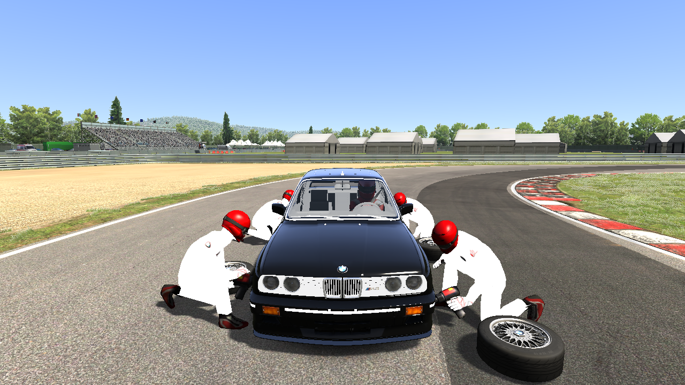
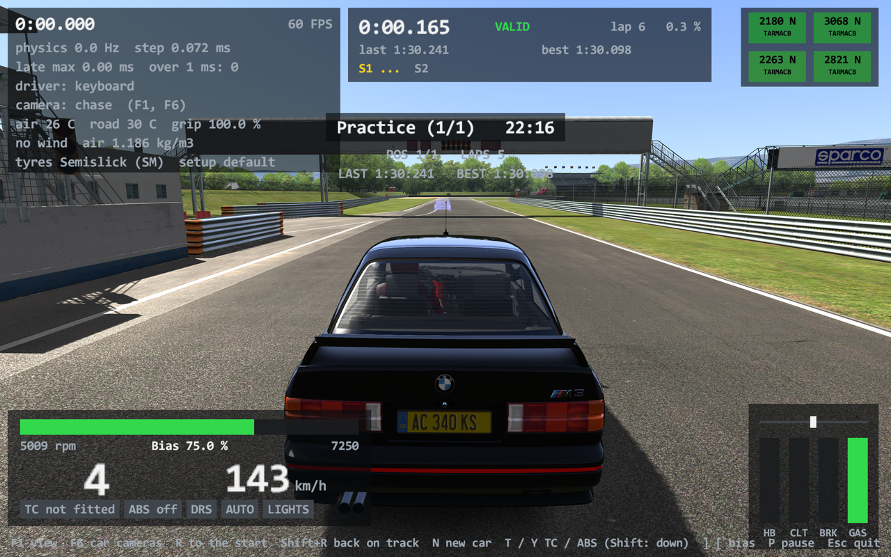
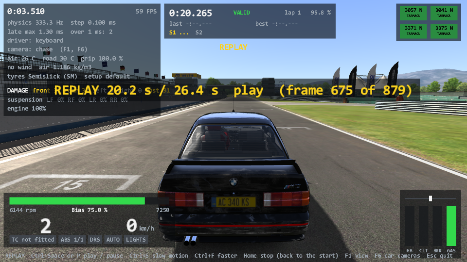

# The pit crew, AC's replays, the ghost car, comparative telemetry (Task 28c)

## Resume here

State at v0.28.2:

- **Done and proven**
  - The four tyre changers and their wheel guns (`PitCrew`): `crates/rustyac-render/src/tyre_crew.rs`,
    `crates/rustyac-audio/src/pit_crew.rs`, wired into rustyac.exe.
  - AC's replays: `crates/rustyac-physics/src/replay/` (`ReplayRecorder`, `ReplayManager`: recording,
    the ring, the file of format 16 and 15, the playback's state machine, `getPhysicsState`), wired into
    rustyac.exe (`crates/rustyac-game/src/ac_replay.rs`, `desktop.rs`): recording, autosave, save, the
    replay of a running session, `--replay <file.acreplay>`.
  - AC's ghost car: `crates/rustyac-physics/src/replay/ghost.rs` (`GhostCarRecorder`: sampling, the
    best-lap rule, the `.ghost` file, the playback), `crates/rustyac-render/src/ghost_car.rs`
    (`GhostCar`: the see-through car), wired into rustyac.exe (`crates/rustyac-game/src/ghost.rs`,
    `desktop.rs`, `render/ac.rs`): race.ini's `[GHOST_CAR]`, `--ghost`.
  - AC's comparative telemetry: `crates/rustyac-physics/src/replay/telemetry.rs`
    (`ComparativeTelemetryRecorder`: the samples, their 3999 slots, the lap rule, the `.tc` file),
    wired into rustyac.exe (`crates/rustyac-game/src/telemetry.rs`, `desktop.rs`). It records and
    saves; rustyAC has no display for it yet.
- **Not done**: the camera's move out of the car during a stop, the replay's GUI and the
  telemetry's display (the UI phase), the telemetry's list of opponents. See "Not done".
- **To check the port again** (all read-only on the game; nothing is written outside this repo):
  - `sh re/scratch/task28c/render_crew.sh`: the crew in the game's renderer and the port's (5
    sequences, about 6 minutes). Needs a copy of the render oracle at
    `re/scratch/task28c/bin/render_oracle_crew.exe`.
  - `tools/audio_oracle/target/release/audio_oracle.exe compare --tape oracle/audio/ks_ferrari_f2004/spa_launch.audiotape --camera chase --frames 700 --crew 20:10 --root re/scratch/task28c/audio_root --out re/scratch/task28c/audio_out`:
    the wheel guns' FMOD calls.
  - `sh re/scratch/task28c/replay.sh a`, `... b`, `... c`: 14 whole sessions with the game's replay
    code recording, saving, loading and playing beside the port's (about 25 minutes). Needs a copy of
    the car oracle at `re/scratch/task28c/bin/car_oracle_replay.exe`.
  - `sh re/scratch/task28c/files.sh`: every file of `Documents\Assetto Corsa\replay` loaded by the
    game's loader and the port's, and played (read only; `bin/car_oracle_file.exe`).
  - `sh re/scratch/task28c/render_replay.sh`: frames and sound of a replay's playback in the game's
    renderer / sound code and the port's.
  - `sh re/scratch/task28c/determinism.sh`: rustyac.exe with 0, 1 and 8 workers, and against the
    v0.28.1 exe (`re/scratch/task28c/tgt_v0281/`, built from the tag).
  - `sh re/scratch/task28c/ghost.sh`: six sessions with the game's ghost recorder beside the
    port's (`bin/car_oracle_ghost.exe`); `sh re/scratch/task28c/render_ghost.sh`: the ghost's
    picture in the game's renderer and the port's (it needs the `.ghost` file the first leaves in
    `re/scratch/task28c/root_g/`).
  - `sh re/scratch/task28c/telemetry.sh`: six sessions with the game's telemetry recorder beside
    the port's (`bin/car_oracle_tel.exe`).
  - `python re/scratch/task28c/tables.py` prints the tables below from the logs.
  - `cargo test --release -p rustyac-physics --test replays`: made-up drives recorded, saved,
    loaded and played, without the game.
- Scratch files: `re/scratch/task28c/`. The four reading briefs there (`rec.md`, `play.md`, `mgr.md`,
  `ghost.md`) say where every field and every float operation of the game's classes is.

## Summary in plain English

**The pit crew.** When you stop in your pit box and asked for new tyres, the screen fades to
black for a quarter of a second, and four mechanics stand at the four wheels. Each walks up,
unscrews the wheel (the wheel gun sounds), carries the old tyre away while a new one comes,
screws it on (the gun again) and steps back. They are the game's own model and animation
(`pitcrewtyre.kn5`, `.ksanim`), in your car's crew colours; the "new tyre" is a copy of your
car's own wheel. Each mechanic is a little slower or faster than the others, by chance, as in
the game. The stop of 28b already said when it begins and ends; the crew listens to that.



**AC's replays.** rustyAC now has the game's replay: while you drive, a compact snapshot of
every car is taken 33 times a second (or what `replay.ini` says) into a ring of fixed size, with
the sun's angle, the leaderboard and the loose objects of the track. In a replay the physics
stands still and every car is rebuilt from two neighbouring snapshots, so the picture, the sound
and the HUD run as they do live. You can play, pause, rewind, fast-forward, go in slow motion,
step a frame, jump a lap, and save. The file is the game's own format (version 16), so:

- a replay saved by rustyAC is, byte for byte, the file the game's own code writes from the same
  drive (proven by running the game's code beside the port);
- rustyAC plays the replays the game recorded: `rustyac.exe --replay <file.acreplay>`. Ten of the
  twelve files in your `Documents\Assetto Corsa\replay` folder load and play exactly as the game's
  own loader plays them; the other two make the game's own loader crash (see "Your AC replays")
  and play in rustyAC without their leaderboard.

rustyAC writes replays into its own `replay` folder (beside rustyac.exe), never into
`Documents\Assetto Corsa`. Its `.ryin` recordings (the inputs of a drive, simulated again) stay
as they are: they are what the proofs run on. A `.acreplay` is a film of the cars; a `.ryin` is
the drive itself.

**The ghost car.** AC's ghost is a see-through copy of your car that drives your best lap again
while you drive, so you see where you gain and lose. The game takes the car's place and its four
wheels about every 129 ms once you have crossed the line; a lap becomes the ghost when it is
valid, has no cut and is strictly faster than the ghost so far. The ghost fades with distance:
right on top of you it is invisible, from 50 m on it is at its full (quarter) strength. rustyAC
does the same, with the same file format (`.ghost`), so a ghost of the game can be played and
the other way round. The file is written when the program ends, into rustyAC's own `GhostCar`
folder, never the game's.



**Comparative telemetry.** The game also keeps, for the lap you are on, your last lap and your
best lap, what gear you were in, how fast you went and how far the two pedals were down at 3999
places round the track, so that an app can draw your lap over your best one. The best lap is
written to a `.tc` file when the game ends and read at the next start. rustyAC now records and
saves the same, in the same file format, into its own `ctelemetry` folder. It has no screen to
show it on yet: that comes with the apps.

**What "proven" means here.** The game's own functions (in `acs.exe`, loaded into a test
program) and the port's were given the same inputs, and everything they produced was compared
bit for bit: 80,190 recorded frames of 14 sessions, 42 saved files, 98,504 rebuilt car states
during playback with every transport function, and the pictures and FMOD calls of replay frames.
Nothing differed.

## What is ported

Addresses are of `acs.exe`.

### The pit crew

| Game | Port |
|---|---|
| `PitCrew::PitCrew` 0x1400a0b80, `CrewMember` 0x1400a0aa0, `loadCrewSkin` 0x1400a30c0 | `tyre_crew::PitCrew::new`, `CrewTimeline::read` |
| `PitCrew::pitCrewUpdate` 0x1400a3f20 | `PitCrew::pit_crew_update` |
| `onPitStopBegin` 0x1400a33e0, `CrewMember::randomizeTimes` 0x1400a4390 | `on_pit_stop_begin` (where each man stands, the mirror for the right-hand wheels, three numbers of `rand()` a man) |
| `updateCurrentPosition` 0x1400a4500 | `update_current_position` (the five states, the animation's position, the car's wheel in the man's hands, the new tyre, the guns) |
| `onPitStopFinished` 0x1400a3b50, `reset` 0x1400a4420 | the same names |
| the handlers 0x1400a2330 (replay), 0x1400a2410 (`evPitStopCommit`), 0x1400a27c0 (`evPitStopOver`), the fade's functor 0x1400a27a0 | `on_replay_status_changed`, `on_pit_stop_commit`, `on_pit_stop_over`, `on_fade_in_finished` |
| `SceneGraphCloner::cloneGraph` 0x140217a40 (`cloneNode` 0x140217a80, `getClonedNode` 0x140217b30; `Node::Node(Node*)` 0x14020d9c0, `Mesh::Mesh(Mesh*)` 0x140225ab0, `SkinnedMesh::SkinnedMesh(SkinnedMesh*)` 0x14022bc50) | `Scene::clone_graph` |
| `Node::visit` 0x14020e610 | `Scene::visit` |
| the two `AudioEvent`s of each man (`event:/common/screw`, `unscrew`) | `rustyac_audio::pit_crew::CrewGuns` |

The stop itself (`rustyac_physics::race::PitStop`) now counts its `evPitStopCommit` and
`evPitStopOver` (`commits`, `overs`, `last_start`, `last_changing_tyres`), so that the picture's
thread misses none. In rustyac.exe the crew is in `render/ac.rs` (`tyre_crew`, `CrewLink`): the
commit starts a fade of 0.25 s, at its black frame the crew begins; the guns' calls go to the
sound after the frame (`GameAudio::crew_*`), with the "is it playing" answers of before the
frame, which are the answers the game's code gets.

### The replays

| Game | Port (`rustyac_physics::replay`) |
|---|---|
| `ReplayRecorder::ReplayRecorder` 0x14015c9e0, `setFrameSize` 0x140162420, `clearFrames` 0x14015d4a0 | `ReplayRecorder::new`, `set_frame_size`, `clear_frames` |
| `ReplayRecorder::recordFrame` 0x1401609d0 (the 272-byte `ReplayFrame`, the 4 bytes of additional info, 4 bytes a wing) | `record_frame` |
| `half_float`'s `float2half` / `half2float` as compiled in (tables 0x1404d0f70, 0x1404d1370, 0x1404ce9d0, 0x1404d09d0, 0x1404d0ad0) | `half::float_to_half`, `half_to_float` |
| `mat44f::toEuler` 0x140053340 and its copies | `to_euler` |
| `mat44f::createFromEulerSafe` 0x140155c30 | `create_from_euler_safe` |
| `ReplayRecorder::getPhysicsState` 0x14015d850 | `get_physics_state` |
| `ReplayRecorder::getWingState` 0x14015ff00, `fetchLapFrames` 0x14015d760 | `get_wing_state`, `fetch_lap_frames` |
| `ReplayRecorder::save` 0x1401622a0, `load` 0x140160220, `convertReplayFormat` 0x14015d4b0 | `save`, `load`, `convert_replay_format` |
| `ReplayManager::ReplayManager` 0x140153130 (`replay.ini`: rate, memory budget, autosave) | `ReplayManager::new`, `size_ring` |
| `onStepCompleted` 0x140158b50, `onLapCompleted` 0x140158a00, the snapshot handlers 0x140154da0 / 0x140154d20 | `on_step_completed`, `on_lap_completed`, `on_lap_leaderboard`, `wants_first_leaderboard` |
| `save` 0x140159d10, `load` 0x140157680 | `save_name`, `save_bytes`, `load` |
| `getReplayFileName` 0x140157260, `getAutoFileName` 0x1401568b0, `clearSaved` 0x1401559f0, the autosave closure 0x1401546d0, `shutdown` 0x14015b1c0, `resetReplay` 0x1401597d0 | `get_replay_file_name`, `get_auto_file_name`, `clear_saved`, `autosave`, `on_new_session`, `reset_replay` |
| `startReplayMode` 0x14015b480, `stopReplayMode` 0x14015b800 | `start_replay_mode`, `stop_replay_mode` (the manager's part) |
| `play` 0x1401591f0, `pause` 0x140159070, `stop` 0x14015b6f0, `rewind` 0x140159b40, `fastForward` 0x140156780, `slowMotion` 0x14015b3b0, `nextFrame` 0x140158900, `nextLap` 0x140158930, `previousLap` 0x1401592a0, `photoMode` 0x140159120, `setNormalizedPosition` 0x14015b0b0, `setCutInPerc` 0x14015af30, `setCutOutPerc` 0x14015aff0 | the same names |
| `updatePlayState` 0x14015b9a0, `updateReplayRecorders` 0x14015bc90, `updateReplayAudio` 0x14015bc00 | `update_play_state`, `update_replay_recorders`, `update_replay_audio` |
| `getLeaderboard` 0x140157040, `getCurrentSunAngle` 0x140156d00, `getNormalizedPosition` 0x140157230, `getNormalizedLapChange` 0x1401570d0, `getLaps` 0x140156d70 | the same names |
| `RaceManager::initReplay` 0x14013e820, `Sim::onReplayModeChanged` 0x14019e0c0, `CarAvatar::onStartReplay` 0x1400d9400 | `rustyac_game::ac_replay` and `desktop.rs` (the session of a file; the physics stands still offline; the cars' states come from their recorders) |

The code has no file, window or sound in it (a file is a vector of bytes; what the game tells
its other parts is a list of events), so it builds for the browser as it is: clippy is clean
for `wasm32-unknown-unknown` and `wasm32-wasip1`. `CarPhysicsState` (the game's 0xb70-byte state)
and the matrix blend `lerp` 0x140108600 moved from the renderer and the multiplayer crate into
`rustyac-physics` (`car_physics_state.rs`, `dxmath.rs`) for the same reason.

The game's quirks are kept, because a file must be read as the game reads it:

- The scene's frames (sun, leaderboard index, loose objects) are saved as they lie in memory,
  neither turned to the ring's start nor cut, while the cars' frames are saved oldest first and
  cut. In a file of a ring that has gone round, the scene is out of step with the cars. (The
  game itself plays such a file that way.)
- A replay entered with no "seconds back" starts with its cursor at the frame count, which is
  the first frame again as soon as it moves (0x14015b562).
- `rewind` and `fastForward` by frames clamp the cursor to 0..1; `setNormalizedPosition(1)` is
  the frame count; the lap jumps are 60 frames past / before the lap's first frame.
- An unrecorded slot's additional info is 0, 255, 0, 0 (the struct's constructor).
- A nation code of more than three letters is read as `AC`.
- The cuts stay as the last replay left them. After you watched a replay of a running session
  and went back to driving, a later save (also the autosave) holds as many frames as were
  recorded when you entered that replay, counted from the oldest frame: `startReplayMode` set
  the cut-out there and nothing resets it.

Three things differ from the game on purpose:

- **Where files go**: `replay/` beside rustyac.exe (or `--replay-dir`), never Documents. The
  save refuses a folder that looks like one of the game's.
- **The extension**: the game's own code adds none (its files get theirs elsewhere); rustyAC
  writes `<name>.acreplay`.
- **What the game leaves undefined**: six bytes of a frame that the game never writes (they hold
  whatever its heap held), the three bytes after a lap's flag (its stack) and three bytes a wing
  are 0 in rustyAC's files.

### The ghost car

| Game | Port |
|---|---|
| `GhostCarRecorder::GhostCarRecorder` 0x140106b90, the new-session handler 0x140107980 | `rustyac_physics::replay::ghost::GhostCarRecorder::new`, `on_new_session` |
| `onStepComplete` 0x1401093f0 (a frame of the body, the four wheels and the four hubs when 129 ms have passed) | `on_step_complete` |
| `onLapCompleted` 0x1401091e0 (the best-lap rule) | `on_lap_completed` |
| `getGhostCarFileName` 0x140107d20, `saveGhostCarRecording` 0x1401097b0, `loadGhostCarRecording` 0x140108c10 | `file_name`, `save_bytes`, `load_bytes` |
| `loadGhostCarRecorderCustomParameters` 0x140108880 (race.ini `LOAD`, `FILE`, `SECONDS_ADVANTAGE`), `RaceManager::initGhostcar` 0x14013a210 (`RECORDING`, `PLAYING`) | `rustyac_game::ghost::GhostRig`, `desktop.rs` `ghost_rig` |
| `shouldDisplayGhostCar` 0x140109ca0, `setCurrentFrame` 0x140109c30, `getBodyMatrix` 0x140107cd0, `getTyreMatrix` 0x140108590, `getSuspensionMatrix` 0x140108520, `lerp` 0x140108600 | `should_display_ghost_car`, `set_current_frame`, `get_body_matrix`, `get_tyre_matrix`, `get_suspension_matrix`, `dxmath::mat44f_lerp` |
| `GhostCar::GhostCar` 0x140104fe0, `loadGhostCarParameters` 0x140105fd0, `init3D` 0x140105520, `assignGhostMaterial` 0x1401053a0 | `rustyac_render::ghost_car::GhostCar::new` |
| `GhostCar::update` 0x140106380, `getGhostCarOpacity` 0x140105480 | `GhostCar::update`, `ghost::ghost_car_opacity` |

Kept as the game has them: frames are 129 to 132 ms apart but played as if exactly 129 ms apart;
the last interval of a ghost lap is never shown; the save always writes version 4; a new session
forgets that an unsaved ghost needs saving; the colour of `ghost_car.ini` is divided by 255 and
then made a unit vector (150,150,255 becomes 0.45, 0.45, 0.77); `MAX_MINUTES_RECORDING`,
`TIME_DIFF_ENABLED` and `PLAYER_NAME_ENABLED` of that file are never read.

Different from the game on purpose: the folder (`GhostCar\<track>\` beside rustyac.exe instead
of `Documents\Assetto Corsa\GhostCar\<track>\`), and the on-screen message "New Ghost Car
best" is a line on the console.

### Comparative telemetry

| Game | Port |
|---|---|
| `ComparativeTelemetryRecorder::ComparativeTelemetryRecorder` 0x1400731b0 | `rustyac_physics::replay::telemetry::ComparativeTelemetryRecorder::new` |
| the closure 0x140073820 on `Car::evOnStepComplete` (a sample of every step into a queue) | `on_step_complete` |
| `update` 0x140076850 (the queue's samples into their slots) | `update` |
| the closure 0x1400736e0 on `Car::evOnLapCompleted` (the tail of the lap, last and best) | `on_lap_completed` |
| `saveBest` 0x140075d50 (the best lap laid out anew at even steps, the file), `loadBest` 0x140074d30 | `file_name`, `save_bytes`, `load_bytes` |

Kept as the game has them: the place on the track in a sample is one physics step old; samples
are dropped while the car's lap count is 0, so the first lap of a race (from the grid) counts as
a lap with nothing recorded in it, and can become the "best"; any finished lap counts, valid or
not; the slots a lap did not reach are filled with the next slot's old content; saving changes
the best lap in memory too (it is laid out anew); gears are the game's raw numbers (0 reverse,
1 neutral, 2 first).

Different from the game on purpose: the folder (`ctelemetry\player\` beside rustyac.exe
instead of `Documents\Assetto Corsa\ctelemetry\player\`); and rustyac.exe files each sample
right after its physics step, where the game files them once a picture (see "Open questions").

## How each part was proven

1. **The crew's picture.** The render oracle (`tools/render_oracle`) builds the game's own
   `PitCrew` with its constructor on the stand-in car, calls the game's `onPitStopBegin` and
   `pitCrewUpdate` every frame, and compares every frame's D3D11 command log line by line and
   the WARP picture byte by byte with the port's (`--set crew=<seconds>@<frame>`, with
   `pitstate`, `session`, `rstatus`). The game's side has `AudioEvent` stubbed (a picture has no
   sound) and `ACCameraManager::setMode` stubbed (the picture's camera is the frame's own).
2. **The wheel guns.** The audio oracle (`--crew <frame>:<seconds>`) lays a `PitCrew` out by hand
   with the game's own `AudioEvent`s on the oracle's engine and runs the game's
   `onPitStopBegin` and `updateCurrentPosition` on it; the port's side is the same `PitCrew`
   code as the picture's with its sound through `CrewGuns`. The two FMOD call logs are compared
   line by line. Both sides seed `rand()` with 28.
3. **Recording.** `car_oracle multi --replay` runs a whole session in the game's own physics
   (the oracle of Tasks 24 to 28b), and after every step calls the game's
   `ReplayManager::onStepCompleted` with the game's own `CarPhysicsState`s
   (`Car::getPhysicsState`), on recorders made by the game's constructor. The port is given the
   same states. At the end every slot of every car's ring (frame, additional info, wings), the
   recorders' counters and lap caches, the scene's frames and the manager's counters are
   compared. Laps and leaderboard snapshots are made up by the harness from the cars' lap
   counts and go through the game's `onLapCompleted` and into its global table.
   The game's `ReplayManager` is laid out by hand as its constructor leaves it (the
   constructor needs the game's GUI): the `replay.ini` arithmetic of the constructor is ported
   from the listing and tested, not run against the game.
4. **The saved file.** The game's `ReplayManager::save` writes the file; the port's bytes are
   compared with it. Three files a session: as an autosave writes it (no cut), after the replay
   was entered, and cut from 25% to 75% (through the game's `setCutInPerc` / `setCutOutPerc`).
   The game's Documents folder in the oracle is `oracle_no_documents` below the scratch root
   (`SHGetFolderPathW` is replaced before any game code runs); the harness checks, before it
   calls `save`, that `Path::getDocumentPath` says so and that the folder is inside this
   repository. Nothing was written to `Documents\Assetto Corsa`: its replay folder has the same
   12 files as before.
   One preparation: the oracle clears the game's ring memory after the game sized it, so that
   the bytes the game never writes are 0 on both sides. The three bytes after each lap's flag
   (the game's stack) are left out of the comparison.
5. **Loading and playback.** The game's `ReplayManager::load` reads the saved file into a
   second manager (`Sim::loadTrack` and `Sim::applyCustomWeather` do nothing, `Sim::addCar`
   makes a stand-in car with the game's own recorder); the port loads the same bytes. The
   recorders and scene frames are compared. Then a script of the transport's functions (play,
   slow motion 4 and 8, fast forward twice, rewind, pause, frame by frame, positions, lap jumps,
   cuts, stop, the frame steps) runs on both with frame times of 1/60, 1/144 and 1/20 s mixed;
   after every `updatePlayState` the manager's state, every car's whole `CarPhysicsState` (as
   the game's `getPhysicsState` left it in the car), the wings, the car node's flag, the dirt
   level and every loose object's matrix are compared bit for bit. The track is the game's real
   one (its ray cast and its AI line) against the port's. Not compared: a surface's sector and
   collision category, which the port's track does not keep, and what follows the end of a
   surface's name in the game's buffer.
6. **Replay frames in the renderer and the sound.** The game's rebuilt states of a playback are
   written as tapes; the render oracle draws them with the replay's status events on both
   sides, the audio oracle plays them.
7. **Your files.** `car_oracle replay-file <file> --track <t>`: the game's loader and the
   port's on the same file, read in place; then playback as in 5. The cars are stand-ins (no
   car's data is read: wings as the file counts them, a tank of 100 l, no limiter file).
7b. **The ghost car.** `car_oracle multi --ghost`: the game's own `GhostCarRecorder` (laid out by
   hand, its handlers hung on the game car's step and lap events) beside the port's, in whole
   sessions of the game's physics: what the code branches on after every step and lap, the
   saved file, the load (and a file of another car refused), then the playback's matrices for
   lap times every 23 ms across the lap and past its end. `render_oracle compare --ghost <file>`:
   the game's own `GhostCar` (constructor and `update`) on a recorder filled from a `.ghost`
   file, beside the port's, over a recorded lap: D3D11 command log and pixels. rustyac.exe: a
   practice with the AI driver recording a ghost, the drive replayed with 0, 1 and 8 workers.
7c. **Comparative telemetry.** `car_oracle multi --telemetry`: the game's own recorder (laid out
   by hand, its queue made by the runtime's own constructor) with the game's two closures hung
   on the game car's step and lap events and the game's `update` run after every sixth step,
   beside the port's with the same car values: the counters after every call, the three laps'
   slots after every lap, the saved file, the load, another driver's file refused.
   rustyac.exe: the drive of 7b replayed with 0, 1 and 8 workers.
8. **Determinism.** rustyac.exe headless: three new sessions run live with the replay
   recording, recorded as `.ryin`, replayed with 0, 1 and 8 workers; state hashes and the saved
   replay files compared. The state dumps of those and of older recordings against the exe
   built from the tag v0.28.1.

## Results

### 1. The crew

| # | Sequence | Frames, calls | Command log | Pixels |
|---|---|---|---|---|
| 1 | Spa, F2004, from the side: a 10 s tyre change, the first frames (the men walk up) | 39; 216,974 calls | IDENTICAL | IDENTICAL |
| 2 | Spa, F2004, from far: a whole stop of 4 s (walk up, unscrew, change, screw, finish), done, 30 frames after | 429; 2,081,153 calls | IDENTICAL | IDENTICAL |
| 3 | Magione, E30, from the front: a stop, a replay entered (the crew goes, the wheels come back) and left | 189; 1,093,670 calls | IDENTICAL | IDENTICAL |
| 4 | Spa, F2004, from the rear with the mirrors: a stop broken off (reset) | 139; 842,815 calls | IDENTICAL | IDENTICAL |
| 5 | Spa, F2004, on board: a stop, then a session in which the crew does not work | 89; 543,609 calls | IDENTICAL | IDENTICAL |

The wheel guns (700 frames, a tyre change of 10 s from frame 20, Spa, F2004): 275,376 lines of
FMOD calls, the game's run twice and the port's: **identical**. Each of the eight events starts
once and stops once.

In rustyac.exe itself (a practice with an AI driver in the player's car, in a window): the stop
is committed, the fade runs, the crew begins (`Starting Pit animation`, the game's own line) and
the program goes on; no picture was taken there (see "Not done": the camera).

### 2. Replays: 14 sessions

Every session ran in the game's own physics with the game's replay code beside the port's. "Ring slots" is what was compared after the recording: every slot of every car's ring (272-byte frame, additional info, wings).

| Session | Cars | Frames recorded (laps) | Recording | The three saved files (bytes) | Playback: car states compared | Loose object matrices | Verdict |
|---|---|---|---|---|---|---|---|
| A race of 3 laps, 6 AI drivers (E30), Magione; the referee (Task 28) | 6 | 11200 (18) | IDENTICAL (95586 ring slots) | 19401274, 19399546, 9724474: IDENTICAL | 10554, 0 differ | 0 | IDENTICAL |
| A race of 4 laps, 4 AI drivers, two pit stops (Task 28b); ring of 5000 frames (it goes round 2.7 times) | 4 | 13500 (15) | IDENTICAL (20000 ring slots) | 5781719, 5780567, 2901719: IDENTICAL | 7036, 0 differ | 0 | IDENTICAL |
| Four cars into the barrier at Spa (damage); 15 ms a frame | 4 | 940 (0) | IDENTICAL (95588 ring slots) | 1214899, 1213683, 643379: IDENTICAL | 7036, 0 differ | 10554 | IDENTICAL |
| An AI race of 6 F2004 at Spa (6 loose objects); 15 ms a frame; ring of 900 frames | 6 | 4000 (0) | IDENTICAL (5400 ring slots) | 1710602, 1708778, 889802: IDENTICAL | 10554, 0 differ | 10554 | IDENTICAL |
| Practice, qualifying and a race of 2 laps, 4 AI drivers; 60 ms a frame; ring of 3000 | 4 | 7500 (8) | IDENTICAL (12000 ring slots) | 3469103, 3467951, 1741103: IDENTICAL | 7036, 0 differ | 0 | IDENTICAL |
| The player's repair stop (a damaged car), 2 cars; 120 ms a frame | 2 | 1050 (0) | IDENTICAL (95588 ring slots) | 609228, 608652, 306252: IDENTICAL | 3518, 0 differ | 0 | IDENTICAL |
| Four different cars at Spa (F2004, E30, a 4WD car, a live-axle car) | 4 | 2500 (0) | IDENTICAL (95588 ring slots) | 3120428, 3119256, 1655428: IDENTICAL | 7036, 0 differ | 10554 | IDENTICAL |
| 12 AI drivers at Spa; ring of 400 frames | 12 | 2000 (0) | IDENTICAL (4800 ring slots) | 1490754, 1487106, 761154: IDENTICAL | 21108, 0 differ | 10554 | IDENTICAL |
| The player's pit stop with a wing change (F2004, 7 wings); 15 ms a frame | 2 | 6000 (0) | IDENTICAL (95588 ring slots) | 3576234, 3575642, 1800234: IDENTICAL | 3518, 0 differ | 0 | IDENTICAL |
| One AI driver at Spa; 90 ms a frame | 1 | 1400 (1) | IDENTICAL (95588 ring slots) | 532173, 531869, 319373: IDENTICAL | 1759, 0 differ | 10554 | IDENTICAL |
| A race with cuts and penalties, 3 cars | 3 | 10000 (6) | IDENTICAL (95586 ring slots) | 8680722, 8679858, 4360722: IDENTICAL | 5277, 0 differ | 0 | IDENTICAL |
| A race with a mandatory pit window, 3 cars; ring of 7000 frames | 3 | 13500 (11) | IDENTICAL (21000 ring slots) | 6077062, 6076198, 3053062: IDENTICAL | 5277, 0 differ | 0 | IDENTICAL |
| A pit stop, three different cars (488 GT3, E30, R8); 15 ms a frame; ring of 1500 | 3 | 6000 (0) | IDENTICAL (4500 ring slots) | 1314327, 1313455, 660327: IDENTICAL | 5277, 0 differ | 0 | IDENTICAL |
| A car into the back of a standing one at Spa (damage); 15 ms a frame | 2 | 600 (0) | IDENTICAL (95588 ring slots) | 410636, 410028, 228236: IDENTICAL | 3518, 0 differ | 10554 | IDENTICAL |

In all: 80190 frames recorded, 98504 car states and 63324 object matrices compared in playback.

The three files of a session are: as an autosave writes it (no cut), after the replay was
entered (cut 0 to the last frame), cut from 25% to 75%. Each was then loaded by the game's
`ReplayManager::load` and by the port's and played: 242 frames for the first and the third, 1275
for the second (play, slow motion 1/4 and 1/8, fast forward x2 and x3, rewind x2 and x3, pause,
frame by frame, positions, lap jumps, the cuts moved, stop), with every car's whole state and
every loose object's matrix compared after each frame.

### 3. Replay frames in the renderer and the sound

| # | What | Frames, calls | Command log (game against port) | Pixels |
|---|---|---|---|---|
| 1 | spa, three F2004 of an AI race, a replay's playback from far: the replay entered, playing, slow motion from frame 90 | 119; 1,158,361 calls | IDENTICAL in all 119 frames | IDENTICAL in all 119 frames |
| 2 | spa, the same playback, chase camera on car 1: fast forward (frames 190 to 270 of the playback), then rewind | 129; 1,172,132 calls | IDENTICAL in all 129 frames | IDENTICAL in all 129 frames |
| 3 | magione, E30 in the pit lane (the pit stop session), on board: paused, frame by frame, then play | 79; 423,736 calls | IDENTICAL in all 79 frames | IDENTICAL in all 79 frames |

The sound of the same playback (the FMOD call logs of the game's sound code, twice, and the port's):

| What | Frames | Lines of FMOD calls | The game twice | Game against port | Verdict |
|---|---|---|---|---|---|
| spa, F2004, 500 frames of the playback (play, slow motion, fast forward, rewind), chase camera | 500 | 110,701 | identical | identical | ok |
| spa, three F2004, 300 frames of the playback, trackside camera | 300 | 237,950 | identical | identical | ok (2 run(s) repeated: FMOD crashed) |

### 4. rustyac.exe: 0, 1 and 8 workers, and against v0.28.1

Three new sessions, headless, an AI driver in the player's car, with the replay recording: a practice of 30 minutes in which the driver pits twice (E30, Magione, 3 cars), a race of 4 laps with a pit window (the same cars), a race of one lap of 6 F2004 at Spa. Each was run live, recorded as `.ryin`, and replayed with 0, 1 and 8 workers; every run saved its replay.

| Session | State hash with 0, 1, 8 workers | The replay file: live run and the three replays | State dump: v0.28.1, this version with the replay off, with it on |
|---|---|---|---|
| Practice, two pit stops | `889a180a3ae928bf` three times | four identical files (10441924 bytes, 18000 frames) | the same three times (`a21587be85a4a9ba`) |
| Race with a pit window | `bebb73dd826046ac` three times | four identical files (9923220 bytes, 17108 frames) | the same three times (`09953746b56c9a6d`) |
| Race at Spa, 6 cars | `b4c7538a6fa7289c` three times | four identical files (14880480 bytes, 9323 frames) | the same three times (`4238c5617a2e49ce`) |

The exe with the ghost car and the telemetry in it (the last commits) gives the same three state dumps again, and the same dumps as v0.28.1 on five older recordings.

Older recordings (every fifth of `oracle/game/*.ryin` and four of Tasks 28 and 28b) replayed by the v0.28.1 exe and by this one: 36 of 36 state dumps the same.

The live run and the replays of its `.ryin` give the same replay file: a `.ryin` replay of a session with the replay recording is exact, and the recording does not depend on the number of workers.

### 5. Your files

See "Your AC replays" below: 10 of 12 files load in the game's loader and the port's and play the same (57,512 car states and 26,208 object matrices compared in all); 2 crash the game's own loader.

### 5b. The ghost car

The recorder, in the game's physics with the game's recorder beside the port's:

| Session | Steps compared | Laps, new ghosts | The `.ghost` file (game = port) | Playback matrices | Verdict |
|---|---|---|---|---|---|
| Race, Magione, 3 E30 | 112,000 | 3 laps, 2 ghosts (1:30.636, 702 frames) | 404,413 bytes | 36,135 | IDENTICAL |
| Race with pit stops, Magione, 4 E30 | 135,000 | 3 laps, 3 ghosts (1:30.878, 704 frames) | 405,565 bytes | 36,243 | IDENTICAL |
| Race with cut laps, Magione | 100,000 | no lap kept, no ghost, no file (on both sides) | none | none | IDENTICAL |
| Practice, qualifying and race, Magione, 4 E30 | 150,000 | 2 laps, 2 ghosts (1:30.177, 699 frames) | 402,685 bytes | 35,982 | IDENTICAL |
| Spa, F2004 alone | 84,000 | 2 laps, 2 ghosts (1:46.775, 828 frames) | 476,991 bytes | 42,633 | IDENTICAL |
| Timed race, Magione, F2004 and 3 E30 | 112,000 | 1 lap, 1 ghost (1:12.722, 555 frames) | 319,747 bytes | 28,557 | IDENTICAL |

In all: 693,000 steps, 5 files byte for byte, 179,550 playback matrices, 0 different.

The picture (Magione, E30, the ghost of the first session over a recorded lap):

| # | Sequence | Frames, calls | Command log | Pixels |
|---|---|---|---|---|
| 1 | the ghost ahead in a slow corner, chase camera | 119; 756,644 calls | IDENTICAL | IDENTICAL |
| 2 | the ghost ahead, cockpit camera | 119; 661,505 calls | IDENTICAL | IDENTICAL |
| 3 | the ghost beside the car and falling behind, chase camera | 119; 711,644 calls | IDENTICAL | IDENTICAL |
| 4 | the ghost's lap runs out and the ghost goes | 119; 661,764 calls | IDENTICAL | IDENTICAL |

rustyac.exe (a practice at Magione, the AI driver in the E30, 152,286 steps): two laps became
the ghost (1:42.070, then 1:30.123, 698 frames, a file of 402,103 bytes). The drive replayed with
0, 1 and 8 workers wrote the same file each time (4 files, one hash), and the state hash
(`3df829ac56993ead`) is the same with the ghost and without it. A second start with `--ghost
play` loaded the file and showed the ghost (the picture above).

### 6. Comparative telemetry

| Session | Samples (dropped on the lap out) | Laps, new bests | The `.tc` file (game = port) | Load | Verdict |
|---|---|---|---|---|---|
| Race, Magione, 3 E30 | 112,000 (34,104) | 3 laps, 2 bests (1:30.636) | 80,041 bytes | the same, another driver's refused | IDENTICAL |
| Race with pit stops, Magione, 4 E30 | 135,000 (43,644) | 3 laps, 3 bests (1:30.878) | 80,041 bytes | the same | IDENTICAL |
| Race with cut laps, Magione | 100,000 (99,996) | no lap, no file (on both sides) | none | none | IDENTICAL |
| Practice, qualifying and race, Magione, 4 E30 | 150,000 (78,198) | 2 laps, 2 bests (1:30.177) | 80,041 bytes | the same | IDENTICAL |
| Spa, F2004 alone | 84,000 (37,188) | 2 laps, 2 bests (1:46.775) | 80,043 bytes | the same | IDENTICAL |
| Timed race, Magione, F2004 and 3 E30 | 112,000 (26,100) | 1 lap, 1 best (1:12.722; the race's first lap: nothing recorded in it, on both sides) | 80,047 bytes | the same | IDENTICAL |

In all: 693,000 samples, the 3 x 3999 slots compared after each of 11 laps and at the end, 5
files byte for byte. rustyac.exe: the drive of section 5 replayed with 0, 1 and 8 workers
wrote the same `.tc` file three times (80,031 bytes, best 1:30.123).

Your own telemetry files: the 14 `.tc` files the game wrote into
`Documents\Assetto Corsa\ctelemetry\player` were read where they are (read only) and have
exactly the layout the port reads and writes: version 1, the four names in the order driver,
track, car, layout, the best time, 3999 slots of 20 bytes, nothing after them. Thirteen of them
are named `_<track>_<layout>_.tc`, with the driver's and the car's name missing from the file's
name (they are inside the file); one has the full name. The game builds the name from the car's
avatar when it shuts down, and in your installation that avatar's names are mostly empty by
then; rustyAC always writes the full name. They were not loaded through the port's code or
compared with the game's loader.

### 7. Tests and builds

- `cargo test --release --workspace --locked`: 286 passed, 0 failed (6 new in `tests/replays.rs`:
  made-up drives recorded, saved, loaded and played, the ghost's and the telemetry's recorders;
  2 new unit tests of the 16-bit floats).
- `cargo clippy --workspace --all-targets --locked -- -D warnings`: clean; the same for
  `wasm32-unknown-unknown` (`rustyac-web`) and `wasm32-wasip1` (math, ode, content, physics, game).
- The three oracles build (`tools/car_oracle`, `render_oracle`, `audio_oracle`).

## How to watch a replay

**A replay of the session you are driving.** While driving, press the command key and `R`
(the command key is `Right Ctrl` or `Alt`, as for the other commands; `controls.ini`'s
`[START_REPLAY]`). The driving stands still and the replay of the session so far plays from its
start. The same key goes back to the driving.

**A file.** `rustyac.exe --replay <file.acreplay>`: the file names its track and cars; they are
loaded and the replay plays. It may be one of rustyAC's own or one the game recorded, from any
folder, for example:

```
rustyac.exe --replay "%USERPROFILE%\Documents\Assetto Corsa\replay\temp\<name>.acreplay"
```

(the file is only read). A `.ryin` file after `--replay` is rustyAC's own recording, as before.

**Keys in a replay** (the commands of AC's `controls.ini`, with the command key):

| Key | Does |
|---|---|
| command + `Space`, or `P` | play / pause |
| command + `F` | faster forward (each press one step more) |
| command + `D` | backwards (each press one step faster) |
| command + `S` | slow motion (half speed), again: normal speed |
| `.` (full stop) | one frame on |
| command + `N` / `Page Up` | the next lap of the car in view |
| command + `P` / `Page Down` | the lap before |
| `Home` | stop: back to the start |
| `F10` | save |
| command + number pad `3` / `1` / `2`, `F4` | the next car / the car before / your car |
| `F1`, `F6` | the views, the car's own cameras |
| command + `R` | back to the driving (not in a replay loaded from a file) |

A line of text in the middle of the screen says where the replay is and what it does:
`REPLAY 20.2 s / 26.4 s  play  (frame 675 of 879)`.



**Where files are saved.** Into `replay\` beside rustyac.exe (`--replay-dir <folder>` for another
place); never into `Documents\Assetto Corsa`.

- `F10` saves `replay\AC_<day><month><year>-<hour><minute><second>_M_<car>_<track>_<layout>.acreplay`.
- With `[AUTOSAVE] ENABLED=1` in `replay.ini`, a new session saves the last one's replay into
  `replay\temp\` under the game's names (`..._R_...` race, `_Q_` qualifying, `_O_` others), keeps
  as many of each kind as the ini says, and starts recording again; so does leaving the program.
  With autosave off, leaving the program writes `replay\cr.acreplay` (the game's "current
  replay").
- `replay.ini` is read from `Documents\Assetto Corsa\cfg` (read only), else from the game's
  `cfg` folder: `[QUALITY] LEVEL` (0 to 4: 8, 11, 17, 33, 67 frames a second), `[REPLAY]
  MAX_SIZE_MB` (10 to 1000; the ring holds that many megabytes for all cars together),
  `[AUTOSAVE]`. Without the file (or with `--no-race-ini`): 33 frames a second, 10 minutes.

Options: `--save-replay <file>` writes the session's replay to a file when the run ends (also
`--headless`, also while a `.ryin` is replayed); `--no-ac-replay` records none; `--replay-script
replay@5,ffwd@6,rewind@8,slow@10,frame@11,pause@12,nextlap@13,prevlap@14,stop@15,save@16,exit@17`
presses the keys by the clock (for checks).

What a replay shows of a car is what the game's replay shows: the body, the suspension and the
wheels, the engine speed, the pedals and the steering, the gear, the lights, DRS and horn, the
damage zones, the tyres' dirt, the fuel, the lap times, the wings. What a frame does not hold is
not there in a replay (tyre temperatures, the forces on the tyres): the game's apps show their
resting values then, and so does rustyAC's HUD.

## How to use the ghost car

- `rustyac.exe --car <car> --track <track> --ghost both`: your best valid lap of the run is kept
  and written to `GhostCar\<track>\GHOST_CAR_<driver>_<car>[_<layout>].ghost` beside rustyac.exe
  when the program ends; at the next start it is loaded and drives with you from the moment you
  cross the line. `--ghost record` only keeps and writes, `--ghost play` only loads and shows,
  `--ghost off` neither.
- Without `--ghost`, race.ini's `[GHOST_CAR]` section decides, as in the game (`RECORDING`,
  `PLAYING`, `LOAD`, `FILE`, `SECONDS_ADVANTAGE`); with `--no-race-ini` there is no ghost.
- `--ghost-file <file>` plays a given file, for instance one of the game's from
  `Documents\Assetto Corsa\GhostCar\<track>\` (read only). It must be of the same car, track
  and layout, as in the game; otherwise the folder's own file is tried.
- `--ghost-advantage <seconds>` puts the ghost that far ahead; `--ghost-dir <folder>` moves the
  folder.
- As in the game: the player's car only, never on a server, hidden in a replay; a lap with a
  cut never becomes the ghost.

## Comparative telemetry in rustyac.exe

In a window, offline, rustyac.exe records it without being asked, as the game does, and writes
`ctelemetry\player\<driver>_<track>_<layout>_<car>.tc` beside rustyac.exe when the program
ends, if a lap was faster than the file's. `--telemetry-dir <folder>` moves the folder (and
turns the recording on in a headless run), `--no-telemetry` turns it off. Nothing shows it yet.

## Your AC replays

All twelve files of `Documents\Assetto Corsa\replay\temp` were read where they are (nothing was
copied or changed; the folder holds the same 12 files). All are format version 16; none is
version 15. Each has a block of Custom Shaders Patch after the game's own data, which neither
the game's loader nor the port reads.

| File (the day and time of its name) | Session | What it holds | The game's loader and the port's | Verdict |
|---|---|---|---|---|
| 061026-124707 | R | version 16, 29760965 bytes, 24 cars (lotus_exos_125_s1), 3982 frames, 12 loose objects, spa | loaded by both; playback 728 frames: 17472 car states and 8736 object matrices compared, 0 and 0 differ | IDENTICAL |
| 061026-173950 | R | | FAILED: the game's code crashed: exception 0xc0000005 at 0x7ff7098385bb | the game's own loader crashes |
| 061026-174127 | Q | version 16, 24198923 bytes, 24 cars (ks_ferrari_f2004, ks_ferrari_sf70h), 3218 frames, 12 loose objects, spa | loaded by both; playback 728 frames: 17472 car states and 8736 object matrices compared, 0 and 0 differ | IDENTICAL |
| 061026-175153 | Q | | FAILED: the game's code crashed: exception 0xc0000005 at 0x7ff7098385bb | the game's own loader crashes |
| 061026-180726 | R | version 16, 30160228 bytes, 24 cars (ks_ferrari_f2004, ks_ferrari_sf70h), 3982 frames, 12 loose objects, spa | loaded by both; playback 728 frames: 17472 car states and 8736 object matrices compared, 0 and 0 differ | IDENTICAL |
| 121026-192202 | O | version 16, 894893 bytes, 1 cars (rss_formula_hybrid_2020), 2479 frames, 0 loose objects, monaco_2017 | loaded by both; playback 728 frames: 728 car states and 0 object matrices compared, 0 and 0 differ | IDENTICAL |
| 121026-192904 | O | version 16, 5418878 bytes, 1 cars (rss_formula_hybrid_2020), 14040 frames, 0 loose objects, monaco_2017 | loaded by both; playback 728 frames: 728 car states and 0 object matrices compared, 0 and 0 differ | IDENTICAL |
| 121026-193517 | O | version 16, 4754102 bytes, 1 cars (rss_formula_hybrid_2020), 12395 frames, 0 loose objects, monaco_2017 | loaded by both; playback 728 frames: 728 car states and 0 object matrices compared, 0 and 0 differ | IDENTICAL |
| 121026-193639 | O | version 16, 1095703 bytes, 1 cars (rss_formula_hybrid_2020), 2695 frames, 0 loose objects, monaco_2017 | loaded by both; playback 728 frames: 728 car states and 0 object matrices compared, 0 and 0 differ | IDENTICAL |
| 121026-193837 | O | version 16, 1556365 bytes, 1 cars (rss_formula_hybrid_2020), 3885 frames, 0 loose objects, monaco_2017 | loaded by both; playback 728 frames: 728 car states and 0 object matrices compared, 0 and 0 differ | IDENTICAL |
| 121026-194032 | O | version 16, 1493222 bytes, 1 cars (rss_formula_hybrid_2020), 3802 frames, 0 loose objects, monaco_2017 | loaded by both; playback 728 frames: 728 car states and 0 object matrices compared, 0 and 0 differ | IDENTICAL |
| 121026-195113 | O | version 16, 3669601 bytes, 1 cars (rss_formula_hybrid_2020), 9437 frames, 0 loose objects, monaco_2017 | loaded by both; playback 728 frames: 728 car states and 0 object matrices compared, 0 and 0 differ | IDENTICAL |

Two files make the game's own loader crash. Their leaderboard table at the end holds snapshots
with fewer entries than the file has cars; the game's `save` writes each snapshot as long as it
is, the game's `load` reads as many entries as there are cars, runs out of step, takes the next
bytes for a car number and asks the session for that car (a null pointer). The port sees a car
number outside the file's cars, leaves the leaderboard snapshots out and plays the file (checked
with the port alone: loaded, 1500 frames played). The Custom Shaders Patch in your game plays
them; plain `acs.exe` would not.

One of the Spa files (24 cars, qualifying) was also opened in rustyac.exe itself:
`re/scratch/task28c/exe/real_spa.png` (not in the repository). The loose objects of a file are
only moved when the file counts as many as rustyAC finds on the track; your Spa files count 12
(written with the patch), rustyAC's Spa has 6, so they stay where they are.

## Not done

- **Of comparative telemetry**: its display (the game's app that draws the laps: the UI
  phase) and the list of other drivers' laps (`getCTOpponents` 0x1400741a0, `loadCTOpponent`
  0x140075730: read out in `re/scratch/task28c/ghost.md` B7, not ported; they only feed that
  app). The game's constructor and its `RaceManager::getLapCount` were stood in for by hand in
  the oracle (the car's own lap count).
- **Of the ghost car**: the on-screen message and the time difference / driver name the game's
  apps show beside it (the UI phase); a ghost file of the game itself (none exists on this PC,
  the `GhostCar` folder of `Documents\Assetto Corsa` is not there), so version 3 files are
  ported from the listing only; the frames rustyac.exe records were not compared with the
  game's for the same drive (the recorder was, with the game's car; rustyac.exe hands it the
  same car state the picture gets).
- **The camera's move out of the car during a pit stop.** The game does it in the crew's code:
  `ACCameraManager::setMode(eOnBoardFree)`, `CameraOnBoardFree::forceThetaPhi(0.1, 0.1, 5)` and
  `lockCamera`, and back to the old view at the stop's end. rustyAC has no free on-board camera
  (`CameraOnBoardFree` 0x140115100 is not ported). The crew's code asks for it through
  `CrewHost` (`set_camera_mode`, `force_theta_phi`, `lock_camera`), rustyac.exe collects the
  requests (`CrewLink::camera`) and drops them: the view stays where it is. To see the crew,
  use the chase view.
- **The replay's GUI** (`ReplayInterface`: the bar with its slider, the cut markers, the save
  box, photo mode): the UI phase. The cuts (`setCutInPerc` / `setCutOutPerc`) and photo mode are
  ported and proven but have no key.
- **The replay's own cameras.** The game switches to the track cameras when a replay starts
  (`ACCameraManager::setMode(eTrack)`); rustyAC has no track cameras yet, the view stays the
  driving view.
- **The body's dirt in rustyAC's own recordings.** The game's recorder reads the car's dirt
  from the picture (`DynamicCarEffects`), at the picture's pace. rustyac.exe records 0 there, so
  that a recording does not depend on the frame rate; a file of the game plays with its recorded
  dirt in the oracle's proof, but rustyac.exe does not yet hand the played dirt to its picture.
  Also not recorded by rustyac.exe: the bodywork's sound level (it is the sound's own value) and
  the driver's button flags other than the lights and DRS.
- **The game's `ReplayManager` constructor against the game.** It needs the GUI; its
  `replay.ini` arithmetic is ported from the listing and tested with the numbers of your files
  (26 MB and 24 cars give 3982 frames, which is what your Spa files hold).
- **Version 15 files against the game.** None exists on this PC. `convertReplayFormat` is
  ported from the listing and tested on a made-up frame only.
- **Online.** The game keeps its physics running during a replay online, and goes on
  recording into the ring it plays from. rustyac.exe keeps the physics running too but does not
  record while a replay shows; no live server run was made with a replay.
- **The browser.** The replay code builds for it; the browser preview has no replay keys yet.

## Open questions

1. **`--replay` now takes both kinds of file.** A file that starts with a small number (the
   format's version) is one of AC's replays; anything else is a `.ryin` recording, as before.
   Chosen so that one option does both.
2. **rustyAC adds the extension `.acreplay`.** The game's code adds none; the files in your
   folder have it. Without it rustyAC's files would not be recognised by the launchers.
3. **`F10` saves under the autosave's name with the letter `M`** ("by hand"). The game asks for a
   name in its GUI; there is none yet.
4. **Recording is on in the window, off in `--headless`** unless `--save-replay` asks for it.
   The headless runs are the proofs; they should not write `replay\cr.acreplay` each time.
5. **Autosave follows `replay.ini` as the game does**, including the file `cr` at exit when
   autosave is off. If you would rather have no file at exit, say so: it is one line.
6. **Undefined bytes are written as 0.** The game writes whatever its memory held there. A
   reader cannot tell, and files are the same from run to run this way.
7. **A leaderboard table out of step is left out** instead of crashing as the game's loader
   does (two of your files).
8. **The lap list and leaderboard snapshots in rustyAC's own recordings** come from each car's
   lap counter (a snapshot holds every car's best lap and lap count); the game takes them from
   its `RaceManager::getLeaderboard`. They are in the file in the game's layout; their content
   is plainer than the game's (no total times).
9. **The recorded sun angle** is the session's fixed angle (-16 when none is given); the game
   records its lighting's angle, which moves with the time of day.
10. **In a replay the game's quirk of the first frame is kept** (`getNormalizedPosition` is 1 at
    the very start). The status line shows it as frame 0.
11. **Ghost cars live in `GhostCar\` beside rustyac.exe**, not in `Documents\Assetto Corsa`
    (rule: never write there). To share ghosts with the game, copy the files by hand or use
    `--ghost-file` / `--ghost-dir`.
12. **`--ghost play` and `--ghost both` set `LOAD=1`.** In the game a ghost of an earlier run is
    only loaded when the launcher writes `LOAD=1`; an option that shows nothing would be odd.
13. **The ghost's driver name** is the player's name of race.ini (`[CAR_0] DRIVER_NAME`), else
    `Player`. It is part of the file's name, as in the game.
14. **A `.ryin` recording played again has a ghost only with `--ghost`**: it must not depend on
    race.ini.
15. **Telemetry samples are filed after every physics step**, not once a picture as in the
    game. In the game the result depends a little on the frame rate (a sample that waits across
    the finish line lands in the new lap); in rustyAC the same drive always gives the same file.
    The game's own behaviour at one fixed pace (every sixth step) is what the oracle proves.
16. **Telemetry is recorded by default in a window, not in headless runs** (they are the
    proofs) unless `--telemetry-dir` is given. The file is small (80 kB) and only written when
    a lap was the best.
17. **The telemetry file's name.** rustyAC writes `<driver>_<track>_<layout>_<car>.tc`, as the
    game's code does when the car's names are there (the oracle's run). Most of your own files
    are named `_<track>_<layout>_.tc` (see the results). To make rustyAC read a file of the game,
    copy it into `ctelemetry\player\` under the full name; the driver's name inside the file
    must be the session's.
