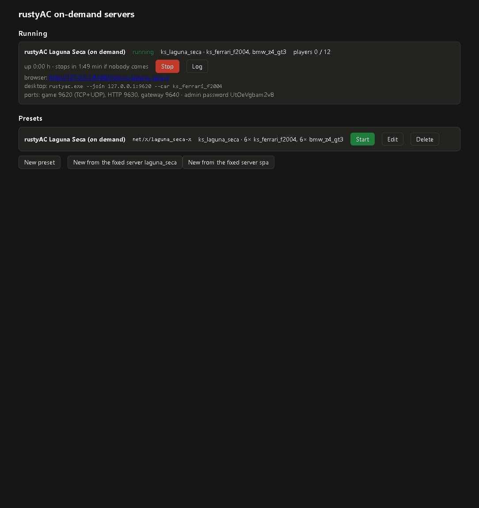
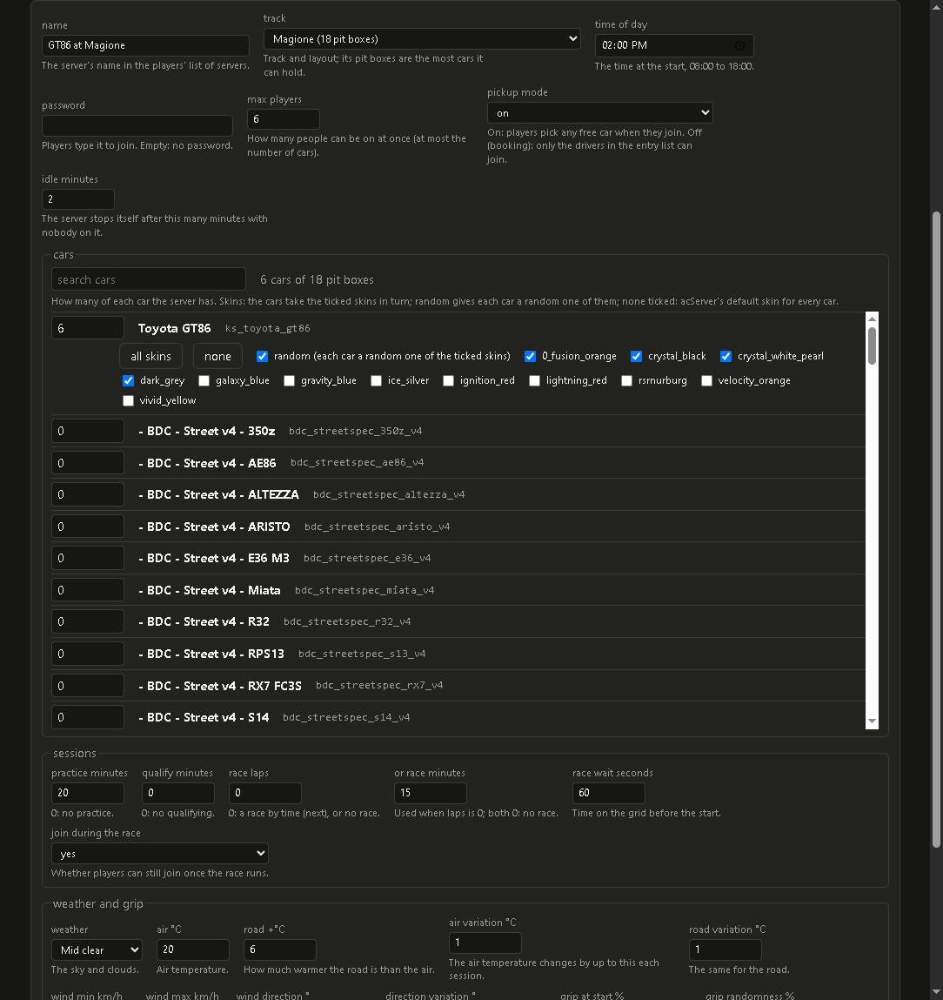
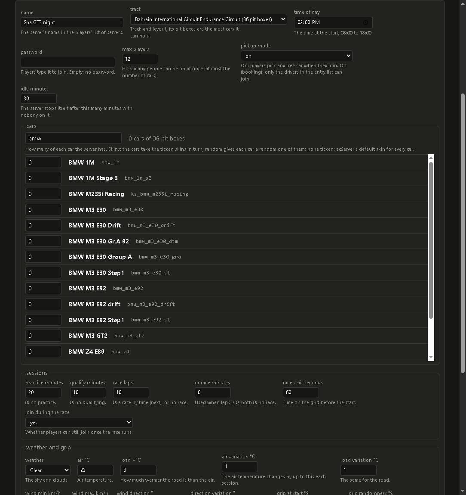

# Task 38e: the private server panel (v0.38.4)

## Resume here

- Task 38g (v0.38.6, the last part of this file) is done: the pack with every car and layout
  (`make_server_pack.py --all`), the new preset form, the Access-proof fetches, the favicon,
  the online page's re-read list. Its end-to-end run, proofs and builds are below.
- Not done: the panel was never run against a real Docker daemon or Cloudflare (by the
  rules); the image tags `node:24.11.1-alpine` and `tecnativa/docker-socket-proxy:0.3.0`
  were not checked online; the Cloudflare Web Analytics switch is described, not tried.
- Task 38e (v0.38.4) below: the panel itself.

## What the panel is

`server/panel/` is one Node process (TypeScript run as it is: Node strips the types; no
runtime packages) with two listeners on `GATEWAY_BIND`:

- **the panel** (`PANEL_PORT`, 9680): a private page behind Cloudflare Access. Every request
  (the page too) needs a valid `Cf-Access-Jwt-Assertion` token: RS256, signed by one of the
  team's keys (`https://<team domain>/cdn-cgi/access/certs`), the application's AUD, the
  team's issuer, not expired. Anything else gets 403.
- **the router** (`PANEL_ROUTER_PORT`, 9681): public, behind the one tunnel route
  `rustyac.com/net/x/*`. `GET /net/x/servers.json` lists the on-demand servers that run;
  a WebSocket on `/net/x/<id>` is carried to that server's gateway. Every other path is 404.

A preset (a JSON file in `<PANEL_DATA_DIR>/presets/`) holds a server's choices: track and
layout, cars with counts and skins, practice / qualify / race, time of day, weather, grip,
password, max players, pickup mode, idle minutes, and the other `server_cfg.ini` keys. The
page sends it; `checkPreset` checks each field against the pack (only cars with a
`data.acd`, only tracks with a `data/surfaces.ini`) and against what an ini line can hold,
before anything is written. "New from the fixed server X" makes a preset from the pack's
`cfg/<X>/` files.

Start writes `server_cfg.ini` and `entry_list.ini` into `<PANEL_DATA_DIR>/run/<id>/`, then
creates and starts two containers from the kit's own images: `rustyac-x-<id>-acserver`
(the pack read-only at `/pack`, the run folder at `/cfg`, `AC_CFG=/cfg`; game port TCP+UDP
and the HTTP port published on every address, for desktops on the LAN / tailnet) and
`rustyac-x-<id>-gateway` (in the acServer container's network, so the server is
`127.0.0.1:<game port>` to it; its port 9601 published on `GATEWAY_BIND` only). Ports come
from three pools in `.env`, never the fixed servers' ports nor 8081 / 8082. Stop stops and
removes both. The admin password is new for each start (shown on the panel); the join
password goes in by `AC_PASSWORD`, as for the fixed servers.

Every `PANEL_POLL_SECONDS` (30) the panel asks each server's HTTP port (`/JSON|`) who is
connected; a server nobody was on for its preset's idle minutes (30) is stopped.

Docker is reached only through `tecnativa/docker-socket-proxy` with `CONTAINERS=1 POST=1`
on an internal network.

## Changes outside the panel

- `server/entrypoint.sh`: `AC_CFG`, the folder with `server_cfg.ini` and `entry_list.ini`
  (default `$AC_PACK/cfg/$AC_SERVER`, as before).
- `server/docker-compose.yml`: services `panel` and `docker-proxy`, profile `panel` (a plain
  `docker compose up -d` starts what it started before).
- `server/.env.example` (new), `.gitignore` gets `server/.env`.
- `LICENSING.md`: the panel and its npm packages and images.

## End to end on 127.0.0.1 (`re/scratch/task38e/e2e.sh`)

The panel (`node server/panel/src/main.ts`) against a Docker API stand-in that runs the
acServer copy from the AC folder's `server\` (in `re/scratch/task38e/acserver/`) and the
repo's `rustyac-gateway` as local processes, behind an Access stand-in that signs tokens
with a test key and serves its public key the way `/cdn-cgi/access/certs` does. The page is
v0.38.3's site with this task's `app.js`; a headless Chrome (`web/check.mjs`) joins.

| Check | Result |
|---|---|
| panel without a token / with a made-up token | 403 / 403 |
| panel through the Access stand-in | 200 |
| a form post (not JSON) | 403 |
| "New from the fixed server laguna_seca", idle minutes set to 2 | saved |
| a preset with a car not in the pack | refused: `car ks_mazda_mx5_cup: not in the pack` |
| start: `server_cfg.ini` vs the pack's `cfg/laguna_seca/` | only NAME and the three ports differ (pool ports 9620 / 9620 / 9630) |
| start: `entry_list.ini` vs the pack's | 0 lines differ (comments aside) |
| router `GET /net/x/servers.json` | the started server, players 0 / 12, no password, no admin password |
| router WebSocket to an unknown server / to `/net/spa` | 404 / 404 |
| the page with `?join=x-laguna_seca-x` | joined through the router, Practice, driving at 244 km/h |
| the panel's player list while the page drove | `panel38e`, idle countdown held at the full 2 min |
| the idle stop (idle minutes 2, poll every 5 s) | stopped and removed both containers 200 s after the start, about 2 min after the page left (last seen with the player ~80 s after the start); the router list empty, the run folder removed |
| the stand-in's calls for that stop | `stop` + `DELETE` of the gateway, then of the acServer; nothing else |

Screenshots: `server_panel.jpg` (43 KB, the panel with the started server; the admin
password is the run's random one) and `server_panel_join.jpg` (149 KB, the page driving on it
through the router).

## Proofs, clippy, builds

`git diff --stat v0.38.3 -- crates` is empty: no Rust crate changed in this task (only
`server/`, `web/app.js`, docs, `LICENSING.md`, `.gitignore`). So, as decided for this task,
only the areas the change can reach ran:

- **net**: the multiplayer goldens four ways (the gateway and client code the panel's
  servers use; the gateway is unchanged, the area checks it still answers the same);
- **browser**: every drive desktop against wasm32-wasip1 (the page's simulation);
- **ai_page**: the Quick Race in the page (the page itself runs `web/app.js`, which changed).

The full run was started first and stopped by request after its first area (physics: 113
cases, 113 identical, 0 different, 35m11s). The other areas (fresh, sound, render, gui,
replays, shaders, launcher, dumps) were not run: they exercise crates, the desktop game and
the launcher, none of which changed; the physics dumps were not regenerated for the same
reason.

| area | cases | identical | different | time |
|---|---|---|---|---|
| physics (the stopped full run) | 113 | 113 | 0 | 35m11s |
| net | 80 | 80 | 0 | 17m46s |
| browser | 223 | 223 | 0 | 50m23s |
| ai_page | 3 | 3 | 0 | 6m44s |

Clippy `-D warnings` (re/scratch/task38e/checks.sh, CI's lists and the Task 38 extras): the
workspace with `--all-targets`; rustyac-web + rustyac-net `--lib` on wasm32-unknown-unknown;
math / ode / content / physics / net / game on wasm32-wasip1; rustyac-render `--features
wgpu --all-targets`; rustyac-web + rustyac-dxbc `--all-targets` on wasm32-unknown-unknown:
all clean. `cargo build --release --locked` and every `tools/*` manifest with `--locked`:
pass. Panel: `npx tsc --noEmit` clean, `npm test` 8 of 8.

# Task 38g: every car and track, a clearer form, Access fixes (v0.38.6)

## The pack: `make_server_pack.py --all`

The 38e pack held only the fixed servers' content (2 tracks, 2 cars), so the panel could
offer nothing else. Now:

- `--all`: every installed car and track layout, kept only when **both** acServer and
  rustyAC can run it. acServer needs a car's `data.acd` (it checks the players' cars
  against it), so a car without one (a DLC that is not owned) is left out. rustyAC's
  verdict comes from the browser pack's own check (`tools/web_pack --dry-run`, the same
  reasons as the browser pack: CSP-encrypted or COSMIC-suspension cars, CSP-only layouts).
  `--no-check` skips that check.
- `--car X` / `--track t[/layout]` add single ones to the pack that is there.
- Per car only `data.acd`; per layout `data/surfaces.ini`, `data/drs_zones.ini` (when there)
  and `models[_layout].ini` (acServer globs `models*.ini`). No AI files: acServer's strings
  read none. Per weather `content/weather/<id>/weather.ini` (for the weather list).
- `index.json`: each car's UI name and skin folders, each layout's UI name and pit boxes,
  each weather's id and readable name, and what was left out and why. The panel reads it
  (a pack without it still works: names are the ids, no pit-box check, any weather).

On this PC (`re/scratch/task38g/pack_all.txt`): **133 cars, 52 tracks and layouts, 7
weathers, 47.6 MB** (41.8 MB without the Windows `acServer.exe`, which the Linux image does
not use); 2m27s. Left out 80: 70 DLC cars without `data.acd`, `urd_darche_992_23` (CSP
encrypted), 3 `vrc_formula_*_csp` (COSMIC), 2 DLC layouts and 5 `*_fa_2026` layouts (CSP
only). The same 133 / 52 as the browser pack's dry run of everything.

## The form

- Track and layout: one dropdown with UI names, layouts grouped under their track, each with
  its pit boxes; the cars' total may not pass them (also checked by the panel).
- Cars: a searchable list (UI name and folder), a count per car, its skins as tick boxes
  with "all skins" / "none" and "random" (each car a random one of the ticked skins). No
  skin ticked: `SKIN=` empty, acServer's default skin.
- Weather: a dropdown with readable names from the pack (`4_mid_clear` → "Mid clear").
- Preset id: made from the name (lowercase, dashes, `-2` when taken), editable under
  "advanced" (with the extra rules). "Duplicate" copies a preset.
- One plain-English help line under every field; new presets start with practice 20 min,
  qualify 10 min, race 10 laps, 14:00, 12 players, pickup on, idle 30 min, clear weather.

## Access, favicon, refresh

- Every fetch goes through `api()` in `public/form.js`: `credentials: 'same-origin'`,
  `redirect: 'manual'`. An answer that was redirected (Access sends an expired session to
  its login page) or is not JSON reloads the page once, saying "your Cloudflare Access
  login expired: reloading"; if that comes back the same, it says to reload by hand. A
  network failure says "the panel did not answer ..."; panel errors show their message.
  Never "Failed to fetch".
- The page's script is now in `panel.js` / `form.js`: the CSP is `default-src 'self';
  style-src 'unsafe-inline'` (no inline scripts at all, stricter than 38e). `favicon.svg`.
- Cloudflare's automatic Web Analytics beacon is blocked by that CSP on purpose;
  `server/README.md` step 5 says how to turn it off for the panel.
- The running list refreshes every second while a server is starting (else every 5 s).
- The browser page (`web/app.js`) re-reads `net/x/servers.json` every time AC's launcher
  asks for the server list (each time its online page opens), not once at load.

## End to end on 127.0.0.1 (`re/scratch/task38g/e2e.sh`)

38e's stand-ins (Docker API, Access, local acServer copy and gateway), the panel on the
`--all` pack, and a browser pack with only the GT86 and Magione
(`re/scratch/task38g/webpack`, made by `web_pack`): a car and a track the old pack did not
have.

| Check | Result |
|---|---|
| panel without a token / through the Access stand-in | 403 / 200 |
| `/panel.js`, `/form.js`, `/favicon.svg`, `/nope.js` | 200, 200, 200 (svg), 404 |
| CSP / inline scripts in the page | `default-src 'self'; style-src 'unsafe-inline'` / 0 |
| the pack in the panel | 133 cars, 52 tracks and layouts, 7 weathers; GT86 12 skins; Magione 18 pit boxes |
| preset "GT86 at Magione": 6 GT86, 4 skins, random | saved |
| MX-5 Cup (DLC not owned) / 19 cars on 18 pit boxes / unknown skin / `9_storm` | refused, each with its own message |
| start: `server_cfg.ini` | `CARS=ks_toyota_gt86`, `TRACK=magione`, `MAX_CLIENTS=6`, `GRAPHICS=4_mid_clear` |
| start: `entry_list.ini` | 6 GT86, skins crystal_black ×3, dark_grey ×2, crystal_white_pearl (random of the 4) |
| AC's launcher in the page, opened before the start | online list before: Spa, Laguna Seca; after: + "GT86 at Magione", 4 s after the start, no reload |
| router list | the server, 0 / 6 players, no password |
| a headless Chrome joins `x-gt86-magione` | joined through the router, Practice, the server's weather (air 20 C, 4_mid_clear) |
| the idle stop (2 min) | stopped 118 s after the page left; router list empty; no containers left |

The joined car stood at 0 km/h: autodrive drives into the pit wall leaving Magione's pit
boxes. It does the same offline (`?go=1&car=ks_toyota_gt86&track=magione&autodrive=1&
spawn=pit`: 0 km/h, full lock; `spawn=start`: 92 km/h), so it is the browser autodrive's,
not the panel's (Not done). Starting went straight to "running" with the Docker stand-in
(it reports a container running at once), so the 1 s refresh while starting is only
covered by reading the code.

## Unit tests

`npm test` 12 of 12, `npx tsc --noEmit` clean. New: the pack index from a made-up AC
folder (`make_server_pack.py --all`, then `--car` adding one), bad presets (skin, random,
pit boxes, weather), entry lists with skins in turn / all / random (drawn numbers given) /
none, the id from the name, and `api()` reloading once on a redirected answer. The pack test
found a bug: a bare number in a `ui_track.json` (`"pitboxes": 6}`) was read as 0.

## Proofs, clippy, builds

No Rust crate changed (`server/`, `web/app.js`, docs). Both runs from
`tools/proofs/run_all.sh`, one after the other:

| area | `--quick` cases | identical | different | time | `--changed v0.38.5` cases | identical | different | time |
|---|---|---|---|---|---|---|---|---|
| physics | 9 | 9 | 0 | 0m57s | | | | |
| fresh | 47 | 47 | 0 | 7m30s | | | | |
| sound | 4 | 4 | 0 | 0m46s | | | | |
| render | 10 | 10 | 0 | 6m36s | | | | |
| gui | 15 | 15 | 0 | 9m19s | | | | |
| replays | 5 | 5 | 0 | 2m51s | | | | |
| net | 16 | 16 | 0 | 5m28s | 80 | 80 | 0 | 16m31s |
| browser | 6 | 6 | 0 | 1m29s | 223 | 223 | 0 | 42m12s |
| ai_page | 3 | 3 | 0 | 7m47s | 3 | 3 | 0 | 7m07s |
| shaders | 4 | 4 | 0 | 1m12s | | | | |
| launcher | 1 | 1 | 0 | 0m44s | | | | |
| dumps | 6 | 6 | 0 | 4m25s | | | | |
| all (wall clock) | | | | 33m | | | | 1h05m |

`--changed v0.38.5` mapped `server/*` to net and `web/app.js` to browser and ai_page.

Clippy `-D warnings` (`re/scratch/task38g/checks.sh`: the workspace `--all-targets`; web +
net `--lib` on wasm32-unknown-unknown; math / ode / content / physics / net / game on
wasm32-wasip1; render `--features wgpu --all-targets`; web + dxbc `--all-targets` on
wasm32-unknown-unknown): all clean. `cargo build --release --locked` and every `tools/*`
manifest with `--locked`: pass (car_oracle's 7 dead-code warnings are the old ones, as in
38f).

Disk: 23 GB free at the start; the 25 old-key fresh recordings (1.2 GB, pre-38f key, list
in `re/scratch/task38g/oldkeys.txt`) were deleted as allowed; 26 GB free at the end.
