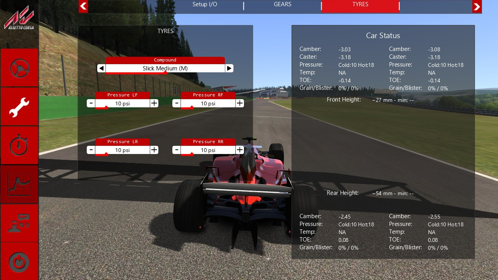
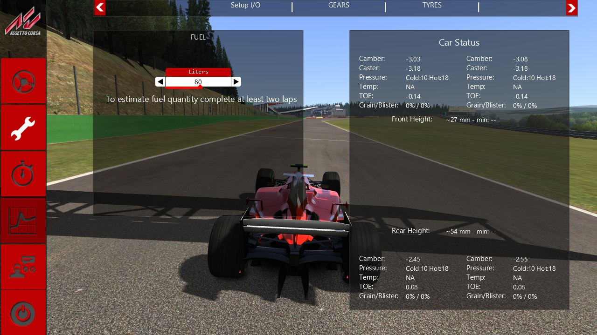
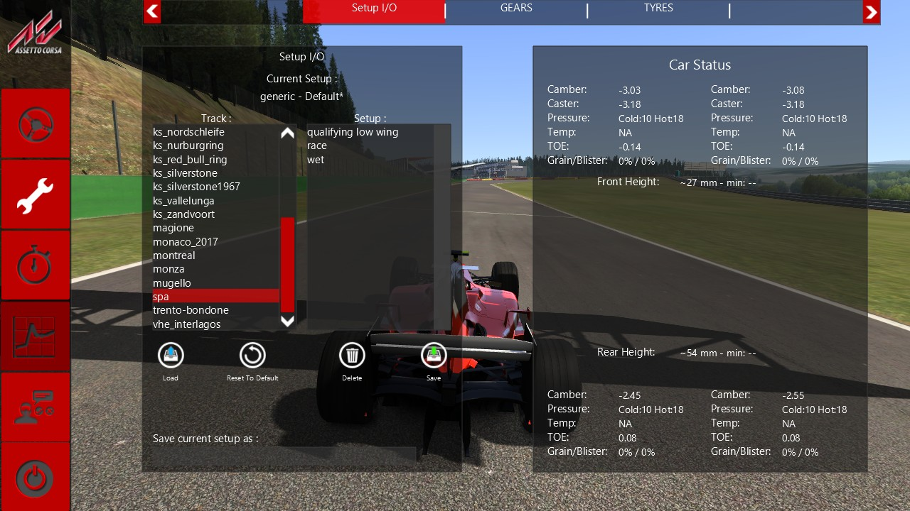
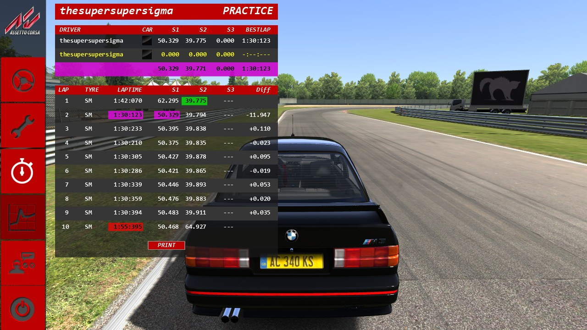

# AC's setup editor (Task 31)

## Resume here

State after the last commit (v0.31.0):

- **Done, proven against the game's own code and wired into `rustyac.exe`:** the setup
  screen of the ESC menu (the tab bar, the generic pages built from the car's `setup.ini`,
  the gears, tyres, fuel and electronics pages, the save / load page, the car status panel on
  the right), the ESC menu's page "Time", the session that begins in the ESC menu with the
  car held until "Drive", and race.ini's `FIXED_SETUP` (the Setup button dimmed, "Blocked").
- **Not done** (reasons under "Not done"): the page "PITSTOP STRATEGY" and the `.sp` file;
  the server's fixed setup online (TCP message 0x52); the ESC menu online; the start camera;
  the setup validation light of `CarPhysicsState`; `SetupManager::load` for AI cars;
  Telemetry (disabled until Task 33).
- **Where the code is:** `crates/rustyac-gui/src/` — `setup_screen.rs` (the screen, save and
  load of a whole setup, `last.ini`), `setup_tab.rs` (a page and its spinners), `setup_io.rs`,
  `setup_gears.rs`, `setup_tyres.rs`, `setup_fuel.rs`, `setup_electronics.rs`,
  `setup_info.rs` (the status panel), `setup_car.rs` (what the editor reads of the car and
  the jobs it leaves for the physics thread), `locale.rs` (the game's words and help texts),
  `time_table.rs` (the page "Time"), `setup_presets.rs` (a stub: see "Not done"). The physics
  side: `crates/rustyac-physics/src/car/setup.rs` (`SetupJob`, `apply_job`, the items' units,
  the rules check). The glue: `crates/rustyac-game/src/render/gui.rs` (`GameGui`,
  `setup_exchange`), `sim.rs` (`setup_jobs`, the `.setup` file beside a recorded drive),
  `desktop.rs` (`esc_start`). The oracle: `tools/render_oracle/src/gui_seq_setup.rs` (scripts
  and what both sides share), `gui_ac_setup.rs` (the game's side: a real `Car` of the game
  on a flat track, in process), `gui_port_setup.rs` (the port's side).
- **Proof batch:** `sh re/scratch/task31/final_b.sh` (Task 30's 38 and Task 29's 14 GUI
  sequences, then every setup sequence on every car of the table below; a little over an
  hour; result lines in `re/scratch/task31/gui_final_30.txt`, `gui_final_29.txt`,
  `gui_final_31.txt` and `cars2.txt`). One sequence:
  `sh re/scratch/task31/cmp.sh setup_tabs@bmw_z4_gt3`. Never two at once. The other checks at
  the end of the task: `sh re/scratch/task31/final_a.sh` (clippy four ways, tests, tools,
  dumps; its dump step needs v0.30.0 built from its tag into `re/scratch/task31/tgt_old`,
  which was deleted at the end) and `python re/scratch/task31/tape_proof.py`.
- **If `rustyac.exe` is running** (it locks `target/release`): build with
  `CARGO_TARGET_DIR=re/scratch/task31/tgt`, as `final_a.sh` does.
- **How a car gets into the oracle:** a sequence's name may end in `@<car folder>`; the car's
  data comes from the repo's `cardata/<car>`; both sides' setups folders are emptied and
  filled alike from `re/scratch/task31/root/seed_setups/<car>` (`sh re/scratch/task31/seed.sh`
  copies your own setups of eight cars there, read only on the source; the folder is
  git-ignored).
- **Briefs** (git-ignored, written by readers from the disassembly; claims, not facts, until
  the oracle agrees): `re/scratch/task31/spec_*.md`. Not yet used: `spec_presets.md`, part B.2
  of `spec_escstart.md` (the server's setup), part of `spec_setupmanager.md` (the AI's load).
- **Gotchas found:** the game's FW1 font wrapper reads an index buffer it never filled, so
  the oracle's `operator new` for the game's code hands out zeroed memory (else the two
  command logs differ by garbage); the game's editor leaves its work for the physics thread
  (`executeOnPhysicsThread` 0x140121f20), which the oracle replaces by "do it now"; a
  tool that builds a `SimSetup` by hand (`chassis_compare`) must name the new header keys.

## In plain English

In Assetto Corsa's pits, the spanner button of the ESC menu opens the setup editor: pages of
little plus / minus boxes for tyre pressures, wings, springs, dampers, gear ratios, fuel and
so on, a page to save and load setups, and a panel on the right showing the car as it now
stands (ride height, camber, toe, tyre temperatures, wheel loads). The stopwatch button opens
a page listing your laps with their sector times. This task ports those to rustyAC, so that
`rustyac.exe` shows the same pages with the same words at the same places, each click changes
the same number in the car, and a saved setup is the same file byte for byte.

"The same" is checked the hard way, as in the two tasks before. A test program loads the real
game's code, lets it build a real car of the game and the real editor for it, moves the mouse
and clicks through every page, and records every drawing command the game sends to the
graphics card. rustyAC does the same with its own car and its own editor. The two recordings
must be equal to the last bit and so must the finished pictures, pixel by pixel, in every
frame. After every frame both sides also write down every setup value as the editor holds it
and as the car's physics holds it, and those lists must be equal too. Then each side saves
setups into its own scratch folder and the files must be the same bytes.

That holds for the Ferrari F2004, the BMW M3 E30, the BMW Z4 GT3, the Alfa Romeo 155 V6, the
Ferrari SF70H and the Ferrari 488 GT3 (see "Results").

What you get in `rustyac.exe`:

- A drive at the wheel now **begins in AC's pit screen**, as the game does: the car stands
  with the brake held until you press **Drive**.
- The **spanner** opens the setup editor. Change something and the car changes at once; the
  panel on the right shows the result.
- **Setup I/O** saves and loads. rustyAC saves into its own `setups` folder beside
  `rustyac.exe`; your Assetto Corsa setups are listed too (marked "(AC)") and can be loaded,
  but nothing is ever written there.
- When you leave, the setup as it stands is written as `generic/last.ini`, as the game
  does. Neither the game nor rustyAC loads it by itself; it is there to be loaded on
  "Setup I/O" under the track "generic".
- The **stopwatch** opens the lap list: every lap with sectors, the best in purple and
  green as in the game, the sessions before this one, and PRINT writes the list to a file.
- A recorded drive keeps the setup changes made in it, so a replay of the drive is still
  the same drive.

What is still missing is listed plainly under "Not done".

## What is ported

Addresses are those of `acs.exe`. "Size" is the class's size in the game.

| What | The game's class (size) | Functions ported | Port |
|---|---|---|---|
| Setup screen | `SetupScreen` (0x1f8) | constructor 0x14017c010, `loadINI` 0x14017d950, `render` 0x14017f7c0, `switchVisibility` 0x14017fcd0, `getSetupTab` 0x14017d650, `needToSave` 0x14017f500, `resetTabsValueToDefault` 0x14017f950, `saveSetupAbsolutePath` 0x14017f9c0, `loadSetupAbsolutePath` 0x14017f2c0, `getFixedFuel` 0x14017d640, `isFixedFuel` 0x14017d940; `ESCMenu::onShutdown` 0x1400fdf80 (`last.ini`) | `setup_screen.rs` |
| A page | `SetupTab` (0x1c0) | constructor 0x140183130, `addItem` 0x140183850, `render` 0x140184370, `onVisibleChanged` 0x140184280, `getStringToSave` 0x140183e90, `loadFromINI` 0x140184120, `resetToDefaultValues` 0x140184420, `setValueToSpinner` 0x1401844c0 (and the list of fixed spinners), the spinners' job for the physics thread 0x140183620 | `setup_tab.rs` |
| Gears | `SetupGearManager` | constructor 0x140170c80, `addGearSet` 0x140171d00, `addSetupItem` 0x140171f60, `populateSpinner` 0x140173810, `getStringMaxSpeed` 0x140172de0, `getStringToSave` 0x1401730d0, `loadFromINI` 0x1401734a0, `render` 0x1401743a0, `resetToDefaultValues` 0x1401749c0; `RaceEngineer::getMaxSpeedFromGear` 0x14027c240 | `setup_gears.rs` |
| Tyres | `SetupTyresManager` | constructor 0x140184650, `getStringToSave` 0x140184ce0, `loadFromINI` 0x140184eb0, `resetToDefaultValues` 0x14016fa20; `CarAvatar::setTyreCompound` 0x1400dabd0 and its job 0x1400d0740 | `setup_tyres.rs` |
| Fuel | `SetupFuelManager` | constructor 0x14016d880, `render` 0x14016ead0, `onVisibleChanged` 0x14016ea70, `getSetupFuel` 0x14016e6f0, `getStringToSave` 0x14016e710, `loadFromINI` 0x14016e8f0, `isFixedFuel` 0x14016e8e0, the spinner's job 0x14016e450; `Car::setRequestedFuel` 0x140275cb0 | `setup_fuel.rs` |
| Electronics | `SetupElectronics` | constructor 0x14016a020, `addTC` 0x14016c610 (and ABS), `addTurbo` 0x14016c890, `addEngineBrake` 0x14016bbb0, `addErsPower` 0x14016be50 (and recovery), `addHeatCharging` 0x14016c380, `checkDrivingAssist` 0x14016cb40, `setSpinner` 0x14016d3f0, `render` 0x14016d2c0, `onVisibleChanged` 0x14016d180, `getStringToSave` 0x14016cd60, `loadFromINI` 0x14016d050, `resetToDefaultValues` 0x14016d350; `Engine::getTurboBoostLevel` 0x140285dc0 | `setup_electronics.rs` |
| Save / load page | `SetupIOManager` | constructor 0x140174c90, `render` 0x1401779d0, `onVisibleChanged` 0x140177270, `refreshSetupListBox` 0x140177290, `refreshStatus` 0x1401776d0, `resetUI` 0x140177de0, `sendSaveMessage` 0x140177f20, `setOverrideStatus` 0x140178480, `setRemoveStatus` 0x140178620, `setSelectedTrack` 0x140178730, `showStatus` 0x140178740, `getPathFromSetupName` 0x140177040, `cutStringIfExceeds` 0x140176f60; `Path::doesFilenameContainsIllegalChar` 0x140230520 | `setup_io.rs` |
| Car status panel | `SetupInformation` | constructor 0x14017fcf0, `render` 0x140180660, `setFrontValues` 0x1401820e0, `setRearValues` 0x140182860, `getTOE` 0x140180580, `cutDecimals` 0x140180510, `tempToString` 0x140182eb0; `RaceEngineer::evalRideHeight` 0x14027a9d0, `getCasterRAD` 0x14027bb20; `Node::worldToLocalNormal` 0x14020e8d0 | `setup_info.rs`, `rustyac-physics` `chassis.rs` |
| The words | locale | `acLocaleSetLocale` 0x140240980, `loadSetupINI` 0x1402414e0, `acLocaleGetString` 0x1402404a0, `acLocaleGetSetupHelpText` 0x140240410, `TagDocumentReader::load` 0x14044e030 | `locale.rs` |
| The car's side | `SetupManager`, `SetupItem` | `getSetupItem` 0x1402891b0, the units of `initItems` 0x140289570, the end of `step` 0x14028d090 (the wait and the rules check, `isSetupRespectingRules` 0x14028cc10), the members as `Car::Car` 0x14026bf00 sets them, the item `FF_GAIN`; `INIReader::getKeyes` 0x140235e10 | `rustyac-physics` `car/setup.rs`, `data/ini.rs` |
| Page "Time" | `EscMenuTimeTable` | constructor 0x140094230, `render` 0x140097660, `onVisibleChanged` 0x140096ef0, `refreshSession` 0x1400972f0, `refreshPlayer` 0x140096f60, PRINT 0x1400959c0, `timeToString` 0x140053110 | `time_table.rs` |
| Start in the menu | `Sim`, `RaceManager` | the ESC part of `Sim::Sim` 0x140192070 (`DISABLE_SHOW_MODE`), the handler of a new session 0x140195c60, `startRace` 0x140141470 waiting for Drive | `desktop.rs` `esc_start`, `GameGui`, `rustyac-physics` `race/referee.rs` |
| Fixed setup off line | `RaceManager` | `fixedSetup` of `initOffline` 0x14013a6c0, read by the ESC menu's constructor and its Setup button | `GameGui` (the menu's half was Task 30's) |

How the editor reaches the car. In AC the editor holds a pointer to the car and reads it
whenever it likes; what it changes it leaves as a small job for the physics thread. Here the
editor sees the car through a trait (`SetupCar`): the physics thread publishes a snapshot of
what the editor reads (items with their ranges, compounds, gear ratios, fuel, electronics,
the status panel's numbers) whenever it changed, and the editor's changes go the other way as
`SetupJob`s, done between two physics steps in the order they were made. A recorded drive
keeps the jobs with the step they were done before, in a small file `<drive>.setup` beside
the drive, so the replay does them at the same steps.

Shared code that changed: `msvc_floor` keeps the sign of a negative zero (whole numbers are
unchanged); a widget's event is written down after its handlers have run, as the game does;
the ESC menu's time button hands the page the session the race control shows.

## How each part was proven

1. **Pictures and commands.** `render_oracle gui --gui <sequence>` runs the game's own code
   and the port through the same script on WARP (the software graphics card, so the result
   does not depend on the graphics driver) at 1280 x 720 and compares, frame by frame, the
   log of every Direct3D call with its data, and the finished picture.
2. **Values.** After every frame both sides write every setup item: its name, the editor's
   value, whether it is attached to the car, and the value the car's physics holds; and what
   the widgets hold (texts, positions, colours, visibility) and every event fired. Those
   lists must be equal. This is what shows that a click reaches the same number in the car.
3. **Files.** Each side saves into its own scratch folder (the game's code believes its
   Documents folder is `re/scratch/task31/root/documents`); the two folders are compared
   with `diff -r` after every sequence.
4. **Physics.** `car_oracle run --scenario spa_setup --setup <file>` drives the game's own
   car with a saved setup at Spa, and `chassis_compare run` drives the Rust car with the same
   file and inputs; every value of every step must be equal. Run with one of your own
   setups and with files the editor saved in the oracle.
5. **Start in the menu.** `rustyac.exe --headless --esc-start` drives are recorded and played
   back; the car must stand until Drive is pressed, and the hash of every car's state at the
   end of the replay must be the same on one thread and on eight.
6. **A second pair of eyes.** The glue in `rustyac.exe` that no oracle sees (the exchange
   between the editor and the physics thread, the recorded jobs, the start in the menu) was
   read by two reviewers working from the briefs; what they found and was confirmed is fixed
   (their notes: `re/scratch/task31/review_a.md`, `review_b.md`, git-ignored).
7. **Nothing else moved.** Every GUI sequence of Tasks 29 and 30 again, the physics dumps
   of four recorded drives against v0.30.0, the multiplayer tapes four ways, the tests,
   clippy for the desktop and both browser targets.

What the scripts do: `setup_tabs` opens the editor, visits each of the 14 places a page can
be, moves the mouse over every place a label can be (the help bubbles), clicks plus once,
minus twice and the bar once on every place a spinner can be, then closes and reopens the
menu; `setup_io` saves under a new name, saves the same name again and confirms "Override",
tries a name that is no file name and no name at all, loads setups (among them your own),
resets, and deletes with its confirmation; `setup_time` fills five cars with laps (some
invalid, some without sectors), pages forward and back, changes the focused car, lets new
laps arrive while the page shows, and picks each earlier session; `setup_probe` is the menu
as a session begins in it.

## Results

### The setup editor and the page "Time" against the game's own (17 of 17 runs identical)

Run on the final code. "Files" is the comparison of the two setups folders after the run (the number of
files in each: the ones put there before the run, which must still be the same, and the ones saved).

| Sequence | Car | Frames | Direct3D calls | Draws | Command log | Pixels | Values, widgets and events | Files |
|---|---|---|---|---|---|---|---|---|
| `setup_probe` | Ferrari F2004 | 4 | 8,357 | 451 | identical | identical | identical (3,896 lines, 77 events) | identical (6) |
| `setup_tabs` | Ferrari F2004 | 1,898 | 6,265,219 | 341,675 | identical | identical | identical (1,818,574 lines, 5,853 events) | identical (7) |
| `setup_tabs` | BMW M3 E30 | 1,898 | 5,498,649 | 289,733 | identical | identical | identical (892,615 lines, 4,220 events) | identical (2) |
| `setup_tabs` | BMW Z4 GT3 | 1,898 | 6,164,441 | 334,115 | identical | identical | identical (1,558,243 lines, 5,548 events) | identical (7) |
| `setup_tabs` | Alfa Romeo 155 V6 | 1,898 | 5,827,646 | 311,611 | identical | identical | identical (1,246,413 lines, 4,989 events) | identical (0) |
| `setup_tabs` | Ferrari 488 GT3 | 1,898 | 6,156,848 | 333,888 | identical | identical | identical (1,558,229 lines, 5,534 events) | identical (0) |
| `setup_tabs` | Ferrari SF70H | 1,898 | 6,177,732 | 334,310 | identical | identical | identical (1,710,158 lines, 5,623 events) | identical (0) |
| `setup_io` | Ferrari F2004 | 179 | 604,368 | 32,953 | identical | identical | identical (172,705 lines, 1,728 events) | identical (8) |
| `setup_io` | BMW M3 E30 | 179 | 564,810 | 30,405 | identical | identical | identical (84,476 lines, 672 events) | identical (3) |
| `setup_io` | BMW Z4 GT3 | 179 | 598,304 | 32,603 | identical | identical | identical (147,953 lines, 1,499 events) | identical (8) |
| `setup_io` | Ferrari SF70H | 179 | 568,794 | 30,516 | identical | identical | identical (161,931 lines, 1,157 events) | identical (2) |
| `setup_io` | Lotus 49 | 179 | 591,624 | 32,207 | identical | identical | identical (122,720 lines, 968 events) | identical (4) |
| `setup_io` | Lotus 98T | 179 | 598,174 | 32,597 | identical | identical | identical (153,729 lines, 1,368 events) | identical (6) |
| `setup_io` | Lotus Exige 240 | 179 | 566,260 | 30,445 | identical | identical | identical (102,496 lines, 792 events) | identical (4) |
| `setup_io` | Lotus Exos 125 S1 | 179 | 598,430 | 32,609 | identical | identical | identical (151,028 lines, 1,531 events) | identical (8) |
| `setup_io` | Tatuus FA01 | 179 | 594,779 | 32,314 | identical | identical | identical (134,604 lines, 1,038 events) | identical (6) |
| `setup_time` | Ferrari F2004 | 39 | 119,064 | 4,278 | identical | identical | identical (3,396 lines, 42 events) | identical (6) |

13,042 frames in all; no frame differs in a call, a pixel or a value.

What the cars were picked for: the F2004 has the most (74 sections in its `setup.ini`: wings,
a list of ratios from a file for every gear, 42 items shown as clicks, three compounds,
traction control); the M3 E30 is a road car with a fixed gearbox and 17 sections; the Z4 GT3
and the 488 GT3 are GT3 cars with ratio files and a ride height rule (`[RULES]`); the Alfa
155 picks whole gear sets (`USE_GEARSET=1`); the SF70H has the hybrid system's spinners on
the electronics page.

### Saved files, and your own setups loaded

- **Saved by both sides, byte for byte the same:** in every `setup_io` run a setup under a
  new name for a track (`Second one.ini`), one for "generic" (`zz.ini`), the same name
  again through "Override", and the deletion of one; in `setup_tabs` what the clicks
  happen to save. The "Files" column is `diff -r` of the game's folder (its stand-in
  Documents) against the port's.
- **Your own setups, loaded by both sides to the same values** (the lists of values after
  each load are part of the compared state): `setup_io` loads every setup of every track of
  the car. The files were copied read-only into the git-ignored scratch folder, not into
  the repo:

  | Car | Setups of `Documents\Assetto Corsa\setups` that were loaded |
  |---|---|
  | ks_ferrari_f2004 | `generic\last.ini`, `monza\god.ini`, `spa\god.ini` |
  | bmw_m3_e30 | `generic\last.ini` |
  | bmw_z4_gt3 | `generic\last.ini`, `ks_nordschleife\hope.ini`, `ks_nurburgring\hope.ini` |
  | lotus_49 | `generic\last.ini` |
  | lotus_98t | `generic\last.ini`, `spa\god.ini` |
  | lotus_exige_240 | `generic\last.ini` |
  | lotus_exos_125_s1 | `generic\last.ini`, `monza\godTrust.ini`, `spa\hope.ini` |
  | tatuusfa1 | `generic\last.ini`, `imola\hope.ini` |

  16 setups of 8 cars. (Their `.sp` files sit beside them and are left alone: see "Not done".)

### Physics with saved setups (6 of 6 runs bit-exact)

`car_oracle run --track spa --scenario <scenario> --car <car> --setup <file>` records the
game's own car driving with the setup; `chassis_compare run` drives the Rust car with the
same file and inputs and compares every value of every step.

| Car | Setup file | Values in the file | Scenario | Steps | Bit-exact steps | Values compared per step (chassis / other systems) | Force calls compared |
|---|---|---|---|---|---|---|---|
| Ferrari F2004 | your own spa/god.ini | 74 | `spa_setup` | 1,668 | 100 % (1668/1668) | 2,009 / 403 | 104,725 |
| Ferrari F2004 | saved by the editor in setup_io (zz.ini) | 74 | `spa_setup` | 5,334 | 100 % (5334/5334) | 2,009 / 403 | 348,032 |
| Ferrari F2004 | saved by the editor in setup_io (Second one.ini) | 74 | `spa_setup_launch` | 8,001 | 100 % (8001/8001) | 2,009 / 403 | 522,690 |
| BMW M3 E30 | saved by the editor in setup_io (zz.ini) | 18 | `spa_setup` | 5,334 | 100 % (5334/5334) | 2,121 / 371 | 221,721 |
| BMW Z4 GT3 | saved by the editor at the end of setup_tabs | 60 | `spa_setup` | 5,334 | 100 % (5334/5334) | 2,121 / 379 | 232,860 |
| BMW Z4 GT3 | saved by the editor in setup_io (zz.ini) | 60 | `spa_setup` | 5,334 | 100 % (5334/5334) | 2,121 / 379 | 232,810 |

A session with a fixed setup off line is the same physics as any other session (the car
keeps the setup it started with; only the editor is shut), so it has no run of its own;
the server's fixed setup is under "Not done".

### The session that begins in the menu

`rustyac.exe --no-race-ini --track spa --headless --esc-start ...`, recorded, then played
back twice. "Held" means: speed 0, brake 1.0 at the end of the live run.

| Drive | What it shows | Hash of the cars' state at the end, replay on 0 / on 8 worker threads |
|---|---|---|
| practice, AI at the wheel, `--no-esc-start` | the start as before this task: the car drives off | `1acd2307e3264fea` / the same |
| practice, AI at the wheel, `--esc-start`, nobody presses Drive | held to the end | `c3be816051f719dc` / the same |
| the same with `--pit-key drive@3` | held for 3 s, then drives (298 km/h at the end) | `fdfeaa39f16681a1` / the same |
| the same with `--restart-session-at 6 --pit-key drive@9` | held again after the restart until the second Drive | `5adb352070602391` / the same |
| `--no-referee`, `--pit-key drive@3` | the lock without a referee | `853b8d0eee3065e3` / the same |
| practice and race with 2 AI cars, the next session at 6 s, Drive at 3 s and 9 s | two sessions, Drive pressed in each | `df11244cf4a4dc9b` / the same |
| the third drive with a hand-written `.setup` file (fuel, compound, 12 items, TC, ABS, engine brake at four steps) | recorded setup jobs change the drive (another hash) and replay the same way each time | `79b01073b1cb6a87` / the same |

The ESC menu as a session begins in it is the oracle's `setup_probe` above. What is not
tested by a program: the menu coming back on the screen after a restart (the window loop's
part; the referee's half, the car held again, is the fourth row).

### Tasks 29 and 30's GUI sequences, run again on this task's code (52 of 52 identical)

| Batch | Sequences | Frames | Result |
|---|---|---|---|
| Task 30's menus (`re/scratch/task30/gui_all.sh`) | 38 | 2,316 | all identical: command log, pixels, state; every line of the result file equal to v0.30.0's, call counts included |
| Task 29's GUI and HUD (`re/scratch/task29/gui_all.sh`) | 14 | 1,262 | all identical; the same frames, calls and draws as at v0.30.0 |

### Everything else, on the final code

| Check | Result |
|---|---|
| `cargo clippy --workspace --locked --all-targets -- -D warnings` | clean |
| `cargo clippy --workspace --locked -- -D warnings` (CI's line) | clean |
| clippy for `wasm32-unknown-unknown` (rustyac-web, -net, -gui) | clean |
| clippy for `wasm32-wasip1` (math, ode, content, physics, net, game, gui) | clean |
| `cargo build --release --workspace --locked` | passes |
| `cargo test --release --workspace --locked` | 60 suites, 293 passed, 0 failed |
| `python web/build.py` (the browser preview) | builds |
| the eight tools with their own lock files, `cargo build --release --locked` | all build (audio_oracle, car_oracle, chassis_compare, math_proof, ode_oracle, sctm_oracle, tyre_oracle, web_pack); render_oracle too |
| multiplayer tapes, four ways each (desktop, desktop as the browser does it, through the gateway, wasm) | 20 of 20 tapes identical to the game at every step, all four ways (in each pass over the 20, one run through the gateway found no free port on 127.0.0.1 and was run again: a clash of ports on this PC, not a difference) |

### Physics dumps against v0.30.0

v0.30.0 built once from its tag; both programs replay the same recorded drive and write
every car's full state at every step; the SHA-1 of the dump must be equal.

| Recorded drive | v0.30.0 | v0.31.0 | State hash, 0 / 8 worker threads |
|---|---|---|---|
| `served.ryin` | `09953746b56c9a6d` | the same | `bebb73dd826046ac` / the same |
| `spa.ryin` | `4238c5617a2e49ce` | the same | `b4c7538a6fa7289c` / the same |
| `missed.ryin` | `8c2fe6e41d7e4dee` | the same | `a528aca4ee0fa29d` / the same |
| `practice.ryin` | `a21587be85a4a9ba` | the same | `889a180a3ae928bf` / the same |

## How to use

```
rustyac.exe --track spa
```

begins in the pit screen. The big buttons down the left: **Drive**, **Setup** (spanner),
**Time** (stopwatch), Telemetry (disabled until Task 33), **Race control**, Exit.

| Option | What it does |
|---|---|
| `--esc-start` / `--no-esc-start` | begin in the pit screen with the car held, or not. Default: on for a drive at the wheel in a window; off for replays, pictures, `--headless`, `--autodrive`, `--ai-drive`, `--duration`, `--gui-do`, `--no-gui`, online, and when the game's `system/cfg/options.ini` has `DISABLE_SHOW_MODE=1` |
| `--setups-dir <folder>` | where the editor saves (default: `setups` beside `rustyac.exe`), as `<car>/<track>/<name>.ini` and `<car>/generic/last.ini` |
| `--no-ac-setups` | do not list the setups of `Documents\Assetto Corsa\setups` |
| `--pit-key drive@<seconds>` | presses Drive at that second of an unattended run |
| `--out-dir <folder>` | where PRINT of the page "Time" writes its text file |
| `--gui-do "pits;click:50:273"` | for pictures: the pit screen with the editor open (`click:1226:16` is the tab bar's right arrow) |

In the editor: click plus or minus, or click on a spinner's bar; hold the mouse over a name
for the help bubble. On "Setup I/O": pick the track on the left, a setup on the right, then
Load; type a name and Save; Reset puts the car's own values back. Setups from Assetto
Corsa's folder carry "(AC)" behind their name and come after rustyAC's own; they can be
loaded, not overwritten or deleted.

race.ini's `[RACE] FIXED_SETUP=1` dims the Setup button; a click answers "Blocked / Cannot
modify setup for this session", as in the game. The car keeps the setup it started with.

## Pictures

Taken by `rustyac.exe` on the graphics card (not the oracle's software renderer).

| | |
|---|---|
|  |  |
| A page of the F2004's editor with the status panel | Another page |
|  |  |
| Setup I/O | The page "Time" |

## Disk space

66 GB free on C: at the start, 59 GB at the end. The v0.30.0 build made for the dump comparison (`re/scratch/task31/tgt_old`, 0.24 GB), the scratch build made while `rustyac.exe` was in use, the oracle's recordings (6.4 GB) and pictures, and the debug build's incremental cache were deleted; the temporary worktree is removed. What is left of the difference is the new version's build output in `target` and `tools/*/target`. Free space never came near the 15 GB limit (lowest seen: 45 GB).

## Not done

1. **The page "PITSTOP STRATEGY" and the `.sp` file** (`SetupPitstopPresets`, constructor
   0x1401787d0). The brief is written (`re/scratch/task31/spec_presets.md`) but the page is
   not ported: `setup_presets.rs` is a stub that makes no page. In the game the page is
   there unless the old mouse pit menu is chosen, so with the game's default settings AC
   shows one page more than rustyAC does. The oracle's sequences run with the mouse pit menu
   chosen on both sides, which is the game's own way to have no such page; the proofs above
   are therefore of the editor without it. No `.sp` file is written beside a saved setup.
   The brief also found that Task 28b's `QuickMenu::save_presets` writes a blank line after
   each preset which the game does not; it is not fixed, as nothing writes that file yet.
   (Task 34: the page, the `.sp` files and the blank line are done; see
   [online_menus.md](online_menus.md).)
2. **The server's fixed setup online** (TCP message 0x52, `ACClient::onSetupReceived`
   0x140050090 and its job 0x14003caf0). The message is parsed (Task 25) and still ignored.
   The loader's `fixed` path (`setValueToSpinner`, read-only spinners) is ported and is run
   by nothing yet. Online, rustyAC has no ESC menu at all, so there is no editor there.
   (Task 34: done.)
3. **The start camera** (`eStart`) while the menu shows at the beginning; rustyAC shows the
   camera it would drive with. (Task 34: done.)
4. **`CarPhysicsState.setupState`** stays 0 in the state dumps (the game writes 1 for
   "legal"), so that dumps stay equal to v0.30.0's; the editor reads the true state through
   its snapshot. The "SETUP VALIDATING" text of the Drive button is in the menu (Task 30) and
   fed from that state.
5. **`SetupManager::load`** for AI cars (0x14028cc90: an AI car's setup file) is not ported.
6. **Online and special session types at the start**: the drag and time attack modes' own
   reactions to the menu, and the online pit teleport five seconds before a session.
7. **Telemetry** stays disabled until Task 33.
8. **The browser.** The pages are in `rustyac-gui`, which builds for the browser, but the
   browser has no painter for AC's GUI yet (Task 29's open item), so nothing shows there.
9. Not compared with the game: the name PRINT gives its file (rustyAC stamps it with the
   clock's time in UTC; the game most likely uses local time), and the message type of "Not
   available" for an aid the session forbids.
10. Found by a second reading of the code and left as they are: the status panel's toe is
    worked out from the physics body's matrix, where the game uses the drawn body's (they
    differ only for a car with `GRAPHICS_PITCH_ROTATION`); the `[RULES]` of a car are read
    from its `data` folder only; with `--race-start-in` together with `--esc-start`, Drive
    starts the race ten seconds later, whatever the option said.

## Open questions

1. The game truncates what it loads: a saved value is read back with `getInt`, so a file
   edited by hand with `12.7` loads as 12. The port does the same. Is that what mods expect
   of fractional steps? (The game's own files never hold fractions.)
2. `SetupManager::step` restarts a one second wait on every change, during which a car with
   `[RULES]` in its `car.ini` is "validating". rustyAC's wait runs on the physics clock, as
   the game's does; with a paused physics thread the game would never finish validating.
   Not seen in practice (the pit screen does not pause physics).
3. rustyAC saves into its own folder and never into Documents. Should a later task offer an
   "export to Assetto Corsa" button, written only when the user asks?
4. The game writes `last.ini` whenever the ESC menu shuts down, also after a session with a
   fixed setup. The port does too. With a server's fixed setup that would keep the server's
   values as the user's "last"; to look at when item 2 of "Not done" is done.
