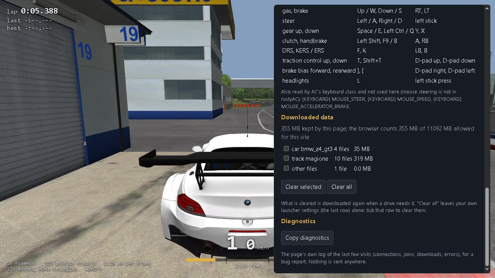

# Browser fixes: drops, downloads, downloaded data (Task 38d)

## Resume here

Done and released as v0.38.3: steps 0 to 4, every proof area (table below), clippy on every
target, `--locked` builds of the workspace and every tool. Nothing is left open but the
questions at the end. To see a case again:

    sh tools/web_checks/task38d/dl.sh old|new clean cut wrong zero short 503x5 spoiled   # downloads
    sh tools/web_checks/task38d/mp.sh old|new cutjoin|cutlate|gwclose|refused|freeze|session

(`re/scratch/task38d/` holds the test pack, the v0.38.2 site and these scripts. It is scratch:
the scripts are described here so they can be written again if the folder is gone.)

## What happened on 2026-10-19 (12:47 to 13:17 UTC, Spa)

**"Network error", two drivers off the server.** The old page joined the server first and only
then downloaded every car and the track. When a download broke off (the Cloudflare tunnel
cancelled big `.kn5` streams that day, its log shows it), Chrome ended the download with its
own error text, `network error`. The page took that as a failed join: it sent acServer the
protocol's goodbye (acServer: `Clean exit, driver disconnected`) and showed Chrome's two words.
The same run on this PC with v0.38.2 gives exactly that: the page says `network error`, the
server says `Clean exit, driver disconnected: b`.

**"Can't be decrypted" for a car that loaded minutes before.** Files the page fetched are kept
in the browser's storage under their SHA-256. A download was checked against that hash, but a
stored copy was only checked for its size. A stored `data.acd` with the right size and damaged
bytes then reached the loader, which can only say that the files do not decrypt with the key
of the folder name. With v0.38.2 and such a copy the page shows exactly that message. Why a
copy on the Chromebook was damaged cannot be seen from here (see Open questions). The page now
checks the hash of every stored copy, so a damaged one is replaced, not used.

**The three 0-second visits** (`#14`, `#15`, `#16` in the gateway's log, one message each way)
were refused join attempts: that is what a refused join looks like (case `refused` below). They
did not touch the drivers already on the server.

## What changed

| Where | Change |
|---|---|
| `web/app.js` downloads | Each file is checked against the pack's list (size, and SHA-256 when the list has it), also when it comes from the browser's storage. A broken download continues where it stopped (HTTP `Range`). A wrong file, a short one or an empty answer is thrown away and fetched again. Up to 5 tries, waiting 0.5, 1.5, 4.5 and 13.5 s between them. A file is written to storage only once it is whole and checked. After 5 tries the error is `couldn't download <file> (<why>; 5 tries)`. |
| `web/app.js` old copies | Files of an older pack (hashes no longer in the list) are deleted when the list is read. |
| `web/app.js` decrypt message | When a pack's car does not decrypt, the message adds that the files arrived whole and match the pack's list, so the pack itself holds them that way and it is not a download fault. |
| `web/app.js` joining | The cars and track that `servers.json` names for a server are downloaded **before** the WebSocket opens, so the server never holds a slot while a download runs. Anything the server runs beyond that is loaded after the join, with the same retries. |
| `web/app.js` leaving | Every way off the server names its reason in the page's log. A closed socket shows the gateway's code and reason, or for code 1006 "the connection to the gateway broke without a goodbye (code 1006: the network, a proxy, or the computer went to sleep)". When the game then gives up, that reason follows "the connection to the server is gone". An error in the display while online now also leaves the server properly. |
| `web/app.js` + `index.html` | Gear (controls page): **Downloaded data** (each car, each track, launcher theme, other files, older-pack files, the player's own launcher settings; size per row, the total, and the browser's usage and quota from `navigator.storage.estimate()`; tick boxes, **Clear selected**, **Clear all**). **Copy diagnostics** copies the page's log of the last 5 visits (connections opened and closed with codes and reasons, joins, downloads with sizes and retries, errors). |
| `crates/rustyac-gateway` | The log line of a client's close has its code and reason. A close that answers the gateway's own close after the game server went away is logged as the server's. |
| `web/serve.py` (test server) | Answers `Range: bytes=N-`, and `--fault cut|wrong|zero|short|503:<text>` makes one answer go wrong. |
| `web/check.mjs` (test driver) | `--freeze 30@60` freezes the page 30 s into the drive for 60 s (a background tab, a sleeping laptop). |
| `tools/car_oracle` (step 0) | See below. |

### Reconnecting

Desktop AC does not reconnect. When nothing has come from the server for 20 s it shows
"Connection Issue: The server seems to be unavailable." (`ACClient::update`, 0x140053b30), and a
lost connection is not tried again. The desktop port ends the drive the same way
(`physics_thread.rs`: "the connection to the server is gone"). The page does the same, and now
says why.

## Step 0: the telemetry difference was the oracle's

`car_oracle`'s telemetry hook replaced the whole of `RaceManager::getLapCount` (0x140138570)
with "car 0's lap count". Twenty other callers in the game use that function too (`isRaceOver`,
`FlagManager::checkForBlue`, the result processors, standings, `SharedMemoryWriter`). With the
hook, every car had car 0's laps, so the game's referee went wrong. rustyAC was right. Now only
the recorder's own call (0x1400768c2 in `ComparativeTelemetryRecorder::update`) goes to a small
stub, written into the int3 padding after that function. `tools/proofs/lib.sh` no longer
filters out the differing lines.

| Case (all `--telemetry`, threads 0, 1, 8) | before | after |
|---|---|---|
| rc_race, pit_ai_race, rc_weekend, ai_solo, rc_timed | DIFFERENT from the first lap | 3 of 3 identical, telemetry file IDENTICAL |
| rc_cut | DIFFERENT | 3 of 3 identical (no lap finished: no telemetry file, as in the game) |

## Results

Everything on 127.0.0.1. "old" is the v0.38.2 site, "new" is the same wasm with this task's
`app.js` and `index.html`. The test pack was made by `tools/web_pack` from ks_ferrari_f2004,
bmw_z4_gt3, magione, ks_laguna_seca and the launcher theme. Kunos' acServer is a copy of the
kit's Laguna Seca server with made-up passwords and no lobby, plus the gateway and headless
Chrome.

### Downloads (bmw_z4_gt3 at Magione; the fault hits one answer)

| Fault | old (v0.38.2) | new |
|---|---|---|
| none | drives | drives |
| connection cut halfway through magione.kn5 (313 MB) | error `network error` | drives: `try 1 of 5 failed at 155 MB: network error`, `goes on from 155 MB (HTTP Range)`, `313 MB downloaded, 1 retries` |
| one byte wrong in data.acd | error `...the file is not the one the pack's manifest lists (SHA-256 ...)` | drives: hash mismatch, fetched again, 1 retry |
| empty 200 answer | error `0 of 228805 bytes arrived` | drives: `the server sent 0 bytes, the pack's list says 228805`, 1 retry |
| one byte short | error `228804 of 228805 bytes arrived` | drives, 1 retry |
| 503 five times | error `...data.acd: the server answered 503` (no retry) | error `couldn't download content/cars/bmw_z4_gt3/data.acd (the server answered 503; 5 tries)`, after 5 tries over 20 s |
| damaged stored copy (same size) + a file of an older pack | error **`...data.acd: its files do not decrypt with the key of the folder name "bmw_z4_gt3"...`** (the incident's message) | drives: `dropped 000000000000...: a file of an older pack`; `the stored copy failed its check (... SHA-256 ...): downloaded again` |

### Multiplayer

| Case | old (v0.38.2) | new |
|---|---|---|
| `cutjoin`: B joins while A drives; B's track download is cut | B: error `network error`; server: `Clean exit, driver disconnected: b`; gateway: `#2 left after 11 s: the client closed the WebSocket (code 1000, reason "")` | B downloads first (resumed at 178 MB), then joins slot 2 and drives with A to the end |
| `cutlate`: the same, the page does not know the server's cars before joining | (same path as above) | B joins, download cut after the join, resumed, B drives to the end |
| `gwclose`: the gateway stops 30 s into A's drive (a tunnel closing) | A: `the connection to the server is gone. You are off the server...` | A: `the connection to the server is gone: the connection to the gateway broke without a goodbye (code 1006: ...)`; the diagnostics have `closed, code 1006, not a clean close` |
| `refused`: A and B drive, C gives a wrong password | C refused; A and B drive on | C: `ERROR :: Password not accepted`; A and B drive on; gateway: `#3 left after 0 s: the game server closed the connection (the client answered the gateway's close); 1 message + 1` |
| `freeze`: B's page frozen 60 s 20 s into the drive | both stay on the server | both stay on the server |
| `session`: practice of 1 minute | (not run) | both stay through Practice → Qualify |

A car that joins mid-session never needs a download: the page loads every car of the server's
entry list when it joins, and a new driver can only take one of those slots.

### Downloaded data and diagnostics

| Visit | What happened |
|---|---|
| 1 | 15 files downloaded; the list shows car bmw_z4_gt3 (4 files, 35 MB), track magione (10, 319 MB), other files (1); "355 MB kept by this page; the browser counts 355 MB of 11092 MB allowed". Tick magione, Clear selected: only the car is left (35 MB). |
| 2 | only magione's 10 files are downloaded; the car comes from storage. Clear all: 0.0 MB. |
| 3 | all 15 files are downloaded again. |
| Copy diagnostics | headless Chrome refuses the clipboard; the page says so, and the text is in `window.rustyac.diagnostics` |

### Every proof (`tools/proofs/run_all.sh`, full size)

The areas that load the game ran one at a time. browser, dumps, shaders, launcher and net ran
beside them in a second chain (`PROOF_OUT=target/proofs_b`), which is why some times differ
from Task 38c's. The telemetry cases now count every thread, with no lines filtered out.

| area | cases | identical | different | time |
|---|---|---|---|---|
| physics | 113 | 113 | 0 | 31m11s |
| fresh | 657 | 657 | 0 | 2 h 54 min |
| sound | 22 | 22 | 0 | 3m29s |
| render | 107 | 107 | 0 | 42m26s |
| gui | 123 | 123 | 0 | 79m40s |
| replays | 34 | 34 | 0 | 48m17s |
| net | 80 | 80 | 0 | 22m15s |
| browser | 223 | 223 | 0 | 57m17s |
| ai_page | 3 | 3 | 0 | 7m24s |
| shaders | 4 | 4 | 0 | 1m26s |
| launcher | 12 | 12 | 0 | 7m03s |
| dumps | 223 | 223 | 0 | 97m33s (every drive's states byte-identical to v0.38.2) |

Clippy `-D warnings`: the workspace with `--all-targets`, rustyac-web on wasm32-unknown-unknown
with `--all-targets`, the game crates on wasm32-wasip1: clean. Disk free: 24 GB at the start,
30 GB at the end.

## Redeploying the gateways (tsss-server)

The gateway's change is only in its log. The page's fixes reach players with the next site zip.

    cd ~/rustyac-src && git pull
    docker compose -f server/docker-compose.yml up -d --build gateway-spa gateway-laguna-seca
    docker compose -f server/docker-compose.yml logs --tail 20 gateway-spa

(`up -d --build` with both names rebuilds and restarts only the two gateways, so the acServers
keep running. Players on the server lose their connection for the restart.)

## Web zip

No new or renamed files. The changed ones are `index.html` and `app.js`. The preview pack does
**not** need a rebuild: `tools/web_pack` has always written per-file SHA-256 hashes into
`manifest.json`, and a pack without them is still checked by size.

## Not done

- An opponent car whose data cannot be loaded is still fatal for the join
  (`rustyac-game/src/sim.rs` `add_remote_cars`), not drawn as a placeholder. It cannot come up
  in the middle of a drive any more, because every car of the server is loaded, and checked,
  before the drive starts.
- No reconnect, because AC has none (see above).

## Open questions

1. Why was a stored copy damaged on the Chromebook? The page now catches it either way. A
   folder-name case mismatch was ruled out for the incident (the pack and the entry list spell
   the cars the same way).
2. The acServer log has `Clean exit` at 13:11:45 and 13:11:55 with no gateway line at that
   second in the excerpt sent. The excerpt may have been cut; the next drop will have the close
   code and reason in both logs and in Copy diagnostics.
3. A tab asleep longer than the gateway's idle timeout (300 s) is closed by the gateway. The
   page now names that reason. Whether the Cloudflare tunnel closes sooner was not tested,
   since the tests stay on localhost.
