# AC's launcher in the browser (Tasks 37, 37b and 37c)

> **Task 38c:** the `re/scratch/task…` paths below are history: those folders were scratch and
> most were deleted in the disk cleanups of 2026-10-15 and 2026-10-18. Every proof of this report
> reruns from `tools/proofs` (`sh tools/proofs/run_all.sh`); `docs/port/proofs.md` lists each path
> and what replaces it.

## Resume here

Task 37c is done (v0.37.2): AI opponents in the browser (Quick Race, Race Weekend, any race.ini
with `CARS>1`) as on the desktop, byte for byte; drives without a page reload; Selawik where
Segoe UI is missing. Online sessions still end without race_out.json (the desktop writes
none either). See "Task 37c" below, its "Not done". Next: Tasks 38-41 (renderer, HUD, apps,
sound in the page), Task 45 (Time Attack, Drift, Drag).

- Task 37c code: `crates/rustyac-game/src/race_cars.rs` (race.ini's cars, shared),
  `crates/rustyac-web/src/race.rs` (`apply`, `setup_of`, `replay_race`), `session.rs`
  (opponents drawn like remote cars), `web.rs` (`race_proof`, `race_speed`),
  `examples/race_proof.rs`, `web/app.js` (`driveFromLauncher`, `returnToLauncher`,
  `freshCanvas`), `web/theme_glue.js` (Selawik), `web/fonts/`.
- Task 37c scratch (not committed): `re/scratch/task37c/` (`rec.sh` desktop recordings,
  `proof.sh` / `chrome_proof.sh` four-way replays, `flows.py` + `flows/*.json` click runs,
  `speed.sh`, `end.sh`, `drives.sh`; `qr/`, `rw/` the race.ini files, tapes and outputs). The
  test pack was deleted; remake it as below with `--out re/scratch/task37c/pack`.

Task 37b (v0.37.1): the browser page is AC's own launcher: the theme of the player's game
(from the preview pack, or from the player's own AC folder) with only the Drive tile, driving
offline and online from it, results back on the theme's results page. The old web menu is
hidden (its elements stay for the URL test hooks).

- Code: `crates/rustyac-web/src/launcher.rs` (the desktop bridge on the page's files),
  `race.rs` (race.ini to the session), `web/launcher.js`, `web/theme_glue.js`, `web/sw.js`,
  `web/app.js` (`openLauncher`, `driveFromLauncher`, `returnToLauncher`, `launcherLobby`),
  `tools/web_pack` (`launcher` in the manifest), pad tape `tools/car_oracle/src/game/pad.rs`
  + `crates/rustyac-game/examples/pad_steering_check.rs`.
- Scratch (not committed): `re/scratch/task37b/` (readers' notes `theme_internals.md`,
  `web_game_raceini.md`, `pad_oracle.md`; desktop click scripts `scripts/`, `desk.sh`; browser
  flows `flows/make.py`, `web.sh`; bridge in Chrome `bridge/bridge.sh`; pad tapes `pad/`;
  end checks `end_a.sh`, `end_b.sh`, `drives.sh`). The test pack and the acServer copy were
  deleted at the end; remake the pack with `tools/web_pack/target/release/web_pack.exe
  --config web/preview.toml --out re/scratch/task37b/pack` (always pass `--config`:
  `web/my_pack.toml`, when present, packs every car).
- Serve and check: `python web/serve.py --pack re/scratch/task37b/pack --port 8137`, then
  `node web/check.mjs --url http://127.0.0.1:8137/ --launcher --profile target/web-check-37b`
  (`--flow <file.json>` runs steps across the page's reloads).

Task 37 (history): Part 0 (the 20 multiplayer goldens remade in `re/gold/net/`), Part A (the
keyboard's `stepSteer`, speed sensitivity, the controls page, cfg seeding) and Part B.1 (the
bridge without Win32) are described under "Task 37" below.

# Task 37c: AI opponents in the browser

## Summary

Quick Race, Race Weekend and any other race.ini drive with AI opponents now run in the browser
page exactly as on the desktop: the same AI drivers (names, skins, grid places, pit boxes,
levels), the same sessions, referee, pit stops and results. Played from the same race.ini,
the same seed and the same input tape, every physics step of every car and the race_out.json
are byte-identical between `rustyac.exe`, a native build, wasmtime and headless Chrome. The
theme's results page shows the browser race's results as it shows the desktop's. Drives now
start and end inside the same page (no reload), so a folder opened as a file list stays
usable. Away from Windows the theme's Segoe UI becomes Selawik. Time Attack, Drift and Drag
still show the notice (Task 45). Online sessions still end without a race_out.json, because
the desktop game writes none either (see "Not done").

## What kept AI out of the browser, and the fix

- `conditions::race_cars` (race.ini's `[CAR_n]` → opponents, grid, skins, pit boxes, AI
  levels) lived in `rustyac-game/src/conditions.rs`, which is Windows-only, and listed skin
  folders with `std::fs` (the page has no file system). It is now
  `crates/rustyac-game/src/race_cars.rs` (cross-platform, folders through `rustyac_content::vfs`,
  the page's files in the browser); `conditions.rs` calls it. The body is unchanged.
- `crates/rustyac-web/src/race.rs` refused `CARS>1`; it now calls `race_cars` under the
  desktop's own condition, gives the referee every car's driver name and seeds the AI as the
  desktop does.
- The page's session drew and stepped other cars only when online: opponents are now captured
  and drawn like remote cars (`session.rs`), and their models load in `Game::finish`.
- The AI's files (`ai/fast_lane.ai`, `ai/pit_lane.ai`, `data/ai_hints.ini`,
  `data/ideal_line.ai`, the car's `ai.ini`, `system/setups/<car>/<track>/ai_default.ini`) are
  now in the drive's file list (`content.rs`), and `GameSim`'s AI setup lookup goes through the
  page's files (`sim.rs`).
- Threads: none needed. The AI runs in the physics step; in the page `available_parallelism`
  fails, so the engine uses 0 workers, and the result has the same bits as the desktop's 8
  workers (proved below). Wasm threads (COOP/COEP + SharedArrayBuffer) would only make big
  grids faster, never different; not done.
- Seeds: the desktop seeds race.ini's draws with the clock. For the proofs, `rustyac.exe
  --race-seed n --ai-seed n-28000` draws exactly as a browser drive of seed n (the page's
  `?seed=n` test hook). Without them nothing changed.

## Proofs

Desktop recordings (`rustyac.exe --race-ini <theirs> --car bmw_z4_gt3 --track ks_laguna_seca
--headless --autodrive --record … --race-seed n --ai-seed n-28000`) of the race.ini files that
Task 37b's desktop launcher clicks wrote (Quick Race: Z4 GT3 at Laguna Seca, one AI at 98 %,
2 laps from the back of the grid; Race Weekend: Practice 30 min and Qualifying 30 min, both
skipped with `--next-session-at`, then a 5-lap race), then the same tape replayed four ways from
the same race.ini and seed: `rustyac.exe --replay --headless --state-hash` (8 workers), the
`race_proof` example natively, `race_proof.wasm` (wasm32-wasip1) under wasmtime, and
`window.rustyac.raceProof` in headless Chrome (the page's wasm, 0 workers).

| drive | steps | cars | state hash (chained over every step) | per-step hash list | race_out.json | four ways |
|---|---|---|---|---|---|---|
| Quick Race (seed 28005) | 93,774 | 2 | `7aea29db0a574b43` | `e51e4a3075709752` | 1,264 B, = the desktop's live run | identical (Chrome 35.4 s) |
| Race Weekend (seed 31337) | 213,771 | 2 | `476234cd03620453` | `2ffa9a6b0a09b5f1` | 2,699 B, = the desktop's live run | identical (Chrome 222.9 s) |
| fault: one AI constant changed in the wasm build only (`driver.rs` genome spread 0.04 → 0.041) | 93,774 | 2 | `69ce17da52d2ca01` | first different step 12,244 | differs | caught |

The setup each replay builds from race.ini (opponents, skins, grid, pit boxes, seeds) is the
recording's header text byte for byte, natively and in the page.

Clicked in headless Chrome (`check.mjs --flow`, the theme's own buttons: Drive → Race → Quick
Race / Race Weekend → opponents → Start, `?seed=n&autodrive=1`):

| | Quick Race | Race Weekend |
|---|---|---|
| race.ini the theme wrote | = the desktop launcher's, byte for byte | = the desktop launcher's |
| notice | none | none |
| drive notes | "1 other car(s) from race.ini ([RACE] CARS=2, 24 pit boxes) … car 1: bmw_z4_gt3, skin assetto_z, pit box 1, grid slot 0, Steve Douglas"; "other cars: 1 (1 AI, 0 on the server)" | same, three sessions |
| race_out.json written into the player's out folder | = the desktop's live run, byte for byte | 2,699 B, same size, other lap times (see below) |
| results page | Steve Douglas 1st 2:59.954, rustyAC driver +45.792, fastest lap Steve Douglas 1:25.503 | Steve Douglas 1st 7:17.489, rustyAC driver +1:47.315, fastest lap 1:25.495 |

- The grid of the Quick Race in the page, the AI's Z4 beside the player (HUD "Quick Race (1/1)
  POS 2/2"): 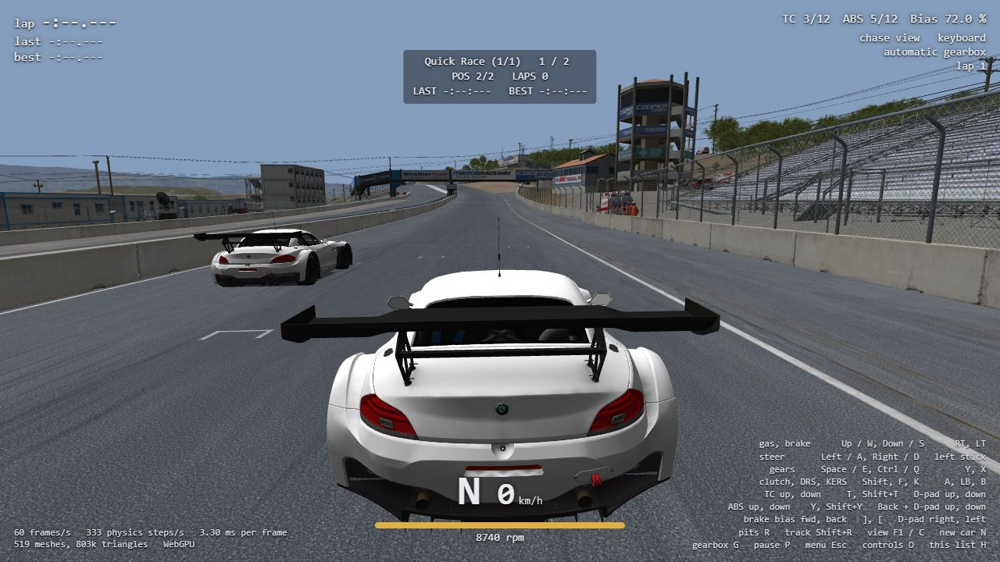
- The theme's results page after it: 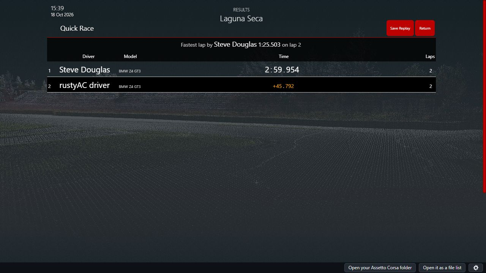
- The Race Weekend's results page: 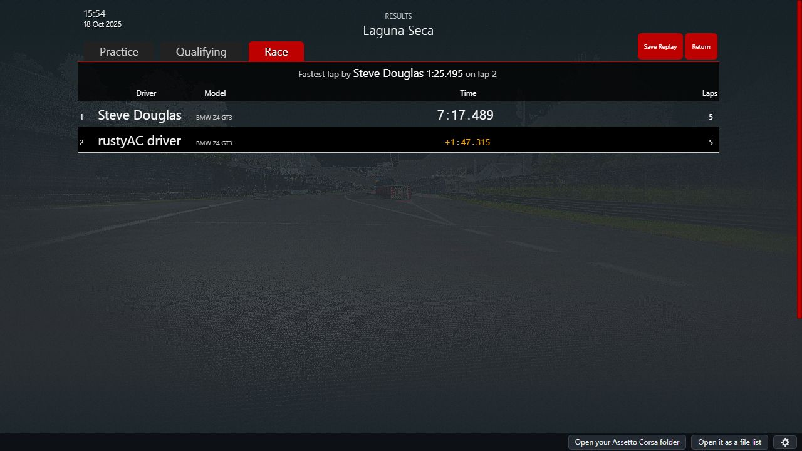

The Race Weekend click run skips Practice and Qualifying with F7 from the page, which lands on
a drawn frame (steps 13,472 and 26,888) and not on the desktop's `--next-session-at` step, so
its race differs from the desktop's live run; the tape replay above is the byte-for-byte proof
for the weekend. A live click run is bit-equal to the desktop only when the page keeps up: the
first Quick Race run on a busy machine (6 fps, dropped seconds) gave other lap times, the rerun
at 60 fps matched the desktop byte for byte.

## Speed

Physics only (no drawing), Quick Race at Laguna Seca with n AI Z4 GT3s, the player on the
autodriver, 6,667 steps (20 s) timed after the 20 s countdown, headless Chrome 155 on this PC
(16 threads, wasm single-threaded):

| AI cars | ms per step | real-time factor (physics) |
|---|---|---|
| 1 | 0.332 | 9.0× |
| 5 | 0.821 | 3.7× |
| 10 | 1.191 | 2.5× |
| 20 | 2.509 | 1.2× |

Drawing costs about 5 ms a frame on top (the drive's `work_ms_per_frame` at 60 fps with one
AI: 6-8 ms). So on this PC up to about 15 AI cars run in real time; 20 run just below real
time (slow motion, never other physics). On a machine half as fast, about 5-8 AI cars keep
real time; 10 and more run in slow motion. Wasm threads (COOP/COEP headers, SharedArrayBuffer,
the engine's workers) would spread the cars over cores; the result is the same bits for any
number of workers (desktop 0 vs 8 above). Not done.

## Drives without a page reload

The launcher's Start no longer reloads the page: the documents are saved, the theme is told
the game is running and hidden, the drive runs in a fresh canvas, and leaving it writes
`out/race_out.json` into the player's documents, saves them and shows the theme again
(`ACStoppedEvent`), which opens its results page. A folder opened as a file list stays
picked. Tested in headless Chrome: the AC folder opened once as a file list ("Open it as a
file list"), then three Practice drives in a row (Start, drive, Esc, results): each drive
from the file list (source `filelist`), the launcher back each time (starts 1, 2, 3), no
errors, no second pick.

## Selawik

`web/theme_glue.js` checks whether the system has "Segoe UI" (canvas text widths). Only when it
has not, it adds `@font-face` rules naming "Segoe UI" (400 / 300 light / 700 bold) and
"Segoe UI Light" with `local()` first and Selawik from `fonts/` second. Kunos' theme files are
unchanged; Windows with Segoe UI renders as before. `?font=selawik` (test hook) uses Selawik
anyway. The fonts are built with `fontmake -o ttf` from the sources of
github.com/microsoft/Selawik (commit 89362e8; the repository holds only sources); OFL-1.1, see
LICENSING.md. Tested in headless Chrome with `?font=selawik` (Segoe UI blocked: no
`local()`): `rustyacTheme.fonts` = `selawik`, the theme's document has the four faces loaded
(Segoe UI 400/300/700, Segoe UI Light 400) and the Drive screen is drawn in Selawik
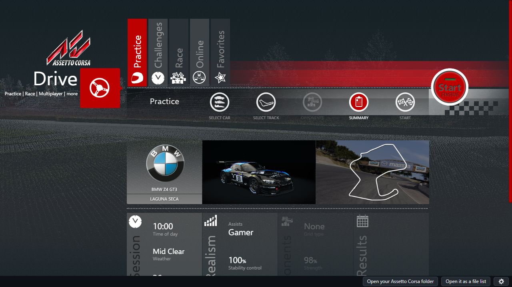

## How to use it

Open the page, Drive, Race: Quick Race or Race Weekend, pick opponents as in AC, Start. The
race runs in the page; leaving it (Esc, or the end of the last session) shows the theme's
results. Same for the player's own AC folder. A slower machine draws fewer frames and the race
runs in slow motion (`MAX_FRAME_SECONDS`); the physics never changes.

Test hooks: `?seed=n` (race.ini's draws, see above), `window.rustyac.raceProof(race, assists,
seed, tape_base64)`, `window.rustyac.raceSpeed(race, assists, seed, skip, steps)`; example
`cargo run -p rustyac-web --example race_proof -- --race <ini> --assists <ini> --seed n
--tape <ryin> [--out dir]` (also builds for wasm32-wasip1).

## New files in the web zip; files the preview pack must gain

New in the site zip: `fonts/selawik-regular.ttf`, `fonts/selawik-light.ttf`,
`fonts/selawik-bold.ttf`, `fonts/Selawik-OFL.txt` (a new `fonts/` folder beside
`acfs/`). Changed: `app.js`, `theme_glue.js`, `pkg/rustyac_web.js`, `pkg/rustyac_web_bg.wasm`.
rustyACSite's `scripts/fetch-web-preview.mjs` allowlist needs the four fonts files.

The preview pack (`tools/web_pack`, unchanged: it packs whole track folders) holds per track
`ai/fast_lane.ai`, `ai/pit_lane.ai`, `data/ai_hints.ini`, `data/ideal_line.ai`; the cars' AI
data is inside their `data.acd`. AC has no `system/setups/*/*/ai_default.ini` for the pack's
cars (looked up, optional). Pack: 1483.3 MB, 675 files.

## Unchanged

| check | result |
|---|---|
| clippy `-D warnings --all-targets` native; wasm32-unknown-unknown (`rustyac-web --all-targets`, CI's crate list `--lib`); wasm32-wasip1 (`rustyac-web --all-targets`, CI's crate list) | clean. `--all-targets` for the other crates on the wasm targets fails at v0.37.1 too (`net_probe` example and `input/bindings.rs` tests are desktop-only) |
| `cargo build/test --release --workspace --locked` | 65 suites, 314 passed, 0 failed |
| the nine tools `--locked` | built |
| physics dumps of Task 36's two fresh recordings (spa, magione with 3 AI) against v0.37.1 | identical (`c175020dafc14eeb`, `726ded63cbc5848b`); state hash the same with 0 and 8 workers |
| the committed net tape three ways; the 20 net goldens four ways | identical |
| plain CLI, a Content Manager race.ini | as before (333.33 Hz; 1 other car from race.ini) |
| keyboard tapes (3 × 2 × 2), pad tapes (5 × 2) | identical |
| recorded drives (`oracle/game/*.ryin` and Task 36's two), desktop against wasm32-wasip1 under wasmtime 49 | 158 of 158 identical at every step, 1,659,570 steps (two with their setup file mounted, as in Task 37b) |
| Task 37b's 12 request lists through the bridge in headless Chrome | 12 of 12 identical to the desktop's transcripts, written files' trees identical |

## Disk space

36 GB free at the start, 37 GB at the end (the test pack, the v0.37.1 build `tgt_old`, the
font build's venv and clone, the drives' hash files and the copied setup file deleted).

## Not done

- **Results of an online session.** Desktop `rustyac.exe` writes no race_out.json after an
  online session either: its online game has no referee, and the end-of-session results
  message (0x4b) is read but not written out. The page can only match the desktop once the
  desktop writes it (port `onlineEndSession`'s output first).
- Time Attack, Drift, Drag (Task 45); renderer, HUD, apps, sound (Tasks 38-41); the showroom;
  removing the old web menu code.
- Wasm threads for big grids (see the speed table).

## Open questions (decided without asking)

- A live browser drive is bit-equal to the desktop's only when the page keeps up (no dropped
  seconds): the first Quick Race click run on a busy machine (6 fps, slow motion) gave other
  lap times. The byte-identical guarantee is the tape replay; the full-speed click run matched
  the desktop byte for byte anyway.
- Selawik only where Segoe UI is missing (not always), so Windows keeps its own font.
- `--race-seed` added to `rustyac.exe` (default unchanged: the clock) instead of a page-side
  copy of the desktop's clock seed.

# Task 37b: AC's launcher in the browser page

## Summary

- **The page opens AC's launcher.** With the site's preview pack, the page shows the
  launcher's own theme (`launcher/themes/default` with its `.base` libraries, injected after
  load as the desktop does), at once, no button. A small bar at the page's bottom edge
  (outside the theme) has "Open your Assetto Corsa folder" (and back: "Use the preview
  pack") and a gear for the controls page. With no pack and no folder, a plain page of our own
  shows only the open-folder button. No Kunos file is in the repo or the release zip: the
  theme comes from the pack or the player's folder.
- **The theme's requests go to the desktop launcher's own bridge**, built for the browser:
  the same Rust code answers every `ac://` request as on the desktop. Task 35 and 36's request
  lists, run in headless Chrome through it: every answer and every written file identical to
  the desktop's (table below).
- **Only the Drive tile.** Career, replays, settings and quit are hidden and refuse clicks (by
  a script, a click on the logo too); Drive opens at once and keeps all its tabs. Time Attack,
  Drift and Drag Race show "... is not available in the browser version yet." in the theme's
  own dialog; sessions with AI opponents (Quick Race, Race Weekend with opponents) the same
  ("Sessions with AI opponents are not available in the browser version yet.").
- **Drive offline:** the theme writes race.ini through the bridge as on the desktop
  (byte-identical to the desktop launcher's for the same clicks: Practice, Hotlap, Quick Race,
  Race Weekend); the page then starts its game from that race.ini (car, skin, track, layout,
  session, conditions, assists, the desktop's own order of random draws), and when the player
  leaves, the referee's `race_out.json` goes to the player's `out` folder and the theme opens
  on its results page.
- **Online:** the site's own servers (`web/servers.json`, through the gateway, no UDP) are the
  entries of the theme's own server list, with their details and the password prompt; Join
  starts the page's multiplayer client from race.ini's `[REMOTE]`.
- **Pad proof:** the game's own gamepad car control (`JoypadCarControl`) run in-process on
  made-up controls.ini files and XInput states, `[X360] SPEED_SENSITIVITY` at the controls
  page's default 0.5, at 0, AC's 0.1, 1 and missing: 5 seeds x 20,000 calls, identical in
  the port.
- **Unchanged:** all earlier proofs pass (table "End checks").

## How the theme runs in the page

**Files.** `web/sw.js` is a service worker under the site's folder (`/play/app/` on the site).
It answers `<site>/acfs/ac/<path>` (the game's folder) and `<site>/acfs/docs/<path>` (the
player's documents) by asking the page for the bytes (a `MessageChannel`). The page reads them
from the preview pack (its manifest's `launcher` files, read once and kept in the pack's OPFS
cache) or from the player's folder (directory handles: `cfg`, `system/cfg`, `launcher/themes`
minus videos, `content/weather` ini files, every car's `ui` and skins' `ui_skin.json`,
`preview.jpg`, `livery.png`, every track's `ui`). The theme runs in an iframe at
`acfs/ac/launcher/themes/<theme>/index.html`; the worker puts `theme_glue.js` at the top of
its `<head>`. The theme is the one launcher.ini `[WINDOW] THEME` names, else `default`.

**`ac://` routing.** jQuery 1.9.1's requests (the theme's `$.ACCall`, `ACGet`/`ACSet` are
synchronous) go through the glue's `XMLHttpRequest`: `ac://...` and `http://ac/...` (posted)
go to the page's `Launcher.request` (the bridge in wasm) synchronously, as WebView2's custom
scheme does; files of the theme go to the worker; anything else (the theme's YouTube and
news feeds, the Kunos lobby) is blocked and reported. Answers carry the bridge's own
`file:///C:/assettocorsa/...` and `file:///C:/Documents/Assetto%20Corsa/...` URLs; the page
rewrites those two prefixes to `acfs/ac/` and `acfs/docs/`. The shell's events are the
desktop's: `uiready` enters the theme with `ACIntroEvent` and `ACVisible`, `Start` starts
the game, `Home` reloads the theme, `showcontrols` opens the controls page; the first-run
wizard (language) is loaded as the desktop's `WIZARD_JS` does.

**Storage.** The bridge sees the game's folder as `C:\assettocorsa` (read only) and the
player's as `C:\Documents\Assetto Corsa`, an in-memory `MemFiles` set up by the desktop's
own `setup_user_directory`. The page keeps it in OPFS (`rustyac-documents-1/documents.bin`,
saved 300 ms after each request that wrote, and before a drive starts). A new player's
`video.ini` gets the page's size (else the theme stops every Start for its video check).
A saved Drive tab the browser can't run (Time Attack, Drift, Drag Race) is set back to
Practice.

**The main-screen limit.** Nothing the bridge answers decides the left column's tiles (they
are fixed in the theme's `index.html`), so the glue hides them with CSS (`#menu ul
li:not([data-panel=drive])`), gives each a click handler that stops it (the theme's handlers
are on the document, so they never run), and turns off the logo's way to the intro page.
Drive is opened as soon as the theme is entered. Kunos files are never changed.

**Drive offline.** Start writes race.ini through the bridge; the page saves the documents,
reloads, reads `cfg/race.ini` and `cfg/assists.ini` and starts `Game.create_race`
(`crates/rustyac-web/src/race.rs`: the desktop's `conditions::apply` order: race.ini's
environment, spawn, session, the seed's `rand()` draws for the dynamic track, wind and the
gearbox, the player's skin as the desktop picks it, the referee's sessions and pit rules,
assists.ini; player only). Leaving writes the referee's `race_out.json` into the documents'
`out` folder and reloads into the theme, which is told `ACRunningEvent` then `ACStoppedEvent`
(the desktop shell's events): the theme shows its results page.

**Online.** `launcherLobby` (web/app.js) answers `getserverlist`, `getserver`, `pingserver`,
`getlanservers` from servers.json: each server is an entry with a made-up address
`10.37.0.<n>` (the page never connects to it), its track, cars and whether it has a
password. The theme's own requests to `http://10.37.0.<n>:<port>/JSON|...` (details, booking)
are answered by the page too. Join writes race.ini `[REMOTE]`; the page reloads and joins the
matching server through its gateway with the car, name and password from race.ini.

**Controls.** The gear opens the page's controls panel (Task 37's settings, the pad's
`[X360] SPEED_SENSITIVITY` among them, and the picture options that were on the old menu).

## Pad tape (Part 6)

`car_oracle pad-micro --seed <n> --root <dir>` (`tools/car_oracle/src/game/pad.rs`) runs the
game's `JoypadCarControl` constructor 0x1401d9280 (it reads `cfg/controls.ini` `[X360]`,
`[ADVANCED]` and the 27 action sections, and `system/cfg/assetto_corsa.ini [GAMEPAD]
USE_LEGACY_CODE`) and `acquireControls` 0x1401dbce0 on the game's `X360Joypad`, with
`XInputGetState` and `GetAsyncKeyState` answered by the oracle. Every 500 calls a new
controls.ini (SPEED_SENSITIVITY 0.5, 0, 0.1, 1, missing in turn; the other keys, the buttons
and keys of each action and the legacy switch random); every call random triggers, sticks
(the dead zone's edge too), buttons, keys, steer lock, speed and last steering. The tape holds
what the constructor read and every call's output (hex bits). `pad_steering_check` plays it
through the port (`crates/rustyac-game/src/input/pad.rs`):

| Seed | Calls | Settings | SPEED_SENSITIVITY 0.5 / 0 | Workers 0 | Workers 8 |
|---|---|---|---|---|---|
| 1 | 20,000 | 40 | 8 / 8 groups | IDENTICAL | IDENTICAL (8 runs) |
| 2 | 20,000 | 40 | 8 / 8 | IDENTICAL | IDENTICAL |
| 3 | 20,000 | 40 | 8 / 8 | IDENTICAL | IDENTICAL |
| 4 | 20,000 | 40 | 8 / 8 | IDENTICAL | IDENTICAL |
| 5 | 20,000 | 40 | 8 / 8 | IDENTICAL | IDENTICAL |

Fault test (`--fault`, SPEED_SENSITIVITY one bit off after reading): caught at call 2. One
thing found: the game keeps the action buttons in its own order (glance back before glance
right, the "up" before the "down" of brake balance, ABS, TC and turbo); the port keeps the
order it reads them in, which changes nothing it does (each button is looked up by name).

## Results

**The bridge in a real browser (proof 1).** Task 35 and 36's request lists (those that need
no server), run in headless Chrome through the bridge built for the browser
(`launcher_transcript`, the game's folder read from `web/serve.py --ac` over HTTP, an empty
player's folder) and through the desktop bridge (`transcript.exe`); answers and every file
the bridge wrote compared (`re/scratch/task37b/bridge/bridge.sh`):

| List | Requests | Answers identical | Written files |
|---|---|---|---|
| career | 3,756 | 3,756 | identical |
| champs | 4,012 | 4,012 | identical |
| guid | 3 | 3 | identical |
| hotlap | 1,974 | 1,974 | identical |
| options | 1,843 | 1,843 | identical |
| practice | 1,956 | 1,956 | identical |
| quickrace | 1,974 | 1,974 | identical |
| raceweekend | 2,007 | 2,007 | identical |
| replays | 14 | 14 | identical |
| results | 6 | 6 | identical |
| special | 3,824 | 3,824 | identical |
| videomodes | 2 | 2 | identical |

Two things this found, both fixed in the page: a synchronous request's text loses a file's
byte-order mark (Chrome decodes it even with `x-user-defined`), so the page makes the bytes
again from the file's length; and the special events are sorted by their folders' write
times, two of which share a millisecond in AC's folder, so the page keeps the times'
fraction.

**Session kinds (the desktop launcher against the page, same clicks, same test pack):**

| Session | race.ini | In-page game |
|---|---|---|
| Practice (Ferrari F2004, Spa) | identical (desktop `rustyac-launcher.exe` script vs page flow) | drove `ks_ferrari_f2004`, skin `00_official`, `spa`, pit; results page after leaving |
| Hotlap (BMW Z4 GT3, Laguna Seca) | identical | drove `bmw_z4_gt3`, skin `0_bmw_motorsport_2013_black`, `ks_laguna_seca`, hotlap start; results page |
| Quick Race (with AI) | identical | refused with the notice (AI not in the browser yet) |
| Race Weekend (with AI) | identical | refused with the notice |
| Online (local acServer copy + gateway) | `[REMOTE]` written by the theme | joined: server log "Dispatching TCP message to ks_ferrari_f2004 (0) [rustyAC driver []]", left cleanly, back on the theme |

The same Practice flow from a player's folder (`?testfolder=`, the test hook for "Open your
AC folder") gave the same race.ini and drive. Every run: no JavaScript error; the only
blocked requests are the theme's YouTube and news feeds.

**Nothing outside Drive is reachable:** clicking career, replay, options, exit and the logo
(jQuery `.click()` as the tests do, and DOM clicks) leaves the Drive panel the only one shown.

**Desktop launcher and page, Drive -> Practice summary** (left the desktop's
`rustyac-launcher.exe`, right the page; the same apart from the missing tiles and the
page's bottom bar):

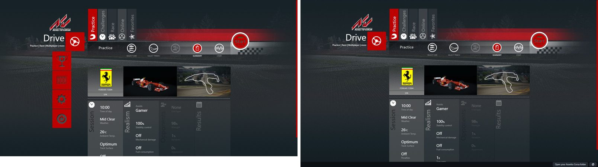

**Screenshots (the page, 1600x900):**

- Start page (no pack, no folder): 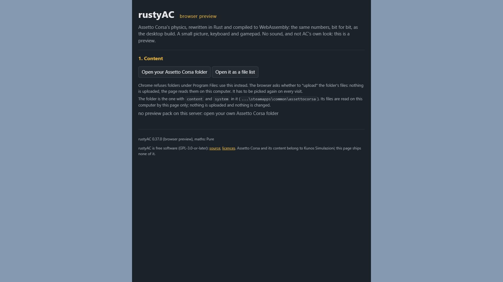
- Main screen: Drive only: 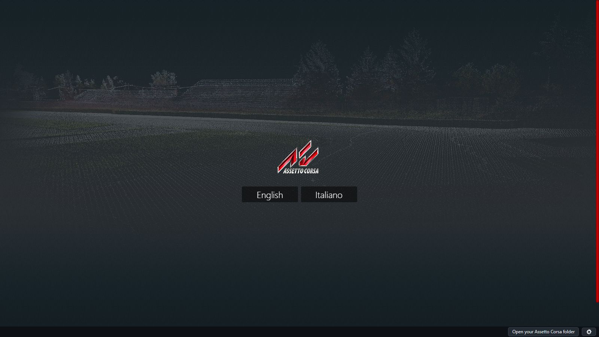
- Car select: 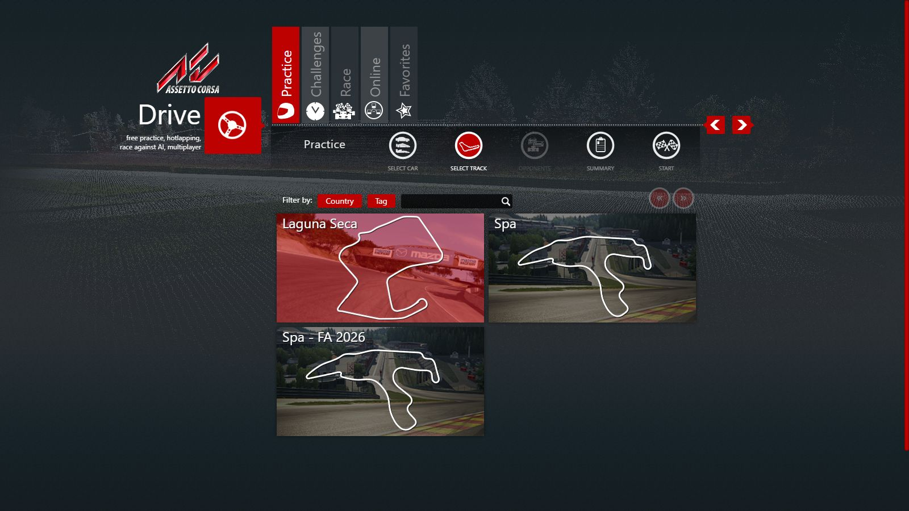
- Track select: 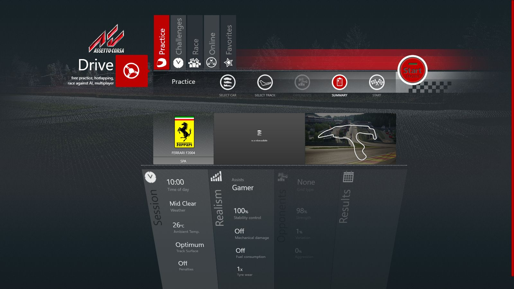
- Race setup (Practice summary): 
- Online list (the site's servers): 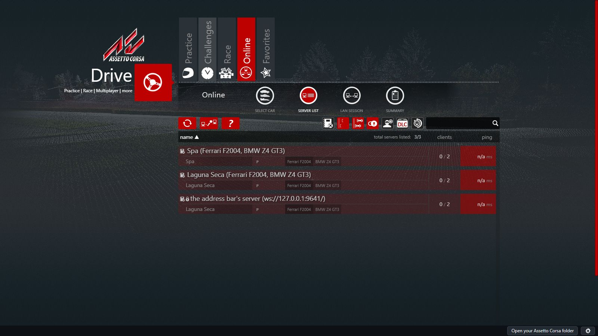
- Controls page (the gear): 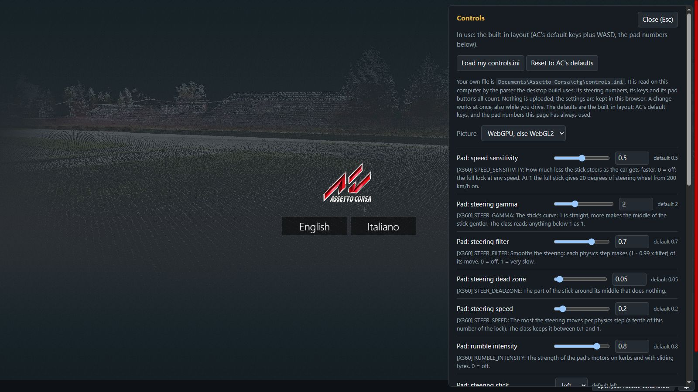
- Results page after a drive: 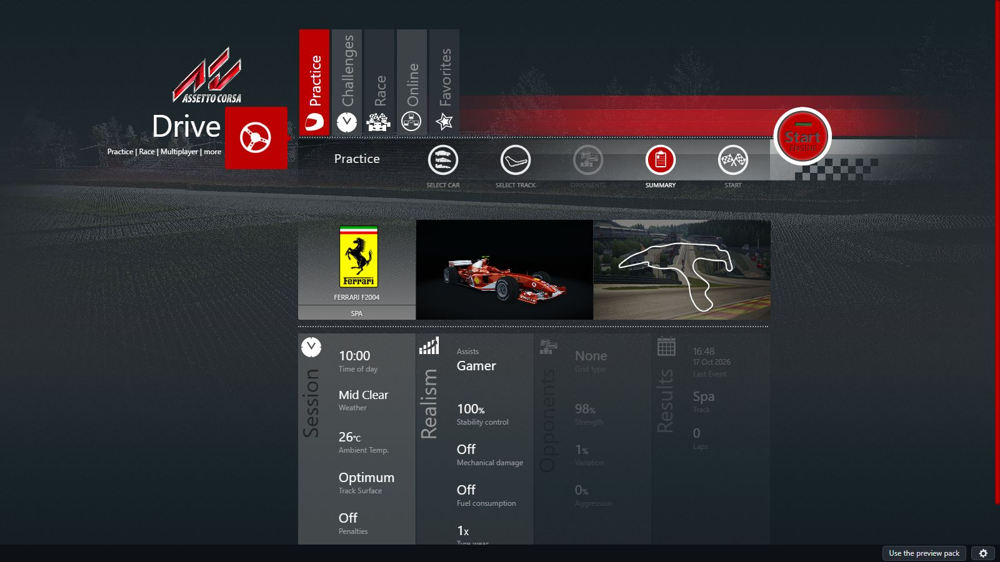

**End checks (nothing else changed).** On the final code (`re/scratch/task37b/end_a.sh`,
`end_b.sh`, `drives.sh`; v0.37.0 built once into `re/scratch/task37b/tgt_old` for the
comparisons, deleted afterwards):

| Check | Result |
|---|---|
| clippy `-D warnings --all-targets` native, the CI line, wasm32-unknown-unknown, wasm32-wasip1 | clean |
| `cargo build` / `cargo test --release --workspace --locked` | built; 65 suites, 314 passed, 0 failed |
| `python web/build.py`, the nine tools (`--locked`), the .NET launcher oracle | built |
| physics dumps against v0.37.0: `spa.ryin` | the same (`c175020dafc14eeb`); state hash `af262162d7ae332b` with 0 and 8 workers, both versions |
| physics dumps against v0.37.0: `magione_ai.ryin` | the same (`726ded63cbc5848b`); state hash `b0d997d76d84e9cd` with 0 and 8 workers, both versions |
| the 20 multiplayer goldens, four ways (desktop, WebSocket, gateway, wasm) | 80 of 80 identical |
| the committed multiplayer tape, desktop / browser / gateway | identical, 3,000 steps |
| plain command line, Content Manager's race.ini | run, exit 0 |
| Tasks 35 and 36's launcher answers against the .NET launcher | hotlap 1,974/1,974, options 1,843/1,843, practice 1,956/1,956, probe 59/59, quick race 1,974/1,974, race weekend 2,007/2,007, results 5/6 (the date, as at v0.37.0), smoke 10/10, career 3,756/3,756, championships 4,012/4,012, replays 14/14, special events 3,824/3,824, video modes 2/2 (`guid`: the oracle refuses it, as at v0.37.0); the player's folders identical; the real Documents folder unchanged |
| the keyboard tapes (Task 37), 0 and 8 workers | 12 of 12 identical |
| the pad tapes (this task), 0 and 8 workers | 10 of 10 identical; the fault run caught at call 2 |
| GUI sequences of Tasks 29 to 34 (41 sequences, setup pages included) | all exit 0, 82 of 82 comparisons IDENTICAL, none different |
| recorded drives (`oracle/game/*.ryin` and Task 36's two), desktop against wasm32-wasip1 under wasmtime 49.0.3 | 158 of 158 identical at every step, 1,659,570 steps (two needed their setup file mounted, as in Task 37) |

## How to use it in the browser

- Open the site's play page (or locally `python web/serve.py`, then
  `http://127.0.0.1:8080/`). With the preview pack the launcher opens at once; Drive is the
  only tile. Pick a tab (Practice, Hotlap, ...), the car and track, press Start: the game starts
  in the page; Esc leaves and the results page shows.
- "Open your Assetto Corsa folder" (bottom bar) uses your own game folder instead (Chrome or
  Edge; it is remembered); "Use the preview pack" goes back. For a folder under Program Files
  (refused by Chrome's picker) "Open it as a file list" works too: tested on the whole AC
  folder (32,490 files listed, 8,595 kept, launcher up in 8.3 s, 182 cars in the theme).
- Online: Drive -> Online lists the site's servers; pick one, a car, Join (password if it has
  one).
- The gear (bottom right) opens the controls (keyboard and pad speed sensitivity, steering
  speeds, the picture options).
- Test hooks still work: `?go=1&autodrive=1&car=..&track=..`, `?join=..`, `?selftest=N`
  open the old page; `?launcher=0` too.

## New or renamed files in the web zip; files the preview pack must gain

New in the site zip (all GPL, ours): `launcher.js`, `theme_glue.js`, `sw.js` (the service
worker must be served from the play page's own folder, `/play/app/sw.js`, so its scope
covers `/play/app/acfs/`). Changed: `index.html`, `app.js`, `style.css`, `servers.json`
(entries have `track`). rustyACSite's `scripts/fetch-web-preview.mjs` allowlist needs the three
new files.

The preview pack (made by `tools/web_pack`) gains a `launcher` list in `manifest.json` and
these files (24.2 MB, 638 files for the two cars and two tracks): `cfg/**`, `system/cfg/**`,
`launcher/themes/.base/**`, `launcher/themes/default/**` without `video/intro.ogv`,
`content/weather/**/*.ini`, per car `content/cars/<car>/ui/**` and
`content/cars/<car>/skins/*/{ui_skin.json,preview.jpg,livery.png}`, per track
`content/tracks/<track>/ui/**` without videos.

## Notes from Task 37's reading (moved here from re/scratch/task37)

- `getthememodules` is not the menu: it only feeds the Options page's module manager. The
  theme's modules are loaded by name in `js/ui.js:366-385` (`__AC.loadModule`); Profile is
  needed by Drive's Start and Online's Join, Online by Online.
- The left column is hard-coded in `index.html:52-110` (drive, career `nonselect`, replay,
  options, exit); `ui.js:553-600` handles `#menu li:not(.disabled)` clicks on the document;
  the logo (`ui.js:500-512`) calls `ac://home` when the intro panel is already shown.
- Drive's tabs (`index.html:215-278`, `ui.js` `modeHandler` 4394-5119): practice, challenges
  (hotlap, special events, time attack, drift), race (quick race, race weekend, drag race),
  online, favorites. The last tab is restored from `launcher.ini [SAVED] DRIVE`.
- Other ways to other pages: the host events `ACGotoCareerEvent`, `ACGotoChamps`,
  `ACGotoSpecialEvent` (never raised by the page), the "verify your video settings" dialog
  (opens Options: avoided by giving `video.ini` a size), the intro panel's links.
- Transport (`.base/ac.utils.js`): `$.ACCall(m, params)` is a synchronous `$.ajax` to
  `ac://m?params` (10 s timeout); `ACGet`/`ACSet`/`ACClear` are `getsetting`/`setsetting`/
  `delsetting`; `listcars`/`listtracks`/`getskinmeta` are asynchronous.
- Start: `ui.js:807-1228` writes race.ini with `ACSet` (opponents' names and skins with
  `Math.random`), then `ac://start/?...` after 1.5 s; `ACStoppedEvent` (`ui.js:1397-1426`)
  needs no earlier state and ends in `_returnFromGame` -> results (`getresults`:
  `race_out.json`, `results.js:620-690`).
- Online (`modules/online/online.js`): `getserverlist` entries `{ip, port, cport, tport,
  name, clients, maxclients, track, cars, session, sessiontypes, durations, timeleft, pass,
  pickup, ...}`, details from `http://ip:cport/JSON|<guid>`, Join writes `[REMOTE]`
  `SERVER_IP`, `SERVER_PORT`, `SERVER_NAME`, `SERVER_HTTP_PORT`, `REQUESTED_CAR`, `NAME`, `TEAM`,
  `PASSWORD`, `GUID` and `ACTIVE=1` (`online.js:400-480`); the password comes from
  `.serverpass` or localStorage `serverpass_<name>`.
- Fonts: the theme uses the system's "Segoe UI" (no font files), so the page looks like the
  desktop only where that font exists (Windows).
- The page before this task (`web_now.md`): `web/build.py` builds the site from a fixed list of
  files (anything else stops the build); `web/serve.py` serves only 127.0.0.1 (pack at
  `/preview/`, `--ac` folder at `/ac-test/` with `?list=1`); the pack format
  `rustyac-preview-pack-1` (manifest `cars`, `tracks`, `shared`, `files[{path, bytes,
  sha256}]`, now `launcher`); `web/check.mjs` runs headless Chrome and waits on
  `window.rustyac.state`.

## Disk space

33 GB free at the start, 40 GB at the end (the test pack, the acServer copy, the old-version
build `tgt_old`, the headless browser profile and the drives' hash files deleted).

## Not done (Task 37c)

(As left by Task 37b. Task 37c did the AI opponents, the fonts and the drives without the
reload; see "Task 37c" above.)

- **AI opponents in the browser.** rustyac-physics' AI builds for wasm, but the page's
  session draws and drives the player's car only (no opponent cars' models, no
  `conditions::race_cars` port, which reads the cars folder and the track's pits). Quick Race,
  Race Weekend and any session with `[RACE] CARS>1` stop at Start with the notice.
- **Time Attack, Drift, Drag Race** (Challenges) stop with the notice; Special Events are
  listed by the theme but those with AI stop at Start like the races (the pack has none).
- **The renderer, HUD, apps, sound in the page** (Tasks 38-41): the in-page game's picture is
  still Task 26's; skins are set in the session but not drawn.
- **The showroom** (`ac://showroom`) answers as on the desktop's not-ported list.
- **Results of an online session**: leaving an online drive returns to the theme without a
  `race_out.json` (the client keeps no referee of its own).
- **The theme's intro video** (`video/intro.ogv`, 169 MB) is left out of the pack and of the
  folder walk; the theme skips it.
- **Fonts away from Windows**: the theme asks for "Segoe UI"; other systems show their own
  sans-serif.
- **The old web menu's code** is still in `index.html` / `app.js` (hidden): the URL test
  hooks (`?go=1`, `?join`, `?selftest`, `?launcher=0`) use it. Moving the hooks onto the
  launcher and deleting it is left.
- **Firefox and Safari**: "Open your Assetto Corsa folder" needs the File System Access API
  (Chrome, Edge); elsewhere only the pack (and the folder picker's file list, as before).
- **A folder opened as a file list** (Chrome's way for a folder under Program Files, and
  Firefox's / Safari's only way) is not kept by the browser over the page's reload when a
  drive starts and ends: the page asks for the same folder again (one click each time; tested:
  whole AC folder, Practice, drive, results). A drive without the reload would remove this.

## Open questions (Task 37b, decided without asking)

- The "... is not available in the browser version yet." notices are our text in the
  theme's own dialog (`UI.displayDialog`): the original launcher has no such message for these
  modes (it would just start the game).
- Hiding the other tiles is done by our glue (CSS and a click handler), because nothing the
  bridge answers decides them: the least intrusive way without changing Kunos files.
- The service worker (not blob URLs) serves the theme, so its relative paths, CSS `url()`s
  and the bridge's `file:///` URLs (rewritten to `acfs/`) all work unchanged; it needs the
  site to serve `sw.js` from the play page's folder.
- The online server list gives every site server a made-up address `10.37.0.<n>`: the theme
  wants an IP and ports, the page never connects to them (only to the gateway).
- A drive starts by reloading the page (as the old page did for a second drive): the
  documents are saved to OPFS first. A drive in the same page without the reload would need
  the game's GPU objects freed; not tried.
- The first-run wizard (language) shows for a new browser player, as the desktop launcher
  shows it on fresh documents.
- The pad tape uses made-up controls.ini files and XInput states (no real pad), and the
  game's own button order differs from the port's in four pairs; that changes nothing
  measurable (each button is found by name), so the port keeps its order.

# Task 37: keyboard steering, the bridge without Win32

## Summary (Task 37)

- **Multiplayer goldens back.** The five tapes and 20 goldens Tasks 25–26 checked against
  were gone; they were recorded again from live sessions and now live in `re/gold/net/`,
  with the scripts to remake and check them in `tools/net_gold/`. Doing so found a port bug
  (a collision on the very step of a collision report went into the next report); fixed.
  All 20, four ways each: identical to the game.
- **Keyboard steering is the game's now.** The look-ahead along the track's AI line
  (`stepSteer`) was missing (it gave 0); it is ported 1:1 and checked against the game's own
  code run in-process: 120,000 calls, identical.
- **A speed-sensitivity setting** for the keyboard (rustyAC's own; 1 = AC exactly, 0 = speed
  doesn't limit or slow the steering) and a **controls page** to set it and the pad's, opened
  by the launcher theme's controls button.
- **The launcher fills its cfg from the player's real AC cfg** on first start (missing files
  only, the real folder only read).
- **The launcher's bridge runs without Windows**: a pure-Rust copy of Windows' ini calls
  (identical to Windows on 20,000 generated files) and a file layer, so the bridge builds for
  the browser; its wasm build answers Task 35–36's 12 request lists exactly as the desktop.
- **Not done:** the theme inside the browser page (B.2 to B.6): the browser still has the old
  menu, unchanged. See "Not done".

## How to use it

Desktop:

- Keyboard steering needs nothing: the look-ahead is on whenever the track has an AI line.
- In the launcher (`rustyac-launcher.exe`), the theme's controls button opens the controls
  page: move "Speed sensitivity" (or press "Off" for 0), Save, Back. It writes the launcher's
  `cfg\controls.ini` (`[KEYBOARD] RUSTYAC_SPEED_SENSITIVITY`, `[X360] SPEED_SENSITIVITY`, ...);
  the next drive uses it. The same key can be set by hand in `cfg\controls.ini`.
- First start of the launcher: the player's `Documents\Assetto Corsa\cfg\*.ini` that the
  launcher's own `cfg` lacks are copied in. `--player-cfg <folder>` names another folder,
  `--player-cfg none` turns it off.
- `rustyac-launcher.exe --pure-ini` uses the pure ini copy instead of Win32 (for checks).

Multiplayer goldens: `sh tools/net_gold/record.sh`, `sh tools/net_gold/gold.sh`,
`sh tools/net_gold/check.sh` (docs/port/multiplayer.md, "Golden tapes").

Browser: nothing new yet (the old menu is as it was).

## New or renamed files in the web zip

None: nothing under `web/` changed in this task.

## Disk space

44 GB free at the start, 34 GB at the end (see "End checks").

## Part 0: the multiplayer tapes

Where they live, how to rerun them and the results: docs/port/multiplayer.md, "Golden tapes:
where they live and how to make them again (Task 37)". In short: `re/gold/net/tapes/` (five
tapes), `re/gold/net/*.netgold` (20 goldens); on v0.36.0 19 of 20 were made and 76 of 76 checks
identical; the 20th showed the collision-report bug; after the fix 20 of 20 and **80 of 80
identical** (desktop, WebSocket, gateway, wasm under wasmtime 49.0.3).

## Part A: the keyboard's steering

### A.1 `KeyboardCarControl::stepSteer` (0x140111650), 1:1

Before this task the port's `step_steer` gave 0, so the keyboard's speed limit was always the
plain `π/(0.5·v+1)`. In the game, `stepSteer` looks ahead along the track's AI line
(`AISplineRecorder`'s best-lap spline, which `load` fills from `ai/fast_lane.ai`):

- with no line it puts the car on the nearest point once (`closestPointIndex`, 0 for an
  empty line) and the look-ahead point is the world's origin;
- with a line the index stays where the constructor put it (-1: the game never moves it),
  `getCarPositionOnSpline` projects the car on the segment there, and `getPointAtDistance`
  walks forward until `lookAhead` (8 m by default) is reached;
- the point in the car's own frame (`dBodyGetPosRelPoint`), `-x · steerGain`, not finite → 0,
  ±0.9, the understeer branch (never taken: nothing sets it), ±0.9.

`getKeyboardSteering` then keeps whichever is larger, that or `π/(0.5·v+1)`. The port
(`crates/rustyac-game/src/input/keyboard.rs`) follows the machine code's order of operations
(checked with `tools/disasm.py`, not the pseudo-C). Its car pose is the `CarProbe` the
keyboard already had (position and left axis of the body's world matrix); the line is the
track's, given to the live driver by `set_track` (desktop and browser).

One shortcut, commented in the code: the game's walk along the line never stops if the line is
shorter than the look-ahead; the port stops after one lap of points.

**Oracle.** `car_oracle steer-micro --seed <n> --root <folder>` builds the game's own objects
in-process: a `PhysicsEngine`'s rigid body (the game's ODE), a `KeyboardCarControl` with six
sets of settings (AC's first), and an `AISpline` loaded by the game's `AISpline::load` from a
copy of Laguna Seca's `fast_lane.ai` (2,331 points), or none. Every call puts the body
somewhere new (near the line, far from it, turned, rolled), with random speed, step, keys and
last steering, calls the game's `stepSteer` and `getKeyboardSteering`, and writes what went in
and came out (hex bits) to a tape. `keyboard_steering_check` (an example of `rustyac-game`)
plays a tape through the port.

| Tape | Calls | Workers 0 | Workers 1 | Workers 8 |
|---|---|---|---|---|
| seed 1, on the line | 20,000 | IDENTICAL | IDENTICAL | IDENTICAL (8 runs) |
| seed 1, no line | 20,000 | IDENTICAL | IDENTICAL | IDENTICAL (8 runs) |
| seed 2, on the line | 20,000 | IDENTICAL | IDENTICAL | IDENTICAL (8 runs) |
| seed 2, no line | 20,000 | IDENTICAL | IDENTICAL | IDENTICAL (8 runs) |
| seed 3, on the line | 20,000 | IDENTICAL | IDENTICAL | IDENTICAL (8 runs) |
| seed 3, no line | 20,000 | IDENTICAL | IDENTICAL | IDENTICAL (8 runs) |

The line's points the game loaded are compared with the port's `AiSpline::load` too (all the
same). Fault test (`--fault`: `STEER_GAIN` one bit off): caught at call 1 on the line, at
call 32 without one.

Found on the way: the game's `steeringMovement` reads the car's own speed
(`Car::getSpeed`, +0x3e90), not the input's; in the game they are the same number, and the
port uses the input's for both. The oracle writes the speed into its stand-in car.

### A.2 Speed sensitivity (rustyAC's own setting, not part of vanilla AC)

`controls.ini` `[KEYBOARD] RUSTYAC_SPEED_SENSITIVITY` (0 to 1, default 1) scales the speed `v`
in both places the keyboard's steering uses it: the limit `π/(0.5·v+1)` and
`steeringMovement`. 1, or the key missing, is AC's own rule bit for bit (the tapes above,
played again with the key set to 1: IDENTICAL); 0 takes the speed out (a unit test: held
steering at 80 m/s reaches full lock with 0, about π/41 with 1).

The pad already has AC's own `[X360] SPEED_SENSITIVITY`; the controls page's pad slider
writes that key. There is no pad oracle in this task: that the port reads it as the game does
is from Task 26's port, not proven again here.

### A.4 The controls page

`crates/rustyac-launcher/src/controls.html`, rustyAC's own page (no Kunos files): the
keyboard's speed sensitivity (with an "Off" button: 0) and its three steering speeds, the
pad's speed sensitivity (with "Off"), steering speed and filter. It reads and saves the
launcher's `cfg\controls.ini` through the bridge's own `getiniasjson` / `savejsontoini`. On the
desktop the theme's controls button (`ac://showcontrols`) opens it in the launcher's window;
"Back" goes home to the theme. Checked with a launcher script (off screen): the page opened, a
sensitivity of 0.4 and the pad's Off were saved (`RUSTYAC_SPEED_SENSITIVITY=0.4` and
`[X360] SPEED_SENSITIVITY=0` in the file), Back returned to the theme.

### A.5 The launcher's cfg files seeded from the player's (rustyAC's own)

The launcher's player folder is rustyac.exe's, not `Documents\Assetto Corsa`. On a window
start (not `--transcript`, so the Task 35/36 comparisons are untouched), every `.ini` of the
player's real `Documents\Assetto Corsa\cfg` that the launcher's own `cfg` lacks is copied
first, then AC's own setup runs (and merges its defaults in, as always). The real folder is
only read. `--player-cfg <folder|none>` names another one.

Checked (`re/scratch/task37/seed.sh`, a fake "real" cfg folder): first start, `controls.ini`
and `video.ini` came from it, a `.txt` did not; second start, the launcher's own changed
`controls.ini` was kept; the real `Documents\Assetto Corsa` hashed the same before and after.

## Part B.1: the bridge without Win32

### The pure-Rust copy of the ini calls

`crates/rustyac-launcher/src/profile.rs` is rustyAC's own copy of what
`GetPrivateProfileStringW` and `WritePrivateProfileStringW` do with a file of the ANSI code
page (1252): the trimming, the quotes, comments, the first matching section only, ASCII-only
case, the list mode and its short-buffer rules, where a new key or section goes, what a
deletion takes with it (and what it leaves: comment lines at a section's end), the line
endings Windows adds. Every rule came from Windows itself (PowerShell probes in
`re/scratch/task37/ini_probe*.ps1`), not from a guess.

`crates/rustyac-launcher/tests/profile.rs` generates files (sections, keys, values, quotes,
comments, blanks, odd lines, all line endings, characters of 1252 and ones outside it),
makes every read the launcher makes plus short buffers 0 to 8, then up to five random writes
and deletions, and compares buffers, answers and the files' bytes with Windows' own calls on
a real file:

| Files | Reads | Writes | Result |
|---|---|---|---|
| 3,000 (the test's default) | 77,844 | 7,387 | all the same as Windows |
| 20,000 (`PROFILE_CASES=20000`) | 519,272 | 49,575 | all the same as Windows |

Left out (28 of the 20,000 files): files Windows itself takes for UTF-16 (it guesses so for
some tiny files, such as `[` and a line feed); the copy reads every file as ANSI, as the
launcher's files are (shortcut, commented in the code).

`ini.rs` uses the copy where there is no Win32 (the browser); the desktop keeps Win32, and
`rustyac-launcher --pure-ini` switches it to the copy. Task 35 and 36's request lists through
the desktop bridge twice, Win32 and `--pure-ini` (`re/scratch/task37/pure_cmp.sh`, the 12
lists that need no server): **every answer and every file of the player's folder the same**,
except the one answer that carries a time (`getresults`' date is `race_out.json`'s write
time, made during each run).

### The bridge builds for the browser

- Every file call of the bridge goes through `files.rs`: the disk (`Disk`), or files the page
  mounts (`files::mount`; `MemFiles` is an in-memory store with Windows' rules: any case,
  `\` or `/`, folders must be made, names listed in NTFS's order).
- `lib.rs` is no longer Windows-only: the shell (WebView2), `sys.rs` (the Win32 host) and the
  online jobs' network code stay `cfg(windows)`; in the browser `online::job` has nothing to
  do (the page's own server list, Part B.5). The backup of the launcher's browser data is
  desktop-only (the browser launcher has none).
- `transcript::Fixed` is a host with the same screen, times and player everywhere, and
  `examples/transcript.rs` runs a request list with it: built for `wasm32-wasip1`, it is the
  bridge's wasm build with a real file system under it.

Task 35 and 36's 12 request lists, the desktop (`transcript.exe`, Win32 ini) against the wasm
build under wasmtime 49.0.3 (pure ini), the AC folder and the player's folder given to it as
`/acroot` and `/player` (`re/scratch/task37/wasm_cmp.sh`; the folders' names are made one
token, and `getresults`' date is left out):

| List | Answers | Player's folder |
|---|---|---|
| hotlap | 1,974 of 1,974 identical | identical |
| options | 1,843 of 1,843 | identical |
| practice | 1,956 of 1,956 | identical |
| quickrace | 1,974 of 1,974 | identical |
| raceweekend | 2,007 of 2,007 | identical |
| results | 6 of 6 | identical |
| career | 3,756 of 3,756 | identical |
| champs | 4,012 of 4,012 | identical |
| guid | 3 of 3 | identical |
| replays | 14 of 14 | identical |
| special | 3,824 of 3,824 | identical |
| videomodes | 2 of 2 | identical |

Under node's own WASI (node 26.4.0, `re/scratch/task37/wasi_node.mjs`) the same module can't
list a folder on Windows (`fd_readdir` answers ENOSYS, os error 52), so every list that reads
the content folders differs; that is node's, not the bridge's. The browser itself is Part B.2.

## End checks (nothing else changed)

On the final code (`re/scratch/task37/end_a.sh`, `end_b.sh`, `drives.sh`; v0.36.0 built into
`re/scratch/task37/tgt_old` for the comparisons, deleted afterwards):

| Check | Result |
|---|---|
| clippy `-D warnings --all-targets`, the CI line, wasm32-unknown-unknown, wasm32-wasip1 | clean |
| `cargo build` / `cargo test --release --workspace --locked` | built; 65 suites, 313 passed, 0 failed |
| `python web/build.py`, the nine tools, the .NET launcher oracle | built |
| physics dumps against v0.36.0: `spa.ryin` | the same (`c175020dafc14eeb`); state hash `af262162d7ae332b` with 0 and 8 workers, both versions |
| physics dumps against v0.36.0: `magione_ai.ryin` | the same (`726ded63cbc5848b`); state hash `b0d997d76d84e9cd` with 0 and 8 workers, both versions |
| the 20 multiplayer goldens, four ways | 80 of 80 identical (Part 0) |
| the committed multiplayer tape, desktop / browser / gateway | identical, 3,000 steps |
| plain command line, Content Manager's race.ini | run, exit 0 |
| Tasks 35 and 36's launcher answers against the .NET launcher | hotlap 1,974/1,974, options 1,843/1,843, practice 1,956/1,956, probe 59/59, quick race 1,974/1,974, race weekend 2,007/2,007, results 5/6 (the date, as before), smoke 10/10, career 3,756/3,756, championships 4,012/4,012, replays 14/14, special events 3,824/3,824, video modes 2/2; the player's folders identical; the real Documents folder unchanged |
| the keyboard tapes (Part A), 0 and 8 workers | 12 of 12 identical |
| GUI sequences of Tasks 29 to 34 (41 sequences, setup pages included) | all exit 0, 82 of 82 comparisons IDENTICAL, none different |
| recorded drives (`oracle/game/*.ryin` and Task 36's two), desktop against wasm32-wasip1 under wasmtime 49.0.3 | 158 of 158 identical at every step, 1,659,570 steps (two needed their setup file mounted: a copy of the player's `god.ini` and `re/scratch/task15/god_tc4.ini`) |

Disk: 44 GB free at the start, 34 GB at the end.

## Not done in Task 37 (done by Task 37b unless listed under Task 37c)

Parts B.2 to B.6 were not started: the time went to Part 0 (one port bug found in the
goldens, fixed), the ini copy's many Windows rules, and the end checks. The browser's page is
unchanged: its old menu is still the default and still works (nothing half-wired in it).

- **B.2** the launcher's theme in the page, from the preview pack (and "Open your AC folder"),
  the `.base` libraries injected as `JSIncludeDefaultLibs` does, `ac://` routed to the wasm
  bridge; `tools/web_pack` taking `launcher/themes/` (the pack's files to add are not yet
  listed).
- **B.3** only Drive (practice, quick race, race weekend, hotlap) and Online reachable. From
  the reading: `getthememodules` only feeds the module manager; the menu and Drive's tabs are
  in the theme's `index.html` and `js/ui.js`, so the page has to hide or refuse the others
  (career, special events, time attack, drift, drag, replays, options' other pages,
  `ACGotoCareerEvent` and its kind).
- **B.4** race.ini from the theme to the in-page game and back with results (the page's game
  takes no race.ini today: `rustyac-web`'s `content::setup` fixes the session).
- **B.5** Online from `web/servers.json` through the gateway, as lobby entries (the theme also
  asks servers' own HTTP ports, which the page cannot reach: a proxy is needed).
- **B.6** the old menu removed; and the controls page in the browser (A.4's browser half: the
  page is ready to be served, it takes `window.rustyacBridge`).
- Proofs 5 (in a headless Chrome; node's WASI cannot list folders on Windows), 6 (the page's
  screenshots) and the browser half of 4.

## Open questions (Task 37)

- The pad's `SPEED_SENSITIVITY` is AC's own key; is a pad oracle (like the keyboard's) wanted,
  to prove the slider's 0 against the game?
- The keyboard look-ahead without a track line aims at the world's origin, as the game's
  does (nothing loaded = no `fast_lane.ai`): keep it the game's, or give rustyAC its own
  fallback (the old 0)?
