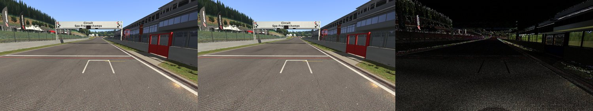
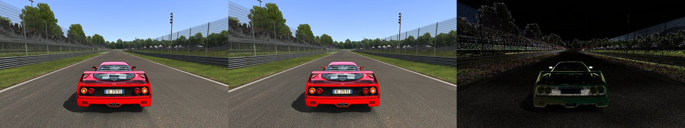
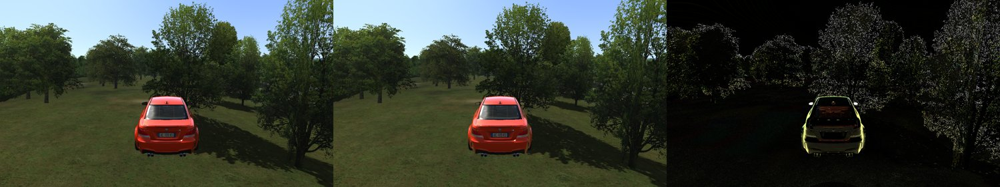
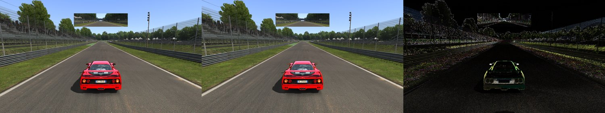
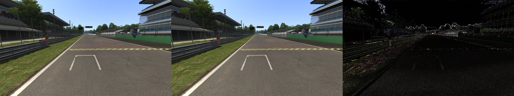
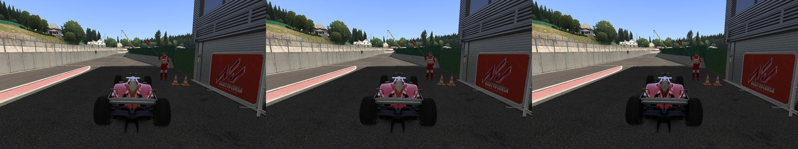
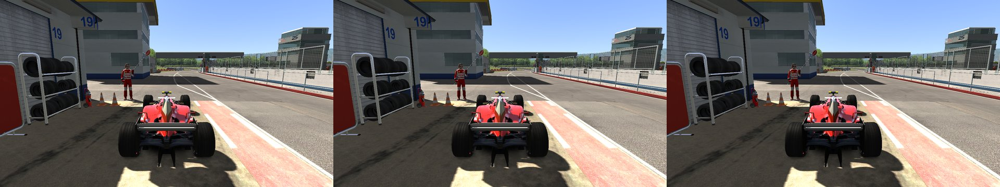
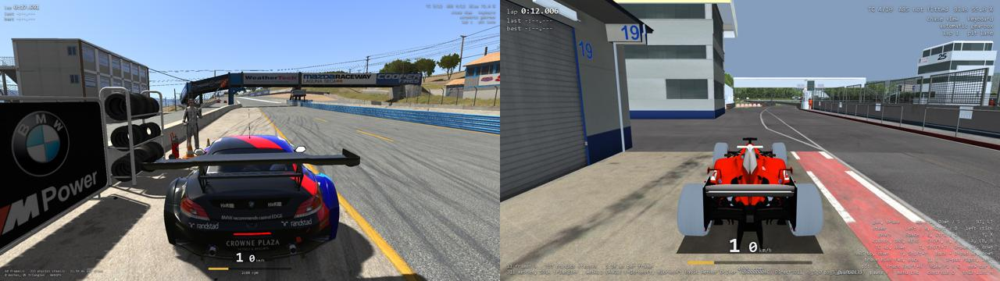

# AC's renderer in the browser, part 1 (Tasks 38, 38b, 38h and 38i, v0.38.0, v0.38.1, v0.38.7 and v0.38.8)

> **Task 38c:** the `re/scratch/task…` paths below are history: those folders were scratch and
> most were deleted in the disk cleanups of 2026-10-15 and 2026-10-18. Every proof of this report
> reruns from `tools/proofs` (`sh tools/proofs/run_all.sh`); `docs/port/proofs.md` lists each path
> and what replaces it.

## Resume here

Task 38j (v0.38.9) closed the Full-mode leftovers: the page reads race.ini's sun, weather and
grip as rustyac.exe does (`RaceLook`), Full drives one after another keep the wasm memory flat,
two Full-mode browsers race each other through the gateway, and the test autodriver leaves a pit
box by the pit lane. Read the Task 38j part at the end.

Task 38i (v0.38.8) finished the Full-mode brief: the page draws with AC's own renderer
(`AcRenderer` of rustyac-game, kgl on WebGPU), Full is the default where the browser has WebGPU
and the debug view the fallback (the gear page's Picture menu, kept per browser). The page's
fixed frame (`?fullproof=3`) writes the same kgl call log as the same drive natively on wgpu and
on Direct3D 11, and the same pixels as native wgpu (Spa from the install, Magione from the test
pack); on this PC's GPU Full runs at 60 fps in Chrome. jpg and bmp decode on wgpu, and a
Cargo.lock change picks only the areas of the crates it reaches. **Not done (Task 38j):**
race.ini's sun and weather in Full, the HUD and apps, sound, YEBIS, Hybrid; a second large-track
Full drive in one visit can run out of wasm memory. Read the Task 38i part at the end first.

Task 38h (v0.38.7) did steps 1–2 of the brief: kgl's wgpu backend beside Direct3D 11 (Cargo
feature `backend-wgpu`), the same kgl call log on both, and the render oracle on wgpu
(`tools/proofs/render_wgpu.sh`, 71 cases identical logs, 22–77 dB PSNR from the game's).

## In plain English

The browser game has to draw the track and cars with Assetto Corsa's own shaders, and a browser
cannot run them as they are: they are compiled Direct3D 11 programs. This task wrote a translator
that reads every compiled shader AC's renderer loads and writes it again in WGSL, the shading
language of WebGPU. All 72 shader pairs translate, and every result passes naga, the validator
wgpu uses. Run side by side with the originals on the same software rasterizer (WARP), 23 pairs
give the same bits in every pixel and 5 more are within 3 units in the last place; WARP's own
Direct3D 12 driver gave up on the rest, which run on the real graphics card. The translator also
reads the shaders' interface (constant buffers, variables, textures) and gives exactly what
Direct3D's `D3DReflect` gives, for all 144 files.

Before any of that, the page's frame loop was checked: a recorded race played in headless Chrome
at about 6 frames a second ends in the same state, step by step, and writes the same results file
as at 57 frames a second and as the desktop game.

Hooking the translated shaders into the renderer (a second backend under kgl) and into the page
did not fit in this task and goes to Task 38b.

## Step 0: the frame-rate check

The page's loop (`crates/rustyac-web/src/session.rs`) steps the simulation with a fixed step and an
accumulator; a frame longer than 0.1 s is cut there, so a slow page runs in slow motion, never with
other steps. Nothing in a step reads the clock. The difference Task 37c saw (a first Quick Race at
6 fps with other lap times) came from when race_out.json was taken: at the moment the test left the
drive, a wall-clock moment, by which a slow-motion race had driven less.

To prove it, the page got a check hook that does not depend on when anyone leaves:

- `Game::play_tape(race_ini, assists_ini, seed, tape)` plays a desktop `.ryin` tape from the
  session's first step and stops the frame loop at its end; `Game::stop_at_step(step)` stops an
  autodriven drive at a session step; `Game::check_state()` gives the step, whether it stopped,
  the state hash of every car chained over every step, and the player's car's state hash.
- `window.rustyac.frameProof(race, assists, tape64 | null, steps, slowMs)` (web/app.js) drives the
  race through the page's own `requestAnimationFrame` loop, every frame made at least `slowMs`
  long by busy work, and returns that state, race_out.json and the frame rate.
- `re/scratch/task38/frame_check.sh <name> <slow ms> [qr | rw | steps]` runs it in headless Chrome
  against `web/serve.py` with the test pack (2 cars, 2 tracks, the launcher theme).

| run | frames/s | steps | chain of every car's state | race_out.json |
|---|---|---|---|---|
| 37c Quick Race tape, full speed | 57.1 | 93,774 | `7aea29db0a574b43` | the same bytes as 37c's desktop run |
| the same tape, 160 ms busy per frame | 5.6 | 93,774 | `7aea29db0a574b43` | the same bytes |
| 37c's Chrome proof (`re/scratch/task37c/qr/chrome.json`) | (no frame loop) | 93,774 | `7aea29db0a574b43` | |
| autodriver (`?autodrive=1`) to step 30,000, full speed | 60.0 | 30,000 | car state at step 30,000 `3ace7ff0997081b6` | 548 bytes |
| the same, 160 ms busy per frame | 5.8 | 30,000 | car state at step 30,000 `3ace7ff0997081b6` | the same bytes |

(For the autodriver the chain itself starts when the test sets the stop, a wall-clock moment, so
only the car state at the fixed step is compared.)

## Step 2: the translator, `crates/rustyac-dxbc`

A small library with no dependencies (MIT OR Apache-2.0, like rustyac-math; it contains no shader):

- `parse(blob) -> Shader`: the DXBC container (chunks RDEF, ISGN, OSGN, SHDR; AC's files have no
  others), the reflection (`Reflection { constant_buffers, bindings }`, the same fields
  `D3DReflect` gives), the input and output signatures and the shader model 4 program as decoded
  instructions (`sm4.rs`).
- `translate_pair(vs, ps) -> Translated`: WGSL for both stages and what they bind. Registers are
  `vec4<u32>` bit patterns with a bitcast per instruction, so integer and float instructions see
  the same bits as on Direct3D; constant buffer `b<n>` is `@group(0) @binding(n)` as
  `array<vec4<u32>, N>`, texture `t<n>` `@group(1)`, sampler `s<n>` `@group(2)`; varyings are
  `@location(register)` with the pixel shader's interpolation copied onto the vertex outputs;
  slots read with a comparison sampler become depth textures.
- AC's 144 files: all shader model 4.1, about 55 opcodes, no `switch`, no indexable temps; seven
  carry an immediate constant buffer, 32 sample shadow maps with `sample_c_lz`, 12 loop.

It builds for `wasm32-unknown-unknown` (`cargo clippy -p rustyac-dxbc --target
wasm32-unknown-unknown`); it has not yet run there (38b, with the page).

### Proofs

- **Reflection**: `cargo test --release -p rustyac-render --test dxbc_reflect` reads all 144 files
  with `D3DReflect` and with `rustyac_dxbc::parse`: every constant buffer, variable (name, offset,
  size), bound resource and slot is the same. The D3D11 renderer keeps calling `D3DReflect`.
- **Translation**: `cargo run --release -p rustyac-dxbc --example shader_table -- "<AC>/system/shaders/win"`:
  72 of 72 pairs translate and pass naga's validator with every check on. `--dump <dir>` writes the
  WGSL for reading; it goes only into the git-ignored `re/scratch/task38/wgsl` and is never committed.
- **Pixels**: `cargo run --release -p rustyac-render --features wgpu --example shader_proof -- --adapter warp|gpu [name...]`
  draws one triangle over a 32×32 RGBA32F target per pair, once as AC's bytecode on Direct3D 11
  WARP and once as the WGSL on wgpu's Direct3D 12 backend, with the same inputs (a seed from the
  shader's name: identity matrices, other constants in 0..1, noise textures with all mips, noise
  depth maps) and compares every float bit for bit.

| | pairs |
|---|---|
| translate and pass naga | 72 of 72 |
| WARP against WARP: the same bits | 23 |
| WARP against WARP: within 3 ULP | 5 (ksIdealLine 2, ksMegaShader 3, ksPerPixelAT_NS 2, ksPerPixel_nosdw 2, ksTree 2) |
| WARP's Direct3D 12 driver lost the device (30) or crashed (6); all run on the GPU | 36 |
| not run: write SV_Depth (ksFXAA, ksPostBW, ksPostBlur, ksPostBlurRadial) or read multisampled textures (4) | 8 (the harness has no depth target and no MSAA inputs yet) |

On the real GPU (AMD Radeon Pro 5500M) 64 pairs run (all but the 8 the harness cannot feed); 12
give the same bits as Direct3D 11 WARP, the others differ as a GPU's texture filtering and maths
differ from WARP's, so that column says the translation runs there, not that it is exact.

The whole table:

| shader pair | WGSL valid (naga) | WARP D3D11 vs WARP wgpu | WARP D3D11 vs GPU wgpu |
|---|---|---|---|
| GL | yes | same bits | same bits |
| GL2D | yes | same bits | same bits |
| GLTextured | yes | same bits | 121/4096 same, ≤ 13479 ULP |
| ksBrakeDisc | yes | not run (WARP DX12 lost the device) | 1038/4096 same, ≤ 49291 ULP |
| ksBrokenGlass | yes | not run (WARP DX12 lost the device) | 47/4096 same, ≤ 26734 ULP |
| ksCameraDirt | yes | same bits | 172/4096 same, ≤ 3601 ULP |
| ksCarPaintSimple | yes | not run (WARP DX12 lost the device) | 41/4096 same, ≤ 9701 ULP |
| ksCircularRPM | yes | same bits | 100/4096 same, ≤ 7702 ULP |
| ksClouds | yes | same bits | 3092/4096 same, ≤ 5522 ULP |
| ksColourShader | yes | same bits | same bits |
| ksFakeCarShadows | yes | same bits | 3116/4096 same, ≤ 8637 ULP |
| ksFakeCarShadowsGen | yes | same bits | same bits |
| ksFlags | yes | not run (WARP DX12 lost the device) | 68/4096 same, ≤ 36695 ULP |
| ksFont | yes | same bits | 3099/4096 same, ≤ 15934 ULP |
| ksFXAA | yes | not run (writes depth) | not run (writes depth) |
| ksGrass | yes | not run (WARP DX12 lost the device) | 27/4096 same, ≤ 10285 ULP |
| ksHighPass | yes | same bits | 2377/4096 same, ≤ 7438336 ULP |
| ksIdealLine | yes | 3689/4096 same, ≤ 2 ULP | 117/4096 same, ≤ 4990 ULP |
| ksMegaShader | yes | 3005/4096 same, ≤ 3 ULP | 130/4096 same, ≤ 4047 ULP |
| ksMSDepthResolve | yes | not run (multisampled input) | not run (multisampled input) |
| ksMultilayer | yes | not run (WARP DX12 lost the device) | 1024/4096 same, ≤ 6447 ULP |
| ksMultilayer_fresnel_nm | yes | not run (WARP DX12 lost the device) | 1024/4096 same, ≤ 33602 ULP |
| ksMultilayer_objsp | yes | not run (WARP DX12 lost the device) | 1024/4096 same, ≤ 7724 ULP |
| ksOrenNayar | yes | not run (WARP DX12 lost the device) | 60/4096 same, ≤ 8840 ULP |
| ksParticle | yes | not run (WARP DX12 lost the device) | 1090/4096 same, ≤ 9320 ULP |
| ksPerPixel | yes | not run (WARP DX12 lost the device) | 103/4096 same, ≤ 6039 ULP |
| ksPerPixel_dual_layer | yes | not run (WARP DX12 lost the device) | 1027/4096 same, ≤ 2349 ULP |
| ksPerPixel_nosdw | yes | 3997/4096 same, ≤ 2 ULP | 165/4096 same, ≤ 6771 ULP |
| ksPerPixelAlpha | yes | not run (WARP DX12 lost the device) | 110/4096 same, ≤ 6954 ULP |
| ksPerPixelAT | yes | not run (WARP DX12 lost the device) | 148/4096 same, ≤ 13339 ULP |
| ksPerPixelAT_NM | yes | not run (WARP DX12 lost the device) | 48/4096 same, ≤ 12980 ULP |
| ksPerPixelAT_NS | yes | 3901/4096 same, ≤ 2 ULP | 106/4096 same, ≤ 8747 ULP |
| ksPerPixelMultiMap | yes | not run (WARP DX12 lost the device) | 1025/4096 same, ≤ 40004 ULP |
| ksPerPixelMultiMap_AT | yes | not run (WARP DX12 lost the device) | 25/4096 same, ≤ 10793 ULP |
| ksPerPixelMultiMap_AT_NMDetail | yes | not run (WARP DX12 lost the device) | 35/4096 same, ≤ 37196 ULP |
| ksPerPixelMultiMap_damage | yes | not run (WARP DX12 lost the device) | 1026/4096 same, ≤ 145820 ULP |
| ksPerPixelMultiMap_damage_dirt | yes | not run (WARP DX12 lost the device) | 1026/4096 same, ≤ 204316 ULP |
| ksPerPixelMultiMap_NMDetail | yes | not run (WARP DX12 lost the device) | 1025/4096 same, ≤ 164420 ULP |
| ksPerPixelMultiMapSimpleRefl | yes | not run (WARP DX12 lost the device) | 1026/4096 same, ≤ 4090 ULP |
| ksPerPixelNM | yes | not run (WARP DX12 lost the device) | 31/4096 same, ≤ 80068 ULP |
| ksPerPixelNM_UV2 | yes | not run (WARP DX12 lost the device) | 39/4096 same, ≤ 20270 ULP |
| ksPerPixelNM_UVMult | yes | not run (WARP DX12 lost the device) | 19/4096 same, ≤ 128209 ULP |
| ksPerPixelReflection | yes | not run (WARP DX12 lost the device) | 46/4096 same, ≤ 16962 ULP |
| ksPerPixelSimpleRefl | yes | not run (WARP DX12 lost the device) | 222/4096 same, ≤ 7967 ULP |
| ksPostAdaptLum | yes | same bits | 64/4096 same, ≤ 1925 ULP |
| ksPostBlur | yes | not run (writes depth) | not run (writes depth) |
| ksPostBlur_MS | yes | not run (multisampled input) | not run (multisampled input) |
| ksPostBlurH | yes | not run (WARP DX12 crashed) | 0/4096 same, ≤ 2308 ULP |
| ksPostBlurRadial | yes | not run (writes depth) | not run (writes depth) |
| ksPostBlurRadialMS | yes | not run (multisampled input) | not run (multisampled input) |
| ksPostBlurV | yes | not run (WARP DX12 crashed) | 1/4096 same, ≤ 1165 ULP |
| ksPostBW | yes | not run (writes depth) | not run (writes depth) |
| ksPostCopy | yes | same bits | 147/4096 same, ≤ 5911 ULP |
| ksPostCopyLuma | yes | same bits | 3080/4096 same, ≤ 2377 ULP |
| ksPostFOG | yes | not run (WARP DX12 crashed) | 1024/4096 same, ≤ 8870 ULP |
| ksPostFOG_MS | yes | not run (multisampled input) | not run (multisampled input) |
| ksPostToneMap | yes | same bits | 45/4096 same, ≤ 2271 ULP |
| ksSelectedMesh | yes | same bits | same bits |
| ksShadowGen | yes | same bits | same bits |
| ksShadowGen_debug | yes | same bits | same bits |
| ksShadowGenAT | yes | same bits | same bits |
| ksShadowGenSKIN | yes | not run (WARP DX12 crashed) | same bits |
| ksSimpleShader | yes | same bits | 1102/4096 same, ≤ 7453 ULP |
| ksSkidMark | yes | not run (WARP DX12 lost the device) | 101/4096 same, ≤ 52032 ULP |
| ksSkinnedMesh | yes | not run (WARP DX12 crashed) | 26/4096 same, ≤ 361812 ULP |
| ksSkinnedMesh_NMDetaill | yes | not run (WARP DX12 crashed) | 2/4096 same, ≤ 67353 ULP |
| ksSky | yes | same bits | same bits |
| ksSkyCubemap | yes | same bits | same bits |
| ksTest | yes | same bits | same bits |
| ksTree | yes | 3983/4096 same, ≤ 2 ULP | 140/4096 same, ≤ 12207 ULP |
| ksTyres | yes | not run (WARP DX12 lost the device) | 1031/4096 same, ≤ 19582 ULP |
| ksWindscreen | yes | not run (WARP DX12 lost the device) | 100/4096 same, ≤ 23887 ULP |

## Not done (Task 38b)

- Step 1: kgl behind one interface. Plan: a `wgpu` feature on rustyac-render that swaps `kgl.rs`
  for a `kgl_wgpu.rs` with the same methods, neutral type names so everything above kgl stays the
  same code, and the D3D-only device calls in `shader.rs`, `texture.rs`, `texture_fallback.rs`
  moved behind kgl methods. D3D11 path byte-unchanged: `kgl.rs` itself not edited.
- Step 3: render oracle sequences through native wgpu, kgl logs compared, PSNR and screenshots.
- Step 4: rustyac-render for wasm32, the page's Full mode, the mode switch, the fallback.
- The 36 pairs WARP's Direct3D 12 driver cannot run: find what it trips on (it is not the depth
  fill pass: a run without it fails the same way), or compare them on the GPU against Direct3D 11
  on the same GPU instead of WARP.
- The proof harness: a depth target for the 4 SV_Depth writers and multisampled inputs for 4.
- Running the translator in wasm (it builds; no run yet).

## Unchanged

`git diff v0.37.2 -- crates/rustyac-physics crates/rustyac-game crates/rustyac-net
crates/rustyac-render/src crates/rustyac-gui crates/rustyac-audio` is empty: the physics, AI, net,
game, GUI, sound and renderer sources are byte for byte v0.37.2's. The renderer crate gained only a
dev-dependency (rustyac-dxbc), an optional `wgpu` feature that nothing but the proof example turns on, a
test and an example. The page changed only by the check hooks above (`play_tape`, `stop_at_step`,
`check_state`, `frameProof`, `slowFrameMs`), which nothing calls unless a test does.

Run at the end (v0.38.0):

- `cargo test --release --locked -p rustyac-render`: every renderer golden (golden, golden_car,
  golden_cars, golden_leftovers, golden_post, golden_scene) passes on D3D11 WARP, plus the
  reflection test.
- `cargo test --release --locked -p rustyac-web -p rustyac-dxbc`: all pass.
- `cargo clippy --release --locked --all-targets -- -D warnings` for rustyac-render (with
  `--features wgpu`), rustyac-dxbc and rustyac-web on the desktop, and for rustyac-web
  (`--all-targets`) and rustyac-dxbc on `wasm32-unknown-unknown`.
- Every tool's lock file follows the new version (`cargo metadata --locked` on each).

Not rerun, because their code did not change (the diff above): the car oracle, the render
oracle sequences, the GUI sequences, the multiplayer tapes, the launcher answers and the physics
dumps against an old build.

## New or renamed files in the web zip

None. `web/build.py` builds the same file list as v0.37.2 (`app.js` and the wasm changed inside).

## Disk

36 GB free at the start, 27 GB at the end. Nothing deleted.

## Open questions (decided without asking)

- License of rustyac-dxbc: MIT OR Apache-2.0, as a small standalone library with no game code.
- The D3D11 renderer keeps `D3DReflect`; the reflection test proves the two agree, so the wgpu
  backend can use the parser alone.
- The frame-rate "fix" is a proof hook, not a change to the loop: the loop was already
  deterministic; race_out taken at a wall-clock moment is how a person leaves a race, and stays.
- Steps 1, 3 and 4 were left whole for 38b rather than half done, as the brief asks.

# Task 38b (v0.38.1)

## In plain English (38b)

Every one of AC's 72 shader pairs has now been drawn by its WGSL translation on a software
rasterizer and compared pixel by pixel with AC's original bytecode on Direct3D 11's WARP. WARP's own
Direct3D 12 driver could not run 37 of them, for reasons that are WARP's and not the translation's
(below), so a second software rasterizer was added: SwiftShader, Google's CPU Vulkan driver (the one
Chrome uses when it has no graphics card). On SwiftShader all 72 pairs run: 40 give the same bits
in every pixel, the other 32 differ by 1 to 51 units in the last place, and each of those is traced
to one cause: SwiftShader computes `exp2`/`log2`/`sin`/`cos` a little differently from WARP (27
pairs), or a chain of multiplies is regrouped by the compiler under wgpu (5 pairs, the same on both
software rasterizers). No pair differs because of the translation.

The renderer itself (kgl behind one interface, a wgpu backend, the render oracle through it and the
page's Full mode, steps 2–4 of this task) did not fit and goes whole to Task 38c. The page still
draws with its debug renderer only. Nothing the game, the oracles or the goldens use changed; the
full end-to-end checks were run (step 5) and pass, all but one: a jump-start race recorded afresh
from the game no longer matches the port, while Task 28's saved recordings of it still do (the
port's code has not changed since v0.37.2; see the open questions).

## Step 1: every shader on a software rasterizer

### Why WARP's Direct3D 12 driver fails on 37 pairs

- **Lost device on every pair that samples a shadow map** (30 pairs: every `ksPerPixel*` with
  shadows, `ksMultilayer*`, `ksBrakeDisc`, `ksTyres`, ...). Narrowed down with hand-written pixel
  shaders: a constant runs, plain `textureSample` and `textureLoad` of the same depth textures run,
  a single `textureSampleCompareLevel(t, s, uv, 0.5)` loses the device. Still lost without the
  depth fill pass, with `Depth16Unorm`, without the render-attachment usage, with a nearest compare
  filter, and with DXC in place of FXC (the 10.0.26100 DXC; 19041's lacks `IDxcCompiler3`). The
  D3D12 debug layer and GPU-based validation say nothing before `DXGI_ERROR_DEVICE_REMOVED`; wgpu's
  last message is `Buffer view error: Validation Error`. The same WGSL runs on the graphics card and
  on SwiftShader, and gives the same bits as Direct3D 11 there, so it is WARP D3D12 with wgpu's
  comparison-sampler path (naga's HLSL puts comparison samplers in a separate sampler heap array),
  not our translation.
- **Process crash (access violation) on every pair with a loop** (ksPostBlurH, ksPostBlurV,
  ksPostFOG, ksPostFOG_MS, ksShadowGenSKIN, ksSkinnedMesh, ksSkinnedMesh_NMDetaill: 7 pairs): WARP D3D12's shader compiler crashes on the `loop {}` naga
  writes. Same answer on the GPU and SwiftShader.

### The second software reference: SwiftShader

`--adapter swiftshader` opens wgpu's Vulkan backend on SwiftShader's `vk_swiftshader.dll`, found
through `VK_DRIVER_FILES`. The DLL and its ICD json are copied from Chrome's own folder into the
git-ignored `re/scratch/task38b/swiftshader/`; they are not in the repository or any release.
wgpu's renderer feature gained `vulkan` (and with it the crates `ash` and `spirv`, in
LICENSING.md); only the proof example turns the feature on.

### What the harness gained

- **Depth writers** (ksFXAA, ksPostBW, ksPostBlur, ksPostBlurRadial): a 32-bit float depth target,
  test ALWAYS, write on, cleared to 0, read back and compared like the colour targets.
- **Multisampled inputs** (ksMSDepthResolve, ksPostBlur_MS, ksPostBlurRadialMS, ksPostFOG_MS):
  4-sample RGBA16F textures filled by a small pass of exact numbers (an integer formula of x, y
  and the sample index, divided by 64), the same pass in HLSL and WGSL.
- **`--flat`**: every texture one value (a half float, so the conversion is exact) on every level.
  Texture filtering is not the same on two rasterizers (the noise runs differ by up to 12M ULP on
  every textured pair) and is not part of the translation; flat textures take it out.
- **`--ops`**: eleven single instructions alone (exp2, log2, rsqrt, sqrt, div, sin, cos, mad,
  dp4, ...) over 4096 inputs, to tell the rasterizer's maths from the translation.
- Knobs for narrowing a difference down: `PROOF_DIFF=1`, `PROOF_VALUES=1`, `PROOF_DUMP=1` (the
  WGSL to stdout, never to a file), `PROOF_PS_HLSL=<file>` (one HLSL pixel shader on both sides),
  `PROOF_PS`/`PROOF_VS=<file>`, `PROOF_LOG=1`. All in the example's header.

### Results

| | SwiftShader, flat textures | WARP D3D12, flat textures |
|---|---|---|
| the same bits | **40** | 30 |
| differ (largest) | 32 (1–51 ULP) | 5 (2–3 ULP) |
| not run | **0** | 37 (30 lost device, 7 crash) |

Single instructions against WARP D3D11:

| instruction | SwiftShader: largest ULP (same of 4096) | WARP D3D12 |
|---|---|---|
| mad, dp4, mul+add, rsqrt, sqrt, div | 0 (4096) | 0 |
| exp2 | 4 (1168) | 0 |
| log2 | 176 (3309) | 0 |
| sin | 42002 (1), near its zeros | 0 |
| cos | 80400 (1), near its zeros | 0 |

So:

- **SwiftShader's maths** (27 pairs, 1–51 ULP): every one calls `exp2` and most `log2` (`pow` in
  the HLSL), ksFlags also `sin`. ksPostAdaptLum (1 ULP) shows it alone: it gives the same bits on
  WARP D3D12, whose exp2 is WARP's.
- **A multiply chain regrouped under wgpu** (ksIdealLine 2, ksMegaShader 3/4, ksPerPixelAT_NS
  3/2, ksPerPixel_nosdw 2, ksTree 2/4 ULP; on both rasterizers). Proven on ksIdealLine: from the
  same inputs b=0x3c23d70b, t=0x3ec7e000, c=0x3f6832c0 Direct3D 11 gives b·(t·c)=0x3b680d9b, the
  IEEE result of the shader's own order, and both wgpu paths give (b·t)·c=0x3b680d9a. Our WGSL keeps
  the bytecode's order (checked in the dump); the regrouping happens in the compilers below wgpu
  (FXC on the D3D12 path even with optimisation off, SwiftShader's JIT on Vulkan). WGSL has no
  `precise`, so the translation cannot pin it. The other four are taken to be the same kind; only
  ksIdealLine was taken apart.

How to run (about 20 s each):

```sh
export VK_DRIVER_FILES="$(cygpath -w $PWD/re/scratch/task38b/swiftshader/vk_swiftshader_icd.json)"
cargo run --release -p rustyac-render --features wgpu --example shader_proof -- --adapter swiftshader --flat
cargo run --release -p rustyac-render --features wgpu --example shader_proof -- --adapter warp --flat
cargo run --release -p rustyac-render --features wgpu --example shader_proof -- --adapter swiftshader --ops
```

All 72 pairs (the noise column is the textured run, filtering included):

| pair | WARP D3D11 vs SwiftShader, flat textures | WARP D3D11 vs WARP D3D12, flat textures | SwiftShader, noise textures (largest ULP) | why not the same bits |
|---|---|---|---|---|
| GL | same bits | same bits | 0 |  |
| GL2D | same bits | same bits | 0 |  |
| GLTextured | same bits | same bits | 797997 |  |
| ksBrakeDisc | 2 ULP (3989/4096 same) | lost device | 6083509 | SwiftShader's exp2/log2 |
| ksBrokenGlass | 5 ULP (3003/4096 same) | lost device | 456824 | SwiftShader's exp2/log2 |
| ksCameraDirt | same bits | same bits | 81149 |  |
| ksCarPaintSimple | 2 ULP (4035/4096 same) | lost device | 1449338 | SwiftShader's exp2/log2 |
| ksCircularRPM | same bits | same bits | 568350 |  |
| ksClouds | same bits | same bits | 318478 |  |
| ksColourShader | same bits | same bits | 0 |  |
| ksFXAA | same bits | same bits | 6035751 |  |
| ksFakeCarShadows | same bits | same bits | 92307 |  |
| ksFakeCarShadowsGen | same bits | same bits | 0 |  |
| ksFlags | 20 ULP (1867/4096 same) | lost device | 839729 | SwiftShader's exp2/log2/sin |
| ksFont | same bits | same bits | 148096 |  |
| ksGrass | same bits | lost device | 359388 |  |
| ksHighPass | same bits | same bits | 984504320 |  |
| ksIdealLine | 2 ULP (3155/4096 same) | 2 ULP (3748/4096 same) | 388909 | a chain of multiplies regrouped under wgpu (both paths) |
| ksMSDepthResolve | same bits | same bits | 0 |  |
| ksMegaShader | 4 ULP (3830/4096 same) | 3 ULP (3053/4096 same) | 80679 | a chain of multiplies regrouped under wgpu (both paths) |
| ksMultilayer | 2 ULP (3713/4096 same) | lost device | 300452 | SwiftShader's exp2/log2 |
| ksMultilayer_fresnel_nm | 2 ULP (3903/4096 same) | lost device | 694393 | SwiftShader's exp2/log2 |
| ksMultilayer_objsp | same bits | lost device | 263342 |  |
| ksOrenNayar | same bits | lost device | 147260 |  |
| ksParticle | 2 ULP (3992/4096 same) | lost device | 165163 | SwiftShader's exp2/log2 |
| ksPerPixel | same bits | lost device | 760493 |  |
| ksPerPixelAT | 2 ULP (3972/4096 same) | lost device | 179717 | SwiftShader's exp2/log2 |
| ksPerPixelAT_NM | 2 ULP (3952/4096 same) | lost device | 474500 | SwiftShader's exp2/log2 |
| ksPerPixelAT_NS | 2 ULP (3702/4096 same) | 3 ULP (3868/4096 same) | 424086 | a chain of multiplies regrouped under wgpu (both paths) |
| ksPerPixelAlpha | 4 ULP (3110/4096 same) | lost device | 231531 | SwiftShader's exp2/log2 |
| ksPerPixelMultiMap | 1 ULP (4067/4096 same) | lost device | 266177 | SwiftShader's exp2/log2 |
| ksPerPixelMultiMapSimpleRefl | same bits | lost device | 821497 |  |
| ksPerPixelMultiMap_AT | 1 ULP (4061/4096 same) | lost device | 305142 | SwiftShader's exp2/log2 |
| ksPerPixelMultiMap_AT_NMDetail | 3 ULP (3606/4096 same) | lost device | 530293 | SwiftShader's exp2/log2 |
| ksPerPixelMultiMap_NMDetail | 4 ULP (3910/4096 same) | lost device | 3999508 | SwiftShader's exp2/log2 |
| ksPerPixelMultiMap_damage | same bits | lost device | 3003145 |  |
| ksPerPixelMultiMap_damage_dirt | 16 ULP (3719/4096 same) | lost device | 455657 | SwiftShader's exp2/log2 |
| ksPerPixelNM | 3 ULP (3858/4096 same) | lost device | 11967208 | SwiftShader's exp2/log2 |
| ksPerPixelNM_UV2 | 51 ULP (3220/4096 same) | lost device | 343724 | SwiftShader's exp2/log2 |
| ksPerPixelNM_UVMult | 2 ULP (3891/4096 same) | lost device | 1021039 | SwiftShader's exp2/log2 |
| ksPerPixelReflection | 4 ULP (3759/4096 same) | lost device | 353622 | SwiftShader's exp2/log2 |
| ksPerPixelSimpleRefl | 2 ULP (3946/4096 same) | lost device | 148438 | SwiftShader's exp2/log2 |
| ksPerPixel_dual_layer | 2 ULP (3879/4096 same) | lost device | 53180 | SwiftShader's exp2/log2 |
| ksPerPixel_nosdw | 2 ULP (3997/4096 same) | 2 ULP (3999/4096 same) | 219085 | a chain of multiplies regrouped under wgpu (both paths) |
| ksPostAdaptLum | 1 ULP (0/4096 same) | same bits | 67375 | SwiftShader's exp2 (WARP D3D12: same bits) |
| ksPostBW | same bits | same bits | 75025 |  |
| ksPostBlur | same bits | same bits | 436780 |  |
| ksPostBlurH | same bits | crash | 48914 |  |
| ksPostBlurRadial | same bits | same bits | 183975 |  |
| ksPostBlurRadialMS | same bits | same bits | 0 |  |
| ksPostBlurV | same bits | crash | 24619 |  |
| ksPostBlur_MS | same bits | same bits | 0 |  |
| ksPostCopy | same bits | same bits | 121580 |  |
| ksPostCopyLuma | same bits | same bits | 32337 |  |
| ksPostFOG | same bits | crash | 25509 |  |
| ksPostFOG_MS | same bits | crash | 16541 |  |
| ksPostToneMap | same bits | same bits | 98038 |  |
| ksSelectedMesh | same bits | same bits | 0 |  |
| ksShadowGen | same bits | same bits | 0 |  |
| ksShadowGenAT | same bits | same bits | 0 |  |
| ksShadowGenSKIN | same bits | crash | 0 |  |
| ksShadowGen_debug | same bits | same bits | 0 |  |
| ksSimpleShader | same bits | same bits | 309173 |  |
| ksSkidMark | 1 ULP (4064/4096 same) | lost device | 1181466 | SwiftShader's exp2/log2 |
| ksSkinnedMesh | 8 ULP (3478/4096 same) | crash | 827373 | SwiftShader's exp2/log2 |
| ksSkinnedMesh_NMDetaill | 3 ULP (3444/4096 same) | crash | 784623 | SwiftShader's exp2/log2 |
| ksSky | same bits | same bits | 0 |  |
| ksSkyCubemap | same bits | same bits | 0 |  |
| ksTest | same bits | same bits | 0 |  |
| ksTree | 4 ULP (4022/4096 same) | 2 ULP (3980/4096 same) | 554553 | a chain of multiplies regrouped under wgpu (both paths) |
| ksTyres | 4 ULP (3447/4096 same) | lost device | 1061297 | SwiftShader's exp2/log2 |
| ksWindscreen | 2 ULP (4019/4096 same) | lost device | 324347 | SwiftShader's exp2 |

## Steps 2–4: not done (Task 38c)

Step 1 took the time: finding why WARP's Direct3D 12 driver fails needed one cut-down shader after
another, and the second rasterizer, the depth and multisample inputs and the single-instruction
mode had to exist before every pair could be compared. The brief's order puts steps 2–4 after
it and says nothing half-wired, so none of them was started; the page draws with its debug renderer
as in v0.38.0. What Task 38c starts from:

- **Step 2, kgl behind one interface.** kgl's public surface is `Kgl` (`kgl.rs`, about 45
  methods: states, samplers, render targets, cbuffers, vertex/index buffers, draws, cube maps,
  read-back, swap) plus `KglRenderTarget`, `KglCubeMap`, `KglVertexBuffer`, `KglIndexBuffer`,
  `KglCBuffer`. D3D11 types also appear outside kgl in `shader.rs`, `texture.rs`,
  `texture_fallback.rs`, `graphics.rs`, `post.rs`, `forward.rs`, `mirror.rs`, `fake_shadow.rs`,
  `fw1.rs`, `gui_paint.rs` and `gpulog.rs` (raw `ID3D11*` views, `DXGI_FORMAT`s, the shader
  objects). Plan as in Task 38: a `wgpu` feature that swaps `kgl.rs` for `kgl_wgpu.rs` with the same
  methods, neutral type names (re-exported per backend: `Format`, `TextureView`, `Sampler`,
  `ShaderSet`), the device calls of those files moved behind kgl methods; the D3D11 build must keep
  every command-log line and pixel (the goldens and the render oracle decide). The wgpu side binds
  through `rustyac_dxbc::parse` reflection and `translate_pair`, cbuffers as `array<vec4<u32>>`
  storage of the same bytes, comparison-sampled slots as depth textures, as the proof harness does.
- **Step 3, render oracle through native wgpu.** With step 2, render_oracle sequences gain a
  `--backend wgpu`: kgl call logs compared line for line with the D3D11 path, PSNR and the largest
  pixel difference per frame against the game's WARP pixels, side-by-side PNGs ≤300 KB. Expect
  SwiftShader-class differences only where the proof above found them (exp2/log2 and the regrouped
  multiplies) plus texture filtering, which the flat-texture runs took out on purpose.
- **Step 4, Full mode in the page.** rustyac-dxbc already builds for `wasm32-unknown-unknown` (clippy
  clean, this task); not yet run there. rustyac-render needs the `windows` crate behind
  `cfg(windows)` and the wgpu backend for wasm. Then the mode switch on the controls page (gear),
  remembered per browser, Full when WebGPU is there, else Debug with the reason shown.
- Leftovers of step 1: SwiftShader's exp2/log2/sin/cos are not WARP's, so for those 27 pairs the
  proof can only bound the difference; a software `exp2`/`log2` in WGSL that matches WARP's bits
  would close it (Task 38c or later, only if the frames of step 3 need it). The four other
  regrouped pairs (ksMegaShader, ksPerPixelAT_NS, ksPerPixel_nosdw, ksTree) were not taken apart
  one by one.

## Step 5: the full end-to-end checks

The renderer, physics, game, net, GUI, audio and launcher sources are byte for byte v0.38.0's
(`git diff v0.38.0 -- crates/*/src tools web` is empty; only the proof example, the renderer's
Cargo features and LICENSING.md changed). Everything was still rerun:

| Check | Result |
|---|---|
| clippy `-D warnings --all-targets`, native workspace; `rustyac-web` (all targets), `rustyac-dxbc`, `rustyac-net` for `wasm32-unknown-unknown`; math/ode/content/physics/net/game/dxbc for `wasm32-wasip1` | clean |
| `cargo build --release --locked --workspace` and every `tools/*` lock file | all build |
| `cargo test --release --locked --workspace` (all six render goldens, `dxbc_reflect`, replays, profile, ...) | 68 suites, 315 passed, 0 failed, 1 ignored |
| Chassis replays: `chassis_compare` over every recording in `oracle/car*` | 49 of 49 scenarios bit-exact at every step |
| car_oracle `all` (every scenario twice in fresh processes, the game's own code) and chassis_compare on those fresh recordings | 12 deterministic; 11 of 11 bit-exact |
| Contacts: `collide --track spa`, `collide-worlds` (7 worlds × 3,000 steps) | no difference; 100 % |
| Tracks: `rays` 300,000 each on magione, spa, ks_laguna_seca | no difference |
| Several cars from saved recordings (`multi-check`: pile-up, rear end, side by side, side swipe, AI solo) with 0, 1, 8 workers | all IDENTICAL, thread counts the same |
| Several cars recorded afresh (`multi`: mc_rear_end, mc_pile_up, mc_mixed at Spa; ai_race, pit_box, rc_cut_practice at Magione) with 0, 1, 8 workers | all IDENTICAL, every race_out.json identical |
| rc_jump (jump start) recorded afresh | **differs** at step 2717 (`car2.ai.desiredOffset`); Task 28's saved rc_jump recordings (`oracle/t28/f_jump`, `oracle/t28/jump`) replay IDENTICAL with 0, 1, 8 workers and identical race_out.json: see Open questions |
| AC's replay recorder (`multi --replay`: mc_pile_up, ai_race, mc_mixed: playback, a cut file, playback of the cut file), ghost car and comparative telemetry (`--ghost`, `--telemetry`) | all IDENTICAL |
| rustyac.exe: a 60 s drive recorded, replayed with 0, 1, 8 workers | one state hash `6ebb7135f37c1373` |
| Render oracle: Spa chase / cockpit / far, Magione chase; F2004 spa_launch 39 frames; E30 spa_wall_slide 39 frames with post-processing and FXAA | command log and pixels IDENTICAL in every frame |
| GUI sequences of Tasks 29–34 (60: HUD, widgets, forms, leaderboards, end-of-session, ESC menus, replay bar, pit menu, setup editor, apps) | 60 of 60 identical (57 by pixels and command log, 3 by the files they write) |
| Sound: the 18 drives of `re/scratch/task19/compare_all.sh` through audio_oracle | 18 of 18 `ok`, sound calls identical in every drive (the mix columns vary from run to run as in Task 19: FMOD) |
| Multiplayer goldens (`tools/net_gold/check.sh`): 20 tapes × desktop, WebSocket, gateway, wasm | 80 of 80 IDENTICAL at every step |
| Launcher answers: 30 requests to the launcher oracle (AC's own bridge) and to the port | 27 identical; the 3 others are the port's fixed test host (screen modes, primary resolution, the clock in `getresults`) |
| Browser drives: all 156 recorded drives in `oracle/game`, desktop vs `wasm32-wasip1` under wasmtime | 156 of 156 identical (1,618,668 steps) |
| AI in the page: Task 37c's Quick Race (seed 28005, the desktop's tape): desktop replay, native `race_proof`, the page in headless Chrome (site built afresh) | chain `7aea29db0a574b43` all three, 93,774 steps, race_out.json 1,264 B identical; the page at 60 fps, no errors |
| Physics dumps: `--dump-states` of every fourth drive, v0.38.0's rustyac.exe vs this one | 39 of 39 byte-identical |

## New or renamed files in the web zip (38b)

None. `web/` and `crates/rustyac-web` did not change.

## Disk (38b)

35 GB free at the start, 34 GB at the end. Deleted at the end: the old-version build
(`re/scratch/task38b/tgt_old`) and its worktree.

## Open questions (38b, decided without asking)

- The second software reference is SwiftShader (Vulkan) copied from the installed Chrome into
  ignored scratch, not lavapipe: it was already on the PC, is what Chrome itself falls back to, and
  needs no download. It is Google's file and stays out of the repository.
- Pairs are compared with flat textures for the bit-for-bit verdict; the noise-texture run is kept
  as a column, since its differences are the two rasterizers' texture filtering, not the shaders.
- The WARP D3D12 failures are not worked around in wgpu (patching naga's comparison-sampler heap or
  its loop code would test a different translation from the one the browser gets).
- The launcher probe uses a short hand-written list (30 requests) because Task 35–36's request
  lists went with their scratch folder; the three different answers come from the port's fixed
  test host (screen modes, primary resolution, the clock in `getresults`), as before.
- Steps 2–4 were left whole for Task 38c rather than started, as the brief asks.
- `rc_jump` recorded afresh does not agree with the port (step 2717, an AI car's desired offset;
  the fresh game run also ends differently from Task 28's: race_out.json 2,339 B against 2,106 B,
  2,715 locked frames against 2,682). The port's code is the same as v0.37.2's and Task 28's two
  saved rc_jump recordings still replay IDENTICAL, so this is not from 38b: the game side of a
  fresh run sees something different from Task 28's (most likely a file in the scratch game
  folder or the user's ini files). Not chased here; Task 38c should record it again and diff the
  game's inputs.
- "Tracks" was rerun as rays on three tracks, contacts and the per-track drives in `oracle/game`;
  Task 18's every-track survey scripts are gone with their scratch folder.

# Task 38h (v0.38.7)

## In plain English (38h)

AC's renderer in rustyAC talks to the graphics card through one small layer, kgl (named after the
game's own). Until now that layer was Direct3D 11 only. It now has a second implementation on
wgpu, the library the browser build already uses, chosen when the renderer is built: the
Direct3D 11 one is still the default and draws exactly what it drew before (the render proofs
below say so call by call and pixel by pixel). The wgpu one runs AC's own compiled shaders through
the translator of Tasks 38 and 38b.

To check the wgpu side, both implementations now write the same kind of log of every kgl call (which
object, which state, which bytes). For every case the render proofs know, the wgpu port makes
exactly the same calls as the Direct3D 11 port, line for line. Its pictures are compared against
the game's own pixels (WARP): they look the same; they are not the same bits, mostly in texture
filtering of fine detail (asphalt grain, leaf edges, fences) and in the car paint's reflections.

The renderer now also builds for the browser (`wasm32-unknown-unknown`), and the shader
translator gives the same text there as on the desktop for all 144 of AC's shader files. Not done:
drawing with it in the page (Full mode) and the mode switch; the page still draws with its debug
renderer. That is Task 38i.

## Step 1: kgl behind one interface

- `crates/rustyac-render/src/kgl.rs` (Direct3D 11) is unchanged in behaviour. Its additions: the
  kgl call log lines, and the names the rest of the renderer now uses instead of Direct3D types:
  `Format` (a DXGI format number), `Sampler`, `View`, `FORMAT_RGBA8` / `FORMAT_RGBA16F` /
  `FORMAT_R32F`, `view_key`.
- `crates/rustyac-render/src/kgl_wgpu.rs` (new): the same struct names, fields and methods on
  wgpu, chosen by the feature `backend-wgpu` of rustyac-render (`lib.rs` swaps the module). Since
  Direct3D 11 runs each call at once and wgpu records command buffers, each draw takes a snapshot
  of the bound state: the cbuffer bytes and dynamic vertex data of that moment go into one upload
  buffer per pass, pipelines are cached by (shader pair, input layout, stride, blend, depth, cull,
  topology, target formats, samples), a pass ends when the targets change, clears are their own
  passes. Shaders bind through `rustyac_dxbc::translate_pair` (cbuffer `b<n>` = group 0 binding n,
  texture `t<n>` group 1, sampler `s<n>` group 2). Depth targets read as textures are copied to an
  R32F texture first.
- What Direct3D 11 does that WebGPU does not, and how kgl_wgpu.rs does it:
  - alpha to coverage with one sample (AC's trees, fences, grass): the pixel is dropped where the
    alpha is below a half, which is what Direct3D 11 does with one sample;
  - a pixel shader that writes depth with no depth target bound (the post-processing pass): the
    draw gets a depth target of its own with the test off (Direct3D drops the value);
  - a draw reaching past the end of its vertex or index buffer is left out (Direct3D reads zeros),
    with a warning, and a viewport outside its target is cut to it.
- `shader.rs`, `texture.rs`, `texture_fallback.rs`: both backends; on wgpu the shader reflection
  comes from rustyac-dxbc (the same answers as `D3DReflect`, Task 38), textures from the dds reader
  and png (shortcut: jpg / bmp, read by WIC on the desktop, are not read on wgpu).
- `fw1.rs` (DirectWrite text) stays Direct3D 11 only; on wgpu `fw1_wgpu.rs` draws no text
  (the HUD's text in Full mode is Task 38i).
- `gpulog.rs` (the Direct3D 11 log of the render oracle) is compiled on Windows only; the six
  golden tests are Direct3D 11 tests and are left out of a `backend-wgpu` build.
- The kgl call log (`kgl_log.rs`): between `kgl_log::begin` and `end` every kgl call writes one
  line; objects are named by kind and creation order (`rt3`, `cb12`, `vb40`), textures by file,
  samplers by their description (Direct3D 11 gives one object for two samplers described alike,
  wgpu two), data by an FNV-1a hash.

## Step 2: the render oracle through native wgpu

`render_oracle` gained the feature `wgpu` (the port side on kgl's wgpu backend, built into its own
target folder) and writes `<frame>.port.kgllog` for every run on either backend.
`RENDER_ORACLE_ADAPTER=gpu|swiftshader|warp` picks the adapter. `tools/proofs/render_wgpu.sh` runs
every case of `render_list.txt` (header: options), `render_wgpu.py table` makes the tables below.

Every case of `render_list.txt` that is one frame (34) ran on the GPU (this PC's graphics card
through Direct3D 12) and on SwiftShader (Vulkan on the CPU, the copy beside Chrome); every second
sequence (37 of 73, `SEQ_EVERY=2`, for time) ran on the GPU, comparing its middle and last frame.
Each case also ran the game and the Direct3D 11 port first (`render_oracle compare`): command log
and pixels the same bits in all 71, after the changes of steps 1 and 3.

| adapter | cases | kgl log identical | D3D11 port = game | frames compared | PSNR min / median (dB) |
|---|---|---|---|---|---|
| gpu | 71 | 71 | 71 | 108 | 22.35 / 30.91 |
| swiftshader | 34 | 34 | 34 | 34 | 22.40 / 31.37 |

- **kgl call log: identical in all 71 cases on both adapters**, from 6,353 lines (one frame with
  post-processing) to 1,160,639 (298 frames of the F40 at Monza with smoke): the wgpu port makes
  the same calls with the same states, objects and bytes as the Direct3D 11 port.
- Pixels against the game's WARP frame: median PSNR 31 dB, the lowest 22.4 dB (r20_09 / r20_10,
  Monza under trees); 3–9 % of the pixels are off by more than 8 of 255, nearly all on fine
  texture detail (asphalt grain, leaves, fence wire: the two rasterizers' texture filtering and
  mip choice), the car paint's cube-map reflection and the edges of alpha-tested leaves. The
  largest single difference is always such an edge pixel. GPU and SwiftShader give nearly the same
  numbers (within 0.4 dB), so the differences are from WARP vs the WebGPU rules, not from one
  driver.
- Before the fixes of this task the numbers were worse in three ways, each found by this batch:
  trees and fences were solid blocks (one-sample alpha to coverage, PSNR 19 dB at Monza), the
  post-processing frames failed validation (depth written without a depth target) and AC's 2x / 8x
  anti-aliasing failed on WebGPU's sample counts (now drawn with 4).
- Time: the wgpu port is faster than the game on WARP plus the Direct3D 11 port (the
  "s (d3d / wgpu)" column: the first number is both of those).

<details><summary>Every case</summary>

| case | adapter | D3D11 port vs game | kgl log D3D11 vs wgpu | frames | PSNR min (dB) | largest diff | pixels off >8 | s (d3d / wgpu) |
|---|---|---|---|---|---|---|---|---|
| r20_01 | gpu | same bits | IDENTICAL (7362 lines) | 1 | 30.91 | 231 | 7.7 % | 13 / 5 |
| r20_01 | swiftshader | same bits | IDENTICAL (7362 lines) | 1 | 30.53 | 231 | 8.0 % | 6 / 6 |
| r20_02 | gpu | same bits | IDENTICAL (6280 lines) | 1 | 30.90 | 241 | 3.6 % | 12 / 4 |
| r20_02 | swiftshader | same bits | IDENTICAL (6280 lines) | 1 | 30.68 | 241 | 3.2 % | 5 / 6 |
| r20_03 | gpu | same bits | IDENTICAL (4914 lines) | 1 | 34.72 | 211 | 4.2 % | 10 / 4 |
| r20_03 | swiftshader | same bits | IDENTICAL (4914 lines) | 1 | 34.06 | 242 | 3.6 % | 4 / 6 |
| r20_04 | gpu | same bits | IDENTICAL (7686 lines) | 1 | 29.23 | 248 | 2.1 % | 16 / 6 |
| r20_04 | swiftshader | same bits | IDENTICAL (7686 lines) | 1 | 28.77 | 248 | 1.8 % | 6 / 9 |
| r20_05 | gpu | same bits | IDENTICAL (12868 lines) | 1 | 31.83 | 238 | 7.0 % | 18 / 6 |
| r20_05 | swiftshader | same bits | IDENTICAL (12868 lines) | 1 | 31.78 | 238 | 6.3 % | 8 / 9 |
| r20_06 | gpu | same bits | IDENTICAL (13416 lines) | 1 | 30.32 | 248 | 6.6 % | 22 / 6 |
| r20_06 | swiftshader | same bits | IDENTICAL (13416 lines) | 1 | 30.22 | 254 | 6.8 % | 9 / 12 |
| r20_07 | gpu | same bits | IDENTICAL (13985 lines) | 1 | 32.00 | 246 | 4.8 % | 18 / 6 |
| r20_07 | swiftshader | same bits | IDENTICAL (13985 lines) | 1 | 31.86 | 250 | 4.4 % | 8 / 9 |
| r20_08 | gpu | same bits | IDENTICAL (13485 lines) | 1 | 62.27 | 1 | 0.0 % | 15 / 6 |
| r20_08 | swiftshader | same bits | IDENTICAL (13485 lines) | 1 | 76.50 | 1 | 0.0 % | 7 / 7 |
| r20_09 | gpu | same bits | IDENTICAL (11507 lines) | 1 | 22.35 | 243 | 4.3 % | 17 / 6 |
| r20_09 | swiftshader | same bits | IDENTICAL (11507 lines) | 1 | 22.40 | 255 | 4.2 % | 7 / 9 |
| r20_10 | gpu | same bits | IDENTICAL (13008 lines) | 1 | 22.67 | 244 | 6.0 % | 19 / 6 |
| r20_10 | swiftshader | same bits | IDENTICAL (13008 lines) | 1 | 22.78 | 245 | 5.7 % | 7 / 11 |
| r20_11 | gpu | same bits | IDENTICAL (9044 lines) | 1 | 28.16 | 245 | 5.0 % | 15 / 6 |
| r20_11 | swiftshader | same bits | IDENTICAL (9044 lines) | 1 | 28.10 | 245 | 5.1 % | 7 / 7 |
| r20_12 | gpu | same bits | IDENTICAL (14846 lines) | 1 | 24.95 | 242 | 3.3 % | 18 / 6 |
| r20_12 | swiftshader | same bits | IDENTICAL (14846 lines) | 1 | 24.96 | 255 | 3.3 % | 8 / 9 |
| r20_13 | gpu | same bits | IDENTICAL (11407 lines) | 1 | 30.65 | 227 | 6.4 % | 14 / 5 |
| r20_13 | swiftshader | same bits | IDENTICAL (11407 lines) | 1 | 30.45 | 242 | 5.8 % | 6 / 7 |
| r20_14 | gpu | same bits | IDENTICAL (11865 lines) | 1 | 30.96 | 240 | 3.6 % | 14 / 5 |
| r20_14 | swiftshader | same bits | IDENTICAL (11865 lines) | 1 | 30.53 | 239 | 3.8 % | 6 / 7 |
| r20_15 | gpu | same bits | IDENTICAL (12774 lines) | 1 | 59.69 | 103 | 0.0 % | 13 / 5 |
| r20_15 | swiftshader | same bits | IDENTICAL (12774 lines) | 1 | 50.83 | 220 | 0.0 % | 5 / 7 |
| r20_16 | gpu | same bits | IDENTICAL (14215 lines) | 1 | 32.84 | 237 | 2.7 % | 17 / 6 |
| r20_16 | swiftshader | same bits | IDENTICAL (14215 lines) | 1 | 31.99 | 250 | 2.6 % | 7 / 9 |
| r20_17 | gpu | same bits | IDENTICAL (13613 lines) | 1 | 29.25 | 236 | 2.2 % | 22 / 6 |
| r20_17 | swiftshader | same bits | IDENTICAL (13613 lines) | 1 | 28.74 | 243 | 2.5 % | 9 / 12 |
| r20_18 | gpu | same bits | IDENTICAL (13993 lines) | 1 | 27.92 | 242 | 3.3 % | 21 / 7 |
| r20_18 | swiftshader | same bits | IDENTICAL (13993 lines) | 1 | 27.78 | 242 | 3.5 % | 8 / 12 |
| r20_19 | gpu | same bits | IDENTICAL (13064 lines) | 1 | 29.23 | 249 | 2.2 % | 20 / 7 |
| r20_19 | swiftshader | same bits | IDENTICAL (13064 lines) | 1 | 28.82 | 252 | 2.5 % | 8 / 12 |
| r20_20 | gpu | same bits | IDENTICAL (13080 lines) | 1 | 62.40 | 1 | 0.0 % | 17 / 7 |
| r20_20 | swiftshader | same bits | IDENTICAL (13080 lines) | 1 | 76.75 | 1 | 0.0 % | 7 / 9 |
| r20_21 | gpu | same bits | IDENTICAL (11243 lines) | 1 | 34.24 | 227 | 0.5 % | 13 / 5 |
| r20_21 | swiftshader | same bits | IDENTICAL (11243 lines) | 1 | 34.17 | 227 | 0.6 % | 5 / 7 |
| r21_01 | gpu | same bits | IDENTICAL (302609 lines) | 2 | 33.06 | 223 | 6.3 % | 34 / 8 |
| r21_03 | gpu | same bits | IDENTICAL (222952 lines) | 2 | 27.47 | 250 | 5.1 % | 29 / 8 |
| r21_05 | gpu | same bits | IDENTICAL (160834 lines) | 2 | 22.95 | 234 | 5.6 % | 21 / 8 |
| r21_07 | gpu | same bits | IDENTICAL (272644 lines) | 2 | 27.08 | 229 | 3.4 % | 34 / 11 |
| r21_09 | gpu | same bits | IDENTICAL (359495 lines) | 2 | 24.94 | 247 | 3.9 % | 37 / 10 |
| r21_11 | gpu | same bits | IDENTICAL (256117 lines) | 2 | 27.23 | 246 | 6.7 % | 25 / 7 |
| r21_13 | gpu | same bits | IDENTICAL (284048 lines) | 2 | 31.54 | 235 | 7.1 % | 24 / 8 |
| r21_15 | gpu | same bits | IDENTICAL (2074699 lines) | 2 | 31.79 | 253 | 7.6 % | 137 / 22 |
| r21_17 | gpu | same bits | IDENTICAL (424949 lines) | 2 | 30.55 | 242 | 3.8 % | 53 / 9 |
| r21_19 | gpu | same bits | IDENTICAL (1160639 lines) | 2 | 29.49 | 241 | 5.8 % | 108 / 15 |
| r21_21 | gpu | same bits | IDENTICAL (195345 lines) | 2 | 30.25 | 220 | 6.4 % | 22 / 7 |
| r21_23 | gpu | same bits | IDENTICAL (134664 lines) | 2 | 29.89 | 238 | 5.5 % | 17 / 6 |
| r21_25 | gpu | same bits | IDENTICAL (231398 lines) | 2 | 28.84 | 249 | 12.1 % | 25 / 7 |
| r21_27 | gpu | same bits | IDENTICAL (153409 lines) | 2 | 27.66 | 224 | 9.3 % | 22 / 6 |
| r22_02 | gpu | same bits | IDENTICAL (328198 lines) | 2 | 27.99 | 242 | 2.0 % | 34 / 8 |
| r22_03 | gpu | same bits | IDENTICAL (10171 lines) | 1 | 35.93 | 163 | 1.0 % | 14 / 4 |
| r22_03 | swiftshader | same bits | IDENTICAL (10171 lines) | 1 | 35.66 | 164 | 1.1 % | 6 / 7 |
| r22_05 | gpu | same bits | IDENTICAL (251105 lines) | 2 | 32.62 | 216 | 5.6 % | 23 / 7 |
| r22_07 | gpu | same bits | IDENTICAL (10416 lines) | 1 | 36.39 | 132 | 0.8 % | 16 / 5 |
| r22_07 | swiftshader | same bits | IDENTICAL (10416 lines) | 1 | 35.87 | 133 | 0.9 % | 6 / 9 |
| r22_09 | gpu | same bits | IDENTICAL (128270 lines) | 2 | 33.34 | 214 | 6.2 % | 22 / 7 |
| r22_11 | gpu | same bits | IDENTICAL (232594 lines) | 2 | 27.33 | 220 | 7.8 % | 30 / 6 |
| r22_13 | gpu | same bits | IDENTICAL (177285 lines) | 2 | 28.65 | 240 | 6.6 % | 23 / 6 |
| r22_15 | gpu | same bits | IDENTICAL (257512 lines) | 2 | 31.70 | 234 | 7.1 % | 25 / 7 |
| r22_17 | gpu | same bits | IDENTICAL (286851 lines) | 2 | 29.66 | 239 | 6.3 % | 26 / 8 |
| r22_22 | gpu | same bits | IDENTICAL (291871 lines) | 2 | 23.46 | 242 | 3.5 % | 24 / 7 |
| r22_23 | gpu | same bits | IDENTICAL (7789 lines) | 1 | 39.77 | 83 | 1.7 % | 17 / 5 |
| r22_23 | swiftshader | same bits | IDENTICAL (7789 lines) | 1 | 39.20 | 182 | 1.8 % | 10 / 6 |
| r22c_02 | gpu | same bits | IDENTICAL (142653 lines) | 2 | 30.91 | 255 | 4.6 % | 18 / 7 |
| r22c_03 | gpu | same bits | IDENTICAL (6305 lines) | 1 | 26.89 | 242 | 7.7 % | 18 / 4 |
| r22c_03 | swiftshader | same bits | IDENTICAL (6305 lines) | 1 | 27.54 | 244 | 7.1 % | 12 / 5 |
| r22c_04 | gpu | same bits | IDENTICAL (7075 lines) | 1 | 31.03 | 240 | 6.2 % | 13 / 4 |
| r22c_04 | swiftshader | same bits | IDENTICAL (7075 lines) | 1 | 30.94 | 241 | 4.8 % | 7 / 6 |
| r22c_07 | gpu | same bits | IDENTICAL (338038 lines) | 2 | 30.91 | 231 | 7.7 % | 36 / 8 |
| r22c_09 | gpu | same bits | IDENTICAL (79941 lines) | 2 | 31.11 | 241 | 2.8 % | 13 / 3 |
| r22c_11 | gpu | same bits | IDENTICAL (18855 lines) | 2 | 39.78 | 83 | 1.7 % | 9 / 5 |
| r22c_13 | gpu | same bits | IDENTICAL (504959 lines) | 2 | 33.50 | 234 | 2.2 % | 43 / 11 |
| r22c_15 | gpu | same bits | IDENTICAL (39264 lines) | 2 | 33.84 | 234 | 1.6 % | 11 / 5 |
| r22c_18 | gpu | same bits | IDENTICAL (71594 lines) | 2 | 30.93 | 255 | 4.5 % | 14 / 6 |
| r23_01 | gpu | same bits | IDENTICAL (6280 lines) | 1 | 33.38 | 178 | 5.5 % | 14 / 5 |
| r23_01 | swiftshader | same bits | IDENTICAL (6280 lines) | 1 | 33.28 | 165 | 5.0 % | 5 / 9 |
| r23_03 | gpu | same bits | IDENTICAL (6280 lines) | 1 | 35.18 | 135 | 4.5 % | 14 / 4 |
| r23_03 | swiftshader | same bits | IDENTICAL (6280 lines) | 1 | 35.17 | 104 | 4.5 % | 6 / 8 |
| r23_04 | gpu | same bits | IDENTICAL (361292 lines) | 2 | 36.89 | 110 | 4.9 % | 35 / 8 |
| r23_06 | gpu | same bits | IDENTICAL (10416 lines) | 1 | 43.76 | 58 | 0.9 % | 19 / 5 |
| r23_06 | swiftshader | same bits | IDENTICAL (10416 lines) | 1 | 41.92 | 63 | 1.8 % | 7 / 11 |
| r23_07 | gpu | same bits | IDENTICAL (95242 lines) | 2 | 34.91 | 145 | 3.7 % | 16 / 7 |
| r23_09 | gpu | same bits | IDENTICAL (7420 lines) | 1 | 29.24 | 235 | 8.6 % | 14 / 4 |
| r23_09 | swiftshader | same bits | IDENTICAL (7420 lines) | 1 | 28.86 | 235 | 8.5 % | 6 / 7 |
| r23_10 | gpu | same bits | IDENTICAL (7441 lines) | 1 | 32.29 | 191 | 8.1 % | 15 / 5 |
| r23_10 | swiftshader | same bits | IDENTICAL (7441 lines) | 1 | 31.37 | 200 | 8.5 % | 6 / 9 |
| r23_11 | gpu | same bits | IDENTICAL (193711 lines) | 2 | 31.94 | 189 | 8.4 % | 20 / 7 |
| r23_13 | gpu | same bits | IDENTICAL (187483 lines) | 2 | 29.65 | 232 | 7.7 % | 28 / 7 |
| r23_15 | gpu | same bits | IDENTICAL (15050 lines) | 2 | 29.33 | 210 | 8.9 % | 6 / 5 |
| r23_16 | gpu | same bits | IDENTICAL (6338 lines) | 1 | 30.86 | 241 | 3.6 % | 12 / 4 |
| r23_16 | swiftshader | same bits | IDENTICAL (6338 lines) | 1 | 30.64 | 241 | 3.2 % | 5 / 7 |
| r23_17 | gpu | same bits | IDENTICAL (6353 lines) | 1 | 35.30 | 187 | 3.3 % | 12 / 4 |
| r23_17 | swiftshader | same bits | IDENTICAL (6353 lines) | 1 | 35.14 | 186 | 3.2 % | 5 / 7 |
| r23_18 | gpu | same bits | IDENTICAL (10510 lines) | 1 | 35.59 | 151 | 4.7 % | 18 / 5 |
| r23_18 | swiftshader | same bits | IDENTICAL (10510 lines) | 1 | 34.21 | 136 | 5.3 % | 6 / 11 |
| r23_20 | gpu | same bits | IDENTICAL (258589 lines) | 2 | 29.20 | 196 | 14.2 % | 41 / 8 |
| r23_22 | gpu | same bits | IDENTICAL (160808 lines) | 2 | 30.46 | 223 | 8.0 % | 36 / 6 |
| r23_24 | gpu | same bits | IDENTICAL (91125 lines) | 2 | 36.84 | 163 | 2.6 % | 20 / 6 |

</details>

Game (WARP) | port on wgpu | difference x8, one frame each:







## Step 3: the browser side

- The `windows` crate is now a Windows-only dependency of rustyac-render; off Windows the crate
  needs `backend-wgpu` (a `compile_error!` says so). `cargo clippy -p rustyac-render --features
  backend-wgpu,wgpu/webgpu --target wasm32-unknown-unknown -- -D warnings` is clean.
- In the browser kgl takes the page's device (`Kgl::give_device` before `Graphics::new`);
  reading back the screen or a render target is desktop only.
- The renderer reads its files through `rustyac_content::vfs` (the same `std::fs` calls on the
  desktop, the content pack in the page).
- The translator in wasm: `shader_table` built for `wasm32-wasip1` and run under wasmtime over
  AC's `system/shaders/win`, `--dump`ing every translated shader, against the same example run
  natively: 72 of 72 pairs translate and validate in both, and the 144 WGSL files are byte
  identical (sha256 of all of them in name order `6435d04f…7d001`). The dumps were deleted after
  the comparison (translated AC shaders are never kept).

## Not done (Task 38i)

- Full mode in the page: rustyac-web drawing with rustyac-render (the game's glue, `rustyac-game`'s
  `render/ac.rs`, is Windows only: its HUD pass, swap chain and timing would have to be split off
  for wasm, and the content pack needs AC's `system/shaders`, `content/texture` and
  `objects3D` files), the mode switch on the controls page (remembered per browser, Full when
  WebGPU is there, else Debug with the reason shown), the headless-Chrome screenshot of a
  Practice drive in Full mode and its frame rate.
- HUD text on wgpu (fw1 is DirectWrite), jpg / bmp textures on wgpu.
- SwiftShader on sequences (minutes each) and every second sequence of `render_list.txt` on the
  GPU (SEQ_EVERY=2, for time).

## New or renamed files in the web zip (38h)

None: `web/` and `crates/rustyac-web` did not change.

## End checks (38h)

| Check | Result |
|---|---|
| `run_all.sh --quick` (every area, 126 cases) | all identical, 0h29m |
| `run_all.sh --changed v0.38.6 render gui shaders` (render 107, gui 123, shaders 4) | all identical, 1h44m |
| `dumps` against v0.38.6's rustyac.exe (in `--quick`) | 6 of 6 identical |
| `git diff v0.38.6 -- crates/rustyac-physics crates/rustyac-ode crates/rustyac-game crates/rustyac-web web` | empty |
| clippy `-D warnings`: workspace `--all-targets`; rustyac-render `--all-targets` with `wgpu` and with `backend-wgpu`; rustyac-render `backend-wgpu,wgpu/webgpu` on wasm32-unknown-unknown; rustyac-web, rustyac-dxbc `--all-targets` and rustyac-web, rustyac-net `--lib` on wasm32-unknown-unknown; the wasm32-wasip1 crates | clean |
| `--locked` builds: workspace, every `tools/*`, render_oracle with `wgpu` | pass |

Disk: 26 GB free at the start, 22 GB at the end (v0.38.6's build deleted; `target/ro_wgpu` kept for
`render_wgpu.sh`).

## Open questions (38h, decided without asking)

- The backend is chosen when the renderer is built (a Cargo feature), not at run time: the
  desktop game and every Direct3D proof keep the exact code they had, and the browser has only
  wgpu anyway. The desktop binary has no wgpu path.
- "kgl call logs identical": kgl's calls are logged by kgl itself, the same way in both backends;
  the Direct3D 11 command log of the render oracle stays as it was and still decides game = port.
- One-sample alpha to coverage on wgpu is a discard below alpha one half in the pixel shader;
  that is what WARP does with one sample, but a GPU's own Direct3D 11 driver may dither.
- Full mode was not started: steps 1–2 and their proofs took the time, the brief's order puts
  them first and says nothing half-wired, and step 4's proofs had to run.
- `run_all.sh --changed v0.38.6` asks for every area (the new `png` line in `Cargo.lock` matches
  no rule of `areas.map`, about 7.5 hours); it ran with the areas the brief names, `render gui
  shaders`, and `--quick` covered every area. The physics code did not change (`git diff v0.38.6
  -- crates/rustyac-physics crates/rustyac-ode crates/rustyac-game crates/rustyac-web web` is
  empty), and `dumps` against v0.38.6 is in the quick run.
- Sequences ran on the GPU only and every second one of the list (SwiftShader takes minutes per
  frame of a sequence); every single frame ran on both adapters.
- WebGPU has 1 and 4 samples only: AC's 2x and 8x anti-aliasing draw with 4 on wgpu (the kgl log
  keeps the count asked for, so the logs stay comparable).
- jpg and bmp textures are not decoded on wgpu (dds and png are; on the desktop WIC reads them).
- No HUD text on wgpu: fw1 (DirectWrite) is a stub there that draws nothing.

# Task 38i (v0.38.8)

## In plain English (38i)

The page now draws its game with Assetto Corsa's own renderer, the one the desktop game uses:
**Full mode**. The same Rust code that sets up the track, the cars, the sky, the shadows and the
pit crew on the desktop builds for the browser and runs on WebGPU, reading the files from the
content pack or the player's own folder. Full is the default wherever the browser has WebGPU;
without it the page falls back to the debug view and says why. The gear page has the switch.

The proof: the page's first frames of a drive write the same list of calls into the renderer's
graphics layer (the kgl call log) as the same drive run natively on wgpu, and natively on
Direct3D 11 too, and the page's picture is the native wgpu picture to the last bit (both on
SwiftShader). Against the Direct3D 11 software renderer (WARP) it is 31 to 35 dB PSNR, the same
as Task 38h measured for wgpu against Direct3D. On this PC's graphics card (AMD Radeon Pro
5500M) Full mode runs at 60 frames a second in Chrome, the screen's own rate.

Finding the page and the desktop on the same calls turned up two bugs that the desktop game had
too, and one place where the port now does what the game does whatever its folder looks like
(below, "What the proof found").

## Step 1: the glue

- `rustyac-game`'s `render/ac.rs` (the scene, track, car and pit crew setup, `AcRenderer`) and
  `render/hud.rs`'s `HudInfo` build for `wasm32-unknown-unknown`. Windows-only stays Windows-only:
  the HUD pass (Direct3D's own shader compiler), the game GUI, the gpu log, the DXGI adapter name,
  the swap chain and the frame timing (`std::time::Instant` panics in wasm). In wasm the renderer
  takes the page's device (`AcRenderer::give_device`, kgl's `give_device`) and draws into the
  page's canvas (`present_to`: kgl's screen texture resolved and copied to the canvas).
- `rustyac-game` has a Cargo feature `wgpu` (kgl on wgpu natively; proofs only: such a
  `rustyac.exe` is a replay-only build, no window, no sound) and `rustyac-web` a feature `wgpu`
  that turns it on.
- Every file the renderer looks for goes through `rustyac_content::vfs` (`vfs_is_file` /
  `vfs_is_dir` in place of `is_file` / `is_dir` in 18 files of rustyac-render): the desktop asks
  the disk as before, the page asks the pack or the folder.
- `AcRenderer::load_car_info`: a car from what the simulation knows of it (its folder, steer lock,
  tyre widths, gears), shared by the desktop (`desktop.rs`) and the page.
- `crates/rustyac-web/src/full.rs`: the page's renderer made as rustyac.exe makes it without a
  race.ini (midday sun, clear sky, the sun moving), one frame of the page's game, and the fixed
  frame (below).
- The files: `content::files_of_picture` lists what the renderer reads besides the drive's files
  (shaders, `system/cfg`, weather, `content/texture` and its clouds, `objects3D`, fonts, the car's
  models, textures, animations, first skin and driver model, the track's `data/` settings). The
  page fetches them first; whatever the renderer still asks for and does not find
  (`Game::files_missing`) is fetched and the drive starts again, up to 6 rounds. With the
  player's folder the page lists the extra folders it needs (`listMore`). `tools/web_pack` puts
  the same files into a pack: the test pack (2 cars, 2 tracks) grew from 1.2 GB to 1.37 GB (78 MB
  of shared files, 521 files).

## Step 2: jpg and bmp on wgpu

`texture_fallback.rs` decodes jpg (`jpeg-decoder` 0.3.2, a new dependency of the `backend-wgpu`
feature only) and bmp (written here: 1, 4, 8-bit palettes, 16, 24, 32 bits, bit fields, alpha only
when a mask says so) where the Direct3D path has Windows' WIC. The test `same_texels_as_wic` reads
real files of the install with both: bmp and png give the same bytes, jpg (Brands_Crew.jpg,
512 x 256) differs by at most 3 steps in 0.6 % of the bytes (two JPEG decoders round the colour
conversion differently; the limit is 4).

## Step 3: the switch

The gear page's Picture menu: **Full: AC's own renderer (needs WebGPU; else Debug)** (the
default), **Debug: WebGPU, else WebGL2**, **Debug: WebGL2**. The choice is kept in the browser
(`localStorage` `rustyac.picture`); `?backend=full|auto|webgl` overrides it. Without a WebGPU
adapter Full gives the debug view on WebGL2 and the first note says "Full mode needs WebGPU, and
this browser offers none: the debug view draws instead (WebGL2)."; if the renderer cannot start
(a file it needs is not there, the device lacks something), the note says "Full mode could not
start, the debug view draws instead: <why>". A drive in Full mode says so in its notes ("picture:
Full mode, AC's own renderer on WebGPU").

## Step 4: the proof in the page

The fixed frame: a drive as it starts (`Session::new`, no physics step), the renderer made for it,
3 frames 1/60 s apart, HUD hidden, 1280 x 720, the kgl call log from the renderer's making to the
last frame. The page runs it with `?fullproof=3` (`full_proof_next`, `Game::full_proof`,
`window.rustyac.fullProof()`), natively the example `full_frame` runs the same code
(`crates/rustyac-web/examples/full_frame.rs`: Direct3D 11 without features, kgl on wgpu with
`--features wgpu`; it points Documents at an empty folder, as the page has none, and writes the
log, the picture and the files it read). Chrome is headless with `--use-webgpu-adapter=swiftshader`;
the native wgpu run uses the same SwiftShader (Vulkan ICD of Task 38b).

| Drive (ks_ferrari_f2004 from the pit) | files from | kgl log page = native wgpu | native wgpu = native D3D11 | PSNR page vs native wgpu | PSNR page vs WARP (largest diff) | JS errors |
|---|---|---|---|---|---|---|
| Spa | the install as the test folder | IDENTICAL (17,409 lines) | IDENTICAL | identical pixels | 31.14 dB (231) | none |
| Magione | **the test pack** (`tools/web_pack`) | IDENTICAL (15,736 lines) | IDENTICAL | identical pixels | 35.17 dB (254) | none |

The 193 files the native Magione run read are all in the test pack's manifest.




The page's drives (the test pack, 10–20 s of driving each):

| Run | Chrome | picture | frames a second | page work per frame | JS errors |
|---|---|---|---|---|---|
| default menu, f2004 at Magione | SwiftShader | Full | 2.1 | | none |
| `?backend=auto`, f2004 at Magione | SwiftShader | Debug (WebGPU) | 0.7 | | none |
| default menu, `--disable-gpu` | no WebGPU adapter | Debug (WebGL2), the note says why | 10.9 | | none |
| default menu, f2004 at Magione, 1920 x 1080 | **GPU** (Radeon Pro 5500M) | Full | **59.9** | 10.6 ms | none |
| default menu, bmw_z4_gt3 at Laguna Seca, 1920 x 1080 | GPU | Full | **59.9** | 11.8 ms | none |
| `?backend=auto`, f2004 at Magione, 1920 x 1080 | GPU | Debug (WebGPU) | 59.9 | 1.3 ms | none |



## What the proof found

1. **A missing `Documents\Assetto Corsa\cfg\video.ini` was read as an empty file** (an empty
   ini, so anisotropic filtering 0, no cube map, and so on) instead of the game's defaults:
   `video_ini_of` now treats a missing file as no file.
2. **The car's own shadow pictures were looked for on the disk only** (`fake_shadow.rs`), so the
   page made the shadows every start instead of reading `body_shadow.png`: now through vfs.
3. **The track's own pit crew meshes (`AC_CREW_n`) keep the track's texture, as in acs.exe**:
   the game splits their texture name `<game folder>::<file>` at its first `:`, the drive letter of
   its absolute folder, finds no file and never dresses them in the car's colours. The port did the
   same on the desktop, but the page's folder is relative (`ac`), so there the split found the
   file and the page dressed them. The dressing is gone (it can never happen in the game). A first
   try split at `::` instead; the render proofs caught it (r22c_13 and r22c_14 DIFFERENT, the
   game's texture against the car's) and now match again.

## Step 5: `--changed` and Cargo.lock

`tools/proofs/lock_crates.py <Cargo.lock> <tag> [<rev>]` compares the lock with the one at `<tag>`
and prints the folders of the path crates whose own entry changed (a dependency added, dropped
or moved; their version is ignored) or that reach a changed outside package through outside
packages only; the folders come from `cargo metadata --no-deps`. `areas.sh` gives a `Cargo.lock`
no rule names the areas of those crates' own rules, and every area when it can't tell (no tag,
no lock at the tag, a crate without a rule, cargo metadata failing).

| Lock change | areas |
|---|---|
| this task's (jpeg-decoder for rustyac-render; png and rustyac-render for rustyac-web) | render gui shaders browser ai_page (before: all 12) |
| the same with `png`'s checksum changed too (made up, then undone) | every area: png reaches rustyac-game, which has no rule |
| v0.38.3 to v0.38.4 (rustyAC's version only) | none |
| no `--changed` tag / a tag that does not exist | every area |

`areas_test.sh` checks the last two kinds and the tag-to-tag lock of this release.

## Not done (Task 38j)

- race.ini's sun, weather and groove in Full mode (the page's renderer takes rustyac.exe's
  defaults without a race.ini).
- The HUD and apps in Full mode (the wgpu text renderer is a stub), sound, YEBIS, Hybrid mode.
- A second Full drive in one page visit can run out of wasm memory on a large track (Spa's
  421 MB model is copied while loading); the page reloads nothing between drives today.
- Online drives in Full mode were wired (the server's cars' files are fetched) but not proven.

## New or renamed files in the web zip (38i)

None: `index.html`, `app.js` and `pkg/rustyac_web_bg.wasm` changed (the wasm is 6.00 MB after wasm-opt, 8.17 MB before).

## Open questions (38i, decided without asking)

- Full is the default as soon as WebGPU is there (step 3), now that the page proves it; without
  WebGPU the page shows why it draws the debug view, also when the menu was never touched.
- The fixed frame is the drive's own first renderer (`?fullproof=N` before the drive), not a
  second one made later: a second Spa in one visit ran out of wasm memory.
- The page frame and the native frame share Session and renderer code (`full.rs`), so the proof
  checks the page's file layer, wgpu in the browser and the glue, not two copies of the setup.
- Native wgpu frames ran on SwiftShader like the page; the GPU numbers are frame rates only.
- `run_all.sh --changed v0.38.7` asks for every area (rustyac-game changed and has no rule:
  about 7.5 h); it ran with the areas the renderer and the page reach (render gui shaders browser
  ai_page), and `--quick` covered every area. rustyac-game's other changes are build gating, the
  shared `load_car_info` and the fixes above, which render and gui draw.

## End checks (38i)

| Check | Result |
|---|---|
| `run_all.sh --quick` | 126 cases, 126 identical, 27 min |
| `run_all.sh --changed v0.38.7 render gui shaders browser ai_page` | 460 cases, 1 h 52 min: render 105 of 107 (r22c_13, r22c_14: the `::` try above), gui 123/123, shaders 4/4, browser 223/223, ai_page 3/3 |
| r22c_13 and r22c_14 again after the crew fix | 2 of 2 identical |
| the page proofs again after the crew fix | Spa and Magione: kgl logs identical, pixels identical to native wgpu |
| clippy `-D warnings`: rustyac-game, -render, -web (lib, bins, examples); with `rustyac-web/wgpu`; rustyac-render `backend-wgpu` (lib, tests); rustyac-web for wasm32 | clean |
| tests: rustyac-web, -render, -content; `texture_fallback` on wgpu | 0 failures |
| `areas_test.sh` | every check ok, the v0.38.7 to v0.38.8 lock among them (crates/rustyac-render, crates/rustyac-web) |

# Task 38j (v0.38.9): Full mode leftovers

## Step 1: a `--changed` rule for rustyac-game

`tools/proofs/areas.map` had no rule for `crates/rustyac-game`, so any change to it asked for
every area (about 7.5 h). The areas that really build it:

| Area | What it builds from rustyac-game |
|---|---|
| fresh, sound, replays, ai_page, dumps | `--bin rustyac` (ai_page also rustyac-web's `race_proof`) |
| browser | `--bin replay_hash`, native and wasm32 |
| launcher | rustyac-launcher, which depends on rustyac-game |
| physics | only `dump.rs` and `input_file.rs`: chassis_compare builds them as its own (`#[path]`); `run --dir` does not start rustyac.exe |

render and gui run render_oracle (rustyac-render, -gui, -physics, -content, -math, not
rustyac-game); net runs rustyac-net's `net_golden` example; shaders run rustyac-dxbc and
rustyac-render examples. So `crates/rustyac-game/*` asks for fresh sound replays browser ai_page
launcher dumps, and `dump.rs` / `input_file.rs` add physics. `areas_test.sh` checks both.

## In plain English (38j)

The browser's Full mode now uses the same race.ini as the desktop game: the time of day, the
weather and the track's grip match, and a fixed frame drawn in the page gives exactly the same
list of graphics calls as the desktop renderer, on both native WebGPU and Direct3D 11. Doing that
check showed the page took the driver's and the pit crew's suits, helmets and gloves from the
wrong place when it read a folder; that is fixed too. Driving again and again in one page no
longer grows the memory: it stays flat after the third drive. Two browsers in Full mode can join
the local test server, see each other's cars and leave cleanly. The test autodriver no longer
drives into the pit wall when it starts from a pit box. The desktop renderer is proved again,
all 230 cases identical.

## Step 0: the desktop renderer after the pit crew fix

`run_all.sh render gui` at full size (log `re/scratch/task38j/step0_render_gui.log`):

| area | cases | identical | different | time |
|---|---|---|---|---|
| render | 107 | 107 | 0 | 39m15s |
| gui | 123 | 123 | 0 | 70m56s |
| all (full, wall clock) | | | | 1h50m |

## Step 2: race.ini's conditions in Full mode

`RaceLook` (`crates/rustyac-game/src/render/ac.rs`) is what race.ini gives the renderer: the sun
angle, the sun's and the clouds' speed (`[LIGHTING] TIME_MULT`, `CLOUD_SPEED`), the weather, the
groove (`[GROOVE] MAX_LAPS`, `STARTING_LAPS`) and the race start lights. Without a race.ini it is
rustyAC's old defaults (midday, `3_clear`, the sun moving). rustyac.exe (`desktop.rs`) and the page
(`rustyac-web/src/session.rs` keeps `session.look`, `full.rs` uses it) both build it, so they can
no longer differ. The page reads race.ini from memory, so its CR LF become LF first, as
`IniReader::load` does for a file.

The check, `re/scratch/task38j/cond.sh [record|physics|frame]`, uses a race.ini with a different
time, weather and grip than the defaults (`cond/race.ini`: `SUN_ANGLE=56`, `TIME_MULT=4`,
`7_heavy_clouds`, ambient 9 / road 12 C, wind 25 km/h from 135, `[DYNAMIC_TRACK]
SESSION_START=86`, `STARTING_LAPS=20`), bmw_z4_gt3 against one AI at ks_laguna_seca, race seed
28005, AI seed 5. The page serves the AC install (`serve.py --ac`, `?testfolder=/ac-test/`),
because the gold pack `re/gold/web/pack` has no `system/shaders` and Full mode does not start
from it.

| check | result |
|---|---|
| physics: desktop `--replay --state-hash` | state hash e1d78f9def1bda39, 2 cars, 7108 steps |
| physics: native `race_proof` | e1d78f9def1bda39, 2 cars, 7108 steps |
| physics: the page in Full mode (`frameProof`) | e1d78f9def1bda39 at step 7108 |
| race_out.json, page against native | identical (548 bytes) |
| fixed frame, page's kgl call log against native wgpu (SwiftShader) | identical, 31383 lines, 1280x720 |
| fixed frame, page against native Direct3D 11 (WARP) | identical, 31383 lines |
| the same frame with Task 37c's race.ini (no conditions) | differs (1931 lines differ): the conditions reach the picture |

The first frame comparison found a page bug: the folder source listed `content/texture` only one
folder deep, so the driver's suit, helmet and gloves and the crew's textures
(`content/texture/<kind>/<name>/<colour>/_nm`) were missing and the renderer used the model's own
textures. Only the `set_texture` ids differed. The page now lists four folders deep there
(`web/app.js` `listPictureFiles`). It lists names only, and fetches a file only when the renderer
asks for it.

## Step 3: memory over many Full drives

`window.rustyac.driveRace(race, assists)` drives a race.ini in the page, after freeing the last
game (`freshCanvas`). `window.rustyac.memory()` gives the wasm memory and the files the page
holds, in MB. `re/scratch/task38j/mem.sh` (`ROUNDS=8`) drives Laguna Seca and Spa one after
another, 16 drives in one page, and reads both after each drive:

| drive | wasm memory | files held |
|---|---|---|
| none yet | 15 MB | 10 MB |
| 1 laguna | 1449 MB | 142 MB |
| 2 spa | 1449 MB | 148 MB |
| 3 laguna | 1792 MB | 148 MB |
| 4 to 16, laguna and spa in turn | 1792 MB | 148 MB |

wasm memory only grows, it never gives memory back. The step at the third drive is most likely the
allocator's fragmentation: a load did not fit in the first one's freed blocks (not measured
further). After that, thirteen drives
reuse the same memory. The page forgets a car's and a track's `.kn5` once they are built
(`fs_forget_models`), so the files held stay at one track's worth. A 3-round run gave the same
numbers (`re/scratch/task38j/mem_3rounds.log`). No code was needed beyond the two test hooks:
`Game::free` already frees the session, the renderer and its GPU objects.

## Step 4: online in Full mode

`re/scratch/task38j/mp.sh`: the local acServer copy (laguna_seca, 127.0.0.1:9640), the gateway on
9641, and two pages in Full mode (`backend=full`, SwiftShader WebGPU) joining by the address bar
in a ks_ferrari_f2004 each, starting from the pits on autodrive. Client a drives 150 s and b
drives 120 s, joining 15 s after a. At the end each page reports, then calls
`window.rustyac.leave()`. Leaving reloads the page 150 ms later, so the report is taken 100 ms
after the leave.

| check | a | b |
|---|---|---|
| picture | Full mode, AC's own renderer on WebGPU | Full mode |
| other cars seen at once (`others_seen`) | 1 | 1 |
| drivers list | a | a, b |
| console errors | none | none |
| after `leave()` | state `left`, "you left the address bar's server" | the same |
| acServer | "Clean exit, driver disconnected: a" | "Clean exit, driver disconnected: b" |
| gateway | #1 left after 185 s, WebSocket code 1000 | #2 left after 155 s, code 1000 |

## Step 5: the autodriver leaves a pit box by the pit lane

`AutoDriver` (`crates/rustyac-game/src/autodrive.rs`) followed the fast lane from the start, so a
car in a pit box steered for the racing line through the pit wall. It now starts on the pit
lane's line (`ai/pit_lane.ai`) when that one is nearer than the fast lane, at most 60 km/h. It
takes the fast lane once that is nearer, and never goes back. Grid and hotlap starts are
unchanged. Test: `from_a_pit_box_on_magione_the_line_follower_leaves_by_the_pit_lane`
(`crates/rustyac-game/tests/track.rs`) uses ks_toyota_gt86, because the F2004 got out with the old
code too. With the old code the GT86 was at 0.06 km/h and 10.38 m from the line after 60 s. Now it
is on the line in about 25 s.

## Proofs (38j)

`run_all.sh --changed v0.38.8`:

| area | cases | identical | different | time |
|---|---|---|---|---|
| fresh | 657 | 654 | 3 | 179m32s |
| sound | 22 | 22 | 0 | 3m29s |
| replays | 34 | 34 | 0 | 50m44s |
| browser | 223 | 223 | 0 | 45m44s |
| ai_page | 3 | 3 | 0 | 7m41s |
| launcher | 12 | 12 | 0 | 6m11s |
| dumps | 223 | 223 | 0 | 81m00s |
| all (changed, wall clock) | | | | 5h23m |

The 3 differences are `pit_mouse` cases (the mouse pit menu, Task 34): seeds 2, 4 and 5. In each,
the game's side holds values no car has (car 0's position exactly 0, a lap value of 1.7e34), while
the port's side is the same in every run. car_oracle builds neither rustyac-game nor rustyac-web,
and rustyac-physics did not change since v0.38.8, so this task's code is not in these cases.
Recorded again once (`re/scratch/task38j/pitmouse/`), seeds 2 and 5 were identical. Seed 4
differed again at the same step (3329, `world.referee.lo`), with the port's value the same as
before and the game's value different from the first run.

| other checks | result |
|---|---|
| clippy: rustyac-web, rustyac-game (lib, bins, examples) | clean |
| `cargo test -p rustyac-game --test track` | 3 passed |
| `areas_test.sh` | 23 of 23 ok |

## New or renamed files in the web zip (38j)

None: `app.js` and `pkg/rustyac_web_bg.wasm` changed (the wasm is 5.73 MB after wasm-opt). The preview pack does not need rebuilding
for this task (see Not done for what a pack still lacks).

## Not done (38j)

- A pack (`tools/web_pack`, `files_of_picture`) still takes only the top of `content/texture`, so
  a pack's Full mode draws the driver's and crew's suits, helmets and gloves with the model's
  textures. The whole folder is 937 MB, and which suit folders a drive uses is known only after
  the renderer has loaded. A pack would have to take what a native load read.
- After a TO_PITS reset the autodriver does not take the pit lane again.
- The GT86 (and other road cars) still runs wide at Magione's first fast bend with the
  autodriver, from the grid too. Its speeds are set for racing cars, and changing them would
  change every autodrive recording.

## Open questions (38j, decided without asking)

- `pit_mouse` seed 4 differed twice in a row, and seed 2 once (as once before, `docs/port/proofs.md`). The game's
  recording of the referee's values is not repeatable there. It looks like the game's side, not
  the port's, but I did not chase it.

- The memory peak of about 1.8 GB is reached by the third drive and then stays. It is below
  wasm32's 4 GB, so I did not chase the first load's peak.
- The online check counts the other car in each page's list of nearby cars (`others_seen`). It
  has no screenshot of the other car in Full mode: a screenshot taken after the leave raced the
  page's reload.
